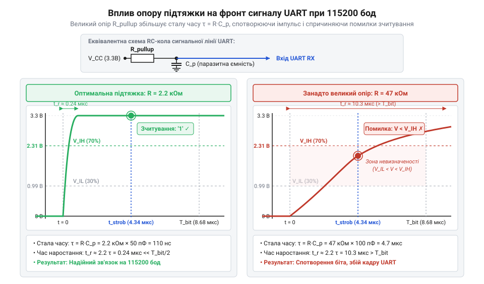

# Розрахунок тепловиділення стабілізатора та параметрів узгодження рівнів

<preknowlist>
- [USB-UART адаптер CP2102 (Micro-USB)](root:cat-hw-boards/cp2102-usb-uart) — рівні логічних сигналів 3.3 В / 5 В та принципи послідовного зв'язку через лінії RX і TX
</preknowlist>

## Падіння зв'язку та перезавантаження модуля

Підключення мікроконтролерного модуля @@en|ESP-01@@ (модель плати на базі чипа @@en|ESP8266@@) безпосередньо до стандартної п'ятивольтової лінії живлення або до логічних виходів п'ятивольтового контролера спричиняє раптові перезавантаження пристрою, обриви бездротового з'єднання та спотворення даних. Причиною такої поведінки є подвійна несумісність: за напругою живлення та за рівнями логічних сигналів. Вбудована периферія модуля розрахована на номінальну напругу 3.3 В, тому пряме подання 5 В на вивід живлення перегріває напівпровідниковий кристал, а на виводи інтерфейсу @@en|UART@@ (від англ. @@en|Universal Asynchronous Receiver-Transmitter@@, універсальний асинхронний приймач-передавач) — викликає струмові перевантаження через вхідні захисні діоди.

Складність підсилюється тим, що при спробі встановити зв'язок через @@en|Wi-Fi@@ вбудований радіопередавач споживає струм нерівномірно. У момент випромінювання високочастотного сигналу струм споживання модуля стрибкоподібно зростає від базових 70 мА до пікових 300–500 мА. Якщо джерело живлення не здатне миттєво віддати такий струм без просідання напруги, на шині живлення виникає короткочасний провал. Коли напруга падає нижче критичного порогу 2.7 В, спрацьовує схема внутрішнього скидання чипа — @@en|brownout reset@@ (від англ. @@en|brownout reset@@, скидання через зниження напруги живлення).

Коли модуль підключають через звичайний [перехідник CP2102 USB-UART](root:cat-hw-boards/cp2102-usb-uart), виникає спокуса заживити його від вбудованого виходу 3.3 В цього адаптера. Проте слабострумовий стабілізатор перехідника розрахований лише на 50–100 мА, тому під час пікового випромінювання модуля він перегрівається та вимикається. Для забезпечення стабільної роботи потрібен окремий лінійний стабілізатор напруги, який знижує 5 В до 3.3 В і витримує пікові струми. Пониження напруги лінійним способом неминуче супроводжується перетворенням лишку електричної енергії на тепло, що вимагає математичного розрахунку теплових та часових параметрів схеми адаптера.

## Тепловий розрахунок лінійного стабілізатора живлення

Лінійний стабілізатор з малим падінням напруги — @@en|LDO@@ (від англ. @@en|Low Dropout Regulator@@, стабілізатор із малою різницею напруг) — працює за принципом керованого активного опору. Електрична потужність, яка втрачається у вигляді тепла на стабілізаторі, пропорційна різниці між вхідною та вихідною напругою й струму навантаження.

Для обчислення розсіюваної теплової потужності `P_loss` позначимо вхідну напругу лінії 5 В як `V_in`, вихідну напругу живлення модуля 3.3 В як `V_out`, а піковий струм споживання радіопередавача як `I_peak`.

P_loss = V_drop · I_peak
       = (V_in - V_out) · I_peak    [падіння напруги помножене на піковий струм]

Отримана формула показує, що теплові втрати зростають лінійно із збільшенням спаду напруги на стабілізаторі та зростанням струму споживання. Згенероване тепло підвищує температуру напівпровідникового кристала стабілізатора.

Для оцінки перегріву використовують тепловий опір кристал-довкілля `R_th_JA` (вимірюється в °C/Вт), який показує, на скільки градусів Цельсія підвищується температура кристала `T_j` відносно температури навколишнього середовища `T_a` при розсіюванні 1 Вт потужності.

ΔT = P_loss · R_th_JA               [перевищення температури кристала над довкіллям]
T_j = T_a + ΔT                      [підсумкова температура кристала]

Розглянемо практичний розрахунок для популярного стабілізатора у корпусі @@en|SOT-223@@ (наприклад, @@en|AMS1117-3.3@@), який живить модуль @@en|ESP-01@@.

**Обчислення температури кристала стабілізатора при піковому струмі**
```
V_in = 5.0 В
V_out = 3.3 В
I_peak = 0.5 А
R_th_JA = 90 °C/Вт
T_a = 25 °C

V_drop = 5.0 - 3.3 = 1.7 В          [різниця напруг між входом і виходом]
P_loss = 1.7 · 0.5 = 0.85 Вт        [розсіювана теплова потужність]
ΔT = 0.85 · 90 = 76.5 °C            [перегрів кристала відносно довкілля]
T_j = 25 + 76.5 = 101.5 °C          [температура кристала стабілізатора]
```

Розрахунок показує, що навіть за нормальної кімнатної температури 25 °C кристал стабілізатора нагрівається до 101.5 °C. Якщо пристрій працює у закритому корпусі при температурі довкілля 40 °C, температура кристала досягне `T_j = 40 + 76.5 = 116.5` °C, що дуже близько до критичної межі спрацьовування теплового захисту 125 °C.

Для безпечної роботи без радіатора необхідно або обмежити тривалість пікових сплесків струму шляхом встановлення згладжувальних конденсаторів високої ємності, або передбачити на друкованій платі @@en|PCB@@ (від англ. @@en|Printed Circuit Board@@, друкована плата) мідний полігон для відведення тепла. Якщо ж передбачається тривала робота у жорстких температурних умовах, краще застосувати [імпульсний перетворювач напруги](root:hw-power/buck).

## Часові параметри RC-кіл узгодження рівнів

Окрім живлення, адаптер @@en|ESP-01@@ має забезпечувати безпечне передавання сигналів між п'ятивольтовою логікою зовнішнього мікроконтролера та тривольтовою логікою модуля. Лінія передачі сигналів від контролера до виводу @@en|RX@@ модуля @@en|ESP-01@@ вимагає зниження амплітуди напруги з 5 В до 3.3 В. Найпростішим розв'язком є резистивний дільник напруги з двох резисторів `R_1` та `R_2`.

Однак вхідний вивід модуля та доріжки друкованої плати володіють паразитною ємністю монтажу `C_par` (зазвичай від 10 до 30 пФ). Разом із опором дільника ця ємність утворює пасивне @@en|RC-коло@@ (від поєднання знаків @@en|R@@ — опір, @@en|Resistor@@, та @@en|C@@ — ємність, @@en|Capacitor@@), яке затримує зміну напруги та викривляє прямокутні фронти імпульсів.


*Осцилограма викривлення фронту сигналу UART через вплив паразитної ємності.*

Для розрахунку швидкості наростання напруги спочатку визначають еквівалентний опір дільника джерела `R_eq` при заряді ємності: `R_eq = (R_1 · R_2) ÷ (R_1 + R_2)`. Постійна часу заряду `τ` обчислюється як добуток еквівалентного опору та паразитної ємності.

τ = R_eq · C_par                     [добуток еквівалентного опору та паразитної ємності]

Тривалість фронту імпульсу `t_r` (час, за який напруга зростає від 10% до 90% від максимального значення 3.3 В) визначається через логарифмічний коефіцієнт заряду конденсатора.

t_r = ln(9) · τ
    ≈ 2.2 · τ                        [підстановка коефіцієнта заряду від 10% до 90%]

Проведемо покрокове обчислення параметрів фронту сигналу для дільника з номіналами `R_1 = 10` кОм та `R_2 = 20` кОм при паразитній ємності 20 пФ.

**Обчислення тривалості фронту імпульсу в RC-колі дільника**
```
R_1 = 10000 Ом
R_2 = 20000 Ом
C_par = 20 · 10⁻¹² Ф

R_eq = (10000 · 20000) ÷ (10000 + 20000)
     = 6667 Ом                       [еквівалентний паралельний опір дільника]
τ = 6667 · 20 · 10⁻¹²
  = 1.33 · 10⁻⁷ с                    [постійна часу RC-кола]
t_r = 2.2 · 1.33 · 10⁻⁷
    = 2.93 · 10⁻⁷ с                  [тривалість фронту 293 наносекунди]
```

Значення `t_r = 293` нс показує, що прямокутний фронт імпульсу затягується майже на третину мікросекунди. Якщо швидкість передачі даних висока, таке затягування робить фронт похилим, через що приймач інтерфейсу @@en|UART@@ може хибно зчитати логічний рівень.

## Оптимізація номіналів для високих швидкостей

Щоб забезпечити надійне зчитування цифрового сигналу через інтерфейс @@en|UART@@ на високих швидкостях (аж до стандартних 115200 @@en|baud@@, названих на честь Еміля Бодо, @@en|Émile Baudot@@), тривалість фронту `t_r` повинна бути значно меншою за тривалість одного біта даних `t_bit`.

Тривалість одного біта `t_bit` обчислюється як обернена величина до швидкості передачі даних.

t_bit = 1 ÷ BaudRate                 [обернена величина від швидкості у бодах]

Для швидкості 115200 @@en|baud@@ тривалість одного біта складає:

**Обчислення тривалості біта даних при 115200 бод**
```
BaudRate = 115200 бод

t_bit = 1 ÷ 115200
      = 8.68 · 10⁻⁶ с                [тривалість біта 8.68 мікросекунди]
```

Для надійного зчитування даних стробуючим імпульсом у середині бітового інтервалу тривалість фронту не повинна перевищувати 10% тривалості біта: `t_r ≤ 0.1 · t_bit`. Тобто при 115200 @@en|baud@@ максимально допустима тривалість фронту становить `0.1 · 8.68` мкс `= 868` нс.

Розраховане у попередньому розділі значення `t_r = 293` нс задовольняє цю умову (`293` нс `< 868` нс). Однак при виборі номіналів резисторів дільника виникає компроміс між часовою затримкою та споживанням струму:

1. Зменшення опору резисторів (наприклад, `R_1 = 1` кОм, `R_2 = 2` кОм) дає еквівалентний опір `R_eq = 667` Ом і скорочує тривалість фронту до `t_r ≈ 29` нс. Сигнал стає ідеально прямокутним, але наскрізний струм через дільник при логічній одиниці зростає до `I = 5 ÷ (1000 + 2000) = 1.67` мА, що даремно витрачає енергію та навантажує вихідний буфер мікроконтролера.
2. Збільшення опору резисторів (наприклад, `R_1 = 47` кОм, `R_2 = 100` кОм) зменшує струм споживання до мікроамперів, але еквівалентний опір `R_eq ≈ 32` кОм збільшує тривалість фронту до `t_r ≈ 1.4` мкс. Це перевищує граничне значення 868 нс і призводить до втрати синхронізації та помилок кадру @@en|UART@@.

Оптимальним компромісом для швидкості 115200 @@en|baud@@ є вибір номіналів `R_1 = 1.5` кОм та `R_2 = 3.3` кОм (або `R_1 = 2.2` кОм та `R_2 = 4.7` кОм). Для ще вищих швидкостей (наприклад, 921600 @@en|baud@@ чи 3 Мбод) пасивні дільники стають непридатними, тому слід переходити на активний [транзисторний конвертер рівнів](root:hw-digital/level-shifter).
