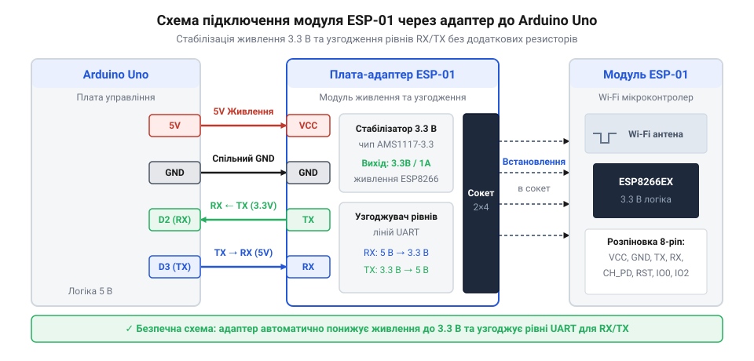

# Підключення ESP-01 через адаптер до Arduino Uno та тестування Wi-Fi зв'язку

## Небезпека прямого підключення ESP-01

Спроба з'єднати Wi-Fi модуль безпосередньо з мікроконтролером без проміжних кіл захисту часто призводить до фізичного пошкодження плати або до її нестабільної поведінки. Компактний модуль @@en|ESP-01@@ (від англ. @@en|Espressif Systems@@ — бездротовий модуль на базі мікроконтролера @@en|ESP8266@@) розрахований на робочу напругу живлення та сигнальні рівні `3.3 В`. Натомість плата @@en|Arduino Uno@@ працює з цифровою логікою та шинами живлення з рівнем `5 В`. Безпосереднє з'єднання цих пристроїв створює одразу дві фізичні загрози: напругове перевантаження сигнальних входів та струмове голодування лінії живлення.

Головна небезпека для цифрових виводів полягає в несумісності логічних рівнів. Послідовна шина @@en|UART@@ (від англ. @@en|Universal Asynchronous Receiver-Transmitter@@ — універсальний асинхронний приймач-передавач) передає дані виводом @@en|TX@@ плати @@en|Arduino Uno@@ із напругою високого рівня `5 В`. Коли цей сигнал надходить прямо на приймальний вивід @@en|RX@@ модуля @@en|ESP-01@@, внутрішні захисні діоди та затвори транзисторів кристала @@en|ESP8266@@ зазнають критичного напругового перевантаження. Це викликає локальний перегрів напівпровідника, деградацію структури кристала та швидкий вихід модуля з ладу.

Другою проблемою є обмеження вбудованого джерела живлення. Вбудований вивід `3.3V` на платі @@en|Arduino Uno@@ живиться від допоміжного мікроконтролера або малого стабілізатора й здатен видавати струм лише до `50–150 мА`. Під час активації бездротового передавача модуль @@en|ESP-01@@ споживає імпульсний струм величиною до `300–500 мА`. Недостатній струм лінії призводить до миттєвого просідання напруги нижче допустимого порогу `3.0 В`. У результаті модуль потрапляє в @@en|bootloop@@ (від англ. @@en|boot loop@@ — безперервний цикл перезавантаження мікроконтролера), тьмяно блимає світлодіодами та видає хаотичні символи в послідовний порт. Для автономного програмування модуля без мікроконтролера зазвичай застосовують [зовнішній послідовний перетворювач](root:cat-hw-boards/cp2102-usb-uart), але під час використання в макеті з платою потрібна спеціалізована плата узгодження.

## Будова та механізми захисту адаптера

Для безпечного поєднання двох систем із різними робочими напругами використовують спеціальну плату-адаптер. Вона виступає проміжним вузлом, який вирішує дві основні задачі: перетворює напругу живлення та узгоджує рівні цифрових сигналів між платою @@en|Arduino Uno@@ та модулем @@en|ESP-01@@.

Стабілізацію живлення забезпечує вбудований лінійний @@en|LDO-регулятор@@ (від англ. @@en|Low Dropout@@ — стабілізатор із низьким спадом напруги) серії @@en|AMS1117-3.3@@. Він приймає напругу `5 В` з виводу `5V` платформи та знижує її до стабільних `3.3 В`, забезпечуючи струм виходу до `800 мА`. Цього запасу струму повністю достатньо для покриття короткочасних піків споживання під час активної роботи радіотракту Wi-Fi. На платі адаптера також розміщено керамічні та електролітичні конденсатори, які згладжують високочастотні імпульсні завади на лінії @@en|VCC@@.

Передачу сигналів без ризику пошкодження кристала виконує схема @@en|level shifter@@ (від англ. @@en|level shifter@@ — схематичний узгоджувач логічних рівнів). Для лінії передачі від мікроконтролера до модуля (сигнал `5 В` з виводу @@en|TX@@ на вхід @@en|RX@@) застосовано двонапрямну транзисторну схему на @@en|MOSFET@@ (від англ. @@en|Metal-Oxide-Semiconductor Field-Effect Transistor@@ — польовий транзистор) або дільник напруги. Вона обмежує амплітуду сигналу до безпечного рівня `3.3 В`. У зворотному напрямку — від виводу @@en|TX@@ модуля @@en|ESP-01@@ до входу @@en|RX@@ плати @@en|Arduino Uno@@ — сигнал із рівнем `3.3 В` передається напряму. Мікроконтролер @@en|ATmega328P@@ сприймає будь-яку напругу вище `3.0 В` як впевнену логічну одиницю, тому додаткового підвищення напруги тут не потрібно.

Окрім регулятора та узгоджувачів, адаптер містить 8-контактне гніздо для встановлення модуля @@en|ESP-01@@ та 4-контактний роз'єм для підключення до макету: @@en|VCC@@, @@en|GND@@, @@en|TX@@ та @@en|RX@@. На платі також розведені підтягувальні резистори, які фіксують високий рівень на виводах @@en|CH_PD@@ (увімкнення модуля) та @@en|RST@@ (скидання), фіксуючи модуль у робочому режимі виконання програми з Flash-пам'яті.

## Збирання схеми підключення до Arduino

Фізичне збирання макета починається із з'єднання шин живлення та послідовних ліній зв'язку. Модуль @@en|ESP-01@@ вставляють у 8-контактне роз'ємне гніздо адаптера так, щоб його вбудована антена виходила за межі друкованої плати для зменшення перешкод. Після цього адаптер підключають до плати @@en|Arduino Uno@@ за допомогою чотирьох з'єднувальних провідників.

Першим кроком комутують кола живлення. Вивід @@en|VCC@@ адаптера підключають до контакту `5V` плати @@en|Arduino Uno@@, звідки напруга надходить на вхід стабілізатора @@en|AMS1117-3.3@@. Вивід @@en|GND@@ адаптера з'єднують із будь-яким контактом `GND` мікроконтролерної платформи для формування спільної точки відліку потенціалів. Далі підключають сигнальні лінії: вивід @@en|TX@@ адаптера з'єднують із цифровим контактом `D2` плати, а вивід @@en|RX@@ адаптера — з контактом `D3`.

*Принципова макетна схема з'єднання адаптера ESP-01 із платою Arduino Uno.*

Вибір контактів `D2` та `D3` замість апаратних виводів `D0` (RX) та `D1` (TX) є принциповим. Апаратний порт `D0/D1` жорстко пов'язаний із внутрішнім USB-перетворювачем плати @@en|Arduino Uno@@ і використовується для прошивки мікроконтролера та виводу даних у @@en|Serial Monitor@@. Використання програмної бібліотеки @@en|SoftwareSerial@@ на цифрових виводах `D2` та `D3` дозволяє розділити потоки: апаратний порт залишається для обміну з комп'ютером, а програмний порт забезпечує прозору ретрансляцію команд на модуль @@en|ESP-01@@.

## Програмна перевірка зв'язку AT-командами

Після завершення монтажу макета перевірку працездатності здійснюють за допомогою прозорого мікропрограмного мосту. Скетч для мікроконтролера приймає символи з послідовного порту комп'ютера й пересилає їх на модуль @@en|ESP-01@@, а отримані у відповідь байти повертає назад у @@en|Serial Monitor@@. Для надійного зв'язку через @@en|SoftwareSerial@@ швидкість обміну встановлюють на рівні `9600 бод`, оскільки вищі швидкості на восьмибітному ядрі @@en|AVR@@ можуть викликати часові спотворення при прийомі байтів.

Діагностика розпочинається з відправки базової команди `AT`. У відповідь модуль повинен повернути рядок `OK`. Для виходу в мережу модуль переводять у режим клієнта командами з [стандартного набору команд](root:cat-hw-boards/esp-01-module-family-overview/api-esp01-at-commands.md), надіславши `AT+CWMODE=1`. Після цього командою `AT+CWLAP` запускають сканування доступних точок доступу. Модуль повертає список знайдених мереж із вказанням типу шифрування, ідентифікатора @@en|SSID@@ та рівня сигналу @@en|RSSI@@ у дБм.

Нижче наведено повну реалізацію програмного мосту та розбору відповідей модуля для платформ Arduino та чистих мікроконтролерів AVR:

:::tabs
@tab C++ | Arduino
:::code proj-esp01-adapter-arduino-wiring/cpp/Esp01Adapter.hpp
:::code proj-esp01-adapter-arduino-wiring/cpp/Esp01Adapter.cpp
:::code proj-esp01-adapter-arduino-wiring/cpp/main.cpp

@tab C | AVR
:::code proj-esp01-adapter-arduino-wiring/c/uart.h
:::code proj-esp01-adapter-arduino-wiring/c/uart.c
:::code proj-esp01-adapter-arduino-wiring/c/main.c
:::

## Діагностика живлення та усунення перезавантажень

Якщо модуль успішно відповідає на команду `AT`, але спонтанно перезавантажується під час виконання `AT+CWLAP` або підключення до точки доступу, причиною є імпульсні просідання напруги живлення. Під час увімкнення підсилювача потужності радіосигналу споживання струму модулем @@en|ESP-01@@ стрибкоподібно зростає. Паразитний опір `Rₚ` та індуктивність `Lₚ` макетних провідників створюють спад напруги `ΔV` під час швидкої зміни струму `ΔI`, внаслідок чого напруга на шині `3.3 В` короткочасно падає нижче критичного порогу роботи мікроконтролера.

Для діагностики таких просідань використовують осцилограф або мультиметр у режимі фіксації мінімальних значень на виводах @@en|VCC@@ та @@en|GND@@ адаптера. Якщо в момент передачі даних напруга просідає нижче `3.0 В`, схема потребує локального буферизування енергії.

Усунення проблеми досягається встановленням фільтрувальних конденсаторів безпосередньо на виводи живлення адаптера:
- Полярний електролітичний або танталовий конденсатор ємністю `10–470 мкФ` підключають паралельно шині живлення для компенсації низькочастотних імпульсних стрибків струму.
- Керамічний конденсатор ємністю `0.1 мкФ` (100 нФ) встановлюють поруч для шунтування високочастотних завад і шумів.

Додатково слід перевірити якість затискання провідників у макетній платі та переконатися, що джерело живлення має спільний дріт @@en|GND@@ з платою @@en|Arduino Uno@@ для виключення різниці потенціалів.
