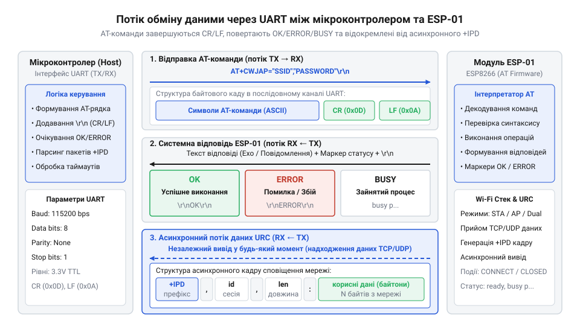
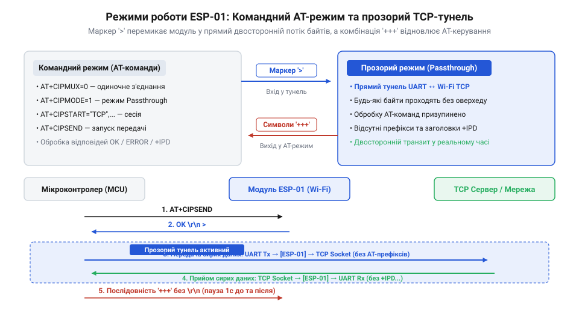

# Програмний інтерфейс AT-команд для модулів ESP-01

<preknowlist>
- [ESP-01 (Wi-Fi, ESP8266)](root:cat-hw-boards/esp-01) — апаратні особливості модуля, розводку виводів UART (TX/RX) та вимоги до живлення 3.3 В.
- [Режими завантаження мікроконтролера ESP8266](root:cat-hw-boards/esp8266-boot-modes) — поділ між режимами завантаження з Flash-пам'яті та програмування для старту AT-прошивки.
- [Конфігураційні виводи завантаження ESP8266](root:cat-hw-boards/esp8266-boot-strapping-pins) — необхідні підтяжки рівнів на GPIO0, GPIO2 та CH_PD для запуску пристрою у робочому режимі.
</preknowlist>

## Синтаксис і логіка текстового AT-інтерфейсу

Невеликі 8-бітні або 32-бітні мікроконтролери часто не мають достатнього обсягу оперативної пам'яті та обчислювальної потужності для розміщення повноцінного стека мережевих протоколів TCP/IP. Додавання апаратного модуля [ESP-01 на базі ESP8266](root:cat-hw-boards/esp-01) розв'язує цю проблему, виносячи мережеві обчислення на окремий чип. Зв'язок між головним контролером та Wi-Fi модулем здійснюється через асинхронний послідовний інтерфейс @@en|UART@@ (англ. *Universal Asynchronous Receiver-Transmitter* — універсальний асинхронний приймач-передавач) за допомогою текстових @@en|AT-команд@@ (англ. *Attention* — привернення уваги).

Кожна текстова @@en|AT-команда@@ передається у вигляді ASCII-рядка, який обов'язково завершується символами переведення каретки та нового рядка `\r\n` (символи `0x0D` та `0x0A`). Система команд мовної прошивки Espressif розрізняє чотири синтаксичні форми виклику:

1. **Тестова команда (Test):** `AT+<Назва>=?` — повертає перелік допустимих параметрів та їхніх діапазонів, не змінюючи поточних налаштувань.
2. **Команда запиту (Query):** `AT+<Назва>?` — зчитує та повертає поточні значення параметрів модуля.
3. **Команда встановлення (Set):** `AT+<Назва>=<Параметри>` — задає нові значення конфігураційних параметрів.
4. **Команда виконання (Execute):** `AT+<Назва>` — запускає внутрішню дію без передачі додаткових аргументів.

Приймаючи команду, модуль опрацьовує її та повертає структурований текстовий статус. Стандартна успішна відповідь закінчується маркером `OK`. Якщо синтаксис порушено або параметри вказано некоректно, модуль повертає `ERROR`. Під час початкового завантаження модуль надсилає статус `READY`. Якщо пристрій ще виконує попередній мережевий запит і не здатний прийняти нове завдання, у послідовний порт повертається сповіщення `BUSY p...` (або `BUSY s...`).


*Потік обміну даними між мікроконтролером і модулем показує відправку AT-команди через UART та отримання підтвердження OK або коду помилки.*

Окрім прямих відповідей на запити, @@en|AT-інтерфейс@@ генерує асинхронні сповіщення (англ. *Unsolicited Result Codes*, @@en|URC@@). Вони виникають незалежно від дій контролера — наприклад, під час підключення до Wi-Fi мережі (`WIFI CONNECTED`), отримання мережевої адреси (`WIFI GOT IP`) або надходження вхідних даних від віддаленого сервера (`+IPD`).

## Базові системні команди та налаштування UART

Першим кроком після подачі живлення є перевірка наявності зв'язку між контролером та модулем. Забезпечити стабільну комунікацію можна лише тоді, коли обидва пристрої налаштовані на однакову швидкість передачі даних (англ. *baud rate*, @@en|Baud rate@@).

Перевірка відгуку пристрою виконується найпростішою виконавичою командою:
```at
AT
```
У разі справності апаратної частини та збігу швидкостей @@en|UART@@ модуль негайно повертає відповідь `OK`. Для зчитування інформації про версію прошивки, версію SDK та дату збірки застосовується команда запиту:
```at
AT+GMR
```

Стандартна прошивка [модуля ESP-01](root:cat-hw-boards/esp-01) за замовчуванням працює на швидкості 115200 біт/с. Для мікроконтролерів із програмною реалізацією послідовного порту ця швидкість може бути занадто високою, що призводить до втрати байтів. Для зміни параметрів порту використовуються дві команди: `AT+UART_CUR` (змінює налаштування лише до перезавантаження) та `AT+UART_DEF` (записує нові параметри у @@en|Flash-пам'ять@@).

Формат команди налаштування порту приймає п'ять аргументів: швидкість, біти даних, стоп-біти, парність та апаратне керування потоком. Наприклад, для збереження швидкості 9600 біт/с без перевірки парності передається запит:
```at
AT+UART_DEF=9600,8,1,0,0
```

Для програмного перезапуску модуля застосовують команду виконання:
```at
AT+RST
```
Після отримання цієї команди пристрій перезавантажується, виконуючи внутрішню ініціалізацію, під час якої перевіряються [режими завантаження мікроконтролера](root:cat-hw-boards/esp8266-boot-modes) та поточні [конфігураційні виводи завантаження](root:cat-hw-boards/esp8266-boot-strapping-pins). У момент старту модуль видає відлагоджувальний лог на системній швидкості 74880 біт/с, після чого переходить на налаштовану робочу швидкість @@en|UART@@ і видає рядок `ready`. За потреби повного скидання конфігураційних параметрів до заводських значень використовується команда `AT+RESTORE`.

## Конфігурація Wi-Fi режимів та підключення

Без налаштування мережевого режиму мікросхема перебуває в ізольованому стані і не може передавати пакунки в ефір. Для керування бездротовим трансивером потрібно визначити роль пристрою в мережі: клієнт, точка доступу або їхнє поєднання.

Перемикання режимів Wi-Fi виконується командою `AT+CWMODE`. Чип підтримує три основні варіанти роботи:
1. @@en|Station@@ (режим `1`): модуль працює як бездротовий клієнт, підключаючись до зовнішнього роутера.
2. @@en|Access Point@@ (режим `2`): модуль сам створює бездротову мережу, до якої можуть підключатися інші пристрої.
3. @@en|Dual@@ (режим `3`): суміщений режим, де пристрій одночасно є клієнтом зовнішньої мережі та власною точкою доступу.

Для встановлення режиму клієнта надсилається команда:
```at
AT+CWMODE=1
```

Після переходу в режим @@en|Station@@ модуль може просканувати доступні в ефірі точки доступу за допомогою команди виконання:
```at
AT+CWLAP
```
У відповідь модуль повертає список мереж із зазначенням типу шифрування, ідентифікатора @@en|SSID@@ (англ. *Service Set Identifier*), рівня сигналу (RSSI), @@en|MAC-адреси@@ та каналу.

Приєднання до обраної мережі здійснюється командою встановлення:
```at
AT+CWJAP="Home_Wi-Fi","Password123"
```
Під час з'єднання модуль послідовно виводить асинхронні сповіщення `WIFI CONNECTED` та `WIFI GOT IP`, після чого повертає підсумковий статус `OK`. Відключення від мережі виконується командою `AT+CWQAP`.

Якщо пристрій налаштовано у режим точки доступу (`AT+CWMODE=2` або `3`), параметри власної мережі конфігуруються командою `AT+CWSAP`:
```at
AT+CWSAP="ESP_Network","12345678",5,3
```
Тут параметри задають відповідно @@en|SSID@@, пароль, номер радіоканалу та тип шифрування (`0` — відкрита мережа, `2` — WPA_PSK, `3` — WPA2_PSK). Перевірити призначену @@en|IP-адресу@@ модуля у всіх активних інтерфейсах дозволяє команда:
```at
AT+CIFSR
```

Для спеціалізованих задач, таких як оновлення [прошивки по повітрю](root:cat-hw-boards/esp8266-fota-update) або [керування GPIO виводами](root:cat-hw-boards/esp8266-at-gpio-control), модуль має бути попередньо підключений до мережі з виходом в інтернет або місцеву локальну мережу.

## Мережеві сесії та режими передачі даних

Отримання @@en|IP-адреси@@ дозволяє пристрою знаходитися в мережі, але для обміну корисними даними з іншими вузлами необхідно відкрити мережевий сокет за протоколом @@en|TCP@@ або @@en|UDP@@.

Перед відкриттям з'єднань слід встановити режим мультиплексування командою `AT+CIPMUX`. Модуль підтримує одиночний режим (`AT+CIPMUX=0`) та режим множинних з'єднань (`AT+CIPMUX=1`), який дозволяє утримувати до 5 одночасних сокетів з ідентифікаторами від 0 до 4.

Встановлення клієнтського з'єднання виконується командою `AT+CIPSTART`. Для одиночного режиму запит має вигляд:
```at
AT+CIPSTART="TCP","192.168.1.100",80
```
У разі використання множинних з'єднань першим аргументом обов'язково вказується ідентифікатор каналу (наприклад, `AT+CIPSTART=0,"TCP","192.168.1.100",80`). Модуль може також працювати як локальний сервер: команда `AT+CIPSERVER=1,80` відкриває прослуховування вказаного порту (вимагає попереднього ввімкнення `AT+CIPMUX=1`).

Передача даних у стандартному командному режимі виконується за допомогою команди `AT+CIPSEND`. Спочатку контролер вказує довжину байтового масиву:
```at
AT+CIPSEND=12
```
Після отримання цієї команди модуль повертає символ запрошення `>`. Контролер надсилає рівно вказану кількість байтів, після чого модуль передає їх у мережу й відповідає маркером `SEND OK`. Вхідні дані від віддаленого вузла повертаються у послідовний порт з префіксом `+IPD`:
```text
+IPD,12:Hello World!
```

Для задач передачі суцільного потоку даних (наприклад, при емуляції бездротового кабелю) командний режим є неефективним через накладні витрати на синтаксичний розбір. У такому разі застосовується прозорий режим передачі даних (англ. *Passthrough mode*, @@en|Passthrough@@).


*Діаграма станів показує перехід від передачі AT-команд до прозорого мосту даних після символу запрошення та вихід за допомогою трьох плюсів.*

Прозорий режим вимагає виконання трьох умов: одиночне з'єднання (`AT+CIPMUX=0`), протокол @@en|TCP@@ та активація прозорого режиму командою `AT+CIPMODE=1`. Після відправки команди `AT+CIPSEND` модуль видає символ `>` і переходить у стан прямого мосту. Усі наступні байти з порту @@en|UART@@ безпосередньо транслюються в мережевий сокет без будь-яких службових обгорток.

Для виходу з прозорого режиму назад у командний необхідно дотримуватись часової паузи: витримати мінімум 1 секунду тиші в лінії @@en|UART@@, надіслати послідовність з трьох символів `+++` без символів `\r\n`, і витримати ще 1 секунду тиші. Лише після цього модуль відновлює розбір текстових команд. Захищені з'єднання через [мережеві сесії TLS](root:cat-hw-boards/esp8266-at-ssl-tls) потребують окремих процедур іменування та сертифікації.

## Обробка помилок та мережевих збоїв

У реальних бездротових середовищах мережевий зв'язок схильний до втрат пакунків, затримок та раптових розривів з'єднання. Контролер, який сліпо надсилає команди без аналізу відповідних статусів, швидко потрапляє у стан неузгодженості та блокування.

Основні збої під час роботи з @@en|AT-інтерфейсом@@ супроводжуються двома типами статусів: `ERROR` та `BUSY`. Статус `ERROR` виникає за наявності синтаксичних помилок у команді, спробі виконати несумісну операцію (наприклад, відкрити прозорий режим при `CIPMUX=1`) або у разі відмови мережевого віддаленого вузла.

Відповідь `BUSY p...` свідчить про те, що внутрішній процесор [модуля ESP-01](root:cat-hw-boards/esp-01) ще опрацьовує попереднє завдання чи встановлює Wi-Fi з'єднання. Надсилання нових команд під час прапорця `BUSY` категорично неприпустиме: вони будуть ігноровані або спричинять скидання внутрішнього буфера. Алгоритм керуючого мікроконтролера повинен чекати вивільнення модуля, реалізуючи затримку з повторною спробою (англ. *backoff*).

При розриві бездротового зв'язку або закритті сокета віддаленим сервером модуль генерує незапитувані сповіщення `WIFI DISCONNECT` або `0,CLOSED`. Якщо сокет завис у проміжному стані й не відповідає на запити, його слід примусово закрити командою:
```at
AT+CIPCLOSE
```
Для множинних з'єднань указується конкретний номер каналу: `AT+CIPCLOSE=0`.

Перед повторним відкриттям сесій рекомендовано опитувати поточний стан сокетів командою `AT+CIPSTATUS`. Якщо модуль припиняє відповідати на будь-які @@en|AT-команди@@ протягом визначеного таймауту, керуючий контролер має виконати апаратне скидання (подачею низького рівня на вивід `RST`) або програмний перезапуск командою `AT+RST`, після чого повторити цикл первинної ініціалізації.
