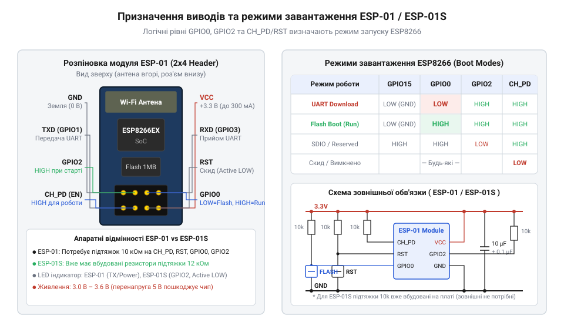
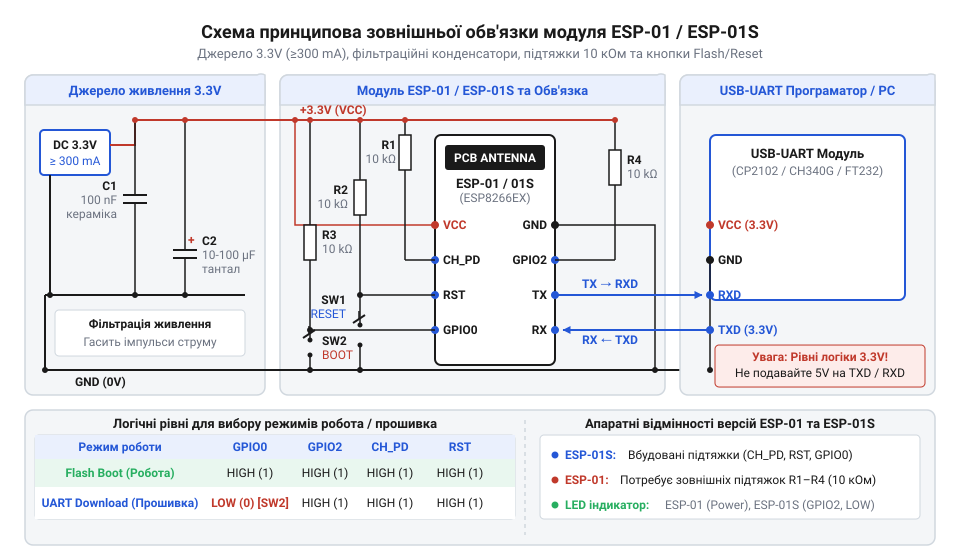

# Апаратний інтерфейс, цокольовка та схемотехніка модулів ESP-01 і ESP-01S

<preknowlist>
- [Режими завантаження мікроконтролера ESP8266](root:cat-hw-boards/esp8266-boot-modes) — розуміння принципів переключення ESP8266 між завантаженням з Flash-пам'яті та завантаженням через UART.
- [Конфігураційні виводи завантаження ESP8266](root:cat-hw-boards/esp8266-boot-strapping-pins) — базове розуміння логічних станів GPIO0, GPIO2 та GPIO15 під час вибору режимів старта чипа.
</preknowlist>

## Проблема нестабільного старту та живлення

Коли розробник уперше підключає модуль @@en|ESP-01@@ до звичайного @@en|USB-UART@@ перетворювача або виходу 3,3 В базової плати, пристрій часто поводиться непередбачувано: постійно перезавантажується, циклічно випадає в @@en|bootloop@@ або повністю ігнорує команди. Зовні здається, що мікроконтролер @@en|ESP8266@@ зламаний, проте причина полягає в двох апаратних нюансах, які роблять чип надзвичайно чутливим до якості живлення та стану його виводів.

Перша причина циклічних збоїв прихована в динаміці споживання струму радіотрактом @@en|Wi-Fi@@. У момент ініціалізації чи випромінювання високочастотного сигналу споживання мікросхеми @@en|ESP8266EX@@ стрибає короткими імпульсами тривалістю в кілька сотень мікросекунд із базових 50 мА до пікових 300 мА. Звичайні вбудовані джерела 3,3 В у дешевих адаптерах розраховані лише на малий постійний струм. Під час імпульсного навантаження напруга на лінії живлення @@en|VCC@@ миттєво просідає нижче критичної позначки 2,7 В, що активує внутрішню схему скидання контролера та спричиняє черговий перезапуск.

Друга причина нестабільності — високий вхідний опір цифрових виводів керування, таких як @@en|CH_PD@@ (від @@en|Chip Power Down@@ — знеструмлення чипа), @@en|RST@@ (від @@en|Reset@@ — скидання) та універсальних виводів @@en|GPIO@@ (від @@en|General Purpose Input/Output@@ — вхід/вихід загального призначення). Якщо залишити ці лінії незадіяними або «висячими» в повітрі, вони працюють як антени, збираючи електромагнітні наводки. Навіть мізерний наводнений потенціал на виводі @@en|CH_PD@@ переводить чип у стан глибокого сну, а випадкові рівні на виводах конфігурації змушують первинний @@en|bootloader@@ намагатися завантажувати код із неіснуючих периферійних інтерфейсів.

Щоб забезпечити впевнений запуск модуля, необхідно категорично відмовитися від живлення слабкими джерелами та забезпечити фіксацію електричних потенціалів на всіх керуючих виводах. Для глибокого розуміння того, як внутрішній алгоритм чипа вибирає режим старта, важливо вивчити [режими завантаження мікроконтролера](root:cat-hw-boards/esp8266-boot-modes), де описано фундаментальну логіку ініціалізації.

## Призначення виводів та режими завантаження

Модуль @@en|ESP-01@@ оснащений дворядним роз'ємом на 8 виводів із кроком 2,54 мм, де кожен контакт має чітко визначене апаратне призначення. Надійна робота системи вимагає розуміння функцій кожного з них:
- @@en|VCC@@ — лінія живлення позитивного потенціалу 3,3 В (нормальний робочий діапазон становить від 3,0 В до 3,6 В; напруга 5 В є смертельною для модуля);
- @@en|GND@@ — спільний провід джерела живлення та сигнальних шин (0 В);
- @@en|TX@@ (@@en|GPIO1@@) — вивід передачі даних послідовного інтерфейсу @@en|UART@@;
- @@en|RX@@ (@@en|GPIO3@@) — вивід прийому даних послідовного інтерфейсу @@en|UART@@ (працює з рівнем 3,3 В і вимагає узгодження при підключенні до джерел 5 В);
- @@en|CH_PD@@ (@@en|CHIP_PU@@) — вхід активації та увімкнення кристала, на якому для нормальної роботи завжди повинен бути високий логічний рівень 3,3 В;
- @@en|RST@@ — вхід апаратного скидання мікроконтролера, який спрацьовує при подачі низького рівня 0 В і підтягується до 3,3 В під час роботи;
- @@en|GPIO0@@ — вивід загального призначення, який додатково слугує головним селектором режиму завантаження;
- @@en|GPIO2@@ — вивід загального призначення, стан якого зчитується під час старту для підтвердження джерела завантаження.

При подачі живлення або відпусканні лінії @@en|RST@@ внутрішній завантажувальний @@en|ROM-код@@ чипа @@en|ESP8266EX@@ фіксує логічні рівні на трьох спеціальних виводах. Розробники [модуля @@en|ESP-01@@](root:cat-hw-boards/esp-01) вже жорстко розвели лінію @@en|GPIO15@@ всередині плати, підтягнувши її до @@en|GND@@ через поверхневий резистор. Оскільки стан @@en|GPIO15@@ завжди залишається низьким, вибір режимів роботи визначається комбінацією на двох доступних користувачеві виводах — @@en|GPIO0@@ та @@en|GPIO2@@.

Для нормального запуску та виконання програми з внутрішньої @@en|Flash-пам'яті@@ (режим @@en|Flash Boot@@) у момент скидання на виводах @@en|GPIO0@@ та @@en|GPIO2@@ обов'язково мають бути високі логічні рівні 3,3 В. Якщо ж вивід @@en|GPIO0@@ перед скиданням притягнути до @@en|GND@@ (низький рівень), а @@en|GPIO2@@ залишити високим, чип перейде в режим завантаження прошивки через послідовний порт (режим @@en|UART Download@@). Будь-яка інша комбінація, наприклад низький рівень на @@en|GPIO2@@, блокує нормальний запуск. Детальний розподіл ліній роз'єму та відповідні логічні стани наведено на схемі.

*Цокольовка роз'єму модуля ESP-01 та таблиця логічних станів GPIO0 і GPIO2 для вибору режиму завантаження чипа.*

Для детальнішого ознайомлення з апаратною фіксацією рівнів перегляньте [конфігураційні виводи завантаження](root:cat-hw-boards/esp8266-boot-strapping-pins), де розібрано часові діаграми зчитування станів.

## Схемотехнічні відмінності ESP-01 та ESP-01S

На ринку співіснують дві основні модифікації плат: класична версія @@en|ESP-01@@ та її модернізований варіант @@en|ESP-01S@@. Попри однакову 8-контактну цокольовку та ідентичний мікроконтролер, оновлена [версія @@en|ESP-01S@@](root:cat-hw-boards/esp-01s) має дві суттєві схемотехнічні відмінності, які значно спрощують її використання.

Перша й найважливіша відмінність полягає в наявності вбудованих резисторів підтяжки (від @@en|pull-up@@ — підтягувати вгору). У класичному модулі @@en|ESP-01@@ лінії @@en|CH_PD@@, @@en|RST@@, @@en|GPIO0@@ та @@en|GPIO2@@ розведені напряму від виводів мікросхеми до зовнішнього роз'єму без жодних резисторів на платі. Через це розробник змушений підключати зовнішні підтягувальні резистори номіналом 10 кОм від кожного з цих чотирьох виводів до шини @@en|VCC@@. На противагу цьому, у плату @@en|ESP-01S@@ вже запаяно чотири @@en|SMD-резистори@@ підтяжки номіналом 12 кОм (або 10 кОм у деяких партіях) між виводами @@en|CH_PD@@, @@en|RST@@, @@en|GPIO0@@, @@en|GPIO2@@ та шиною 3,3 В. Завдяки цьому модуль @@en|ESP-01S@@ здатен стабільно запускатися в режимі виконання коду взалі без зовнішніх підтягувальних елементів.

Друга відмінність стосується схеми підключення світлодіодного індикатора (@@en|LED@@, від @@en|Light Emitting Diode@@ — світлодіод):
- Класичний модуль @@en|ESP-01@@ містить два світлодіоди: червоний індикатор живлення, що постійно горить при подачі 3,3 В, та синій індикатор стану, підключений до лінії передачі даних @@en|TXD@@ (@@en|GPIO1@@). Кожне відправлення байта через послідовний порт змушує синій світлодіод спалахувати, що створює додаткове електричне навантаження на вивід @@en|TXD@@.
- Модуль @@en|ESP-01S@@ має лише один синій світлодіод, який перенесено на вивід @@en|GPIO2@@ та увімкнено за схемою зі спільним анодом (до шини @@en|VCC@@ через обмежувальний резистор). Світлодіод засвічується низьким логічним рівнем 0 В на виводі @@en|GPIO2@@. Це звільняє лінію @@en|TXD@@ від паразитного струмового навантаження та дозволяє використовувати @@en|GPIO2@@ як індикаторний вихід у власних програмах.

## Вимоги до живлення та обв'язка

Спроєктувати надійну зовнішню обв'язку модуля — це означає гарантувати стабільну напругу без просідань під час пікових навантажень та забезпечити зручне переключення режимів. Оскільки імпульсне споживання струму під час передачі даних досягає 300 мА, як джерело живлення слід використовувати спеціальний лінійний регулятор напруги (@@en|LDO@@, від @@en|Low Dropout@@ — мала різниця напруг) із вихідним струмом не менше 500 мА, наприклад мікросхему @@en|AMS1117-3.3@@ або @@en|AP2112K-3.3@@.

Для компенсації реактивного опору провідників та згладжування імпульсних кидків струму безпосередньо біля контактів @@en|VCC@@ та @@en|GND@@ модуля необхідно встановити два паралельні розв'язувальні конденсатори:
- Керамічний конденсатор ємністю 0,1 мкФ (100 нФ) для пригнічення високочастотних імпульсних завад;
- Електролітичний або танталовий конденсатор ємністю від 10 мкФ до 100 мкФ для зберігання заряду під час короткочасних сплесків споживання радіомодуля.

Повна принципова схема обв'язки залежить від версії модуля. Для класичного @@en|ESP-01@@ виводи @@en|CH_PD@@, @@en|RST@@ та @@en|GPIO2@@ підтягуються до @@en|VCC@@ через резистори 10 кОм. Вивід @@en|GPIO0@@ підключається до @@en|VCC@@ через резистор 10 кОм та одночасно через тактову кнопку «@@en|Flash@@» до мінусової шини @@en|GND@@. Для скидання між виводом @@en|RST@@ та @@en|GND@@ встановлюють кнопку «@@en|Reset@@». У випадку використання модуля @@en|ESP-01S@@ зовнішні підтягувальні резистори виключаються зі схеми, залишаючи тільки розв'язувальні конденсатори та тактові кнопки. При підключенні до 5-вольтових інтерфейсів (наприклад, @@en|USB-UART@@ адаптерів чи мікроконтролерів) лінію @@en|RX@@ модуля обов'язково захищають дільником напруги з двох резисторів (1 кОм та 2 кОм).

Для зручності налагодження можна використати спеціалізовані [адаптери для програмування](root:cat-hw-boards/esp-01-programmer-adapters), які містять усе необхідне узгодження рівнів та кнопкові перемикачі на одній платі.

*Принципова схема підключення модуля ESP-01 для програмування та автономної роботи з підтяжками, розв'язувальними конденсаторами та узгодженням порти UART.*
