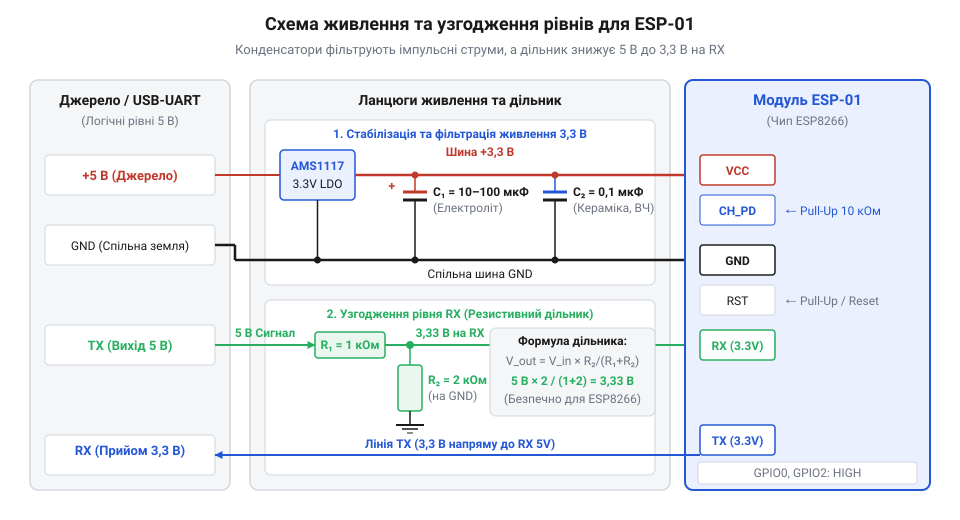
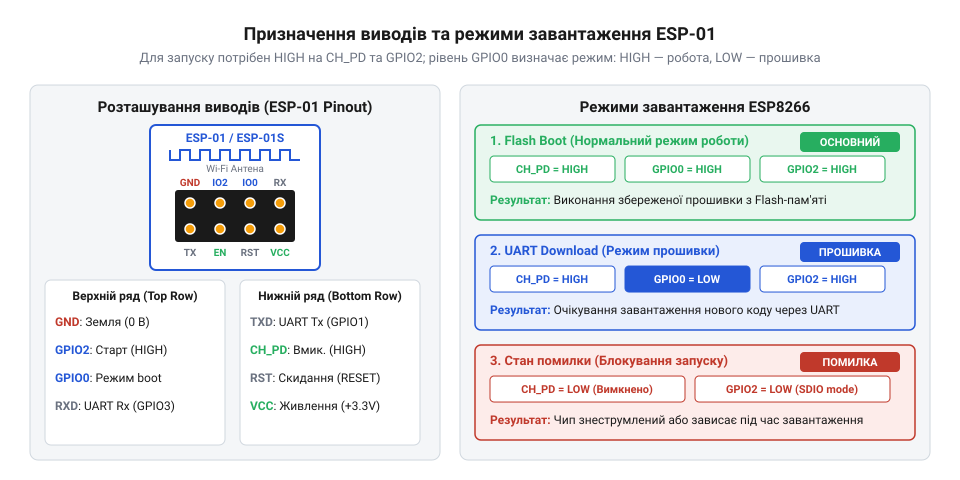
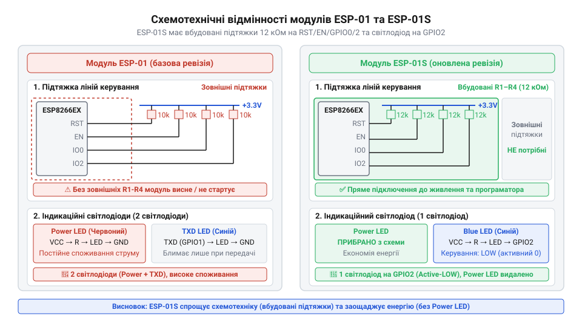

# Огляд сімейства Wi-Fi модулів ESP-01 та ESP-01S

<preknowlist>
- [Режими завантаження мікроконтролера ESP8266](root:cat-hw-boards/esp8266-boot-modes) — призначення режимів завантаження UART Download та Flash Boot і логічні рівні для їх активації
- [Конфігураційні виводи завантаження ESP8266](root:cat-hw-boards/esp8266-boot-strapping-pins) — функціональне призначення виводів GPIO0, GPIO2 та GPIO15 під час подачі живлення або скидання
</preknowlist>

## Чому компактні модулі ESP8266 збоять

Пряме підключення компактного Wi-Fi модуля до п'ятивольтової плати розробки часто закінчується розчаруванням: пристрій або відмовляється стартувати, або постійно перезавантажується під час спроби підключитися до мережі, а іноді й зовсім виходить з ладу. Причина полягає у виключній чутливості чипа @@en|ESP8266@@ (від англ. @@en|ESP8266@@, назва серії бездротових мікроконтролерів) до умов живлення та амплітуди логічних сигналів. На відміну від повнорозмірних відлагоджувальних плат, де на одному керамічному текстоліті розведено регулятор напруги, захисні діоди та перетворювачі рівнів, модулі сімейства @@en|ESP-01@@ (від англ. @@en|ESP-01@@, перша ревізія плати) містять лише сам бездротовий чип @@en|SoC@@ (від англ. @@en|System on a Chip@@, система на чипі), флеш-пам'ять, кварцовий резонатор та мінімальну обв'язку.

Головним джерелом апаратної нестабільності є вимоги до джерела живлення. Під час виходу в ефір та передачі пакетів радіочастотний тракт чипа споживає короткочасні пікові струми величиною до `300 мА`. Якщо модуль живиться від вбудованого виходу `3,3 В` звичайного @@en|USB@@-@@en|UART@@ (від англ. @@en|Universal Asynchronous Receiver-Transmitter@@, універсальний асинхронний приймач-передавач) перетворювача або слабострумового виводу платформи @@en|Arduino@@, напруга на лінії @@en|VCC@@ (від англ. @@en|Voltage at the Common Collector@@, напруга живлення) просідає нижче критичного порогу. Це викликає спрацьовування внутрішньої схеми скидання за зниженою напругою та хаотичне перезавантаження. Для усунення цих збоїв необхідне виділене джерело живлення на базі @@en|LDO@@ (від англ. @@en|Low Dropout@@, регулятор напруги з малим падінням) та [правильної фільтрації завад](root:hw-power/power-supply-decoupling-for-rf-modules), де паралельно виводам @@en|VCC@@ та @@en|GND@@ (від англ. @@en|Ground@@, земля) встановлюються електролітичний конденсатор ємністю від `10` до `100 мкФ` для компенсації кидків струму та керамічний конденсатор на `0,1 мкФ` для приглушення високочастотних завад.

Другий критичний чинник — несумісність логічних рівнів. Вхідний вивід прийому @@en|RX@@ (від англ. @@en|Receive@@, прийом) модуля розрахований на максимальну напругу `3,3 В`. Подача сигналу з рівнем `5 В` від класичного мікроконтролера викликає пробій вхідних діодів захисту та поступову деградацію напівпровідникової структури. Щоб запобігти пошкодженню, для захисту чутливого входу прийому передавача слід застосовувати [узгодження логічних рівнів](root:hw-digital/level-shifter) між п'ятивольтовою периферією та тривольтовою мікросхемою. Найпростішим та надійним розв'язком є використання дворезисторного дільника напруги.

Обчислення параметрів дільника здійснюється на основі закону Ома. Вихідна напруга `V_out` знімається з нижнього резистора `R_2`, який з'єднаний із землею @@en|GND@@, а вхідний сигнал `V_in` подається через верхній резистор `R_1`:

вольт-амперне співвідношення дає вихідний рівень напруги:
```
V_out = V_in × (R_2 ÷ (R_1 + R_2))      [формула резистивного дільника]
      = 5.0 × (2000 ÷ (1000 + 2000))     [підстановка значень R1=1кОм, R2=2кОм]
      = 5.0 × 0.6667                    [обчислення коефіцієнта дільника]
      = 3.33                            [вихідна напруга в вольтах]
```
У цьому розрахунку `V_in` позначає вхідну напругу лінії передачі `5,0 В`, `V_out` — безпечну напругу на виводі @@en|RX@@, а `R_1` та `R_2` — опори резисторів у омах. Отримане значення `3,33 В` ідеально відповідає допуску логічної одиниці чипа. Детальний [розрахунок резистивного дільника](root:cat-hw-boards/esp-01-module-family-overview/math-esp01-divider-and-pullup-calc.md) дозволяє також врахувати паразитну ємність лінії та підбрати оптимальний опір для збереження крутизни фронтів сигналів @@en|UART@@. Більш глибоко внутрішня периферія та кристали пам'яті описуються в [архітектурі бездротового чипа](root:cat-hw-boards/esp8266-soc-architecture-overview), що пояснює особливості його низькорівневої роботи.


*Схема підключення модуля ESP-01 до джерела живлення 3,3 В із блокируючими конденсаторами та резистивним дільником напруги на лінії RX.*

Окрім якісного живлення та узгодження ліній зв'язку, третім джерелом апаратних відмов є невизначений стан керуючих виводів. На платі @@en|ESP-01@@ виходи увімкнення чипа та скидання позбавлені вбудованих підтягувальних резисторів. Високий вхідний опір незадіяних ліній підхоплює електромагнітні наведення й викликає спонтанні перезавантаження мікроконтролера. Одночасно рівні напруги на цих виводах під час подачі живлення визначають [режими завантаження](root:cat-hw-boards/esp8266-boot-modes) внутрішнього процесора. Випадковий стан на [конфігураційних виводах](root:cat-hw-boards/esp8266-boot-strapping-pins) блокує запуск записаної програми або перешкоджає старту системи. Через це стабільність модуля вимагає комплексної зовнішньої обв'язки з виділеним регулятором, дільником напруги та підтяжкою службових ліній.

## Будова та конфігурація виводів ESP-01

Модуль @@en|ESP-01@@ став першим масовим рішенням на ринку, розробленим компанією @@en|AI-Thinker@@ (від англ. @@en|AI-Thinker@@, назва компанії-виробника модулів) на базі бездротового чипа @@en|ESP8266@@, яке започаткувало справжній бум бюджетних @@en|Wi-Fi@@ пристроїв у спільноті розробників. Конструктивно цей [класичний модуль компактної плати](root:cat-hw-boards/esp-01) виконаний у вигляді невеликої друкованої плати @@en|PCB@@ (від англ. @@en|Printed Circuit Board@@, друкована плата) з дворядним восьмипіновим роз'ємом із кроком `2,54 мм`. Перші розробники зіткнулися з низкою серйозних схемотехнічних викликів: на платі були відсутні внутрішні підтягувальні резистори, вивід індикаційного світлодіода був жорстко прив'язаний до лінії @@en|TX@@ (від англ. @@en|Transmit@@, передача), а будь-які наведення на відкритих виводах призводили до зриву завантаження. Виявлені недоліки згодом спонукали інженерів випустити оновлену ревізію @@en|ESP-01S@@ з оптимізованою схемотехнікою, де з'явилися резистори @@en|pull-up@@ (від англ. @@en|pull-up@@, підтяжка до живлення) номіналом `10 кОм` та змінилася схема керування світлодіодом.

Усі вісім виводів плати мають суворо визначене функціональне призначення. Окрім шин живлення @@en|VCC@@ та @@en|GND@@ та інтерфейсу послідовного зв'язку @@en|TX@@ і @@en|RX@@, модуль містить чотири службові лінії: @@en|GPIO0@@ (від англ. @@en|General Purpose Input/Output@@, вивід загального призначення 0), @@en|GPIO2@@, @@en|CH_PD@@ (від англ. @@en|Chip Power Down@@, вимкнення чипа; також позначається як @@en|EN@@, від англ. @@en|Enable@@, увімкнення) та @@en|RST@@ (від англ. @@en|Reset@@, скидання). Лінія @@en|CH_PD@@ відповідає за активацію внутрішніх блоків чипа: якщо на цей вивід подати логічний нуль або залишити його підвішеним у повітрі, мікроконтролер перебуває у стані глибокого вимкнення з мінімальним струмом споживання, але повністю непрацездатний. Для нормальної роботи на @@en|CH_PD@@ та @@en|RST@@ обов'язково має бути присутній високий логічний рівень `3,3 В`.

Особливість архітектури полягає у тому, що виводи @@en|GPIO0@@ та @@en|GPIO2@@ виконують роль @@en|bootstrapping@@-пінів (від англ. @@en|bootstrap@@, початкове завантаження). В момент подачі живлення або зняття сигналу скидання @@en|RST@@ внутрішня апаратна логіка мікросхеми зчитує стан цих виводів для вибору режиму виконуваного коду. Якщо під час старту на @@en|GPIO0@@ зафіксовано високий рівень, а на @@en|GPIO2@@ — також високий, чип активує режим @@en|Flash Boot@@ та починає виконання програми з внутрішньої флеш-пам'яті. Якщо ж @@en|GPIO0@@ притягнути до землі @@en|GND@@ (стан логічного нуля), мікроконтролер переходить у режим @@en|UART Download@@ для прошивки нового коду через послідовний порт. Щоб правильно налаштувати [режими завантаження системи](root:cat-hw-boards/esp8266-boot-modes), не можна залишати ці лінії ненаправленими, адже статичні наведення спричинять випадковий вибір режиму.

Для стабільного функціонування виводи @@en|GPIO0@@, @@en|GPIO2@@, @@en|CH_PD@@ та @@en|RST@@ у ревізії @@en|ESP-01@@ вимагають зовнішніх резисторів підтяжки до лінії `3,3 В` номіналом `10 кОм`. Якщо залишити їх підвішеними, будь-які радіозавади призведуть до хаотичного скидання процесора. Усі деталі електричних меж, розводку плати та розпиновку описано в [довіднику апаратного інтерфейсу](root:cat-hw-boards/esp-01-module-family-overview/api-esp01-hardware-pinout-schematic.md), де зібрано повну цокольовку пристрою. Крім того, правильний стан [конфігураційних ліній старту](root:cat-hw-boards/esp8266-boot-strapping-pins) гарантує, що пристрій не зависне при виконанні перезавантаження. Практичне складання схеми прошивального стенда описується через [спеціальний адаптер прошивки](root:cat-hw-boards/esp-01-module-family-overview/proj-esp01-flasher-adapter-build.md), який авто-перемикає рівні ліній @@en|GPIO0@@ та @@en|RST@@. Для завантаження бінарного коду використовують [консольну утиліту прошивки](root:sys-ide/esptool-flashing-utility), яка керує режимами розробки. Після успішного завантаження коду керування пристроєм або перевірка зв'язку реалізується через [набір текстових команд](root:cat-hw-boards/esp-01-module-family-overview/api-esp01-at-commands.md) заводського програмного забезпечення.


*На схемі показано розташування виводів модуля ESP-01 та комбінації логічних рівнів на GPIO0, GPIO2 і CH_PD для вибору режимів завантаження UART і Flash.*

## Схемотехнічні покращення у ревізії ESP-01S

Практична експлуатація першої версії модуля виявила потребу у спрощенні зовнішньої обв'язки. У відповідь на це було випущено ревізію @@en|ESP-01S@@, яка є прямим схемотехнічним еволюційним розвитком базової плати. Головне покращення [поліпшеного бездротового модуля](root:cat-hw-boards/esp-01s) полягає у монтажі безпосередньо на друковану плату чотирьох чип-резисторів @@en|SMD@@ (від англ. @@en|Surface Mount Device@@, пристрій для поверхневого монтажу) номіналом `10 кОм`. Ці резистори здійснюють внутрішню підтяжку @@en|pull-up@@ ліній @@en|GPIO0@@, @@en|GPIO2@@, @@en|CH_PD@@ та @@en|RST@@ до шини живлення `3,3 В`.

Наявність інтегрованих підтяжок кардинально змінює процес проектирування пристроїв. Розробникові більше не потрібно розміщувати зовнішні резистори на макетній платі або окремому щиті для забезпечення штатного запуску мікроконтролера в режимі @@en|Flash Boot@@. Для нормальної роботи модуля @@en|ESP-01S@@ достатньо підключити лише чотири провідники: @@en|VCC@@, @@en|GND@@, @@en|TX@@ та @@en|RX@@. Якщо ж виникає потреба перевести модуль у режим прошивки @@en|UART Download@@, вивід @@en|GPIO0@@ просто замикається на землю @@en|GND@@ без ризику короткого замикання джерела живлення, оскільки струм обмежується внутрішнім резистором `10 кОм`.

Другою важливою зміною в @@en|ESP-01S@@ є модифікація схеми індикаційного світлодіода. У старій ревізії @@en|ESP-01@@ на платі розпаювалися два світлодіоди: червоний (індикатор живлення @@en|VCC@@) та синій, підключений до лінії @@en|TX@@. Таке підключення створювало додаткове паразитна навантаження на послідовну лінію зв'язку та викликало мерехтіння світлодіода під час кожної передачі даних. У ревізії @@en|ESP-01S@@ індикатор живлення було повністю вилучено для зниження енергоспоживання, а єдиний синій світлодіод перенесено на вивід @@en|GPIO2@@.

Схема підключення світлодіода на @@en|GPIO2@@ у ревізії @@en|ESP-01S@@ виконана за інверсною логікою: анод світлодіода через обмежувальний резистор з'єднаний із шиною `3,3 В`, а катод підключений до виводу мікроконтролера. При вихідному високому рівні на @@en|GPIO2@@ світлодіод вимкнений, а при встановленні логічного нуля — світиться. Оскільки при завантаженні чипа вивід @@en|GPIO2@@ повинен мати високий логічний рівень, підтяжка до `3,3 В` через світлодіод і резистор одночасно забезпечує і коректний @@en|bootstrapping@@-стан, і відсутність свічення у стані спокою. Це вивільняє виводи @@en|TX@@ та @@en|RX@@ від стороннього електричного шумлення. Завдяки мінімальній кількості необхідних зовнішніх компонентів дана ревізія є ідеальним вибором для [побудови бездротового сенсора](root:cat-hw-boards/esp-01-module-family-overview/proj-esp01s-standalone-sensor-node.md) в автономних пристроях @@en|IoT@@ (від англ. @@en|Internet of Things@@, інтернет речей).


*Порівняльна принципова схема модулів ESP-01 та ESP-01S з акцентом на вбудовані підтягувальні резистори та перенесення індикаційного світлодіода.*

## Вимоги до живлення та узгодження рівнів

Спроба заживити модуль @@en|ESP-01@@ від стандартного 3,3-вольтового виводу плати @@en|Arduino@@ або дешевого перетворювача інтерфейсів призводить до циклічних перезавантажень пристрою. У момент ініціалізації радіочастотного тракту @@en|Wi-Fi@@ мікроконтролер @@en|ESP8266@@ споживає короткочасні імпульси струму амплітудою до `300 мА`. Вбудовані регулятори напруги @@en|LDO@@ (від @@en|Low Dropout@@ — регулятор з малим падінням напруги) на більшості макетних плат спроектовані на струм лише `50–100 мА`. Недостатня потужність джерела викликає раптове просідання живлення @@en|brownout@@ (від @@en|brownout@@ — просідання напруги живлення), через що спрацьовує внутрішній скид модуля.

Для забезпечення стабільної роботи бездротового вузла лінію живлення @@en|VCC@@ та @@en|GND@@ необхідно підключати до зовнішнього джерела напруги `3,3 В`, здатного віддавати струм не менше `500 мА`. Щоб запобігти збоям під час сплесків струму, необхідно забезпечити [якісне фільтрування живлення](root:hw-power/power-supply-decoupling-for-rf-modules), підключаючи керамічні та електролітичні конденсатори безпосередньо біля виводів модуля. Паралельне встановлення керамічного конденсатора ємністю `0,1 мкФ` пригнічує високочастотні завади, а електролітичний або танталовий конденсатор ємністю `100 мкФ` згладжує низькочастотні просідання напруги під час передачі пакетів.

Другою поширеною причиною виходу модуля з ладу є пряме підключення ліній зв'язку @@en|UART@@ (від @@en|Universal Asynchronous Receiver-Transmitter@@ — універсальний асинхронний приймач-передавач) до 5-вольтових контролерів. Вхідні каскади @@en|ESP8266@@ розраховані на логічні рівні `3,3 В`, і напруга понад `3,6 В` спричиняє тиристорний ефект @@en|latch-up@@ (від @@en|latch-up@@ — защіпання паразитної структури) або поступову деградацію напівпровідникового кристала. Вихід @@en|TX@@ модуля дає сигнал рівнем `3,3 В`, який надійно розпізнається 5-вольтовою транзисторно-транзисторною логікою @@en|TTL@@ (від @@en|Transistor-Transistor Logic@@ — транзисторно-транзисторна логіка) як логічна одиниця, тоді як лінія @@en|RX@@ обов'язково потребує зниження напруги.

Найпростішим і найдешевшим способом захисту входу @@en|RX@@ є резистивний дільник напруги, який зменшує амплітуду 5-вольтового сигналу передавача до безпечного рівня. У цій схемі `V_in` позначає вхідну напругу з боку 5-вольтового @@en|TX@@, `V_out` — напругу на виході дільника, яка подається на @@en|RX@@, `R1` — верхній резистор, що підключається послідовно в лінію, а `R2` — нижній резистор, підтягнутий до @@en|GND@@. Обчислення вихідного сигналу виконують за базовим співвідношенням:

```
V_out
= V_in × R2 ÷ (R1 + R2)      [формула резистивного дільника]
= 5.0 × 2000 ÷ (1000 + 2000) [підстановка опорів R1 = 1 кОм, R2 = 2 кОм]
= 3.33                       [розрахована напруга сигнальної лінії]
```

Отримана напруга `3,33 В` повністю відповідає специфікації цифрових входів @@en|ESP8266@@ та гарантує надійне зчитування даних без ризику перегріву виводу. Детальний математичний [розрахунок номіналів резисторів](root:cat-hw-boards/esp-01-module-family-overview/math-esp01-divider-and-pullup-calc.md) дозволяє точно підібрати деталі під конкретний вихідний опір передавача. Для двонаправленого обміну даними між пристроями з різною напругою застосовують [ефективні схеми узгодження](root:hw-digital/level-shifter), які запобігають пошкодженню вхідних каскадів мікроконтролера. Повний перелік електричних характеристик та [принципову схемну розводку](root:cat-hw-boards/esp-01-module-family-overview/api-esp01-hardware-pinout-schematic.md) зведено в окремому довіднику залізничного інтерфейсу.


*Схема підключення джерела живлення 3,3 В із розв'язувальними конденсаторами та дільника напруги 5V-to-3.3V на лінії RX модуля ESP-01.*

## Вибір модуля під практичні задачі

Обираючи модуль для проектування, слід виходити з наявного обв'язування та умов експлуатації кінцевого пристрою. Класична ревізія [базового компактного модуля](root:cat-hw-boards/esp-01) вимагає монтажу зовнішніх підтягувальних резисторів під час макетування. Для нормального запуску розробнику доводиться вручну розпаювати резистори опором `10 кОм` на виводи @@en|CH_PD@@ (чип-увімкнення), @@en|RST@@, @@en|GPIO0@@ та @@en|GPIO2@@. Це ускладнює збирання схеми на макетній платі без спеціального перехідника.

Для створення готових пристроїв зручніше обирати [оновлену ревізію плати](root:cat-hw-boards/esp-01s), у якій обв'язування вже інтегровано на друковану плату. Модуль @@en|ESP-01S@@ містить чотири @@en|SMD@@ (від @@en|Surface Mount Device@@ — пристрій для поверхневого монтажу) резистори `10 кОм`, що утримують високий логічний рівній на службових виводах за замовчуванням. Крім того, в @@en|ESP-01S@@ світлодіод індикації перенесено на @@en|GPIO2@@ з інверсною логікою активності, що дає змогу вимикати його у програмному коді для економії заряду батареї.

Правильна комбінація сигналів на службових виводах визначає потрібні [режими стабільного завантаження](root:cat-hw-boards/esp8266-boot-modes) мікроконтролера під час подачі живлення. Виставляння високого рівня на @@en|GPIO2@@ та підтяжка @@en|GPIO0@@ до землі в момент скидання активує режим прошивки @@en|UART Download@@. Керування підтяжками на виводах згідно зі специфікацією на [конфігураційні піни завантаження](root:cat-hw-boards/esp8266-boot-strapping-pins) гарантує відсутність хаотичних перезавантажень. Для швидкої прошивки обидвох модулів зручно зібрати [зручний стенд програматора](root:cat-hw-boards/esp-01-module-family-overview/proj-esp01-flasher-adapter-build.md) на основі послідовного USB-перетворювача.

На практиці мінімалістичну плату застосовують для побудови [автономного вузла давачів](root:cat-hw-boards/esp-01-module-family-overview/proj-esp01s-standalone-sensor-node.md) із низьким енергоспоживанням. Відсутність зайвої периферії на @@en|ESP-01S@@ робить його ідеальним кандидатом для періодичної передачі показників температури чи вологості у системі @@en|IoT@@ (від @@en|Internet of Things@@ — інтернет речей). Первинну перевірку зв'язку та налаштування мережевих параметрів виконують за допомогою [базових текстових команд](root:cat-hw-boards/esp-01-module-family-overview/api-esp01-at-commands.md) через послідовний порт.


*Схема підключення службових виводів GPIO0, GPIO2, CH_PD та RST для модулів ESP-01 та ESP-01S у режимі роботи та програмування.*
