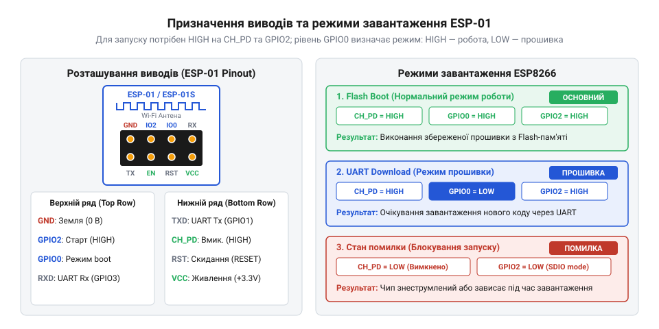
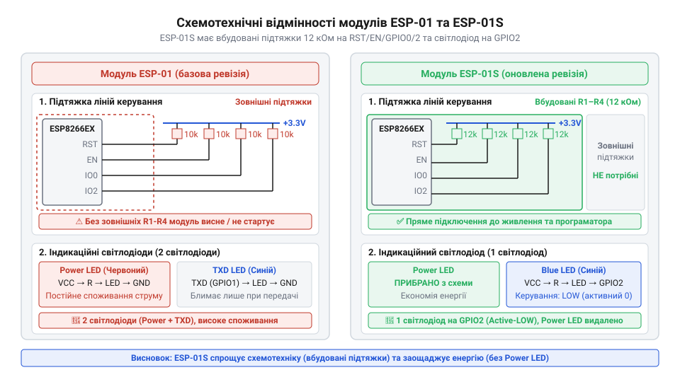

# Огляд сімейства Wi-Fi модулів ESP-01 та ESP-01S

<preknowlist>
- [Режими завантаження мікроконтролера ESP8266](root:cat-hw-boards/esp8266-boot-modes) — призначення режимів завантаження UART Download та Flash Boot і логічні рівні для їх активації
- [Конфігураційні виводи завантаження ESP8266](root:cat-hw-boards/esp8266-boot-strapping-pins) — функціональне призначення виводів GPIO0, GPIO2 та GPIO15 під час подачі живлення або скидання
</preknowlist>

## Чому компактні модулі ESP8266 збоять

Пряме підключення компактного модуля @@en|ESP-01@@ до 5-вольтових плат розробки часто призводить до спонтанних перезавантажень або виходу мікросхеми з ладу. Головною причиною є відсутність на [платах серії @@en|ESP-01@@](root:cat-hw-boards/esp-01) вбудованого регулятора напруги, захисних схем та підтягувальних резисторів. Під час активності радіотракту @@en|Wi-Fi@@ виникають короткочасні піки споживання струму до 300 мА, які просаджують слабкі джерела живлення. Водночас 5-вольтовий сигнал на лінії @@en|RX@@ перевантажує вхідний каскад чипа @@en|ESP8266@@, а непідключені керуючі виводи ловлять завади й перемикають режими роботи.

## Будова та конфігурація виводів ESP-01

Класичний модуль @@en|ESP-01@@ оснащено дворядним 8-піновим роз'ємом із кроком 2.54 мм. Окрім виводів живлення @@en|VCC@@ (3.3 В), землі @@en|GND@@ та послідовного порту @@en|RX@@/@@en|TX@@, плата містить керуючі лінії @@en|CH_PD@@ (увімкнення), @@en|RST@@ (скидання), @@en|GPIO0@@ та @@en|GPIO2@@.


*Призначення виводів @@en|ESP-01@@ та необхідні логічні рівні для вибору режиму роботи.*

Під час подачі живлення стан виводів визначає [режимів завантаження мікроконтролера](root:cat-hw-boards/esp8266-boot-modes). Для звичайного запуску @@en|Flash Boot@@ лінії @@en|CH_PD@@, @@en|RST@@, @@en|GPIO0@@ та @@en|GPIO2@@ підтягують до високого рівня 3.3 В. Для переходу в режим прошивки @@en|UART Download@@ вивід @@en|GPIO0@@ замикають на землю @@en|GND@@. Через відсутність вбудованих резисторів на @@en|ESP-01@@ усі [конфігураційні виводи завантаження](root:cat-hw-boards/esp8266-boot-strapping-pins) вимагають зовнішніх підтягувальних резисторів 10 кОм.

## Схемотехнічні покращення у ревізії ESP-01S

Оновлена ревізія @@en|ESP-01S@@ спрощує зовнішнє обв'язування завдяки вбудованим компонентам. На плату додано чотири @@en|SMD@@-резистори підтяжки 12 кОм на лінії @@en|CH_PD@@, @@en|RST@@, @@en|GPIO0@@ та @@en|GPIO2@@.


*Принципові відмінності електричних схем двох ревізій модулів.*

Завдяки вбудованій підтяжці [оновлену ревізію @@en|ESP-01S@@](root:cat-hw-boards/esp-01s) можна запустити всього за чотирма провідниками: @@en|VCC@@, @@en|GND@@, @@en|RX@@ та @@en|TX@@. Для прошивки достатньо замкнути @@en|GPIO0@@ на @@en|GND@@ без ризику коротець. Крім того, індикаційний @@en|LED@@ перенесено з шини живлення на вивід @@en|GPIO2@@ з інверсною логікою, що усуває паразитне навантаження на послідовний порт.

## Вимоги до живлення та узгодження рівнів

Стабільна робота @@en|ESP8266@@ потребує зовнішнього джерела 3.3 В, здатного віддавати імпульсний струм до 300 мА. Для фільтрації високочастотних завад і просідань напруги паралельно шині живлення ставлять керамічний (0.1 мкФ) та електролітичний (10–100 мкФ) конденсатори.


*Фільтрація напруги живлення та дільник для безпечного узгодження 5-вольтової логіки.*

Для захисту входу @@en|RX@@ від 5-вольтових сигналів застосовують дворезисторний дільник напруги. Напруга `V_out` на вході @@en|RX@@ обчислюється через вихідну напругу `V_in` джерела сигналу та опори `R1` і `R2`:

```
V_out = V_in × R2 ÷ (R1 + R2)
      = 5 × 2000 ÷ (1000 + 2000)      [підстановка V_in=5 В, R1=1 кОм, R2=2 кОм]
      = 3.33                          [обчислення вихідної напруги]
```

Отриманий рівень `3.33` В є безпечним для вхідного каскаду мікроконтролера @@en|ESP8266@@.

## Вибір модуля під практичні задачі

Вибір між ревізіями визначається вимогами до монтажу та компактності. Модуль @@en|ESP-01@@ зручний для навчального макетування, де потрібен прямий доступ до всіх ліній. Для готових компактних пристроїв та автономних сенсорів краще використовувати @@en|ESP-01S@@, який не потребує зовнішнього обв'язування на безпаєчній платі.


*Підключення модулів до прошивального стенда.*

Первинне налаштування здійснюють через @@en|UART@@ за допомогою @@en|AT@@-команд. Для зручної розробки доцільно зібрати прошивальний стенд або використати адаптер @@en|USB-UART@@ із перемикачем режимів завантаження.
