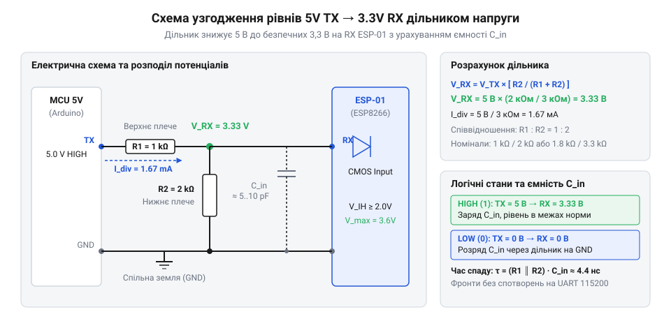

# Розрахунок дільника напруги та параметрів підтяжки для ESP-01

<preknowlist>
- [ESP-01 (Wi-Fi, ESP8266)](root:cat-hw-boards/esp-01) — розпіновка модуля, граничні напруги логічних рівнів та робоче живлення 3,3 В.
- [Конфігураційні виводи завантаження ESP8266](root:cat-hw-boards/esp8266-boot-strapping-pins) — призначення виводів GPIO0, GPIO2, CH_PD та необхідні логічні рівні при старті.
</preknowlist>

## Ризики прямого підключення п'ятивольтової логіки

Підключення п'ятивольтового виходу передавача `TX` мікроконтролера безпосередньо до приймального виводу `RX` [модуля ESP-01](root:cat-hw-boards/esp-01) створює критичний режим роботи для вхідних кіл мікросхеми. Серцем модуля є мікроконтролер ESP8266, виготовлений за напівпровідниковою технологією @@en|CMOS@@ (від англ. @@en|Complementary Metal-Oxide-Semiconductor@@ — комплементарна структура метал-оксид-напівпровідник) з номінальною напругою живлення `3.3 V`. Згідно з технічною документацією виробника, максимально допустима напруга на виводах вводу-виводу не повинна перевищувати `V_IO_max = 3.6 V`.

Кожен цифровий вивід мікросхеми оснащений внутрішньою схемою захисту від статичної електрики @@en|ESD@@ (від англ. @@en|Electrostatic Discharge@@, від грецького *elektron* — бурштин та англійського *discharge* — розряд). Цей захист складається з двох зустрічно увімкнених діодів, один із яких під'єднаний між вхідним виводом та внутрішньою шиною живлення `3.3 V`. Коли на вивід `RX` подається високий логічний рівень `5.0 V` від п'ятивольтового пристрою, потенціал на вході перевищує напругу живлення шини на значення, більше за порогову напругу відкривання прямого `pn`-переходу діода (`0.6 V`).

У результаті верхній захисний діод відкривається, і через нього починає протікати неконтрольований струм від зовнішнього передавача в шину живлення ESP8266. Тривале протікання цього струму призводить до трьох деструктивних наслідків:
1. **Теплове перевантаження**: Виділення теплової енергії на мікроскопічному `pn`-переході спричиняє локальний перегрів та незворотну деградацію напівпровідникового кристала.
2. **Паразитне живлення та логічний збій**: Струм витоку піднімає напругу на шині живлення модуля, спричиняючи ефект тиристорного защіпання кристала (англ. @@en|latch-up@@ — тиристорний збій CMOS-структури), що блокує роботу обчислювального ядра.
3. **Випадкові перезавантаження**: Зростання рівня завад у колі живлення призводить до спотворення приймання даних через послідовний інтерфейс @@en|UART@@ (від англ. @@en|Universal Asynchronous Receiver-Transmitter@@ — універсальний асинхронний приймач-передавач) та періодичних апаратних збоїв.

Для забезпечення тривалої надійної роботи пристрою виникає сувора схемотехнічна вимога: амплітуду високого логічного рівня 5-вольтового сигналу необхідно примусово знизити до безпечного діапазону `3.0 V ... 3.3 V` ще до його потрапляння на вхідний вивід `RX`. Замість складних двонаправлених схем, як-от [активний конвертер рівнів на MOSFET](root:hw-digital/mosfet-level-shifter), для однонаправленої лінії `RX` найпростішим та найефективнішим розв'язком є резистивний дільник напруги.

## Розрахунок резистивного дільника вхідної напруги

Щоб узгодити п'ятивольтовий вихідний сигнал з входом `RX` модуля ESP8266, між лінією `TX` джерела та заземленням включають пасивний дільник напруги на двох резисторах: верхньому `R1` та нижньому `R2`. Точка з'єднання цих двох опорів підключається безпосередньо до виводу `RX`.

Вхідна буферна схема ESP8266 розпізнає логічну одиницю, якщо вхідна напруга `V_RX` перевищує мінімальний пороговий рівень `V_IH_min = 0.75 × V_DD = 0.75 × 3.3 V = 2.475 V`. Водночас напруга не повинна перевищувати максимально допустиму `V_IH_max = 3.6 V`. Ідеальним цільовим значенням високого логічного рівня на вході `RX` є напруга `V_RX = 3.3 V` при вхідному сигналі `V_TX = 5.0 V`.


*Резистивний дільник знижує амплітуду п'ятивольтового сигналу TX до безпечного рівня 3.3 В на вході RX.*

Зв'язок між вихідною напругою дільника `V_RX`, вхідною напругою `V_TX` та опорами плечей `R1` і `R2` описується базовим рівнянням дільника напруги. Для обчислення необхідного співвідношення опорів `R1 / R2` виконаємо алгебраїчні перетворення:

```
V_RX / V_TX
= R2 / (R1 + R2)                 [формула дільника напруги]
```

Обертаючи співвідношення та розкладаючи дріб, отримуємо вираз для співвідношення опорів:

```
R1 / R2
= (V_TX / V_RX) - 1              [алгебраїчне виведення співвідношення плечей]
```

**Обчислення співвідношення номіналів дільника для напруги 3.3 В:**
Застосуємо отриману формулу для конкретних значень напруг `V_TX = 5.0 V` та `V_RX = 3.3 V`:

```
R1 / R2
= (5.0 / 3.3) - 1                [підстановка значення напруг V_TX та V_RX]
= 1.515 - 1                      [обчислення відношення вхідної та вихідної напруг]
= 0.515                          [знаходження коефіцієнта співвідношення опорів]
```

Отже, опір верхнього плеча повинен становити `R1 = 0.515 × R2`, або навпаки, опір нижнього плеча має дорівнювати `R2 ≈ 1.94 × R1`. Оскільки реальні резистори випускаються за вимірювальними рядами номіналів (зокрема ряду @@en|E24@@, від англ. @@en|EIA standard series@@ — стандартний ряд номіналів), отримане співвідношення округлюють до найближчих стандартних значень.

Якщо обрати `R1 = 1.0 kΩ` (1000 Ом) та `R2 = 2.0 kΩ` (2000 Ом), вихідна напруга дільника становитиме:

```
V_RX
= 5.0 × (2000 / (1000 + 2000))   [підстановка обраних номіналів R1 та R2]
= 5.0 × (2 / 3)                  [скорочення дробу]
= 3.33 V                         [розрахункове значення напруги на вході RX]
```

Напруга `3.33 V` задовольняє всі вимоги: вона знаходиться в межах безпечного діапазону та гарантує надійне розпізнавання логічної одиниці мікроконтролером.

## Вибір номіналів з урахуванням завадостійкості

Знайдене співвідношення `R2 ≈ 2 × R1` визначає лише пропорцію між резисторами, але не їхні абсолютні значення. На практиці вибір абсолютних опорів обмежений двома протилежними фізичними чинниками: струмовим навантаженням передавача та швидкістю перезаряду паразитної ємності лінії.

З одного боку, використання занадто малих опорів (наприклад, `R1 = 100 Ω` та `R2 = 200 Ω`) призводить до невиправдано високого споживання струму від п'ятивольтового виходу `TX`. При сумарному опорі дільника `R_sum = R1 + R2 = 300 Ω` через лінію протікатиме струм `I = 5.0 V / 300 Ω = 16.7 mA`. Таке навантаження спричиняє нагрів вихідного каскаду передавача мікроконтролера та виходить за межі енергоефективного режиму роботи.

З іншого боку, використання надто великих опорів (наприклад, `R1 = 100 kΩ` та `R2 = 200 kΩ`) різко погіршує завадостійкість та крутизну фронтів сигналу. Довгі провідники друкованої плати та вхідний буфер ESP8266 володіють паразитною ємністю навантаження `C_L`, яка зазвичай становить `20 pF ... 50 pF`. Разом із еквівалентним опором дільника `R_eq = (R1 × R2) / (R1 + R2)` ця ємність утворює @@en|RC-ланцюг@@ (від латинського *resisto* — опиратися та *capacitas* — місткість), який затримує зміну напруги.

Постійна часу перезаряду паразитної ємності становить `τ = R_eq × C_L`. Час наростання фронту сигналу від 10% до 90% описується співвідношенням `t_r ≈ 2.2 × τ`. Для високоомного дільника з `R_eq = 66.7 kΩ` та ємністю `C_L = 30 pF` постійна часу дорівнюватиме `τ = 2.0 μs`, а час наростання фронту сягне `t_r ≈ 4.4 μs`.

При високошвидкісній передачі даних по інтерфейсу `UART` на швидкості 115200 @@en|бод@@ (від прізвища інженера Еміля Бодо — одиниця швидкості передачі символів) тривалість передачі одного біта становить:

```
T_bit
= 1 / 115200                    [формула тривалості бітового інтервалу]
= 8.68 × 10⁻⁶ s                 [значення в секундах]
= 8.68 μs                       [переведення у мікросекунди]
```

Якщо час наростання фронту `t_r = 4.4 μs` становить половину тривалості всього біта, прямокутні імпульси перетворюються на згладжені трапеції. Це викликає фазове тремтіння фронтів (англ. @@en|jitter@@ — тремтіння сигналу) та призводить до помилок зчитування даних приймачем.

Оптимальним компромісом є вибір сумарного опору дільника в діапазоні `3 kΩ ... 15 kΩ`. Рекомендованими стандартними номіналами є `R1 = 1.0 kΩ` та `R2 = 2.0 kΩ` (або `R1 = 4.7 kΩ` та `R2 = 10 kΩ`). У випадку `R1 = 1.0 kΩ` і `R2 = 2.0 kΩ` еквівалентний опір становить `R_eq = 667 Ω`, струм споживання не перевищує `1.67 mA`, а час наростання фронту становить лише `t_r ≈ 44 ns`, що гарантує ідеальну форму прямокутних імпульсів `UART`.

## Розрахунок підтяжки конфігураційних виводів завантаження

Окрім узгодження входу `RX`, стабільна робота ESP8266 залежить від правильного встановлення початкових логічних рівнів на виводах керування. Виводи `GPIO0`, `GPIO2` та `CH_PD` (вивід увімкнення мікросхеми, який також позначається як `EN`) визначають [режими завантаження](root:cat-hw-boards/esp8266-boot-modes) мікроконтролера при підключенні живлення.

Для запуску виконання програми з внутрішньої `SPI`-флеш-пам'яті на [конфігураційних виводах](root:cat-hw-boards/esp8266-boot-strapping-pins) під час скидання повинні утримуватися такі логічні рівні:
- `CH_PD` — високий рівень (`3.3 V`);
- `GPIO2` — високий рівень (`3.3 V`);
- `GPIO0` — високий рівень (`3.3 V`). Якщо при старті `GPIO0` виявиться підтягнутим до землі, мікроконтролер перейде в режим прошивки через `UART`.

Залишати ці виводи "плаваючими" (непідключеними) неприпустимо, оскільки наводки та електромагнітні завади викликають довільні перезавантаження. Для фіксації високого рівня використовують підтягувальні резистори `R_pullup`, підключені до шини `V_DD = 3.3 V`.

Максимальне значення опору підтяжки `R_pullup_max` обмежується вхідним струмом витоку виводу `I_leak_max` (для ESP8266 він становить близько `10 μA`). При протіканні струму витоку через резистор підтяжки на ньому виникає падіння напруги `ΔV`. Щоб на виводі утримувався гарантований рівень високої одиниці `V_IH_min = 2.475 V`, падіння напруги не повинно перевищувати `ΔV_max = V_DD - V_IH_min = 3.3 V - 2.475 V = 0.825 V`.

За законом Ома обчислимо граничний опір підтягувального резистора:

```
R_pullup_max
= (V_DD - V_IH_min) / I_leak_max [закон Ома для кола підтяжки]
```

**Обчислення максимального опору підтяжки:**
Підставимо граничні параметри вхідного каскаду ESP8266:

```
R_pullup_max
= (3.3 - 2.475) / (10 × 10⁻⁶)    [підстановка напруг V_DD, V_IH_min та струму витоку I_leak_max]
= 0.825 / 0.000010               [обчислення допустимого падіння напруги]
= 82500 Ω                        [значення граничного опору в омах]
= 82.5 kΩ                        [переведення значення в кілооми]
```

Хоча теоретично припустимий опір сягає `82.5 kΩ`, використання таких високих номіналів робить лінію чутливою до зовнішніх наводок. На практиці стандартним вибором є номінали від `4.7 kΩ` до `10 kΩ`. При `R_pullup = 10 kΩ` падіння напруги від струму витоку становить лише `ΔV = 10 kΩ × 10 μA = 0.1 V`, що забезпечує напругу на виводі `3.2 V` і створює високий запас завадостійкості.

На відміну від [модуля ESP-01S](root:cat-hw-boards/esp-01s), на платі якого підтягувальні резистори вже розпаяні виробником, базовий модуль ESP-01 вимагає обов'язкового зовнішнього підключення цих опорів у схемі обв'язки.

## Компенсація імпульсних струмів фільтруючим конденсатором

Живлення модуля ESP-01 висуває підвищені вимоги до стабільності напруги. Під час роботи бездротового передавача @@en|Wi-Fi@@ споживання струму мікроконтролером має виражений імпульсний характер. У режимі очікування модуль споживає близько `20 mA ... 50 mA`, але під час випромінювання високочастотних пакетів даних або калібрування радіочастотного каскаду виникають короткочасні кидки струму до `I_peak = 300 mA ... 500 mA` тривалістю `Δt = 100 μs ... 500 μs`.

Якщо джерело живлення або підвідні провідники мають відчутний опір чи індуктивність, імпульсний струм викликає миттєве просідання напруги на шині `3.3 V`. При падінні напруги нижче порогового рівня скидання `V_RST ≈ 2.8 V` у мікроконтролері спрацьовує схема захисту від просідання живлення (англ. @@en|brown-out reset@@ — скидання при просіданні живлення), що призводить до раптового перезавантаження модуля прямо під час сеансу зв'язку.

Для компенсації імпульсних кидків струму безпосередньо біля виводів живлення модуля встановлюють фільтруючі конденсатори, які виконують роль локального резервуару електричного заряду. Обсяг заряду `Q`, який накопичує конденсатор ємністю `C`, описується співвідношенням `Q = C × ΔV`. Водночас заряд, що віддається в навантаження під час імпульсу струму `I_impulse = I_peak - I_avg`, дорівнює `Q = I_impulse × Δt`.

Прирівнюючи обидва вирази, отримуємо формулу для розрахунку мінімально необхідної ємності конденсатора `C`:

```
C
= (I_impulse × Δt) / ΔV          [формула розрахунку ємності для компенсації імпульсу]
```

**Обчислення фільтруючої ємності для Wi-Fi спалаху:**
Розрахуємо ємність для імпульсу додаткового струму `I_impulse = 250 mA = 0.25 A` тривалістю `Δt = 200 μs = 200 × 10⁻⁶ s` при допустимому просіданні напруги `ΔV = 0.1 V`:

```
C
= (0.25 × 200 × 10⁻⁶) / 0.1      [підстановка параметрів струмового імпульсу та падіння напруги]
= (50 × 10⁻⁶) / 0.1              [обчислення величини відданого заряду]
= 500 × 10⁻⁶ F                   [значення ємності у фарадах]
= 500 μF                         [переведення значення у мікрофаради]
```

Практична схема фільтрації шини живлення ESP-01 будується за двокомпонентним принципом і комбінує два типи конденсаторів:
1. **Накопичувальний конденсатор**: Електролітичний або танталовий конденсатор ємністю від `100 μF` до `470 μF`. Він компенсує низькочастотні просідання напруги під час тривалих пакетних передач Wi-Fi.
2. **Високочастотний керамічний конденсатор**: Керамічний `SMD`-конденсатор ємністю `0.1 μF` (`100 nF`), який монтується якомога ближче до контактів `VCC` та `GND` модуля. Він володіє мінімальним еквівалентним послідовним опором (англ. @@en|ESR@@, від англ. @@en|Equivalent Series Resistance@@ — еквівалентний послідовний опір) та індуктивністю (англ. @@en|ESL@@ — еквівалентна послідовна індуктивність), що дозволяє пригнічувати високочастотні імпульсні завади та наводки від RF-тракту.

Поєднання накопичувального та високочастотного конденсаторів у колі живлення разом із розрахованим резистивним дільником на ліній `RX` та підтяжками виводів завантаження забезпечує повну схемотехнічну обв'язку для надійної та тривалої експлуатації модуля ESP-01.
