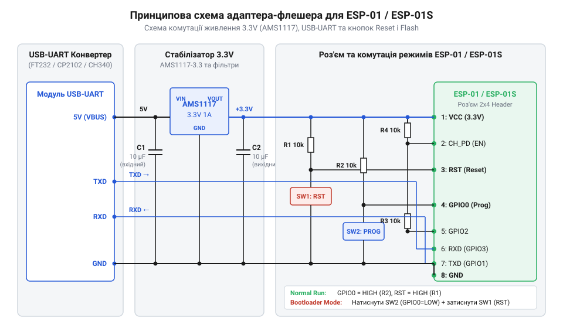
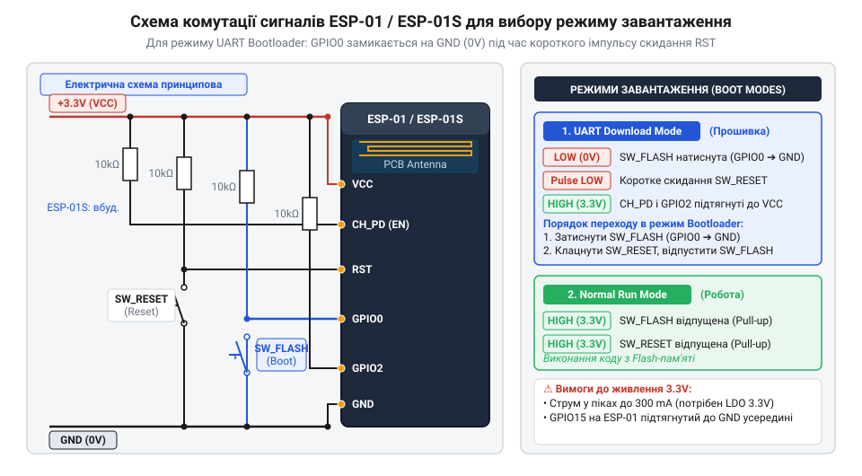

# Складання універсального адаптера-програматора для ESP-01 та ESP-01S

<preknowlist>
- [ESP-01 (Wi-Fi, ESP8266)](root:cat-hw-boards/esp-01) — розпіновка модуля та особливості відсутності підтягувальних резисторів на платі
- [ESP-01S (Wi-Fi, ESP8266)](root:cat-hw-boards/esp-01s) — схемотехнічні відмінності модуля та наявність вбудованих резисторів підтяжки
- [Режими завантаження мікроконтролера ESP8266](root:cat-hw-boards/esp8266-boot-modes) — логічні рівні сигналів для переведення у режим прошивки та звичайного запуску
- [Конфігураційні виводи завантаження ESP8266](root:cat-hw-boards/esp8266-boot-strapping-pins) — вимоги до логічних станів GPIO0, GPIO2 та GPIO15 під час скидання
</preknowlist>

## Нестабільність звичайних USB-UART перехідників

Спроба прошити мікроконтролерний модуль безпосередньо від дешевого USB-UART адаптера майже завжди закінчується раптовими збоями зв'язку та помилками синхронізації. Головна причина полягає в тому, що інтегрований у простий @@en|USB-UART-конвертер@@ (USB to UART converter) малопотужний лінійний стабілізатор напруги розрахований лише на струм до 50–100 мА. Водночас бездротовий мікроконтролер ESP8266 у моменти активації високочастотного передавача Wi-Fi споживає короткими піками струм до 300 мА. Фізичний механізм цього провалу зумовлений тим, що інтегрований @@en|LDO-стабілізатор@@ (з англ. @@en|low dropout regulator@@, де low — малий, dropout — падіння, — стабілізатор із малою різницею напруги вхід-вихід) має обмежену швидкодію аналогової петлі зворотного зв'язку та високий вихідний опір `R_out` регулювального транзистора. При різкому зростанні струму `I_peak` під час радіовипромінювання малі вихідні конденсатори адаптера (0.1–1 мкФ) розряджаються за частки мікросекунди, а підсилювач помилки стабілізатора не встигає відкрити силовий ключ. Падіння напруги `ΔV` обчислюється за формулою:

```
ΔV
= I_peak · R_out                 [законом Ома для вихідного кола стабілізатора]
= 0.3 A · 2.5 Ом                 [підстановка пікового струму Wi-Fi та опору LDO]
= 0.75 В                         [амплітуда провалу напруги живлення]
```

Отриманий провал `ΔV` у 0.75 В миттєво знижує робочу напругу `V_CC` з номінальних 3.3 В до 2.55 В, що нижче критичного порогу функціонування цифрової логіки 2.7 В. Це просідання активує внутрішній компаратор системи @@en|brownout-скидання@@ (з англ. @@en|brownout@@ — просідання напруги, від brown — тьмяніти, та @@en|reset@@ — скидання). Оскільки напруга падає нижче допустимого рівня, компаратор генерує внутрішній імпульс через вузол @@en|Power-On Reset@@ (з англ. @@en|Power-On Reset@@, де power — живлення, on — увімкнення, reset — скидання). Цей сигнал форсовано перериває роботу ядра CPU, скидає стани внутрішніх регістрів, викликає апаратне перезавантаження та спричиняє аварійний зрив сесії прошивки [модулів серії ESP-01](root:cat-hw-boards/esp-01).

Другим бар'єром стає відсутність на стандартних перехідниках зручних органів комутації для керування конфігураційними виводами. Щоб задіяти внутрішній завантажувач прошивки (@@en|Bootloader Mode@@), вивід @@en|GPIO@@0 необхідно надійно притиснути до загального проводу GND під час подачі живлення або скидання, а вивід CH_PD (Chip Enable) утримувати під високим логічним рівнем 3,3 В. Пряме замикання ніжок дротами на макетній платі призводить до невизначених станів і випадкового замикання контактів. Для усунення цих системних проблем необхідна розробка спеціалізованої плати-адаптера з потужним автономним джерелом живлення 3,3 В та зручними кнопками перемикання режимів.

## Розрахунок живлення та виводів підтяжки

Забезпечення безперебійного живлення починається з вибору лінійного стабілізатора напруги (@@en|LDO@@, Low Dropout Regulator). Популярний мікросхемний стабілізатор AMS1117-3.3 забезпечує вихідний струм до 800 мА, що з великим запасом покриває пікові потреби ESP8266. Для компенсації високочастотних завад і згладжування пульсацій паралельно виходу встановлюють керамічний конденсатор ємністю `0.1` мкФ та електролітичний (або танталовий) @@en|декоплінг-конденсатор@@ ємністю `10` мкФ до `100` мкФ.

Вхідна напруга `V_in` з порту USB становить `5.0` В, вихідна напруга `V_out` стабілізатора дорівнює `3.3` В, а пікове споживання струму `I_peak` складом ESP8266 досягає `0.3` А (300 мА). Надлишок вхідної напруги гаситься на регулювальному транзисторі стабілізатора, який працює у режимі керованого опору. За законом збереження енергії вся електрична потужність на цьому падінні напруги перетворюється на тепло безпосередньо в напівпровідниковому кристалі. Оскільки власний корпус @@en|SOT-223@@ (від англ. @@en|Small Outline Transistor@@ — транзистор із малим контуром) відводить мало тепла в повітря, основним шляхом охолодження є його металева підкладка. Для запобігання перегріву та вимкненню стабілізатора цю підкладку припаюють до @@en|мідного полігону@@ (від англ. @@en|copper pour@@ — заливка міддю) на друкованій платі. Отримане падіння напруги та струм навантаження визначають повну теплову потужність `P_d`, яку мусить розсіювати компонент.

```
P_d
= (V_in - V_out) · I_peak      [формула розсіюваної потужності лінійного стабілізатора]
= (5.0 - 3.3) · 0.3            [підстановка вхідної 5 В, вихідної 3.3 В напруг та пікового струму 0.3 А]
= 1.7 · 0.3                    [падіння напруги на стабілізаторі]
= 0.51                         [перемноження величин, результат у ватах]
```

Отримане значення `P_d = 0.51` Вт показує теплову потужність, яку розсіює корпус SOT-223 стабілізатора AMS1117-3.3 під час максимального навантаження.

Окрім живлення, для стабільного старту мікроконтролера виводи CH_PD (Chip Enable) та @@en|GPIO@@2 повинні мати фіксований високий рівень під час подачі живлення. Якщо вивід CH_PD залишається у повітрі, кристал мікроконтролера вимикається. Для класичних модулів ESP-01 потрібно встановити зовнішній @@en|підтягувальний резистор@@ (@@en|pull-up resistor@@) опором від `4.7` кОм до `10` кОм між цими виводами та шиною 3,3 В.

Вихідна напруга стабілізатора `V_out` дорівнює `3.3` В, а опір підтягувального резистора `R_p` для виводів CH_PD та GPIO2 становить `10000` Ом (10 кОм).

```
I_p
= V_out ÷ R_p                  [закон Ома для виведення струму виводу підтяжки]
= 3.3 ÷ 10000                  [підстановка напруги 3.3 В та опору 10 кОм]
= 0.00033                      [значення струму в амперах, що відповідає 0.33 мА]
```

Струм `I_p = 0.33` мА є цілком безпечним для внутрішніх кіл мікроконтролера та забезпечує чіткий фіксований логічний рівень одиниці. На відміну від першої версії, в оновленій [ревізії плати ESP-01S](root:cat-hw-boards/esp-01s) ці резистори з опором `12` кОм вже розпаяні безпосередньо на платі.


*Повна принципова електрична схема адаптера з роз'ємами 2x4, стабілізатором AMS1117-3.*

## Кнопкове керування режимами завантаження мікроконтролера

Для ручного перемикання між нормальним виконанням програми (@@en|Normal Run@@) та режимом завантаження прошивки схема адаптера доповнюється двома тактовими кнопками: Reset та Flash. Кнопка Reset підключається між виводом RST та загальним проводом GND. Натискання цієї кнопки замикає вивід RST на нуль, викликаючи апаратне скидання мікроконтролера. Вивід RST має бути обов'язково підтягнутий до 3,3 В через резистор `10` кОм (у модулях ESP-01S цей резистор уже встановлений), щоб запобігти самовільним перезавантаженням від наведень.

Кнопка Flash підключається між виводом @@en|GPIO@@0 та GND. Щоб перевести пристрій у [спеціальний режим прошивки](root:cat-hw-boards/esp8266-boot-modes), необхідно затиснути кнопку Flash, натиснути та відпустити кнопку Reset, а потім відпустити Flash. Під час підйому напруги на лінії RST, коли сигнал формує @@en|наростаючий фронт@@ (від англ. @@en|rising edge@@ — наростаючий край), апаратна логіка мікроконтролера опитує стан [конфігураційних виводів завантаження](root:cat-hw-boards/esp8266-boot-strapping-pins) та миттєво фіксує його в @@en|апаратній засувці@@ (від англ. @@en|latch@@ — замикати засувом). Ця @@en|засувка@@ зчитує логічні рівні у вузькому часовому вікні кількох тактів внутрішнього генератора ще до запуску перших інструкцій внутрішнього @@en|ROM-завантажувача@@. Така фіксація необхідна для збереження вибраного режиму в регістрі й звільнення виводу @@en|GPIO@@0 під інші завдання під час виконання програми. Якщо в момент формування @@en|наростаючого фронту@@ на лінії RST вивід @@en|GPIO@@0 утримується в низькому логічному рівні (0 В), @@en|засувка@@ передає завантажувачу команду на прийом даних через @@en|UART@@. Якщо ж вивід @@en|GPIO@@0 підтягнутий до 3,3 В, мікроконтролер фіксує логічну одиницю та запускає виконуваний код із зовнішньої флеш-пам'яті в режимі @@en|Normal Run@@. Будь-який @@en|брязкіт контактів@@ (від англ. @@en|contact bounce@@ — відскок контактів) або передчасне відпускання кнопки Flash до завершення @@en|засувки@@ призведе до зчитування 3,3 В через підтягувальний резистор, і замість режиму прошивки запуститься попередньо записана програма.

При розробці універсального адаптера важливо врахувати схемотехнічну відмінність між версіями модулів. Модуль ESP-01S містить внутрішні резистори підтяжки `12` кОм на лініях GPIO0, GPIO2, CH_PD та RST. Класичний модуль ESP-01 позбавлений будь-яких резисторів. Тому на платі адаптера слід обов'язково розпаяти зовнішні підтягувальні резистори `10` кОм для лінії GPIO0 до шини 3,3 В. Для модуля ESP-01S це паралельне підключення знизить ефективний опір підтяжки до приблизно `5.45` кОм, що є абсолютно безпечним для логічних рівнів, але гарантує надійну роботу з класичним ESP-01.


*Схема підключення сигнальних ліній GPIO0, CH_PD та RST з кнопками Flash і Reset.*

Після складання схема адаптера перевіряється шляхом прошивки тестового скеча, який виконує циклічне блимання вбудованим світлодіодом та надсилає діагностичні повідомлення в послідовний порт.

:::tabs
@tab C (ESP-IDF)
:::code proj-esp01-flasher-adapter-build/c/main/user_main.c
@tab C++ (PlatformIO)
:::code proj-esp01-flasher-adapter-build/cpp/src/main.cpp
:::

## Складання принципової схеми адаптера-програматора

Об'єднання окремо розрахованих вузлів у єдину принципову схему розв'язує проблему апаратної узгодженості між джерелом живлення, сигнальними лініями @@en|USB-UART-конвертер@@а та конфігураційними виводами модуля. Основою комутаційного вузла є дворядний штирьовий роз'єм (від англ. *pin header* — @@en|штирьовий роз'єм@@) формату `2×4` pin, у який встановлюється [модуль ESP-01](root:cat-hw-boards/esp-01) або його оновлена версія. Для забезпечення завадостійкості та захисту від пікових струмів шина `5.0` В від USB-порту подається виключно на вхід стабілізатора AMS1117-3.3, а вивід VCC макетного роз'єму живиться від його виходу `3.3` В, згладженого паралельно підключеними керамічним та танталовим @@en|декоплінг-конденсатор@@ами.

Сигнальні лінії послідовного інтерфейсу з'єднуються хрест-навхрест: вивід TXD конвертера підключається до RXD модуля, а RXD конвертера — до TXD модуля. Однак при використанні @@en|USB-UART-конвертер@@ів із `5.0`-вольтовою логікою виникає проблема апаратної несумісності: напруга `5.0` В на виводі TXD конвертера перевищує допустиму межу вхідного каскаду RXD [модуля ESP-01](root:cat-hw-boards/esp-01) (`3.6` В). Пряме підключення викликає протікання струму через внутрішні вхідні @@en|ESD-діод@@и модуля на шину `3.3` В, що призводить до локального перегріву та ризику виходу з ладу мікроконтролера. Для безпечної роботи необхідно проводити @@en|узгодження логічних рівнів@@ — наприклад, перемиканням джампера живлення логіки конвертера на `3.3` В або встановленням резистивного @@en|дільник напруги@@ на лінії TXD (з опорами `1` кОм та `2` кОм), який знижує амплітуду сигналу до безпечних `3.3` В. Зворотний сигнал з виводу TXD модуля напряму підключається до RXD конвертера, оскільки рівень `3.3` В стабільно сприймається `5.0`-вольтовими TTL-входами як логічна одиниця (поріг розпізнавання становить близько `2.0` В). Загальний провід GND конвертера, стабілізатора та макетного роз'єму об'єднується в єдину шину для забезпечення спільного опорного потенціалу логічних рівнів `3.3` В. Лінії CH_PD та GPIO2 підтягуються до шини `3.3` В через зовнішні @@en|підтягувальний резистор@@и опором `10` кОм (що є обов'язковим для ESP-01 та повністю сумісним із [вбудованими резисторами ESP-01S](root:cat-hw-boards/esp-01s)). Виводи RST та GPIO0, якими вибираються [режими завантаження мікроконтролера](root:cat-hw-boards/esp8266-boot-modes), комутуються @@en|тактова кнопка@@ми на шину GND із паралельною зовнішньою підтяжкою до `3.3` В. Така топологія створює завершену електричну схему, готову до монтажу на @@en|макетна плата@@.

## Перевірка роботи та прошивка тестового скеча

Монтаж пристрою починається з розташування компонентів на безпаяльній макетній платі (від англ. *breadboard* — дошка для хліба). Перед першим підключенням до USB-порту обов'язково проводиться холодний аудит кола за допомогою мультиметра в режимі прозвонки. Перевіряється відсутність короткого замикання між шинами `3.3` В та GND, а також відсутність прямого контакту між вхідною лінією `5.0` В та виходом стабілізатора. Це запобігає виходу з ладу комп'ютера та мікроконтролера через випадкові помилки монтажу.

Для завантаження прошивки дотримуються чіткого алгоритму комутації [режимів завантаження ESP8266](root:cat-hw-boards/esp8266-boot-modes). Спочатку затискається тактова кнопка Flash (утримуючи вивід GPIO0 під низьким рівнем 0 В), після чого короткочасно натискається й відпускається кнопка Reset. У момент зняття скидання мікроконтролер опитує стан [виводів конфігурації завантаження](root:cat-hw-boards/esp8266-boot-strapping-pins), фіксує низький рівень на GPIO0 та переходить у @@en|Bootloader Mode@@. Далі відпускають кнопку Flash і запускають процес завантаження прошивки з ПК через середовище розробки на швидкості `115200` бод.

Після успішного завершення завантаження для переходу в режим @@en|Normal Run@@ достатньо один раз натиснути кнопку Reset без утримання Flash: високий логічний рівень підтяжки на GPIO0 ініціює запуск завантаженого коду з флеш-пам'яті. Під час старту виконання програма спочатку ініціалізує апаратний модуль @@en|UART@@, налаштовуючи швидкість передачі `115200` бод, формат кадру з 8 бітами даних без парності та з 1 стоп-бітом, а також закріплює виводи TXD (GPIO1) та RXD (GPIO3) для виведення діагностичного банера й телеметрії в послідовний порт. Наступним кроком конфігурується напрямок роботи виводу @@en|GPIO@@ у режим виходу (`OUTPUT`) — для ревізії ESP-01S це лінія GPIO2, а для ESP-01 використовується GPIO1: виводу одразу задається високий логічний рівень `3.3` В, що відповідає вимкненому стану індикатора через апаратне підключення за схемою @@en|Active-LOW@@ (від англ. *active* — активний, *low* — низький), де світлодіод засвічується лише при притягненні катода до потенціалу землі `0` В. У нескінченному робочому циклі або фоновому завданні тестовий код інвертує логічний стан цього виводу, передає крізь послідовний порт форматований рядок із номером ітерації та поточним рівнем на піні, після чого викликає функцію затримки на `1000` мс для збереження періодичності блимання світлодіода та запобігання перевантаженню процесорного ядра.

:::tabs
@tab C (ESP-IDF)
:::code proj-esp01-flasher-adapter-build/c/main/user_main.c
@tab C++ (PlatformIO)
:::code proj-esp01-flasher-adapter-build/c/cpp/src/main.cpp
:::
