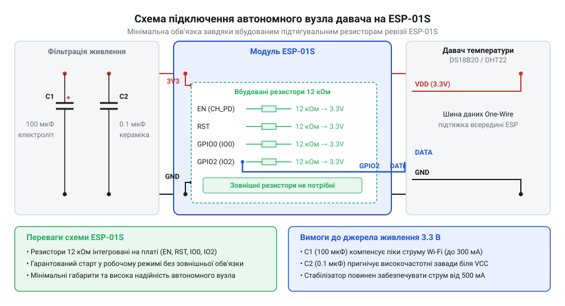

# Створення автономного Wi-Fi вузла давача на базі ESP-01S

<preknowlist>
- [ESP-01S (Wi-Fi, ESP8266)](root:cat-hw-boards/esp-01s) — розводку виводів модуля та наявність інтегрованих резисторів підтяжки
- [Конфігураційні виводи завантаження ESP8266](root:cat-hw-boards/esp8266-boot-strapping-pins) — необхідні логічні рівні на GPIO0, GPIO2 та CH_PD для успішного старту з flash-пам'яті
- [Режими завантаження мікроконтролера ESP8266](root:cat-hw-boards/esp8266-boot-modes) — умови переходу мікроконтролера в режим виконання прошивки
- [ESP-01 (Wi-Fi, ESP8266)](root:cat-hw-boards/esp-01) — базові конструктивні обмеження оригінального модуля без підтягувальних резисторів
</preknowlist>

## Потреба у компактному сенсорному вузлі

Розгортання віддалених датчиків для моніторингу температури чи вологості вимагає максимальної компактності та надійності. Спроба зібрати автономний @@en|sensor node@@ (від англ. sensor node — сенсорний вузол) на громіздких відлагоджувальних платах призводить до необґрунтованого збільшення габаритів корпусу та перевитрати енергії. З іншого боку, застосування мініатюрних мікроконтролерних модулів створює схемотехнічний виклик: для стабільного старту необхідно жорстко зафіксувати логічні рівні на виводах конфігурації.

У разі використання [оригінального модуля ESP-01](root:cat-hw-boards/esp-01) розробник змушений додавати зовнішні резистори @@en|pull-up@@ (від англ. pull-up — підтяжка догори). Без цих компонентів @@en|boot strapping pins@@ (від англ. boot strapping pins — виводи вибору режиму завантаження) опиняються в плаваючому стані. Найменша наводка під час подачі живлення хаотично перемикає мікроконтролер між режимом виконання прошивки з @@en|flash memory@@ (від англ. flash memory — флеш-пам'ять) та режимом програмування, через що вузол просто не запускається.

Використання [модуля ESP-01S](root:cat-hw-boards/esp-01s) вирішує проблему зовнішньої обв'язки на апаратному рівні. На цій ревізії плати вже розпаяні підтягувальні резистори номіналом 10 кОм для ліній `GPIO0`, `GPIO2` та `CH_PD`. Вивід `CH_PD` (від англ. @@en|Chip Power Down@@ — вимкнення чипа) керує живленням внутрішніх блоків мікроконтролера: високий рівень вмикає кристал, а низький — переводить його в режим повного знеструмлення. Інтегровані резистори дозволяють виключити зовнішній монтаж, правильно виставити [конфігураційні виводи завантаження](root:cat-hw-boards/esp8266-boot-strapping-pins) та забезпечити передбачуваний [режим завантаження мікроконтролера](root:cat-hw-boards/esp8266-boot-modes) одразу після подачі напруги. У результаті незадіяні виводи @@en|GPIO@@ (від англ. General Purpose Input/Output — вхід-вихід загального призначення) перебувають у безпечному логічному стані. У режимі @@en|Deep Sleep@@ (від англ. deep sleep — глибокий сон) внутрішній таймер мікроконтролера продовжує працювати лише за наявності високого рівня на `CH_PD`, тому вбудований резистор підтяжки забезпечує штатне збереження енергії без додаткових компонентів. Водночас якщо зовнішня схема примусово притягує `CH_PD` до землі для повного вимкнення модуля, через підтяжку 10 кОм виникає постійний витік струму `3.3 В / 10 кОм = 0.33 мА` (330 мкА). Цей струм суттєво перевищує власне споживання мікроконтролера у глибокому сні, що слід ураховувати під час розробки ультранизькоспоживаних сенсорних вузлів.

## Схемотехніка та живлення модуля ESP-01S

Головною причиною нестабільної роботи бездротових сенсорних вузлів є просідання напруги живлення під час активації радіочастотного тракту. В момент підключення до мережі Wi-Fi мікроконтролер споживає імпульсні струми амплітудою до 300–400 мА. Якщо джерело живлення побудоване на малопотужному регуляторі або не має належного фільтрування, напруга 3.3 В короткочасно падає нижче 2.8 В, що викликає апаратне перезавантаження @@en|Brownout Reset@@ (від англ. Brownout Reset — скидання при просіданні напруги).

Для забезпечення стабільної роботи необхідно використовувати якісний @@en|LDO@@ (від англ. Low DropOut — регулятор з малою різницею напруг) та правильний @@en|decoupling capacitor@@ (від англ. decoupling capacitor — розв'язувальний конденсатор). Безпосередньо біля виводів живлення модуля `VCC` та `GND` слід паралельно встановити керамічний конденсатор ємністю 0.1 мкФ для придушення високочастотних завад та електролітичний або танталовий конденсатор ємністю 100 мкФ для компенсації струмових піків.


*Принципова схема автономного вузла на базі ESP-01S з керамічним та електролітичним конденсаторами живлення.*

Підключення периферії до [модуля ESP-01S](root:cat-hw-boards/esp-01s) спрощене до мінімуму. Оскільки [виводи завантаження ESP8266](root:cat-hw-boards/esp8266-boot-strapping-pins) `GPIO0` та `GPIO2` підтягнуті до `VCC`, вивід `GPIO2` є ідеальним кандидатом для підключення цифрових давачів температури (наприклад, DS18B20), які працюють за протоколами типу @@en|One-Wire@@ (від англ. One-Wire — однопровідна шина). Вбудована підтяжка 10 кОм на `GPIO2` позбавляє потреби додавати зовнішній резистор для лінії даних давача, проте її номінал прямо впливає на часові інтервали шини та живлення сенсора. Оскільки протокол @@en|One-Wire@@ використовує відкритий колектор, відновлення високого логічного рівня після розряджання шини здійснюється пасивно через @@en|pull-up@@ резистор. Стала часу `tau` відновлення напруги на лінії визначається добутком опору резистора підтяжки `R_pu` та паразитної ємності шини `C_bus`:

```
tau = R_pu × C_bus
= 10000 × 30 × 10⁻¹²    [підстановка опору 10 кОм та ємності 30 пФ]
= 3 × 10⁻⁷              [обчислення сталої часу в секундах]
```

Символ `R_pu` означає опір резистора підтяжки в омах, `C_bus` — @@en|bus capacitance@@ (від англ. bus capacitance — ємність шини, від латин. capacitas — місткість) у фарадах, а `tau` — сталу часу в секундах. Здобуте значення `tau` у 3 × 10⁻⁷ с (0.3 мкс) формує @@en|rise time@@ (від англ. rise time — час наростання) сигналу близько 0.36 мкс, що є повністю припустимим для короткого монтажу, оскільки вікно зчитування біта становить 15 мкс. Проте при подовженні провідників ємність `C_bus` зростає, затягуючи фронт наростання напруги вище допуску і спричиняючи спотворення даних. Окрім часових інтервалів, опір підтяжки обмежує струм у схемах без окремого джерела живлення. Струм `I_pu`, який підтягувальний резистор здатний передати в лінію, обчислюється з різниці напруги живлення `V_CC` та падіння напруги на відкритому ключі `V_d`, поділеної на опір `R_pu`:

```
I_pu = (V_CC - V_d) ÷ R_pu
= (3.3 - 0.7) ÷ 10000    [підстановка напруги живлення 3.3 В, падіння 0.7 В та опору 10 кОм]
= 0.00026                [обчислення струму підтяжки в амперах]
```

Символ `I_pu` означає струм підтяжки в амперах, `V_CC` — напругу живлення у вольтах, `V_d` — падіння напруги у вольтах, а `R_pu` — опір у омах. Отриманий струм `I_pu` у 0.26 мА є занадто малим для забезпечення @@en|parasite power@@ (від англ. parasite power — паразитичне живлення, від грец. παράσιτος — утриманець), яке під час вимірювання вимагає до 1.5 мА. Через це автономний сенсорний вузол на ESP-01S потребує виключно прямого підключення виводу живлення давача до шини 3.3 В.

## Програмування опитування давача та передачі

Програмне забезпечення автономного вузла реалізує циклічний процес: ініціалізація периферії, зчитування показників з давача, встановлення Wi-Fi з'єднання, відправка сформованого @@en|payload@@ (від англ. payload — корисне навантаження) на сервер та перехід у стан очікування або глибокого сну.

Передача вимірювань зазвичай здійснюється за допомогою @@en|HTTP POST@@ запитів у форматі @@en|JSON@@ або через протокол @@en|MQTT@@, який є стандартом для систем "Інтернету речей". У коді процес опитування починається з читання виводу `GPIO2` та обов'язкової перевірки дійсності значень функцією `isnan()`, що запобігає відправці хибних даних у разі апаратного збою сенсора. Після успішного зчитування мікроконтролер формує текстовий @@en|payload@@ у форматі @@en|JSON@@ та ініціалізує @@en|HTTP POST@@ запит із заголовком `Content-Type: application/json`. Для збереження стабільності мережевого обміну програма аналізує коди відповідей сервера: якщо запит повертає від'ємний код помилки з'єднання чи @@en|timeout@@ (від англ. time out — вичерпання часу), або код, відмінний від `200 OK`, вузол пропускає поточний крок або повторює спробу без безкінечного блокування основного циклу. Замість використання затримувальної функції `delay()`, під час якої трансивер продовжує споживати струм близько 70–170 мА, для автономного [модуля ESP-01S](root:cat-hw-boards/esp-01s) критично застосовувати режим @@en|Deep Sleep@@ (від англ. deep sleep — глибокий сон). Викликом відповідної функції мікроконтролер вимикає більшість внутрішніх вузлів і знижує споживання до кількох мікроампер на заданий час, після чого внутрішній таймер перезапускає систему для наступного вимірювання. Нижче наведено приклади коду для опитування давача на виводі `GPIO2` та відправки даних на веб-сервер.

:::tabs
@tab Arduino (C++)
:::code proj-esp01s-standalone-sensor-node/cpp/arduino/setup.cpp
@tab ESP-IDF (C)
:::code proj-esp01s-standalone-sensor-node/c/esp-idf/-http-event-handler.c
:::

## Порядок розгортання та усунення збоїв

Введення в експлуатацію автономного сенсорного вузла розпочинається із лабораторного тестування на макетній платі. Під час прошивки модуль ESP-01S підключають до USB-UART перехідника. Для переведення плати у @@en|UART download mode@@ (від англ. UART download mode — режим завантаження через UART) вивід `GPIO0` тимчасово замикають на `GND`. Після завершення завантаження прошивки вивід `GPIO0` залишають вільним, оскільки завдяки внутрішній підтяжці 10 кОм він автоматично повернеться до високого логічного рівня.

Діагностика апаратних проблем виконується через аналіз системних повідомлень у момент подачі живлення. Підключивши вивід `TX` модуля до консолі з параметром @@en|baud rate@@ (від англ. baud rate — швидкість передачі в бодах) 74880 бод, можна зчитати статус завантаження. Наприклад, рядок `boot mode:(3,7)` підтверджує нормальний старт з флеш-пам'яті, тоді як `boot mode:(1,7)` вказує на те, що `GPIO0` залишився підтягнутим до землі.

У реальних умовах автономний вузол може втрачати Wi-Fi з'єднання через перешкоди або перезавантаження роутера. Програма повинна містити механізми автоматичного перепідключення та скидання апаратного таймера @@en|watchdog timer@@ (від англ. watchdog timer — сторожовий таймер). Якщо мережа недоступна протягом тривалого часу, доцільно виконувати програмне перезавантаження контролера для відновлення стека безпровідного зв'язку.
