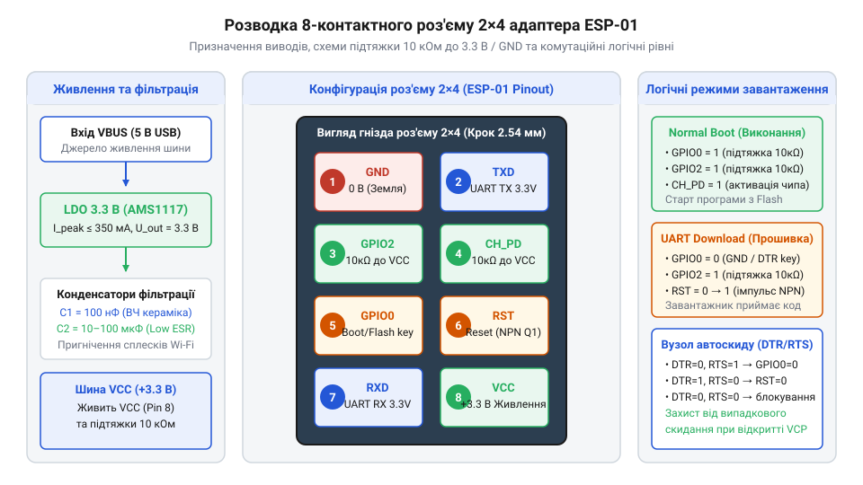
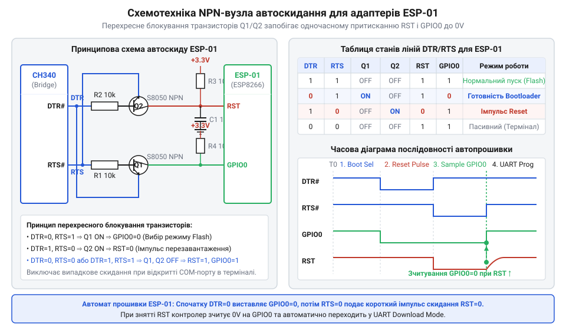

# Специфікація схемотехніки та апаратного інтерфейсу адаптерів ESP-01

<preknowlist>
- [ESP-01 (Wi-Fi, ESP8266)](root:cat-hw-boards/esp-01) — цокольовка та розміщення контактів модуля ESP-01
- [Режими завантаження мікроконтролера ESP8266](root:cat-hw-boards/esp8266-boot-modes) — логічні рівні на GPIO0, GPIO2 та CH_PD для вибору режимів завантаження
- [Конфігураційні виводи завантаження ESP8266](root:cat-hw-boards/esp8266-boot-strapping-pins) — вимоги до зовнішніх підтяжок виводів при включенні
</preknowlist>

## Проблема безпосереднього підключення ESP-01

Спроба підключити мікроконтролерний модуль [ESP-01](root:cat-hw-boards/esp-01) безпосередньо до стандартного перетворювача послідовного порту @@en|USB-UART@@ без спеціалізованого адаптера спричиняє низку апаратних проблем. Класичні перетворювачі виводять сигнальні лінії з рівнем напруги 5 В, тоді як кристал периферії розрахований на робочий діапазон 3.0–3.6 В. Подача напруги 5 В на сигнальний вхід приймача призводить до електричного пробою вхідних буферів мікроконтролера. Для узгодження логічних рівнів 5 В лінії @@en|TX@@ перетворювача та 3.3 В входу @@en|RX@@ модуля найпростішим рішенням є резистивний дільник напруги. Проте при використанні високоомного дільника паралельний опір плечей разом із паразитною ємністю виводу мікроконтролера утворює інтегрувальне @@en|RC@@-коло, яке затягує фронти прямокутних імпульсів і викликає фазові викривлення бітів на високошвидкісній шині UART. Щоб запобігти завадам і збоям кадрів, параметри дільника добирають так, аби забезпечити стабільний коефіцієнт передачі:

K = R₂ / (R₁ + R₂)
= 3.3 / 5.0
= 0.66

Обираючи резистори опором `R₁ = 1 кОм` та `R₂ = 2 кОм`, отримуємо вихідну напругу `V_out = 5 · 2 / (1 + 2) = 3.33 В`, що повністю входить у безпечний робочий діапазон. Для двонапрямних ліній або високошвидкісної передачі даних замість дільника застосовують активну схему узгодження на польовому транзисторі @@en|MOSFET@@ (від англ. *Metal-Oxide-Semiconductor Field-Effect Transistor* — польовий транзистор зі структурою метал-оксид-напівпровідник) з підтягувальними резисторами 10 кОм до шин 3.3 В і 5 В, яка забезпечує круті фронти імпульсів та захищає вхідні кола.

Другим чинником є імпульсне енергоспоживання. Під час активації передавача @@en|Wi-Fi@@ модуль споживає піковий струм до 300 мА тривалістю в кілька мікросекунд. Вбудовані лінійні регулятори з низьким падінням напруги @@en|LDO@@ (від англ. *Low Drop-Out* — низьке падіння напруги) дешевих USB-мостів спроможні видавати лише 50–100 мА. У момент спроби підключення до мережі напруга живлення різко просідає, що викликає апаратне скидання за недостатньою напругою @@en|brown-out reset@@ (від англ. *brown-out* — просідання напруги, та *reset* — скидання) та входить у циклічний перезапуск.

Крім цього, для старту виконання програми або переходу в режим завантажника модуль вимагає строго визначених логічних рівнів на декількох виводах одночасно. Ручна комутація провідників та підтягувальних резисторів на макетній платі створює ризик помилкового замикання. Спеціалізований апаратний адаптер вирішує ці проблеми на рівні своєї принципової схеми, поєднуючи потужний стабілізатор 3.3 В, схеми узгодження рівнів та автоматичне керування виводами.

Таке комплексне апаратне обв'язування реалізується у вигляді плашок-програматорів зі спеціалізованим дворядним роз'ємом (англ. @@en|header@@ — штирьовий або гніздовий з'єднувач) у форматі 2×4 виводи. Адаптер бере на себе не лише стабілізацію напруги та захист вхідних каскадів, але й гарантує коректну фіксацію потенціалів на лініях увімкнення @@en|CH_PD@@ та @@en|GPIO2@@ через внутрішні підтягувальні резистори (англ. @@en|pull-up resistor@@ — резистор підтяжки до живлення). Це дозволяє усунути нестабільність завантаження, яку викликають незадіяні [конфігураційні виводи завантаження ESP8266](root:cat-hw-boards/esp8266-boot-strapping-pins), та забезпечує стандартизований апаратний інтерфейс для швидкого підключення модуля до комп'ютера.

## Специфікація та розводка роз'єму 2x4

Фізичний інтерфейс підключення модуля реалізовано через дворядний 8-контактний роз'єм @@en|header@@ (від англ. *head* — голова, штировий роз'єм) з кроком між виводами 2.54 мм. Конфігурація призначення виводів @@en|pinout@@ (від англ. *pin* — контакт, та *out* — вихід) роз'єму 2x4 забезпечує подачу живлення, обмін даними та вибір режимів роботи. Під час подачі живлення або зняття сигналу скидання внутрішній завантажувач мікроконтролера фіксує стан трьох ключових конфігураційних ліній @@en|boot-strapping modes@@: `GPIO0`, `GPIO2` та `GPIO15`. Внутрішня периферія @@en|SoC ESP8266@@ містить слабкі підтягувальні резистори опором близько 30–50 кОм (для `GPIO0` та `GPIO2` — до шини 3.3 В, а для `GPIO15` — до землі `GND`). Однак через імпульсні завади під час старту внутрішніх підтяжок недостатньо для гарантованого визначення режиму, тому на платі адаптера встановлюють зовнішні підтягувальні резистори 10 кОм. Зокрема, критичну роль відіграє лінія активації чипа `CH_PD` (також відома як `EN` від англ. *enable* — увімкнення): без зовнішньої підтяжки 10 кОм до шини 3.3 В внутрішній кварцовий генератор тактування @@en|crystal oscillator@@ втрачає стабільну фазову синхронізацію при старті, викликаючи апаратні зависання процесорного ядра. Для входу в режим завантаження прошивки вивід `GPIO0` замикають на землю (`GPIO0 = 0`), вивід `GPIO2` залишають підтягнутим до високого рівня (`GPIO2 = 1`), а лінія `GPIO15` (підтягнута на модулі до землі) зафіксована як `GPIO15 = 0`. Якщо ж під час скидання `GPIO0 = 1`, мікроконтролер розпочинає звичайне виконання коду з внутрішньої Flash-пам'яті.

*Розводка виводів 8-контактного роз'єму 2x4 адаптера ESP-01 з підтягувальними резисторами та колами живлення.*

Призначення ліній роз'єму 2x4 адаптера:
- `VCC`: Вхід живлення +3.3 В від вбудованого стабілізатора.
- `GND`: Спільна шина заземлення.
- `TX`: Вихід передавача послідовного порту (рівень 3.3 В).
- `RX`: Вхід приймача послідовного порту (рівень 3.3 В).
- `CH_PD` (CHIP_PU): Лінія активації чипа. Для роботи модуля потребує постійного фіксування високого логічного рівня через підтягувальний резистор @@en|pull-up@@ (від англ. *pull* — тягти, та *up* — вгору) опором 10 кОм до шини `VCC`.
- `RST`: Активний низький сигнал апаратного скидання.
- `GPIO0`: Конфігураційна лінія вибору [режимів завантаження ESP8266](root:cat-hw-boards/esp8266-boot-modes).
- `GPIO2`: Допоміжний вивід, який під час увімкнення підтягується резистором 10 кОм до `VCC`.

Для виходу з режимів сну та надійного старту [конфігураційні виводи завантаження ESP8266](root:cat-hw-boards/esp8266-boot-strapping-pins) вимагають чітких логічних станів у момент подачі живлення або зняття сигналу `RST`. Для звичайного завантаження виконується умова `GPIO0 = 1`, `GPIO2 = 1`, `CH_PD = 1`. Для переведення у режим прошивки лінію `GPIO0` притискають до землі: `GPIO0 = 0`.

## Схемотехніка автоскиду та комутації режимів

При використанні адаптера для розробки ручне перемикання джамперів або затискання кнопок уповільнює процес. Для автоматизації у схемотехніку адаптерів інтегрують вузол автоматичного скидання @@en|auto-reset@@ (від англ. *automatic* — автоматичний, та *reset* — скидання), який керується службовими лініями `DTR` та `RTS` мосту @@en|USB-UART@@. Двотранзисторний перемикач використовує перехресні зв'язки між колекторами й базами @@en|NPN@@-транзисторів `Q₁` і `Q₂`. Режими роботи вузла та стан базово-емітерних переходів при напрузі відмикання `V_BE ≈ 0.7 В` показує така таблиця істинності станів:

| `DTR` | `RTS` | `V_BE(Q₁)` | `V_BE(Q₂)` | `GPIO0` | `RST` | Режим роботи |
|---|---|---|---|---|---|---|
| 1 | 1 | 0.0 В | 0.0 В | 1 (3.3В) | 1 (3.3В) | Звичайне виконання коду |
| 0 | 1 | 0.7 В | 0.0 В | 0 (GND) | 1 (3.3В) | Підготовка до завантаження |
| 1 | 0 | 0.0 В | 0.7 В | 1 (3.3В) | 0 (GND) | Апаратне скидання процесора |
| 0 | 0 | 0.0 В | 0.0 В | 1 (3.3В) | 1 (3.3В) | Блокування взаємних сигналів |

Завдяки такій схемотехніці стан `DTR = 0` та `RTS = 0` утримує обидва транзистори закритими, захищаючи модуль від хибних скидань під час ініціалізації драйвера VCP у системі.

*Принципова схема двотранзисторного вузла автоматичного скидання та комутації режимів GPIO0 / RST.*

Вузол побудовано на двох NPN-транзисторах біполярної структури @@en|BJT@@ (від англ. *Bipolar Junction Transistor* — біполярний транзистор). Схема працює за логікою взаємного блокування станів:
- Коли утиліта прошивки виставляє `DTR = 0` та `RTS = 1`, відкривається перший транзистор, який притягує вивід `GPIO0` до землі (`GPIO0 = 0`), готуючи режим завантажника.
- Коли подається комбінація `DTR = 1` та `RTS = 0`, відкривається другий транзистор, який притягує лінію `RST` до землі (`RST = 0`), викликаючи скидання мікроконтролера.
- Повернення у стан `DTR = 1` та `RTS = 1` знімає сигнал `RST`, і мікроконтролер зчитує нульовий рівень на `GPIO0`, успішно входячи в режим [оновлення прошивки ESP-01](root:cat-hw-boards/esp01-firmware-flashing).

Одночасне опускання обох ліній `DTR = 0` та `RTS = 0`, яке часто виникає при відкритті послідовного порту в операційній системі, блокується схемотехнікою: обидва транзистори залишаються закритими, запобігаючи неконтрольованому скиданню.

## Електричні характеристики та діагностика

Надійність роботи адаптера визначається параметрами схеми живлення. Сучасні модулі [ESP-01S](root:cat-hw-boards/esp-01s) під час калібрування радіочастотного тракту створюють короткі сплески струму амплітудою до 350 мА. На осцилограмі шини `VCC` під час увімкнення передавача без додаткової фільтрації спостерігається просідання напруги з номінальних 3.3 В до критичного рівня 2.6–2.7 В тривалістю 10–50 мкс, що активує компаратор скидання чипа. Встановлення шунтувальних конденсаторів згладжує ці сплески до безпечних меж `ΔV ≤ 100 мВ`. Крім стабілізації живлення, для захисту ліній `RX` та `TX` від статичної електрики під час гарячого підключення у схемотехніку адаптера додають двоспрямовані супресори @@en|TVS-diodes@@ (від англ. *Transient Voltage Suppressor* — діод придушення перехідних стрибків напруги) з напругою фіксації 3.3–5 В, які безпечно скидають високовольтні розряди на землю.

Для компенсації цих сплесків на платі адаптера встановлюють два типи конденсаторів:
- Керамічний шунтувальний конденсатор ємністю 100 нФ, розташований якомога ближче до виводів `VCC` та `GND` роз'єму 2x4 для фільтрації високочастотних завад.
- Електролітичний або танталовий конденсатор ємністю 10–100 мкФ з низьким значенням еквівалентного послідовного опору @@en|ESR@@ (від англ. *Equivalent Series Resistance* — еквівалентний послідовний опір) для накопичення енергії під час піків передавача.

Діагностика типових неполадок адаптера:
1. Циклічне перезавантаження з виводом текстового логу `rst cause:4`: вказує на брак ємності фільтрації на шині 3.3 В або недостатню потужність LDO-стабілізатора.
2. Помилка таймауту `Timed out waiting for packet header` в esptool: свідчить про ненадійний контакт на виводі `GPIO0`, відсутність підтяжки `CH_PD` або непрацездатність транзисторного ключа автоскиду.
3. Відсутність обміну по UART: перевіряється перехресне з'єднання ліній — вихід `TX` адаптера має підключатися до входу `RX` модуля, а вхід `RX` адаптера — до виходу `TX`.
