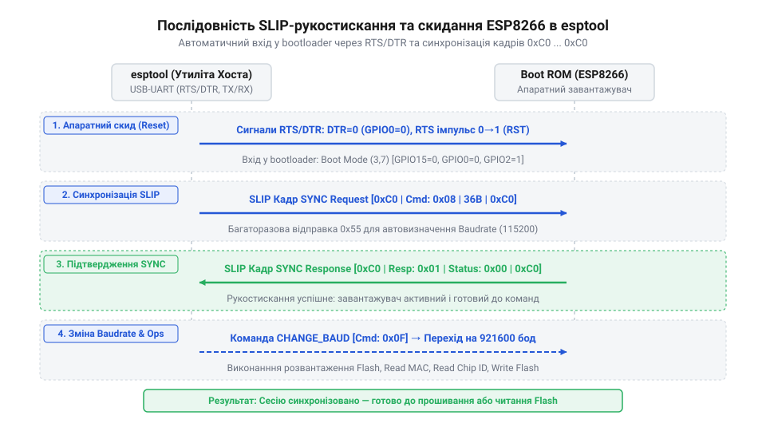
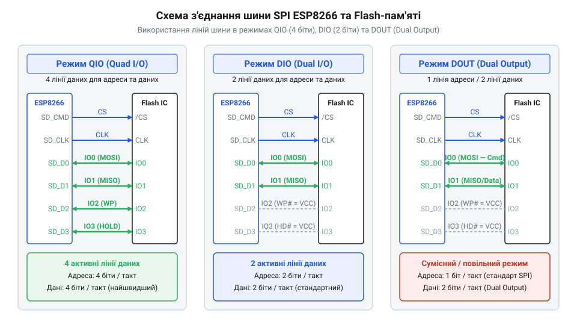

# Програмний інтерфейс прошивки ESP8266: параметри esptool, режими Flash-пам'яті та коди завантажувача

<preknowlist>
- [Режими завантаження мікроконтролера ESP8266](root:cat-hw-boards/esp8266-boot-modes) — призначення режимів UART Download та Flash Boot та умови входу в них
- [Конфігураційні виводи завантаження ESP8266](root:cat-hw-boards/esp8266-boot-strapping-pins) — логічні рівні на виводах GPIO0, GPIO2 та GPIO15 під час скидання контролера
- [Огляд мікроконтролера та архітектури SoC ESP8266](root:cat-hw-boards/esp8266-soc-architecture-overview) — базову організацію пам'яті чипа, роботу послідовного інтерфейсу UART та принципи підключення зовнішньої SPI Flash-пам'яті
</preknowlist>

## Збій прошивання через відсутність синхронізації

Спроба завантажити новий бінарний код у мікроконтролер ESP8266 часто завершується помилкою ще до початку передачі даних. Утиліта прошивання виводить у консоль нескінченні цятки очікування, після чого видає повідомлення про відсутність відповіді. Така поведінка виникає через те, що апаратний первинний завантажувач @@en|boot ROM@@ (англ. *Read-Only Memory* — постійний запам'ятовувальний пристрій) під час фізичного скидання мікроконтролера не перейшов у режим прийому даних через послідовний порт.

Апаратна логіка чипа ESP8266 опитує стан трьох конфігураційних виводів у момент підняття сигналу скидання `RST` або подачі живлення `CH_PD`. Щоб завантажувач активував режим програмування через @@en|UART@@ (англ. *Universal Asynchronous Receiver-Transmitter* — універсальний асинхронний приймач-передавач), на виводі `GPIO0` має бути встановлений низький логічний рівень 0 В. Якщо `GPIO0` залишається підтягнутим до високого рівня 3.3 В, мікроконтролер вважає, що повинен виконувати наявну програму з зовнішньої пам'яті, і починає звичайне завантаження. Стан ліній `GPIO2` та `GPIO15` також критичний: `GPIO2` повинен мати високий рівень, а `GPIO15` — низький. Нехтування цими умовами призводить до того, що чип входить у непідтримувані проміжні стани.

Спеціалізовані адаптери розширюють можливості керування за допомогою ліній `RTS` та `DTR` послідовного порту. Завдяки схемі автоскидання утиліта @@en|esptool@@ автоматично притискає `GPIO0` до землі та короткочасно скидає `RST`. Проте у простих модулях типу [класичного ESP-01](root:cat-hw-boards/esp-01) або при використанні баз без автоскидання цей ланцюг відсутній. У такому разі перехід у режим завантаження вимагає утримання кнопки програмування вручну під час подачі імпульсу скидання. Додатковим чинником збоїв є просідання живлення: у момент старту радіочастотний тракт чипа споживає короткочасні пікові струми до 500 мА. Якщо джерело 3.3 В не здатне забезпечити такий струм, чип перезавантажується через апаратне просідання напруги, перериваючи узгодження параметрів зв'язку.

## Протокол взаємодії з завантажувачем boot ROM

Після успішного входження чипа у режим програмування завантажувач @@en|boot ROM@@ очікує спеціальних команд для ініціалізації обміну даними. Для пакування службових повідомлень у послідовний потік використовується протокол @@en|SLIP@@ (англ. *Serial Line Internet Protocol* — протокол послідовної лінії Інтернету). Він обгортає кожен байтовий пакет байтами-рамками `0xC0` та застосовує екранування байтом `0xDB` для службових символів усередині тіла кадру.

Процес з'єднання починається з того, що утиліта @@en|esptool@@ надсилає послідовність команд синхронізації @@en|handshake@@ (англ. *handshake* — узгодження зв'язку). Ця послідовність складається з байта `0x07` та набору службових символів `0x07 0x12 0x20`, за якими йдуть 32 однакові байти `0x55`. Отримавши цей пакет, завантажувач відповідає підтвердженням і підтверджує готовність виконувати базові операції з пам'яттю.


*Послідовність команд синхронізації SLIP, завантаження flasher stub у SRAM та переключення швидкості UART.*

Оскільки вбудований у кремній завантажувач @@en|boot ROM@@ має обмежений набір команд і низьку швидкість запису, @@en|esptool@@ застосовує технологію @@en|flasher stub@@ (англ. *stub* — завантажувана заглушка). Утиліта записує невелику допоміжну програму безпосередньо у оперативну пам'ять @@en|SRAM@@ (англ. *Static Random-Access Memory* — статична оперативна пам'ять) за адресою `0x40100000` і передає їй управління. Ця заглушка перехоплює роботу з послідовним портом, дозволяючи динамічно підвищувати швидкість обміну @@en|baudrate@@ (англ. *baud rate* — швидкість передачі даних) з початкових 115200 бод до 921600 бод та прошивати мікросхему пам'яті за лічені секунди.

## Команди esptool для зчитування інформації

Перед записом нового бінарного образу важливо перевірити цілісність лінії зв'язку та отримати апаратні характеристики модуля. Утиліта @@en|esptool@@ надає для цього спеціальні команди командного рядка, які виконуються через послідовний порт.

Команда `chip_id` запитує у завантажувача унікальний 24-бітовий ідентифікатор мікроконтролера, сформований на основі його заводського номера. Для отримання повної фізичної адреси мережевого інтерфейсу використовується команда `read_mac`:

```bash
esptool.py --port /dev/ttyUSB0 --baud 115200 read_mac
```

Ця команда зчитує вміст блоку @@en|eFuse@@ (англ. *electronic fuse* — електронний запобіжник) та виводить унікальну @@en|MAC-адресу@@ (англ. *Media Access Control* — керування доступом до середовища) пристрою.

Щоб визначити параметри встановленої мікросхеми зовнішньої пам'яті, застосовують команду `flash_id`. Вона надсилає до мікросхеми через шину @@en|SPI@@ (англ. *Serial Peripheral Interface* — послідовний периферійний інтерфейс) кодовий запит @@en|JEDEC ID@@ (англ. *Joint Electron Device Engineering Council* — стандарт ідентифікації напівпровідників). На основі відповіді @@en|esptool@@ відображає код виробника @@en|Manufacturer ID@@ (англ. *manufacturer identifier* — ідентифікатор виробника), тип пристрою та розрахований реальний обсяг пам'яті у мегабайтах або мегабітах. Це дає змогу точно спланувати розмітку пам'яті для [модулів серії ESP-01S](root:cat-hw-boards/esp-01s) та запобігти виходу за межі фізичного обсягу чипа.

## Налаштування режимів роботи Flash-пам'яті

Неправильне налаштування режиму роботи шини @@en|SPI@@ є однією з найпоширеніших причин, чому модуль не запускається після успішної прошивки. Фізичне з'єднання між ESP8266 та мікросхемою пам'яті може використовувати різну кількість ліній даних.

Існує чотири основні режими адресації та читання: @@en|QIO@@ (англ. *Quad Input/Output*), @@en|QOUT@@ (англ. *Quad Output*), @@en|DIO@@ (англ. *Dual Input/Output*) та @@en|DOUT@@ (англ. *Dual Output*). У режимах Quad використовуються 4 лінії даних (`MOSI`, `MISO`, `HD`, `WP`), що вимагає підключення виводів `GPIO9` та `GPIO10`. У режимах Dual працюють лише 2 лінії даних (`MOSI` та `MISO`), що вивільняє `GPIO9` та `GPIO10` для внутрішніх потреб або користувацького введення-виведення.


*Схема з'єднання ліній шини SPI між контролером ESP8266 та зовнішньою мікросхемою Flash для Quad та Dual режимів.*

Якщо прошити модуль у режимі `QIO`, коли фізична розводка плати підтримує лише двопровідне з'єднання (як у більшості планок ESP-01), заголовок бінарного образу зафіксує вимогу 4-бітового читання. Під час старту первинний завантажувач спробує прочитати дані через незадіяні лінії, поверне сміття замість інструкцій і потрапить у циклічне перезавантаження. Для таких плат слід завжди вказувати прапорці `--flash_mode dout` та `--flash_freq 40m`, що гарантує сумісність із будь-яким розведенням друкованої плати.

## Очищення та запис бінарних образів

Тривала експлуатація або зміна версій фреймворків призводить до накопичення залишків конфігурації у секторі @@en|NVS@@ (англ. *Non-Volatile Storage* — енергонезалежне сховище). Щоб уникнути фантомних помилок і зациклень, перед записом нового проекту рекомендується виконувати повне форматування пам'яті за допомогою команди `erase_flash`:

```bash
esptool.py --port COM3 erase_flash
```

Запис бінарних файлів виконується командою `write_flash`. Вона приймає параметри швидкості, режиму пам'яті та список пар «зміщення-файл». Зміщення @@en|offset@@ (англ. *offset* — зміщення адреси) визначає точну фізичну адресу у пам'яті, з якої починається розміщення конкретного бінарного блока:

```bash
esptool.py --port COM3 --baud 921600 write_flash --flash_mode dout --flash_size 1MB 0x00000 boot_v1.7.bin 0x10000 user1.bin 0xFC000 esp_init_data_default.bin 0xFE000 blank.bin
```

Адреса `0x00000` призначена для первинного табличного завантажувача, `0x10000` містить безпосередньо виконний код програми, а системні сектори `0xFC000` та `0xFE000` зберігають калібрувальні дані радіочастотного модуля та системні налаштування @@en|SDK@@ (англ. *Software Development Kit* — набір засобів розробки). Використання граничних швидкостей до 921600 бод суттєво прискорює процес розробки при використанні якісних послідовних адаптерів, забезпечуючи надійне [прошивання плати ESP-01](root:cat-hw-boards/esp01-firmware-flashing).

## Розшифровка логів завантажувача boot ROM

При кожному скиданні або подачі живлення завантажувач @@en|boot ROM@@ виводить у послідовний порт `UART0` відлагоджувальну інформацію. Оскільки ця процедура відбувається до ініціалізації основної системи фазового автопідлаштування частоти @@en|PLL@@ (англ. *Phase-Locked Loop*), вивід здійснюється на нестандартній швидкості 74880 бод, яка відповідає частоті опорного кварцевого резонатора 26 МГц.

Ключовим елементом логу завантаження є рядок `boot mode (x,y)`. Перше число `x` являє собою десяткове вираження 3-бітової маски @@en|bitmask@@ (англ. *bit mask* — бітова маска) фізичних рівнів на конфігураційних виводах `[GPIO15, GPIO0, GPIO2]`:

* Значення `boot mode (1,7)` відповідає двійковому коду `001` (де `GPIO15=0`, `GPIO0=0`, `GPIO2=1`). Це означає успішний вхід у режим програмування через послідовний порт, коли чип очікує команди від `esptool`.
* Значення `boot mode (3,7)` відповідає двійковому коду `011` (де `GPIO15=0`, `GPIO0=1`, `GPIO2=1`). Це стандартний режим старта з зовнішньої пам'яті, коли чип виконує записану користувацьку програму.

Якщо під час спроби завантажити прошивку у моніторі порту з'являється запис `boot mode (3,7)`, це пряме свідчення того, що вивід `GPIO0` не був надійно притиснутий до землі в момент скидання. Інтерпретація цього коду дає змогу миттєво відрізнити апаратні проблеми з лініями завантаження від програмних помилок утиліти прошивання.

## Діагностика та усунення помилок прошивання

Під час роботи з утилітою @@en|esptool@@ можуть виникати помилки передачі даних, розшифровка яких дає змогу швидко усунути несправність.

Помилка `Timed out waiting for packet header` вказує на відсутність відповіді від чипа. Головними причинами є відсутність підтяжки `GPIO0` до землі при скиданні, неправильне перехресне підключення ліній `RX` та `TX`, або відсутність спільного провідника заземлення `GND` між адаптером та модулем. Також ця помилка виникає через недостатню потужність джерела живлення: якщо під час спроби узгодження швидкості напруга 3.3 В падає нижче критичної межі, чип вимикається.

Помилки виду `MD5 of file does not match MD5 of flash` або `Packet content transfer verify failed` виникають при спотворенні даних у процесі запису. Вони спричинені наведеннями на довгих провідниках послідовної лінії або надмірно високою швидкістю обміну. Для усунення проблеми слід знизити швидкість до 115200 бод та скорочити довжину з'єднувальних дротів.

Якщо прошивка завантажилася без помилок, але після скидання мікроконтролер циклічно перезавантажується з повідомленнями про збій `rst cause:2` або `wdt reset` (англ. *Watchdog Timer reset* — скидання сторожовим таймером), це свідчить про використання непідтримуваного режиму `QIO` замість `DOUT`, або про відсутність очищення секторів `NVS` після зміни фреймворку.
