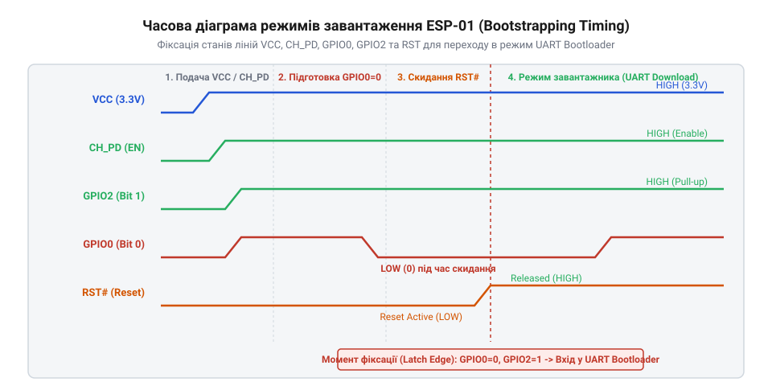
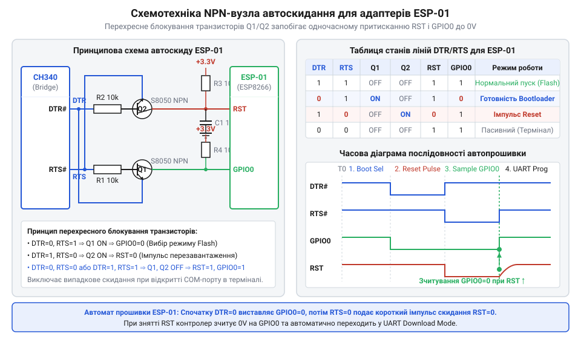
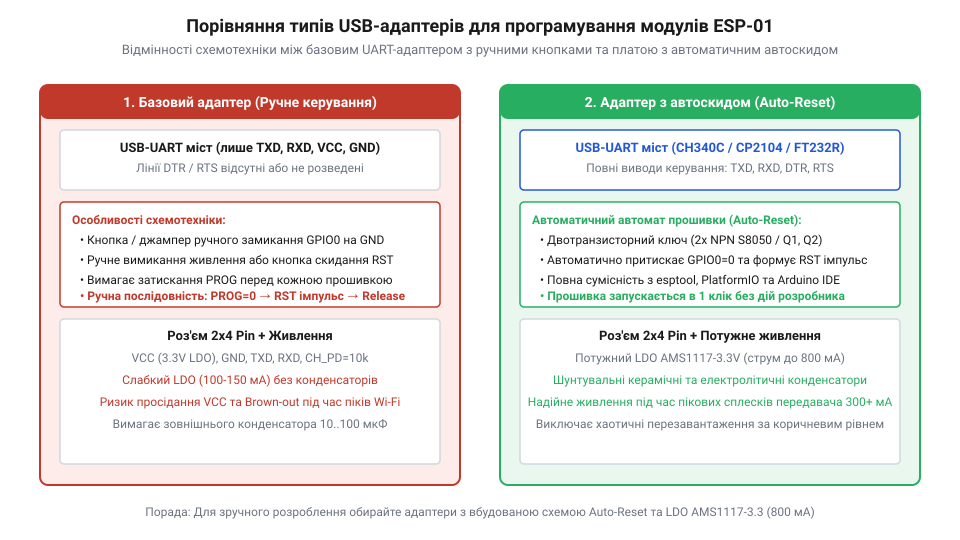

# esp-01-programmer-adapters

<preknowlist>
- [Конфігураційні виводи завантаження ESP8266](root:cat-hw-boards/esp8266-boot-strapping-pins) — електричні рівні на виводах GPIO0, GPIO2 та GPIO15 під час скидання для вибору режиму UART-завантаження
- [ESP-01 (Wi-Fi, ESP8266)](root:cat-hw-boards/esp-01) — цокольовка роз'єму 2x4, призначення сигналів CH_PD, RST, TX, RX та особливості схеми підтяжки
- [Режими завантаження мікроконтролера ESP8266](root:cat-hw-boards/esp8266-boot-modes) — комбінації логічних рівнів для переходу мікроконтролера між режимами виконання з флеш-пам'яті та завантаження через UART
</preknowlist>

## Проблема надійного прошивання модулів ESP-01

Спроба запрограмувати компактний модуль @@en|ESP-01@@ за допомогою стандартного моста @@en|USB-UART@@ найчастіше закінчується помилкою зв'язку в утиліті @@en|esptool@@. Розробник підключає лінії @@en|TX@@ та @@en|RX@@, подає живлення 3.3 В, запускає прошивання і бачить повідомлення про вичерпаний таймаут очікування заголовка пакета. Модуль або продовжує виконувати попередню програму, або зависає в невизначеному стані. На відміну від повнорозмірних відлагоджувальних плат, де вузли узгодження та скидання розведені безпосередньо на друкованій платі, мініатюрний модуль містить лише мікроконтролер @@en|ESP8266@@, флеш-пам'ять і мінімальне обв'язування. Для його успішного завантаження потрібен спеціальний @@en|програматор@@ (англ. *programmer*, від грецького *програма* — припис) або зовнішній @@en|адаптер@@ (англ. *adapter*, від латинського *adaptare* — пристосовувати).

Під час включення або подачі імпульсу скидання внутрішній @@en|UART-bootloader@@ (англ. @@en|bootloader@@, від @@en|bootstrap loader@@ — завантажувач) мікроконтролера зчитує електричні рівні на кількох сигнальних виводах. Фізично цей процес відбувається через апаратну засувку (англ. @@en|latch@@ — засувка, фіксатор): у момент відновлення напруги на виводі @@en|RST@@ та перетину логічного порогу вхідні тригери мікроконтролера фіксують стани на ніжках @@en|GPIO0@@, @@en|GPIO2@@ та @@en|GPIO15@@ у внутрішніх конфігураційних регістрах. Одразу після засувки первинна програма з масочно-запрограмованого ПЗУ @@en|ROM@@ зчитує записаний вектор і за комбінацією `GPIO0 = 0`, `GPIO2 = 1` передає керування у код обробки завантажувальних пакетів @@en|UART0@@. Якщо хоча б один вивід перебуває в підвішеному плаваючому стані або через наводки фіксує неправильний потенціал під час спрацьовування засувки, кристалик помилково обирає режим виконання з внутрішньої флеш-пам'яті чи завантаження зі SD-карти замість прийому прошивки. На відміну від платок @@en|NodeMCU@@ чи @@en|WeMos D1 mini@@, де підтягувальні резистори 10 кОм на лініях @@en|CH_PD@@, @@en|RST@@, @@en|GPIO0@@ та @@en|GPIO2@@ розведені безпосередньо на друкованій платі, мініатюрний планарний модуль [ESP-01](root:cat-hw-boards/esp-01) розроблявся для максимального здешевлення та мінімізації габаритів, тому позбавлений зовнішніх підтяжок на більшості виводів. Без зовнішніх підтягуючих резисторів та чіткої послідовності подачі сигналів ручне замикання дротів на безпайковій макетці залишає конфігураційні виводи у стані високого імпедансу і стає джерелом нестабільних збоїв.

При переході у завантажувальний режим системна логіка [мікроконтролера ESP8266](root:cat-hw-boards/esp8266-soc-architecture-overview) ініціалізує внутрішній фазовий автопідлаштовувач частоти @@en|PLL@@ (англ. @@en|Phase-Locked Loop@@, від @@en|phase@@ — фаза). Опорна частота від зовнішнього кварцового резонатора (зазвичай 26 МГц) через дільники PLL підганяється до базової тактової частоти ядра 80 МГц та задає коефіцієнт обчислення швидкості @@en|UART0@@. Якщо в момент засувки логічних рівнів на виводах конфігурації генератор працює нестабільно чи тактовий дільник синтезує відхилення частоти стробування, первинне узгодження кадру прошивального термінала зривається. Це призводить до фазового розсинхронізування кадру й унеможливлює встановлення стійкого зв'язку, що додатково деталізують [апаратні режими завантаження](root:cat-hw-boards/esp8266-boot-modes).

Окремою перешкодою є керування лінією живлення та виводом увімкнення мікросхеми. Стандартні перетворювачі інтерфейсів не мають вбудованої логіки для комутації службових режимів, тому користувачеві доводиться вручну заземлювати виводи, натискати кнопки та одночасно запускати команду в терміналі. Детальний шлях від саморобних розкладок на макетних платах до появі спеціалізованих USB-плашок висвітлює [еволюція засобів програмування](root:cat-hw-boards/esp-01-programmer-adapters/hist-esp01-adapters-evolution.md). Щоб позбутися ручних маніпуляцій і забезпечити повторюваність процесу розробки, було створено розведені адаптери, апаратну будову яких описує [специфікація апаратного інтерфейсу](root:cat-hw-boards/esp-01-programmer-adapters/api-esp01-adapter-hardware-interface.md).

Крім того, апаратну проблему поглиблюють електричні обмеження мостів @@en|USB-UART@@: поширені перетворювачі на базі мікросхем [сімейства CH340](root:hw-components/ch340-usb-uart-bridge-family) чи @@en|FT232R@@ часто формують на виводі @@en|TX@@ 5-вольтові логічні рівні та містять слабкий внутрішній стабілізатор 3.3 В, розрахований лише на струм до 25–50 мА. Спроба заживити мікроконтролер від такого джерела під час калібрування передавача викликає стрімке просідання напруги та спрацьовування @@en|Brown-out Reset@@ (англ. *brown-out*, від *brownout* — зниження напруги), через що кристал циклічно перезавантажується. Саме тому повноцінний адаптер слугує не просто механічним перехідником роз'єму, а інтегрує потужний лінійний регулятор 3.3 В та вузли узгодження сигналів, реалізуючи стабільний запуск і стійку передачу даних для [оновлення прошивки ESP-01](root:cat-hw-boards/esp01-firmware-flashing).

## Вимоги до сигнальних ліній завантаження

Правильний вибір режиму роботи мікроконтролера в момент скидання визначається станом трьох конфігураційних ліній, які називають виводами вибірки режиму. Для переведення модуля в режим завантаження коду через @@en|UART@@ необхідно забезпечити низький логічний рівень на виводі @@en|GPIO0@@, високий рівень на @@en|GPIO2@@ та низький рівень на внутрішній лінії @@en|GPIO15@@. Одночасно вивід увімкнення @@en|CH_PD@@ (англ. *Chip Power Down*, також позначений як @@en|EN@@) мусить перебувати під високим потенціалом 3.3 В для активності @@en|SoC@@ (англ. *System-on-Chip* — система на кристалі). Повний перелік комбінацій визначають [конфігураційні виводи завантаження ESP8266](root:cat-hw-boards/esp8266-boot-strapping-pins), а логіку їх обробки описують [режими завантаження мікроконтролера ESP8266](root:cat-hw-boards/esp8266-boot-modes).

Приєднані до виводів @@en|GPIO0@@ та @@en|GPIO2@@ зовнішні резистори або сигнали перетворювача @@en|USB-UART@@ утворюють специфічний фізичний ефект паразитного заживлення кристала (від @@en|phantom power@@ — примарне живлення). Всередині кремнієвої структури чипа кожен вхідний порт @@en|I/O@@ (від @@en|Input/Output@@ — ввід/вивід) захищений двома @@en|ESD@@-діодами (від @@en|Electrostatic Discharge Protection@@ — захист від електростатичного розряду), один із яких увімкнений анодом до виводу, а катодом — до внутрішньої шини живлення @@en|VCC@@ (від @@en|Voltage at the Common Collector@@ — напруга живлення). Якщо під час відключення основного джерела 3.3 В на лінії @@en|GPIO0@@ або @@en|GPIO2@@ лишається високий логічний рівень 5 В чи 3.3 В від виходу перетворювача, виникає різниця потенціалів, яка відкриває верхній підтягувальний діод. Зворотний струм витікає через цей діод безпосередньо на внутрішню лінію живлення кристала, частково заживлюючи [архітектуру SoC ESP8266](root:cat-hw-boards/esp8266-soc-architecture-overview). Оскільки опір відкритого діода становить лише кілька ом, зворотний струм величиною 10–50 мА здатний утримувати внутрішній процесорний сердечник у напівробочому стані. У результаті внутрішні підтягувальні резистори та схема скидання опиняються у невизначеному стані, що унеможливлює правильне зчитування конфігураційних рівнів під час повторного старту й спричиняє хаотичний [перехід між режимами завантаження](root:hw-arch/strapping-piny-i-rezhymy-zavantazhennia) або циклічний @@en|boot loop@@ (від @@en|boot loop@@ — цикл перезавантаження). Для усунення цього ефекту необхідно обмежувати струм витоку через захисні діоди на рівні `I_leak ≤ 1.0 мА`. При використанні послідовного струмообмежувального резистора `R_s = 1 кОм` на лінії 5 В прямий струм витоку обчислюється як `I_leak = (5.0 - 3.3 - 0.7) ÷ 1000 = 1.0 мА`, що знижує навантаження до припустимої межі, проте залишає потенціал на виводі зсунутим до 4.0 В. Застосування дільника напруги з резисторами `R1 = 1 кОм` (верхнє плече) та `R2 = 2 кОм` (нижнє плече) знижує вихідну напругу сигналу до значення `V_out = 5.0 × (2000 ÷ (1000 + 2000)) = 3.33 В`. Оскільки отримані 3.33 В не перевищують сумарний поріг відкривання діода `VCC + V_diode ≈ 3.9 В`, верхній ESD-діод залишається повністю закритим, а струм витоку падає до нуля. Порівняння показує: один послідовний резистор є мінімальним захистом від вигоряння входу, тоді як дільник 1 кОм / 2 кОм полностью усуває паразитне заживлення та гарантує точний узгоджений рівень 3.33 В, що детально описує [розрахунок параметрів живлення та дільників](root:cat-hw-boards/esp-01-programmer-adapters/math-esp01-power-and-divider-calc.md).

Вивід скидання @@en|RST@@ (англ. *Reset*) має активний низький рівень. Щоб мікроконтролер зафіксував режим завантаження, вивід @@en|GPIO0@@ повинен бути притиснутий до землі до моменту відпускання лінії @@en|RST@@ у високий стан і зберігати цей потенціал протягом кількох мілісекунд, поки внутрішнє @@en|ПЗП@@ проініціалізує периферію.


*Часова діаграма сигнальних ліній завантажувача ESP-01 під час скидання та ініціалізації.*

Другим важливим фактором є електричне узгодження сигналів керування. Більшість дешевих USB-перетворювачів працюють із 5-вольтними логічними рівнями на лініях @@en|TX@@ та @@en|RX@@. Подача напруги 5 В на вхідний вивід прийому даних мікроконтролера спричиняє протікання паразитного струму через захисні діоди виводу, що описує [огляд мікроконтролера та архітектури SoC ESP8266](root:cat-hw-boards/esp8266-soc-architecture-overview). Для захисту входів застосовують резистивні дільники напруги або двонаправлені перетворювачі рівнів, точний розрахунок яких наведено в матеріалі [розрахунок параметрів живлення та дільників](root:cat-hw-boards/esp-01-programmer-adapters/math-esp01-power-and-divider-calc.md).

## Особливості живлення при пікових струмах

Причина більшості незрозумілих збоїв під час стирання або запису флеш-пам'яті полягає в електричних характеристиках джерела живлення 3.3 В. У момент старту передавача @@en|Wi-Fi@@ або при підтвердженні блоків прошивки модуль споживає коротковчасні пікові струми амплітудою від 300 до 500 мА. Середнє споживання становить близько 70–80 мА, однак тривалість струмових сплесків вимірюється мікросекундами, що висуває жорсткі вимоги до швидкодії та потужності стабілізатора.

Вбудовані допоміжні стабілізатори 3.3 В, які розміщені всередині USB-UART мостів, мають істотні електричні обмеження: внутрішній регулятор мікросхеми @@en|CH340G@@ здатен віддавати лише до 25–30 мА, тоді як інтегрований стабілізатор мікросхеми @@en|CP2102@@ забезпечує граничний струм до 100 мА. Попри те, що @@en|CP2102@@ має дещо вищу струмову віддачу, жодна з цих внутрішніх схем не спроможна покрити пікові сплески споживання модулів [ESP-01](root:cat-hw-boards/esp-01) амплітудою 300–500 мА під час роботи каскадів @@en|Wi-Fi@@. Якщо живити модуль безпосередньо від цих виводів, у момент ініціалізації передавача чи прошивання виникає глибоке просідання напруги нижче 2.8 В. Це викликає внутрішнє апаратне скидання за низькою напругою — @@en|Brown-out Reset@@ (англ. *brown-out*, просідання напруги), через що сесія запису флеш-пам'яті обривається.

Лабораторні осцилограми на внутрішніх виводах живлення @@en|VDD33@@ кристала демонструють характерні високочастотні провали напруги тривалістю від 200 наносекунд до кількох мікросекунд під час підключення к калібрувальній процедурі @@en|RF@@-каскаду. За відсутності локального керамічного шунта ємністю 0.1 мкФ з низьким еквівалентним послідовним опором (від @@en|ESR@@ — еквівалентний послідовний опір) паразитна індуктивність провідників друкованої плати не дозволяє зовнішньому стабілізаторові компенсативно реагувати на круті фронти наростання струму. Величина еквівалентного послідовного опору безпосередньо формує амплітуду просідання `ΔV_dip = I_peak × ESR`: при виборі звичайного електролітичного конденсатора з опором `ESR ≈ 0.5 Ом` піковий струм `I_peak = 0.4 А` викликає миттєвий стрибок падіння напруги `ΔV_dip = 0.4 × 0.5 = 0.2 В`. Використання багатошарових керамічних конденсаторів @@en|MLCC@@ (від англ. *Multi-Layer Ceramic Capacitor* — багатошаровий керамічний конденсатор) з опором `ESR ≤ 0.01 Ом` зменшує це падіння до невагомих `ΔV_dip ≤ 4 мВ`. Осцилограф фіксує імпульсне падіння напруги безпосередньо на ніжках чипа без керамічної фільтрації до рівнів 2.3–2.5 В, хоча звичайний мультиметр на виході джерела живлення показує стабільні 3.3 В. Саме ці локальні високочастотні просідання призводять до збоїв зчитування команд із мікросхеми @@en|SPI Flash@@ під час [оновлення прошивки ESP-01](root:cat-hw-boards/esp01-firmware-flashing) та спровокують миттєвий @@en|Brown-out Reset@@ мікроконтролера.

Для забезпечення стабільної роботи на платі адаптера встановлюють окремий лінійний стабілізатор @@en|LDO@@ (англ. *Low Drop-Out* — низький спад напруги) серії AMS1117-3.3, який живиться від 5-вольтової шини USB і здатний віддавати струм до 800 мА. На виході стабілізатора обов'язково розміщують паралельну комбінацію конденсаторів: електролітичний або танталовий ємністю 10–100 мкФ для компенсації низькочастотних кидків струму та керамічний 0.1 мкФ для фільтрації високочастотних завад безпосередньо біля роз'єму модуля.

Розрахунок теплового виділення лінійного стабілізатора при піковому струмі виконується за формулою спаду напруги:

```
P_diss = (V_in - V_out) × I_peak
= (5.0 - 3.3) × 0.4
= 1.7 × 0.4
= 0.68 W [теплова потужність стабілізатора при піковому струмі]
```

Розрахована потужність 0.68 Вт показує, що без достатньої площі мідного полігону для відведення тепла регулятор на адаптері швидко перегрівається. Поліпшена версія модуля, яку деталізує [огляд сімейства Wi-Fi модулів ESP-01 та ESP-01S](root:cat-hw-boards/esp-01-module-family-overview), містить розведені резистори підтяжки на самій платі, проте так само потребує зовнішнього потужного джерела живлення 3.3 В на адаптері.

## Апаратний автомат автоскидання на транзисторах

Необхідність ручного затискання кнопки `FLASH` та короткочасного натискання `RESET` при кожній прошивці суттєво уповільнює розробку програмного забезпечення. Для автоматизації цього процесу в адаптерах застосовують схемотехніку автомату автоскидання (@@en|Auto-Reset@@, від англ. @@en|Auto-Reset@@ — автоматичне скидання), побудовану на двох дрібносигнальних @@en|NPN-транзисторах@@ (від англ. @@en|NPN transistor@@ — біполярний транзистор зі структурою n-p-n, наприклад @@en|S8050@@ або @@en|SS8050@@) та управляючих сигналах @@en|DTR@@ (від англ. @@en|Data Terminal Ready@@ — готовність терміналу даних) і @@en|RTS@@ (від англ. @@en|Request to Send@@ — запит на передачу) послідовного порту.


*Схема двотранзисторного вузла автоматичного керування лініями RST та GPIO0 від виходів DTR і RTS.*

Вузол автоскидання вирішує конфліктну задачу: перевести лінію @@en|GPIO0@@ у логічний нуль раніше, ніж на виводі @@en|RST@@ підніметься високий рівень після імпульсу скидання. Схема працює за принципом перехресного затискання базових кіл, де керування розбито на три послідовні фази. На першій фазі утиліта прошивки виставляє активний сигнал @@en|RTS@@ при низькому @@en|DTR@@, відкриваючи перший транзистор `Q1`, який розряджає накопичувальну ємність лінії @@en|RST@@ на землю й примусово утримує мікроконтролер у стані скидання. На другій фазі відбувається інверсія сигналів: @@en|DTR@@ переводиться у високий стан, а @@en|RTS@@ скидається в нуль, що миттєво закриває `Q1` та відкриває другий транзистор `Q2`. Відкритий ключ `Q2` притискає вивід @@en|GPIO0@@ до землі саме в момент, коли напруга на лінії @@en|RST@@ відновлюється до 3.3 В через підтягувальний резистор, гарантуючи зчитування стану `GPIO0 = 0` апаратною засувкою завантажувача. На третій фазі обидва сигнали повертаються у пасивний стан, транзистори закриваються, і зв'язок по інтерфейсу @@en|UART0@@ триває без перешкод.

Однак практична робота транзисторної схеми @@en|Auto-Reset@@ істотно ускладнюється динамічними затримками перезаряду фільтруючих ємностей. На лінії @@en|RST@@ зазвичай встановлюють конденсатор ємністю від 100 нФ до 1 мкФ для захисту від імпульсних наводок, який разом із зовнішнім резистором підтяжки 10 кОм утворює інтегрувальне @@en|RC@@-коло (від англ. @@en|RC circuit@@ — резистивно-ємнісний ланцюг). Постійна часу цього ланцюга обчислюється як добуток опору на ємність: `τ = R · C`. Для типових номіналів 10 кОм та 100 нФ постійна часу дорівнює `τ = 10⁴ Ω · 10⁻⁷ Ф = 1 мс`. Крім того, паразитна ємність монтажу та трасування друкованої плати (порядок `C_parasitic = 20–50 пФ`) додається паралельно до накопичувального конденсатора і при розряджанні через відкритий колектор транзистора утворює з індуктивністю провідників паразитичний контур. Цей ефект викликає високочастотне коливання фронту (англ. @@en|ringing@@) та затягує тривалість спаду напруги `t_fall`, уповільнюючи вихід імпульсу на нульовий рівень. Щоб напруга впала нижче логічного порогу 0.8 В (близько 24% від 3.3 В), розряд повинен тривати щонайменше `1.4 мс`. Застосування ж ємності 1 мкФ збільшує `τ` до `10 мс`, через що повний розряд вимагає понад `14 мс`. Якщо номінал конденсатора занадто великий або тривалість керуючого імпульсу утиліти @@en|esptool@@ менша за цей час, напруга не встигає впасти до логічного нуля, і внутрішнє скидання чипа ламається. Навпаки, при закритті транзистора лінія @@en|RST@@ відновлює високу напругу за експоненційним законом `V(t) = V_CC · (1 - e^(-t ÷ τ))`. Для безпечного входу в режим завантаження вивід @@en|GPIO0@@ мусить утримуватися в нулі до моменту, поки напруга на виводі @@en|RST@@ не перетине вхідний поріг логічної одиниці `V_IH = 2.0 В`. Мінімальне часове вікно затримки `t_threshold` обчислюється з рівняння заряджання ємності:

        t_threshold = -τ · ln(1 - V_IH ÷ V_CC)
        = -1.0 мс · ln(1 - 2.0 ÷ 3.3)    [підстановка напруги живлення 3.3 В та порогу 2.0 В]
        = -1.0 мс · ln(0.394)             [обчислення відношення логічних рівнів]
        = 0.93 мс                        [мінімальний час утримання GPIO0 у нулі]

Якщо вивід @@en|GPIO0@@ відпуститься у стан високого імпедансу раніше ніж через `0.93 мс` (або `9.3 мс` для ємності 1 мкФ), завантажувач мікроконтролера під час наростання напруги на @@en|RST@@ зчитає помилкову логічну одиницю та замість програмування здійснить [режими завантаження ESP8266](root:cat-hw-boards/esp8266-boot-modes) із флеш-пам'яті.

```
Сплав логіки автоскиду:
DTR = 0, RTS = 1  => Q1 = ON  (RST = GND),  Q2 = OFF (GPIO0 = Floating/Hi-Z)
DTR = 1, RTS = 0  => Q1 = OFF (RST = High), Q2 = ON  (GPIO0 = GND)
DTR = 0, RTS = 0  => Q1 = OFF (RST = High), Q2 = OFF (GPIO0 = Floating/Hi-Z)
DTR = 1, RTS = 1  => Q1 = OFF (RST = High), Q2 = OFF (GPIO0 = Floating/Hi-Z)
```

Коли утиліта прошивки починає сесію, вона встановлює `DTR=0` та `RTS=1`, що відкриває транзистор `Q1` і розряджає конденсатор лінії @@en|RST@@ на землю. Потім стан змінюється на `DTR=1` та `RTS=0`: транзистор `Q1` закривається, дозволяючи лінії @@en|RST@@ підтягнутися до 3.3 В, а відкритий `Q2` примусово утримує вивід @@en|GPIO0@@ у стані нульового потенціалу. Внутрішній завантажувач мікроконтролера зчитує цей стан і переходить у [режим UART-завантаження](root:cat-hw-boards/esp8266-boot-modes). Повну принципову схему цього вузла наведено в [апаратному інтерфейсі адаптерів](root:cat-hw-boards/esp-01-programmer-adapters/api-esp01-adapter-hardware-interface.md).

Після завершення сесії передачі бінарного образу програмне забезпечення повертає обидва управляючі сигнали у пасивний стан `DTR=1` та `RTS=1` (або `DTR=0` та `RTS=0`), що одночасно закриває транзистори `Q1` і `Q2`. Вивід @@en|GPIO0@@ звільняється від затискання на землю й підтягується резистором до 3.3 В, завдяки чому при наступній підтяжці лінії @@en|RST@@ мікроконтролер автоматично обирає виконання коду з флеш-пам'яті без необхідності ручного відключення живлення чи знімання перемичок. Для безвідмовної роботи цього автомату [промислові USB-UART перетворювачі](root:hw-components/ch340-usb-uart-bridge-family) повинні формувати чіткі фронти сигналів без завад і паразитних витоків струму через захисні діоди виводів.

## Вибір адаптерів та усунення збоїв

На ринку представлено кілька типів USB-плашок для модулів [ESP-01](root:cat-hw-boards/esp-01) та [ESP-01S](root:cat-hw-boards/esp-01s). Бюджетні жовті адаптери на базі [перетворювачів CH340](root:hw-components/ch340-usb-uart-bridge-family) містять лише мостову мікросхему та LDO-стабілізатор, але повністю позбавлені апаратних кнопок і транзисторів автоскиду. Схема розводки друкованої плати жовтого адаптера обмежується прямими доріжками сигналів `RX` та `TX` і підтяжкою виводів `CH_PD` та `RST` до живлення 3.3 В, тоді як вивід `GPIO0` залишається нерозведеним до керувальних елементів або жорстко підключеним до високого рівня. Через це такі адаптери призначені лише для виконання викликів у підключеному стані, а для прошивки вимагають впаювання кнопкового вузла або транзисторних ключів. Натомість чорні програмувальні адаптери мають доопрацьовану розводку плати: сигнальні доріжки `GPIO0` та `RST` виведені на фізичні тактові кнопки або перемикач режимів, які при натисканні замикають відповідні виводи на землю, забезпечуючи переведення модуля в режим UART-завантаження без зовнішніх навісних провідників.


*Порівняльна схема компонування бюджетних плашок без автоскиду та спеціалізованих програматорів з кнопками й транзисторами.*

Чорні адаптери з вбудованою кнопкою перемикання режимів спрощують роботу, але вимагають ручних маніпуляцій перед кожним завантаженням. Найзручнішими для розробки є плашки з вбудованими транзисторами автоскиду та регулятором на 500 мА. Процес перетворення бюджетного донгла на повноцінний авто-програматор висвітлено у [покроковій інструкції модифікації](root:cat-hw-boards/esp-01-programmer-adapters/proj-esp01-auto-reset-adapter-mod.md), а історію їхньої появи розкрито в [огляді еволюції плашок](root:cat-hw-boards/esp-01-programmer-adapters/hist-esp01-adapters-evolution.md).

Для діагностики збоїв зв'язку при використанні утиліти @@en|esptool@@ (від англ. @@en|esptool@@ — утиліта прошивки ESP) застосовують послідовний алгоритм перевірки. При цьому першочерговою апаратною дією є вимірювання амплітуди пульсацій та просідань живлення безпосередньо на штирях роз'єму модуля за допомогою двоканального осцилографа у режимі закритого входу по змінній складовій (англ. @@en|AC coupling@@ — зв'язок по змінному струму). Оскільки звичайний мультиметр усереднює виміри і показує уявні стабільні 3.3 В, лише осцилографічний контроль дозволяє виявити короткочасні мікросекундні провали напруги `ΔV_ripple > 100 мВ`, які виникають під час ініціалізації @@en|RF@@-каскаду і викликають апаратне скидання @@en|Brown-out Reset@@. Для повного усунення високочастотного дзвону амплітуду пульсацій утримують у межах `ΔV_ripple ≤ 50 мВ` шляхом монтажу шунтувального керамічного конденсатора 0.1 мкФ безпосередньо біля контактів живлення плашки, після чого переходять до системної перевірки кіл за покроковим списком:

При налаштуванні середовища розробника ключове значення має вибір правильної схеми скидання та режиму шини флеш-пам'яті. У меню @@en|Arduino IDE@@ або у файлі конфігурації `platformio.ini` для плат першого покоління обирають профіль `Generic ESP8266 Module`. Параметр `Reset Method` визначає порядок маніпуляції лініями @@en|DTR@@ та @@en|RTS@@: для програматорів із двотранзисторним автоскиданням встановлюють значення `nodemcu`, а для планок із ручними кнопками або простішими схемами — `ck`. У режимі `nodemcu` послідовна утиліта керує перехресними транзисторами за допомогою коротких сигнатур: спочатку встановлюється високий рівень на @@en|DTR@@ при низькому @@en|RTS@@ для примусового розряджання лінії @@en|RST@@ (імпульс скидання тривалістю 10–50 мілісекунд), після чого @@en|DTR@@ скидається в 0, а @@en|RTS@@ переводиться у 1 для притиснення виводу @@en|GPIO0@@ до землі під час зростання фронту @@en|RST@@. Натомість у режимі `ck` лінія @@en|DTR@@ підключена безпосередньо до @@en|RST@@ через роздільний керамічний конденсатор, а @@en|RTS@@ прямує на @@en|GPIO0@@: тут утиліта заздалегідь утримує @@en|RTS@@ у низькому стані щонайменше 100 мікросекунд до та після формування від'ємного диференційованого імпульсу скидання на @@en|DTR@@. Некоректний вибір методу призводить до того, що рівень на @@en|GPIO0@@ зчитується вже після відпускання лінії @@en|RST@@, і модуль запускає звичайне виконання з флеш-пам'яті замість завантажувача. Фізична відмінність між протоколами шини @@en|SPI Flash@@ полягає у кількості задіяних ліній даних та фазах адресації: режим @@en|QIO@@ (від англ. @@en|Quad I/O@@ — чотирипровідний ввід/вивід) передає адреси й дані одночасно через чотири лінії (`SD0`–`SD3`), що вимагає шести фізичних провідників зв'язку кристала з мікросхемою пам'яті. Режим @@en|DIO@@ (від англ. @@en|Dual I/O@@ — двопровідний ввід/вивід) використовує дві двонаправлені лінії (`SD0`, `SD1`) як для передачі адрес, так і для зчитування байтів. Натомість найпростіший режим @@en|DOUT@@ (від англ. @@en|Dual Output@@ — подвійний вихід) передає адреси по одній лінії `SD0`, а зчитує відповідь по двох лініях (`SD0`, `SD1`). Для стандартних модулів @@en|ESP-01@@ режим роботи флеш-пам'яті `Flash Mode` встановлюють у значення `dout` або `dio`, оскільки виводи `SD2` та `SD3` (відповідають виводам @@en|GPIO9@@ та @@en|GPIO10@@) підтягнуті до живлення всередині модуля і відсутні у компактному [залізі роз'єму 2x4](root:cat-hw-boards/esp-01-programmer-adapters/api-esp01-adapter-hardware-interface.md), через що спроба увімкнути режим `qio` призводить до фатального блокування зчитування команд та циклічного @@en|boot loop@@.

```
Помилка: "Failed to connect to ESP8266: Timed out waiting for packet header"
Крок 1: Перевірити напругу 3.3 В на виводі CH_PD (має бути VCC)
Крок 2: Перевірити стан GPIO0 в момент скидання (має бути 0 В)
Крок 3: Перевірити лінію RXD (TX мікросхеми мосту має йти на RX модуля)
Крок 4: Перевірити наявність пульсацій на лінії 3.3 В осцилографом
```

Якщо під час прошивки модуль видає сміття на швидкості 74 880 бод, це свідчить про невиконання умов на [конфігураційних виводах завантаження](root:cat-hw-boards/esp8266-boot-strapping-pins). Усунення системних завад по живленню та встановлення транзисторного автоскиду гарантує стабільну прошивку модулів з будь-якого розробницького середовища.
