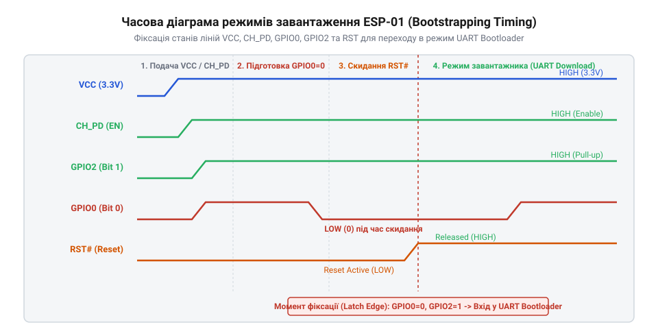
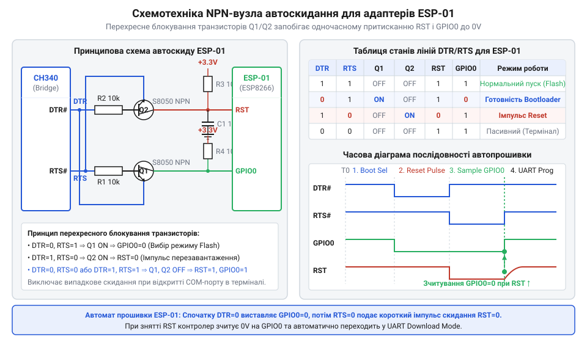
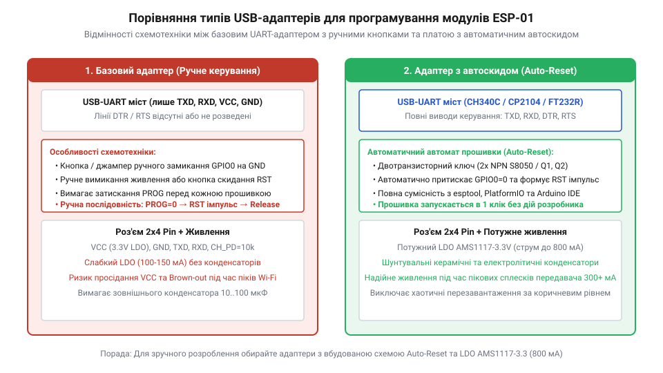

# esp-01-programmer-adapters

<preknowlist>
- [Конфігураційні виводи завантаження ESP8266](root:cat-hw-boards/esp8266-boot-strapping-pins) — електричні рівні на виводах GPIO0, GPIO2 та GPIO15 під час скидання для вибору режиму UART-завантаження
- [ESP-01 (Wi-Fi, ESP8266)](root:cat-hw-boards/esp-01) — цокольовка роз'єму 2x4, призначення сигналів CH_PD, RST, TX, RX та особливості схеми підтяжки
- [Режими завантаження мікроконтролера ESP8266](root:cat-hw-boards/esp8266-boot-modes) — комбінації логічних рівнів для переходу мікроконтролера між режимами виконання з флеш-пам'яті та завантаження через UART
</preknowlist>

## Проблема надійного прошивання модулів ESP-01

Спроба запрограмувати планарний модуль [ESP-01](root:cat-hw-boards/esp-01) за допомогою звичайного перетворювача @@en|USB-UART@@ (від англ. *Universal Serial Bus* та *Universal Asynchronous Receiver-Transmitter*) найчастіше закінчується помилкою зв'язку в консольній утиліті @@en|esptool@@. На відміну від повнорозмірних платок, цей модуль позбавлений зовнішніх підтягувальних резисторів на сигнальних лініях та схем автоматичного скидання. У момент зняття низького рівня з виводу скидання `RST` системний завантажувач @@en|ROM Bootloader@@ (від англ. *Read-Only Memory bootstrap loader*) зчитує логічні рівні на виводах `GPIO0`, `GPIO2` та `GPIO15` за допомогою апаратної засувки (англ. @@en|latch@@). Якщо ці виводи перебувають у підвішеному стані, мікроконтролер помилково обирає режим виконання програми замість прийому прошивки. Додатково слабкі внутрішні стабілізатори USB-мостів не здатні покрити пікове споживання струму, через що процесор перезавантажується під час спроби запису. Для надійного програмування необхідний спеціалізований адаптер, що вирівнює рівні та забезпечує стабільне живлення для [оновлення прошивки ESP-01](root:cat-hw-boards/esp01-firmware-flashing).

## Вимоги до сигнальних ліній завантаження

Активація режиму програмування вимагає чіткої комбінації логічних рівнів: `GPIO0 = 0` (притискання до землі), `GPIO2 = 1` та `CH_PD = 1` (підтяжка до 3.3 В), що детально висвітлюють [конфігураційні виводи завантаження](root:cat-hw-boards/esp8266-boot-strapping-pins).

*Часова діаграма сигнальних ліній ESP-01 під час скидання.*

При вимкненому джерелі 3.3 В високий потенціал 5 В на лініях `TX` чи `RX` викликає паразитне живлення (англ. @@en|phantom power@@): струм витече через захисні @@en|ESD@@-діоди (від англ. @@en|Electrostatic Discharge@@ — електростатичний розряд) на внутрішню шину живлення, підживлюючи [архітектуру SoC ESP8266](root:cat-hw-boards/esp8266-soc-architecture-overview). Запобігають хибним перезапускам та пошкодженню вхідних каскадів послідовні резистори 1 кОм або дільники напруги 1 кОм / 2 кОм, які знижують сигнали 5 В до безпечних 3.3 В.

## Особливості живлення при пікових струмах

Під час ініціалізації радіотракту модуль споживає імпульсні струми до 500 мА, як зазначає [огляд сімейства Wi-Fi модулів](root:cat-hw-boards/esp-01-module-family-overview). Вбудовані регулятори USB-мостів CH340 чи CP2102 видають лише 25–100 мА, тому напруга просідає нижче 2.8 В, викликаючи апаратне скидання @@en|Brown-out Reset@@ (від англ. *brownout* — просідання напруги).

Для стабілізації встановлюють окремий регулятор @@en|LDO@@ (англ. *Low Drop-Out*) AMS1117-3.3 до 800 мА. Паралельно живленню розпаюють танталовий конденсатор 10–100 мкФ та керамічний шунт 0.1 мкФ з низьким опором (англ. @@en|ESR@@ — *Equivalent Series Resistance*), який згладжує високочастотні провали напруги й захищає процес запису мікросхеми @@en|SPI Flash@@.

## Апаратний автомат автоскидання на транзисторах

Щоб уникнути ручного натискання кнопок при прошиванні, використовують автомат @@en|Auto-Reset@@ на двох @@en|NPN-транзисторах@@ та лініях @@en|DTR@@ і @@en|RTS@@.

*Схема двотранзисторного вузла автоматичного керування лініями RST та GPIO0 від виходів DTR і RTS.*

Вузол працює фазово: спочатку `RTS=1` відкриває `Q1`, розряджаючи `RST` на землю. Потім утиліта ставить `DTR=1` та `RTS=0`, що відкриває `Q2` і притискає `GPIO0` до землі під час відновлення напруги на `RST`. Постійна часу `RC`-ланцюга скидання (`τ = R · C ≈ 1 мс` при 10 кОм і 100 нФ) гарантує утримання `GPIO0` у нулі понад 0.93 мс для фіксації стану засувкою. Після прошивання транзистори закриваються, і модуль обирає [режими завантаження мікроконтролера](root:cat-hw-boards/esp8266-boot-modes) для запуску програми.

## Вибір адаптерів та усунення збоїв

Готові адаптери для модулів [ESP-01S](root:cat-hw-boards/esp-01s) поділяються на три основні види: бюджетні жовті плашки без кнопок, чорні адаптери з тактовими кнопками та повноцінні програматори з транзисторами автоскидання.

*Порівняльна схема компонування бюджетних плашок без автоскиду та спеціалізованих програматорів з кнопками й транзисторами.*

Жовті адаптери вимагають доопрацювання дрібними провідниками або кнопками, тоді як чорні адаптери з кнопками дозволяють вручну утримувати `GPIO0` під час натискання `RESET`. Найзручнішими є авто-програматори, що підтримують режим `nodemcu` у середовищі розробки. При виникненні помилок `Timed out waiting for packet header` першочергово перевіряють наявність 3.3 В на `CH_PD`, заземлення `GPIO0` при старті та вибирають режим флеш-пам'яті `dout` замість `qio` для запобігання фатальним циклічним скиданням.
