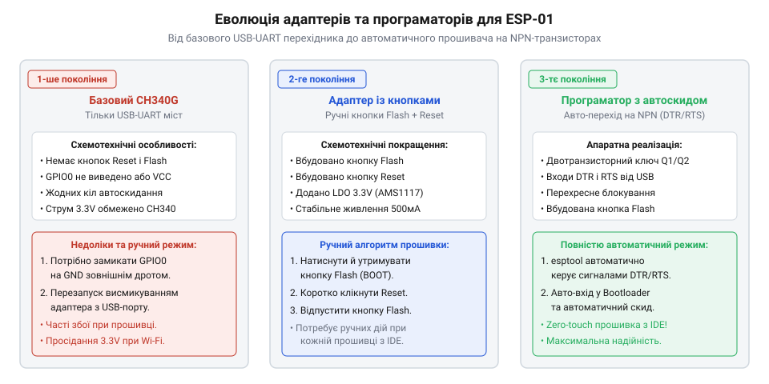
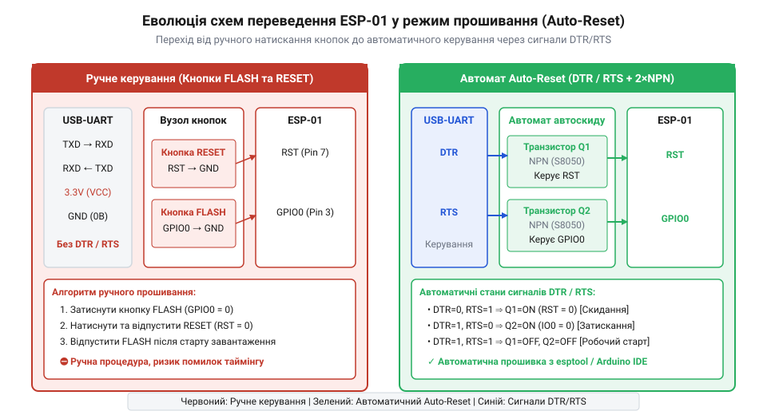

# Еволюція засобів програмування та плашок-адаптерів для ESP-01

<preknowlist>
- [ESP-01 (Wi-Fi, ESP8266)](root:cat-hw-boards/esp-01) — цокольовка виводів та базові електричні вимоги до живлення модуля
- [Режими завантаження мікроконтролера ESP8266](root:cat-hw-boards/esp8266-boot-modes) — логічні рівні на виводах GPIO0, GPIO2 та MTDO для входу у режим прошивки
- [Конфігураційні виводи завантаження ESP8266](root:cat-hw-boards/esp8266-boot-strapping-pins) — призначення та правила підтяжки підтягувальних резисторів ліній керування
</preknowlist>

## Саморобні схеми на макетних платах

У серпні 2014 року вихід компактного бездротового мікромодуля @@en|ESP-01@@ на базі чипа @@en|ESP8266@@ спричинив справжній фурор серед розробників електроніки. За ціною менше двох доларів інженери отримали повноцінний мікроконтролер із підтримкою @@en|Wi-Fi@@. Проте спроба швидко зібрати прототип на безпайковій макетній платі (англ. @@en|breadboard@@ — дошка для різання хліба, що стала синонімом макетної плати) одразу впиралася в схемотехнічні та конструктивні бар'єри. Роз'єм модуля має дворядний крок 2.54 мм у форматі 2×4 виводи, що унеможливлює його пряме встановлення на стандартний @@en|breadboard@@: штирі перекривають обидва боки центрального розділювача плати й закорочують протилежні контакти.

Першим викликом для інженерів стало живлення. Мікроконтролер @@en|ESP8266@@ працює від напруги 3.3 В і під час пікових сплесків випромінювання @@en|Wi-Fi@@ споживає імпульсний струм до 300–400 мА. Більшість популярних на той час перетворювачів @@en|USB-UART@@ на базі мікросхем @@en|FT232@@ чи @@en|PL2303@@ мали внутрішні регулятори @@en|LDO@@ (англ. @@en|Low Dropout@@ — з малим падінням напруги), розраховані лише на 20–50 мА. Спроби заживити [плата ESP-01](root:cat-hw-boards/esp-01) напряму від виводу 3.3 В перетворювача призводили до циклічних перезавантажень пристрою (англ. @@en|brownout reset@@). Розробникам доводилося будувати окремі схеми живлення з зовнішніми лінійними стабілізаторами @@en|AMS1117-3.3@@ та громіздкими блоками фільтруючих конденсаторів.

Друга фундаментальна проблема полягала в неузгодженості логічних рівнів. Переважна більшість адаптерів @@en|USB-UART@@ мала 5-вольтову логіку на лінії @@en|TX@@, тоді як входи @@en|ESP8266@@ не мали захисту від такої напруги. Без застосування резистивних дільників напруги або двонаправлених конвертерів рівнів виводи модуля швидко виходили з ладу. До того ж, аби перевести мікроконтролер у режим завантажувача (англ. @@en|bootloader@@ — програма початкового завантаження), вимагалося суворе дотримання послідовності сигналів: вивід @@en|GPIO0@@ слід було притягнути до землі, після чого подати короткий імпульс низького рівня на лінію @@en|RESET@@. Будь-який деренч контактів на макетній платі скидав [режими завантаження ESP8266](root:cat-hw-boards/esp8266-boot-modes), змушуючи розробника повторювати ручну комутацію знову й знову. Через складність цієї обв'язки та ненадійність ненадійних дільників виникла нагальна потреба у спеціалізованому компактному інструменті для підключення.

Додатковим джерелом помилок виступала необхідність одночасної підтяжки інших службових виводів модуля. Щоб мікроконтролер взагалі стартував, лінію увімкнення @@en|CH_PD@@ (англ. @@en|Chip Power Down@@) та вивід @@en|GPIO2@@ необхідно було притягнути до шини 3.3 В через зовнішні підтягувальні резистори (англ. @@en|pull-up resistor@@ — резистор, що підтягує потенціал до живлення). Якщо ці [конфігураційні виводи завантаження ESP8266](root:cat-hw-boards/esp8266-boot-strapping-pins) залишалися у висячому стані, пристрій хаотично зависав або відмовлявся виконувати завантажений код. Спроби зібрати подібне обв'язування на провідниках створювали на макетній платі справжні "павутиння" з резисторів та кнопок, де будь-який рух плати спричиняв розрив кола. Саме ця електрична та механічна ненадійність саморобних схем у 2014–2015 роках змусила спільноту розробників шукати шляхи апаратної інтеграції всіх необхідних дільників, підтяжок та роз'ємів на єдину друковану плату.

## Перші жовті та чорні USB-плашки

Масовий запит спільноти на спрощення роботи з модулем спонукав китайських виробників випустити у 2015 році перші серійні адаптери. Вони являли собою компактні друковані плати із USB-вилкою з одного боку та відповідним 8-контактним роз'ємом для @@en|ESP-01@@ з іншого. Найпоширенішими стали жовті та чорні плашки на базі мікросхем перетворювачів @@en|CH340G@@ та @@en|CP2102@@. Плати вирішили критичну проблему живлення, оскільки містили виділений стабілізатор @@en|AMS1117-3.3@@, який забезпечував достатній струм для стабільної роботи безпровідного тракту.

Однак перші серійні плашки мали принциповий конструктивний недолік: їх розробляли виключно як адаптери зв'язку для передачі @@en|AT-команд@@ через послідовний порт, а не як програматори. Лінія @@en|GPIO0@@ на них була жорстко підтягнута до лінії живлення 3.3 В (або залишалася підвішеною через [підтяжки виводів завантаження](root:cat-hw-boards/esp8266-boot-strapping-pins)), а лінія @@en|RESET@@ з'єднувалася з VCC. На платі повністю були відсутні кнопки керування або апаратна обв'язка для виклику скидання. У результаті підключений модуль завжди запускався у режимі виконання основної програми з @@en|flash-пам'яті@@, а виконати [процес прошивання ESP-01](root:cat-hw-boards/esp01-firmware-flashing) без апаратного втручання було неможливо.

*Порівняння конструкції та схемотехніки перших безкнопкових USB-адаптерів, кустарних модифікацій із кнопками та сучасних плашок з автоскидом.*

Щоб прошити модуль через таку плашку, радіоаматорам доводилося вдаватися до самостійних модифікацій. Найпопулярнішим доопрацюванням стало підпаювання тактової кнопки між виводом @@en|GPIO0@@ та землею або виведення окремого джампера (англ. @@en|jumper@@ — перемичка). Схема процедури вимагала затискання кнопки при включенні адаптера в USB-порт комп'ютера або короткого замикання контакту @@en|RESET@@ на мікросхемі перетворювача. Такий кустарний підхід усував потребу в макетній платі, але вимагав спритності рук і прискорював знос механічних роз'ємів комп'ютера через постійне перепідключення плашки.

## Винахід двотранзисторної схеми автоскидання

Необхідність щоразу тиснути кнопки чи переставляти перемички гальмувала автоматизоване розроблення та тестування софту. Рішення створила відкрита спільнота розробників під час створення платформ на кшталт @@en|NodeMCU@@. Ідея полягала у використанні допоміжних службових сигналів послідовного порту @@en|DTR@@ (англ. @@en|Data Terminal Ready@@ — готовність термінала даних) та @@en|RTS@@ (англ. @@en|Request to Send@@ — запит на передачу) для автоматичного формування потрібної послідовності на виводах @@en|RESET@@ та @@en|GPIO0@@.

Пряме підключення ліній @@en|DTR@@ і @@en|RTS@@ до мікроконтролера виявилося непридатним. При відкритті COM-порту операційною системою або терміналом обидва сигнали одночасно переходять у низький логічний рівень, що викликало б небажане скидання модуля під час звичайного моніторингу через послідовний порт. Для вирішення цього завдання було розроблено елегантну схему на двох @@en|NPN-транзисторах@@ (наприклад, @@en|S8050@@ або @@en|2N3904@@). Логіка її роботи побудована на перехресному керуванні: бази транзисторів підключені до службових ліній через обмежувальні резистори, а емітери відкриваються лише тоді, коли протилежний сигнал перебуває у високому стані.

*Схемотехніка двотранзисторного вузла автоматичного керування виводами RESET та GPIO0 за допомогою сигналів DTR і RTS.*

Коли програма-програматор (як-от @@en|esptool.py@@ в середовищі @@en|Arduino IDE@@) починає завантаження прошивки, вона спочатку притягує @@en|RTS@@ до низького рівня, що відкриває транзистор керування @@en|GPIO0@@ і притягує його до землі. Потім імпульс на лінії @@en|DTR@@ через другий транзистор коротить @@en|RESET@@ на землю, після чого @@en|RESET@@ відпускається при утриманому @@en|GPIO0@@. Мікроконтролер надійно входить у режим завантажувача. Після закінчення завантаження обидва сигнали повертаються у високий стан, що дозволяє вивчити [архітектури SoC ESP8266](root:cat-hw-boards/esp8266-soc-architecture-overview) у нормальному режимі роботи. Ця двотранзисторна схема стала світовим стандартом, інтегрованим у всі сучасні плашки-програматори для [сімейства модулів ESP-01](root:cat-hw-boards/esp-01-module-family-overview).

## Сучасні адаптери зі вбудованими кнопками

Подальша еволюція засобів програмування пройшла шлях від аматорських доробків до уніфікованих фабричних рішень. Сучасні адаптери для модулів [ESP-01 (Wi-Fi, ESP8266)](root:cat-hw-boards/esp-01) розділилися на два основні конструктивні класи: повністю автоматичні програматори із вбудованими транзисторними каскадами автоскидання та адаптери з двопозиційними тумблерами (@@en|toggle switch@@ (від англ. *toggle switch* — тумблерний перемикач)). У моделях із тумблером перемикач "UART / PROG" у режимі програмування фізично з'єднує лінію GPIO0 із землею, а в робочому режимі підтягує її до 3.3 В, залишаючи лінії даних вільними для обміну AT-командами.

Крім зручності перемикання режимів, у сучасних адаптерах вирішено проблему паразитного живлення (@@en|parasitic powering@@ (від англ. *parasitic powering* — паразитне живлення)). У ранніх схемах при вимкненні основної шини 3.3 В струм із ліній TX та RX комп'ютера протікав через захисні діоди (@@en|ESD diode@@ (від англ. *Electrostatic Discharge* — діод захисту від електростатичного розряду)) мікроконтролера в шину VCC. Це викликало часткове зависання чипу й унеможливлювало чистий холодний перезапуск. Сучасні плашки включають діод Шотткі (@@en|Schottky diode@@ (від англ. *Schottky diode* — діод з малим падінням напруги)) або буферні узгоджувачі рівнів на лініях даних, що блокують зворотний витік струму.

Підбір конкретної модифікації адаптера залежить від завдань розробника. Для швидкої автоматизованої прошивки з середовищ розробки найзручнішими є автоматичні програматори з транзисторною схемою. Для тривалого автономного налагодження або підключення периферійних датчиків краще обирати плашки з тумблером та виведеними дублюючими роз'ємами GPIO.

Завдяки апаратній стандартизації сучасних плашок процес розробки для модуля [ESP-01 (Wi-Fi, ESP8266)](root:cat-hw-boards/esp-01) остаточно позбувся нестабільності перших макетних схем. Автоматичне маніпулювання логічними рівнями дозволяє легко інтегрувати пристрій у конвеєри тестування, де [оновлення прошивки ESP-01](root:cat-hw-boards/esp01-firmware-flashing) виконується повністю програмно без ручного натискання кнопок. Напрацьований досвід побудови цих адаптерів сформував фундаментальні принципи схемотехнічного узгодження живлення та ліній зневадження, які стали стандартом для всієї індустрії бездротових мікроконтролерів.

## Міфи та помилкові уявлення екосистеми

Тривала історія розвитку плашок-адаптерів породила низку стійких апаратних міфів. Найпоширенішою помилкою є твердження про повну тотожність модулів ESP-01 та [модулів ESP-01S](root:cat-hw-boards/esp-01s) щодо вимог до програматора. В оригінальному модулі ESP-01 підтягувальні резистори на лініях GPIO0, GPIO2 та CH_PD були відсутні, тому на ранніх адаптерах без зовнішніх резисторів модуль не міг запуститися. У версії ESP-01S виробник інтегрував чип-резистори на 10 кОм безпосередньо на друковану плату модуля, завдяки чому ESP-01S працює навіть на найпростіших плашках, де класичний ESP-01 зависає.

Другий міф переконує, що для стабільного прошивання достатньо будь-якого USB-порту без додаткового фільтраційного обв'язування. У момент увімкнення радіопередавача ESP8266 споживає імпульсний струм тривалістю в мікросекунди. За відсутності розв'язувального конденсатора (@@en|decoupling capacitor@@ (від англ. *decoupling capacitor* — розв'язувальний конденсатор)) ємністю 10–100 мкФ безпосередньо біля роз'єму модуля, індуктивність USB-кабелю спричиняє високочастотне просідання напруги, що призводить до випадкових збоїв запису флеш-пам'яті.

Третій міф полягає у безпечності прямого підключення 5-вольтових TX-сигналів USB-перетворювача до входу RX. Хоча мікроконтролер може не згоряти відразу, тривала експлуатація при напрузі 5 В викликає деградацію затворів транзисторів кристала, спричиняючи підвищене тепловиділення та незворотний вихід з ладу.
