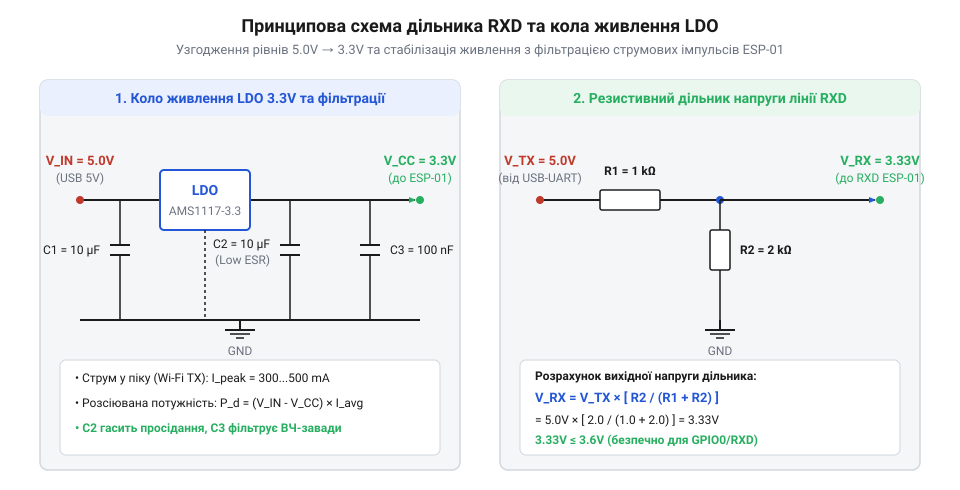

# Розрахунок параметрів живлення та дільників напруги узгодження рівнів

<preknowlist>
- [ESP-01 (Wi-Fi, ESP8266)](root:cat-hw-boards/esp-01) — електричні характеристики виводів, номінальну напругу живлення 3.3V та пікове споживання струму передавача Wi-Fi
- [Огляд сімейства Wi-Fi модулів ESP-01 та ESP-01S](root:cat-hw-boards/esp-01-module-family-overview) — призначення контактів цокольовки RXD, TXD, VCC, GND та вхідні електричні рівні
</preknowlist>

## Проблема живлення та сигнальних рівнів

При прямому з'єднанні компактного бездротового модуля [ESP-01 (Wi-Fi, ESP8266)](root:cat-hw-boards/esp-01) із класичними 5-вольтовими мостами @@en|USB-UART@@ виникає дві критичні схемотехнічні проблеми: електрична перенапруга сигнальних ліній та гостра нестача струму живлення. Вхідний вивід `RXD` мікроконтролера @@en|ESP8266@@ розрахований на номінальну логічну напругу 3.3V із максимально допустимою межею 3.6V. Подача потенціалу 5.0V безпосередньо з виходу `TXD` моста USB-UART викликає протікання паразитного струму через внутрішні захисні діоди виводу на шину живлення, що призводить до деградації напівпровідникової структури та незворотного виходу з ладу порту введення-виведення.

Другим деструктивним чинником є імпульсний характер споживання струму бездротовим передавачем @@en|Wi-Fi@@ та прямий паразитний витік струму через сигнальні лінії. При прямому з'єднанні 5-вольтового виходу `TXD` моста з входом `RXD` мікроконтролера вихідний опір драйвера моста `R_out ≈ 100 Ом` викликає відкриття внутрішнього захисного @@en|ESD-діода@@ (від англ. @@en|Electrostatic Discharge@@ — захист від електростатичного розряду) при досягненні порогу `VCC + V_D ≈ 3.3V + 0.6V = 3.9V`. При вихідній напрузі 5.0V прямому струмовій витік обчислюється як `I_leak = (5.0V - 3.9V) / 100 Ом = 11 мА`, що у декілька разів перевищує допустимий поріг 2 мА для захисних структур @@en|ESP8266@@ та веде до локального перегріву й деградації кристала. Водночас під час відправлення пакетів даних струм споживання модуля зростає від базових 70 мА до пікових 300–500 мА тривалістю в десятки мікросекунд. Прості 5-вольтові адаптери або вбудовані лінійні стабілізатори (англ. *low dropout*, @@en|LDO@@ — стабілізатор із малою різницею напруг) мостів USB-UART нерідко обмежені вихідним струмом 100–150 мА. Внаслідок цього на шині живлення модуля `VCC` виникають глибокі просідання напруги нижче допустимого порогу 2.7V, що викликає апаратне перезавантаження пристрою — @@en|brownout reset@@ (англ. *brownout*, падіння напруги живлення нижче норми).

Крім того, при використанні неоптимального стабілізатора з високою вхідною напругою (наприклад, 5.0V з шини @@en|USB@@) надлишок напруги перетворюється на теплову потужність `P_d`. При піковому струмі передавача недостатня площа розсіювання тепла призводить до перегріву й спрацьовування термозахисту стабілізатора. Для забезпечення стабільного зв'язку та тривалої експлуатації необхідно провести математичний розрахунок параметрів резистивного дільника рівнів і кіл буферизації живлення.

Систематичний аналіз цих апаратних обмежень визначає чіткий порядок розрахунку електричного кола. Спочатку обчислюються номінали резисторів дільника напруги для збереження крутизни фронтів сигналу `RXD`, після чого розраховується допустима площа розсіювання тепла стабілізатора @@en|LDO@@ та мінімальна ємність вихідного фільтра для придушення імпульсних просідань напруги при [оновленні прошивки ESP-01](root:cat-hw-boards/esp01-firmware-flashing). Лише комплексний підхід до узгодження сигнальних і силових кіл гарантує відсутність помилок передачі даних та перезавантажень модуля під час пікового навантаження.

## Розрахунок резистивного дільника лінії RXD

Для безпечного зниження амплітуди логічного сигналу 5.0V з виходу `TXD` моста USB-UART до рівня 3.3V на вході `RXD` модуля використовується симетричний або несиметричний резистивний дільник напруги. Схема складається з верхнього плеча з опором `R_1` та нижнього плеча `R_2`, увімкненого між лінією `RXD` і спільною землею `GND`.


*Принципова та еквівалентна схема дільника напруги та кола живлення LDO з фільтраційними конденсаторами.*

Вихідна напруга дільника `V_out` в режимі холостого ходу без урахування вхідного опору порту обчислюється за базовим співвідношенням:

```
V_out = V_in × (R_2 / (R_1 + R_2))
```

Необхідний коефіцієнт ділення `K_d` для узгодження рівнів 5.0V в 3.3V дорівнює:

```
K_d = V_out / V_in
= 3.3 / 5.0                   [підстановка цільових напруг]
= 0.66                        [коефіцієнт передачі дільника]
```

Звідси отримуємо базове співвідношення між опорами `R_1` та `R_2`:

```
R_2 / (R_1 + R_2) = 0.66
=> R_2 = 0.66 × R_1 + 0.66 × R_2
=> 0.34 × R_2 = 0.66 × R_1
=> R_2 = 1.941 × R_1
```

Обираючи практичні номінали зі стандартного ряду Е24, доцільно взяти `R_1 = 1.0` кОм та `R_2 = 2.0` кОм (або `R_1 = 1.2` кОм та `R_2 = 2.4` кОм). Проведемо розрахунок вихідної напруги для парних номіналів `R_1 = 1.0` кОм та `R_2 = 2.0` кОм:

```
V_out = 5.0 × (2000 / (1000 + 2000))
= 5.0 × (2000 / 3000)          [підстановка номіналів R_1 та R_2]
= 5.0 × 0.6667                 [обчислення коефіцієнта ділення]
= 3.33 V                       [напруга логічної одиниці на вхідному виводі]
```

Отримане значення 3.33V ідеально вкладається в допустимий діапазон логічної одиниці мікроконтролера (2.5V...3.6V). З іншого боку, еквівалентний опір дільника `R_eq = (R_1 × R_2) / (R_1 + R_2)` разом із паразитною ємністю монтажу `C_p` (близько 15–30 пФ) створює фільтр низьких частот із постійною часу `τ = R_eq × C_p`. При виборі занадто великих номіналів (`R_1 > 10` кОм) зростає тривалість фронту сигналу, що спотворює передачу даних на високих швидкостях @@en|UART@@ (понад 115200 бод). Для обраних номіналів `R_1 = 1.0` кОм та `R_2 = 2.0` кОм еквівалентний опір дорівнює `R_eq = 666.7` Ом. За ємності `C_p = 20` пФ гранична частота зрізу утвореного @@en|RC-фільтра@@ обчислюється як:

```
f_c = 1 / (2 × π × R_eq × C_p)
= 1 / (2 × 3.1416 × 666.7 × 20 × 10⁻¹²)      [підстановка параметрів R_eq та C_p]
= 11.93 MHz                                   [гранична частота зрізу дільника]
```

Значення 11.93 МГц суттєво перевищує спектральний склад сигналів @@en|UART@@, що гарантує відсутність спотворень фронтів навіть при максимальній швидкості обміну. Крім того, високий вхідний опір виводу `RXD` на [модулі ESP-01](root:cat-hw-boards/esp-01) (`R_in` близько 1 МОм) шунтує нижнє плече `R_2 = 2.0` кОм, знижуючи його до еквівалентного значення `R_2' = (R_2 × R_in) / (R_2 + R_in) = 1.996` кОм. Таке несуттєве відхилення (менше 0.2%) зміщує вихідну напругу логічної одиниці лише до 3.328V, що не впливає на стабільність розпізнавання логічних рівнів.

## Тепловий розрахунок лінійного стабілізатора LDO

Живлення модуля [ESP-01S (Wi-Fi, ESP8266)](root:cat-hw-boards/esp-01s) здійснюється через лінійний стабілізатор LDO, який знижує вхідну напругу адаптера `V_in` (наприклад, 5.0V з порту USB) до номінальних 3.3V. Рівняння енергетичного балансу лінійного стабілізатора показує, що весь надлишок напруги розсіюється у вигляді тепла:

```
P_d = (V_in - V_out) × I_out + V_in × I_q
```

де `P_d` — розсіювана теплова потужність у ватах, `V_in` — вхідна напруга, `V_out = 3.3` V — вихідна напруга, `I_out` — струм навантаження, `I_q` — власний струм споживання стабілізатора (англ. *quiescent current*, зазвичай менше 5 мА, яким при обчисленнях можна знехтувати).

Під час активної передачі даних бездротовим модулем середній струм споживання `I_avg` складає 120 мА, а піковий струм `I_peak` досягає 400 мА. Обчислимо розсіювану потужність на стабілізаторі типу AMS1117-3.3 у корпусі SOT-223 при живленні від 5.0V:

```
P_d_avg = (5.0 - 3.3) × 0.120
= 1.7 × 0.120                  [різниця вхідної та вихідної напруг]
= 0.204 W                      [середня теплова потужність]

P_d_peak = (5.0 - 3.3) × 0.400
= 1.7 × 0.400                  [різниця напруг при піковому струмі]
= 0.680 W                      [пікова розсіювана потужність]
```

Температура напівпровідникового кристала стабілізатора `T_j` (англ. *junction temperature*) визначається за формулою теплового опору:

```
T_j = T_a + (P_d × R_thJA)
```

де `T_a` — температура навколишнього середовища (приймемо 25 °C), `R_thJA` — тепловий опір кристал-середовище для корпусу SOT-223 без масивного мідного радиатора (близько 90 °C/W). Обчислимо температуру кристала при тривалому середньому навантаженні:

```
T_j = 25 + (0.204 × 90)
= 25 + 18.36                   [перегрів кристала відносно середовища]
= 43.36 °C                     [робоча температура кристала]
```

Якщо ж вхідна напруга адаптера зросте до 12V (наприклад, при живленні від бортової мережі), розсіювана потужність при струмі 120 мА зросте відповідно:

```
P_d_12V = (12.0 - 3.3) × 0.120
= 8.7 × 0.120                  [падіння напруги 8.7V]
= 1.044 W                      [критична теплова потужність]

T_j_12V = 25 + (1.044 × 90)
= 25 + 93.96                   [перегрів понад 93 °C]
= 118.96 °C                    [температура кристала близька до межі спрацьовування захисту]
```

Отже, для стабілізаторів LDO в адаптерах ESP-01 вхідна напруга не повинна перевищувати 5.0–6.0V, інакше виникає тепловий розгін і вимикання модуля.

## Розрахунок ємності згладжувальних конденсаторів

Імпульси струму споживання передавача Wi-Fi мають крутий фронт наростання (менше 1 мкс) і тривалість `Δt` від 20 до 100 мікросекунд. Лінійний стабілізатор LDO через обмежену швидкість наростання вихідного струму (англ. *transient response time*) не встигає миттєво відреагувати на такий стрибок, що призводить до падіння вихідної напруги. Для компенсації цього ефекту паралельно лінії `VCC` модуль потребує встановлення накопичувальних і фільтраційних конденсаторів.

Необхідна ємність накопичувального конденсатора `C` обчислюється з базового рівняння розряджання ємності постійним струмом `I_peak` за час `Δt` при максимально допустимому просіданні напруги `ΔV`:

```
C = (I_peak × Δt) / ΔV
```

Припустимо, що імпульс струму `I_peak = 300` мА триває `Δt = 50` мкс, а допустиме падіння напруги на шині 3.3V не повинно перевищувати `ΔV = 0.1` V (щоб напруга не опустилася нижче критичного порогу 3.2V). Обчислимо необхідну ємність:

```
C = (0.300 × 50 × 10⁻⁶) / 0.1
= (15 × 10⁻⁶) / 0.1            [обчислення переданого заряду Q = I × t]
= 150 × 10⁻⁶ F                 [необхідна розрахункова ємність]
= 150 μF                       [значення ємності в мікрофарадах]
```

Окрім номінальної ємності, критичним параметром є еквівалентний послідовний опір (англ. *equivalent series resistance*, @@en|ESR@@). Спад напруги на власному опорі конденсатора `ΔV_esr` під час піку струму додається до ємнісного просідання:

```
ΔV_total = ΔV_c + ΔV_esr
= ΔV_c + (I_peak × ESR)
```

Якщо використати звичайний алюмінієвий електролітичний конденсатор із високим `ESR = 1.5` Ом, то спад напруги лише на внутрішньому опорі складе `0.300 A × 1.5 Om = 0.45` V, що миттєво викличе [перезавантаження ESP8266](root:cat-hw-boards/esp8266-boot-modes). Тому в схемах живлення адаптерів застосовують паралельне увімкнення двох типів конденсаторів:

1. Танталовий або полімерний конденсатор ємністю 47–100 мкФ із низьким `ESR < 0.2` Ом для збереження енергетичного буфера.
2. Керамічний конденсатор типу X7R/X5R ємністю 0.1–1.0 мкФ із наднизьким `ESR < 0.01` Ом, розміщений безпосередньо біля контактів `VCC` та `GND` модуля для шунтування високочастотних завад.

Таке комбіноване фільтрування гарантує стабільність напруги живлення модуля при будь-яких режимах бездротового зв'язку.
