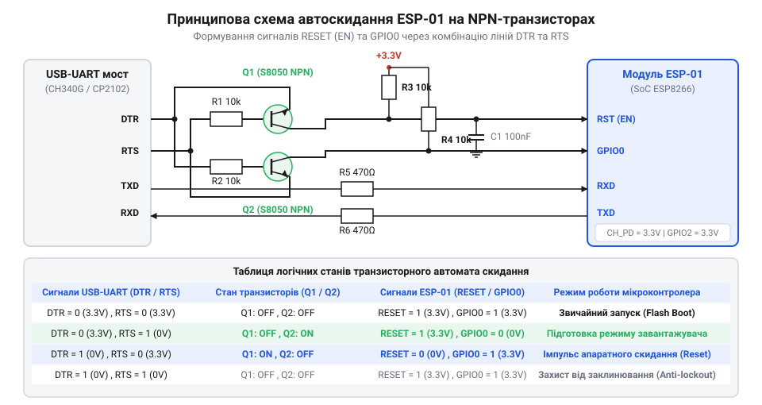
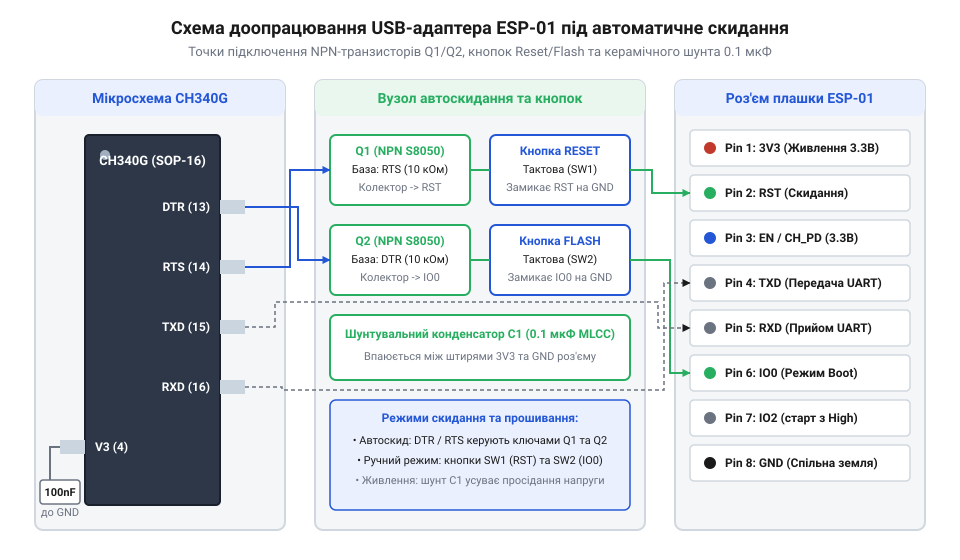

# Модифікація базового USB-адаптера ESP-01 до повного програматора з автоскидом

<preknowlist>
- [ESP-01 (Wi-Fi, ESP8266)](root:cat-hw-boards/esp-01) — цокольовку виводів, призначений рівень живлення 3.3 В та обмеження струму GPIO модуля ESP-01
- [Режими завантаження мікроконтролера ESP8266](root:cat-hw-boards/esp8266-boot-modes) — комбінації логічних рівнів на виводах GPIO0, GPIO2 та GPIO15 для переведення у режим UART-завантаження прошивки
- [Оновлення прошивки та прошивання ESP-01](root:cat-hw-boards/esp01-firmware-flashing) — базовий процес завантаження бінарних файлів прошивки через послідовний порт за допомогою інструменту esptool
</preknowlist>

## Проблема ручного перемикання режимів адаптера

Бюджетні мости @@en|USB-UART@@, розроблені для прошивання компактних [модулів ESP-01](root:cat-hw-boards/esp-01), за замовчуванням випускаються у спрощеній схемотехнічній конфігурації. У таких перехідниках сигнальний вивід `GPIO0` залишається підтягнутим до шини живлення `VCC` або перебуває у вільному стані, через що пристрій кожного разу стартує у звичайному режимі виконання програми з флеш-пам'яті. Щоб перевести мікроконтролер у режим завантажувача, розробникові доводиться вручну замикати вивід `GPIO0` на спільний провід `GND` перед подачею живлення або при перезапуску через вивід `RST`, про що описують [режими завантаження ESP8266](root:cat-hw-boards/esp8266-boot-modes).

Постійне маніпулювання перемичками або використання пінцета для тимчасового замикання контактів створює суттєві труднощі під час активного налагодження коду. Неточний момент замикання чи виникнення брязкоту контактів призводить до того, що завантажувач чипа втрачає синхронізацію рукостискання утиліти @@en|esptool@@. Крім того, при частому механічному підключенні пінцета зростає ризик виникнення короткого замикання між сусідніми виводами живлення 3.3V та 5V, що спричиняє пошкодження порту @@en|USB@@ або вихід із ладу самого модуля. Для усунення цих недоліків необхідна апаратна модифікація адаптера, яка автоматизує встановлення логічних рівнів на виводах за допомогою керувальних ліній послідовного інтерфейсу при кожному [оновленні прошивки ESP-01](root:cat-hw-boards/esp01-firmware-flashing).

Електрична небезпека ручного заземлення полягає у фізичному влаштуванні кіл підтяжки звичайних перехідників. У заводських платах вивід `GPIO0` часто під'єднаний безпосередньо до лінії живлення 3.3 В або підтягнутий низькоомним резистором. Якщо утримувати цей контакт притиснутим до заземлення `GND` тривалий час після завершення стадії защепкування завантажувача, виникає високий струмовий перевантажувальний контур. У разі, коли завантажена користувацька програма після старту переводить цей вивід у режим цифрового виходу з високим логічним рівнем, пряме заземлення створює коротке замикання вихідного каскаду. Струм, що перевищує максимально припустимі 12 мА, швидко перегріває напівпровідникову структуру внутрішніх комплементарних транзисторів @@en|CMOS@@ (від англ. @@en|Complementary Metal-Oxide-Semiconductor@@ — комплементарна структура метал-оксид-напівпровідник), викликаючи деградацію або незворотний електричний пробій вхідних буферів, що описує [архітектура SoC ESP8266](root:cat-hw-boards/esp8266-soc-architecture-overview). Шляхом усунення цієї загрози є використання транзисторних ключів з обмежувальними резисторами, які притискають вивід до нуля строго імпульсно у вікні фіксації стану.

Окрім ризику пошкодження вихідних каскадів, додатковим обмеженням більшості дешевих китайських перехідників є повна відсутність розводки модемних ліній керування @@en|DTR@@ (від англ. @@en|Data Terminal Ready@@ — готовність термінала) та @@en|RTS@@ (від англ. @@en|Request to Send@@ — запит на передачу) до роз'єму модуля. У заводській розводці друкованої плати мікросхема @@en|USB-UART@@ містка використовується лише для двопровідного обміну даними `TXD` і `RXD`, а допоміжні виводи залишаються непідключеними або взагалі не виведені на контактні площадки. При цьому фізична реалізація модифікації суттєво залежить від встановленого на платі чипа. У мікросхемі @@en|CH340G@@ у корпусі @@en|SOP-16@@ з кроком виводів 1.27 мм виводи `DTR#` (вивід 13) та `RTS#` (вивід 14) виходять на зовнішні ніжки корпусу, що дозволяє відносно легко підпаяти тонкі провідники безпосередньо до напівпровідникового елемента. Натомість мости @@en|CP2102@@ виконуються у безвивідному корпусі @@en|QFN-28@@ із кроком 0.5 мм, де лінії `DTR` (вивід 28) та `RTS` (вивід 24) часто сховані під черевом корпусу чи виведені на мікроскопічні перехідні отвори, вимагаючи високої точності мікропаяння. Через відсутність розводки цих активних низьких сигналів розробник позбавлений можливості автоматично узгоджувати тактування скидання з командами утиліти прошивання. Щоб усунути це обмеження й відмовитися від ручного маніпулювання живленням, виникає потреба в комплексному апаратному доопрацюванні плати: фізичному підпаюванні ліній `DTR` і `RTS` безпосередньо до виводів мікросхеми моста, додаванні тактових кнопок `Reset` і `Flash` та побудові транзисторної схеми узгодження станів, яку визначають [конфігураційні виводи завантаження ESP8266](root:cat-hw-boards/esp8266-boot-strapping-pins).

## Схемотехніка автоскиду на NPN транзисторах

Автоматичне переведення мікроконтролера в режим програмування реалізується за допомогою двох біполярних ключових елементів @@en|NPN@@ (англ. @@en|Negative-Positive-Negative@@ — структура напівпровідникового транзистора), які керуються сигнальними лініями @@en|DTR@@ (англ. @@en|Data Terminal Ready@@ — готовність терміналу даних) та @@en|RTS@@ (англ. @@en|Request To Send@@ — запит на передачу) моста @@en|USB-UART@@.


*Принципова схема формування сигналів RESET та GPIO0 за допомогою транзисторних ключів NPN.*

Схема працює за перехресною логікою, яка запобігає одночасному притисканню обох ліній до нуля під час програмного скиду: кожен транзистор `Q1` та `Q2` відкривається лише тоді, коли його база отримує логічний нуль від керувальної лінії через додатковий замикальний ключ, заблокований високим рівнем сусіднього сигналу. При цьому важливу роль відіграють обмежувальні резистори опором 10 кОм у колі бази кожного транзистора. При керувальній напрузі 3.3 В та спаді напруги базова-емітер `V_BE ≈ 0.7 В` струм бази становить `I_B = (3.3 - 0.7) / 10000 = 0.26 мА`. Оскільки для притискання ліній `GPIO0` або `RST` (підтягнутих резисторами 10 кОм до 3.3 В) потрібен струм колектора лише `I_C ≈ 0.33 мА`, малий струм бази з запасом забезпечує перехід біполярного транзистора в глибокий режим насичення з залишковою напругою `V_CE(sat) ≤ 0.1 В`. Така величина опорних опорів надійно захищає виходи @@en|USB-UART@@ містка від перевантаження за струмом і водночас гарантує повне відкривання ключів. Стабільність входження в завантажувач критично залежить від тривалості затримок перемикання транзисторів (зазвичай 50–100 мс у програмній послідовності сигналів `DTR` і `RTS`) та постійної часу розряджання ємності лінії `RST`. Електрична постійна часу `τ = R · C` (де `R = 10 кОм` — опори підтяжки до 3.3 В, а `C` — паразитна ємність монтажу й фільтрувальних конденсаторів) визначає швидкість спаду напруги. Якщо тривалість імпульсу відкривання транзистора `Q2` менша за потрібний час розряджання ємності `τ` (менше 100 мкс), потенціал на виводі `RST` не встигає опуститися нижче порогу спрацьовування компаратора скидання. Лише за достатньої тривалості низького рівня лінії `RST` та збереження стану `GPIO0 = 0` у момент її розблокування внутрішній [ROM-завантажувач чипа](root:cat-hw-boards/esp8266-boot-modes) гарантовано защепковує логічні рівні, які детально визначають [конфігураційні виводи завантаження](root:cat-hw-boards/esp8266-boot-strapping-pins).

1. Скидання у режим Bootloader: коли програмне забезпечення подає стан `DTR = 0` (активний низький рівень) та `RTS = 1` (високий рівень), транзистор `Q1` відкривається й притискає лінію `GPIO0` до `GND`. Наступний стан `DTR = 1` та `RTS = 0` відкриває транзистор `Q2`, який короткочасно підтягує лінію `RST` до `GND`.
2. Перехід до виконання програми: при поверненні обох ліній у неактивний стан `DTR = 0` та `RTS = 0` обидва транзистори закриваються. Напруга на лінії `RST` зростає до 3.3V через внутрішній резистор підтяжки, а лінія `GPIO0` зчитується завантажувачем як логічний нуль, що ініціює режим завантаження через @@en|UART@@.

Для реалізації цієї послідовності утиліти автоматизації прошивки маніпулюють станами керувальних ліній послідовного порту через системні виклики:

:::code proj-esp01-auto-reset-adapter-mod/py/flasher.py 34-64

З боку мікроконтролера стан лінії `RST` та логічний рівень виводу `GPIO0` перевіряються системним завантажувачем або низькорівневим кодом для діагностики причини скидання чипа:

:::code proj-esp01-auto-reset-adapter-mod/c/esp8266_reset.h 17-54

:::code proj-esp01-auto-reset-adapter-mod/c/main.c 54-85

:::code proj-esp01-auto-reset-adapter-mod/c/uart.h 34-62

## Монтаж тактових кнопок та конденсаторів

Окрім транзисторного автомата скиду, апаратне вдосконалення базового адаптера передбачає встановлення двох тактових кнопок @@en|Reset@@ та @@en|Flash@@ для зручного ручного керування та шунтувального керамічного конденсатора на лінію живлення `VCC`.


*Схема розміщення й з'єднання кнопок Reset/Flash, транзисторної збірки та шунтувального конденсатора на адаптері.*

Кнопка @@en|Reset@@ підключається паралельно між лінією `RST` та спільною землею `GND`, а кнопка @@en|Flash@@ — між `GPIO0` та `GND`. Це дає змогу перезапускати модуль вручну без від'єднання від порту @@en|USB@@. Окрему увагу при модифікації слід приділити буферизації живлення: під час увімкнення передавача @@en|Wi-Fi@@ імпульсне споживання струму сягає 300–500 мА, що у звичайних адаптерах викликає просідання напруги 3.3V та апаратний перезапуск @@en|brownout reset@@. Установка керамічного конденсатора ємністю 10 мкФ (або паралельно 10 мкФ та 100 нФ) безпосередньо на виводи роз'єму `VCC` та `GND` повністю ліквідує імпульсні завади. Вирішальну роль у стабілізації відіграє еквівалентний послідовний опір @@en|ESR@@ (від англ. @@en|Equivalent Series Resistance@@ — еквівалентний послідовний опір) накопичувального конденсатора. Звичайні електролітичні конденсатори з високим `ESR > 1.5 Ом` створюють суттєвий спад напруги `ΔV_ESR = ΔI · ESR` (до 0.6 В при сплеску `ΔI = 400 мА`), через що напруга на шині короткочасно падає нижче критичних 2.7 В. Натомість багатошарові керамічні конденсатори @@en|MLCC@@ (від англ. @@en|Multilayer Ceramic Capacitor@@ — багатошаровий керамічний конденсатор) із низьким опором `ESR < 0.05 Ом` реагують на мікросекундні фронти струму безвідмовно, утримуючи просідання в межах допустимих 20 мВ і захищаючи [модуль ESP-01](root:cat-hw-boards/esp-01) від спонтанних перезавантажень.

Для перевірки коректності монтажу та обробки натискання кнопок використовується тестовий скетч з апаратним придушенням дребезгу контакту:

:::code proj-esp01-auto-reset-adapter-mod/cpp/src/main.cpp 4-77

:::code proj-esp01-auto-reset-adapter-mod/cpp/src/main.cpp 87-116

## Покрокове паяння та модифікація адаптера

Практичне доопрацювання плати USB-адаптера починається з підготовки інструментів і виводів мікросхеми @@en|USB-UART@@ перетворювача (наприклад, @@en|CH340G@@ або @@en|CP2102@@). Оскільки бюджетні адаптери не виводять сигнали `DTR` та `RTS` на контактні майданчики, тонкі емальовані провідники діаметром 0.1–0.2 мм допаюються безпосередньо до відповідних ніжок чипа. Для безпечного монтажу використовують гостре конусне жало паяльника при температурі не вище 280–300 °C та гелеподібний безотмивочний @@en|flux@@ (англ. @@en|flux@@ — флюс), який запобігає утворенню коротких замикань між сусідніми виводами мікросхеми. Одразу після паяння місце з'єднання знежирюється та фіксується краплею захисної УФ-маски (англ. @@en|solder mask@@ — паяльна маска), що полімеризується світлом УФ-лампи й запобігає механічному обриву тонкого дроту під час подальшого монтажу. Для зменшення підсумкових габаритів конструкції замість двох окремих корпусованих елементів зручно застосувати подвійну транзисторну збірку @@en|UMH3N@@ або два дискретні @@en|SMD@@-транзистори @@en|S8050@@ у корпусах @@en|SOT-23@@.

Колектор першого транзистора `Q1` підпаюється до лінії `GPIO0` роз'єму [ESP-01](root:cat-hw-boards/esp-01), а колектор `Q2` — до контактного майданчика `RST`. Бази транзисторів через обмежувальні резистори номіналом 10 кОм з'єднуються з провідниками ліній `DTR` і `RTS`, а емітери виводяться на спільне заземлення `GND`. Паралельно до контакту `GPIO0` монтується тактова кнопка @@en|Flash@@ для забезпечення ручного вибору [режиму завантаження ESP8266](root:cat-hw-boards/esp8266-boot-modes).

Усі підпаяні провідники та SMD-компоненти фіксуються краплею термоклею чи ультрафіолетового масок-лаку для захисту від випадкового обриву. Заключним кроком монтажу є запаювання керамічного конденсатора ємністю 10 мкФ між виводами `VCC` та `GND` безпосередньо на з'єднувачі модуля, що мінімізує падіння напруги під час первинної ініціалізації Wi-Fi радіотракту.

## Перевірка та відлагодження оновленого програматора

Перевірка доопрацьованого адаптера починається з контролю відсутності коротких замикань між лініями `VCC`, `GND`, `GPIO0` та `RST` за допомогою мультиметра в режимі прозвонки. Після підключення пристрою до USB-порту ПК перевіряється стабільність напруги 3.3 В на контактному роз'ємі модуля.

Автоматичне скидання та переведення в режим завантажувача перевіряється в консольній утиліти @@en|esptool@@ або спеціалізованим скриптом на @@en|Python@@, який формує послідовність керування лініями `DTR` та `RTS`.

:::code proj-esp01-auto-reset-adapter-mod/py/flasher.py

Якщо автоматичний автоскид відпрацьовує коректно, утиліта зчитує ідентифікатор флеш-пам'яті й розпочинає [процес прошивання ESP-01](root:cat-hw-boards/esp01-firmware-flashing). Для верифікації працездатності кнопок та подальшого виконання коду у середовищі @@en|Arduino IDE@@ або @@en|Non-OS SDK@@ завантажується тестовий скетч діагностики.

:::tabs
```cpp|arduino
:::code proj-esp01-auto-reset-adapter-mod/cpp/src/main.cpp
```
:::code proj-esp01-auto-reset-adapter-mod/c/esp8266_reset.h
:::code proj-esp01-auto-reset-adapter-mod/c/main.c
:::code proj-esp01-auto-reset-adapter-mod/c/uart.h
:::

У разі виникнення помилки зв'язку `Failed to connect to ESP8266` мультиметром перевіряють рівні напруг: у момент скидання на лініях `RST` та `GPIO0` мають з'являтися короткі імпульси низького рівня (0 В). Якщо лінія `GPIO0` залишається у високому стані (3.3 В), перевіряють справність транзистора `Q1` та надійність пайки керувальної лінії `DTR`. Для точної діагностики часових інтервалів використовують @@en|осцилограф@@ (від лат. *oscillo* — коливаюсь та грец. *grapho* — пишу): на двоканальному графіку перевіряють фронти сигналів `DTR` та `RTS`. Автомат скиду має спершу затискати `GPIO0` до землі через `Q1`, після чого імпульс `RTS` відкриває `Q2` для перезапуску `RST`, а в момент відпускання `RST` лінія `GPIO0` мусить утримуватися в режимі `0 В` ще щонайменше 10–50 мс для коректного зчитування станів сигнальних виводів. Остаточну верифікацію [режимів завантажувача ESP8266](root:cat-hw-boards/esp8266-boot-modes) здійснюють декодуванням системного логу @@en|ROM-завантажувача@@ у консолі послідовного порту на нестандартній швидкості 74880 бод (від прізвища інженера @@la|Emile Baudot@@, @@en|baud@@). Одразу після фронту скидання в лог виводиться рядок `boot mode:(1,6)`, де перша цифра `1` підтверджує успішне зчитування логічного нуля на `GPIO0` і перехід у режим прошивання, тоді як значення `3` свідчить про помилковий запуск із внутрішньої флеш-пам'яті через відсутність заземлення `GPIO0`.
