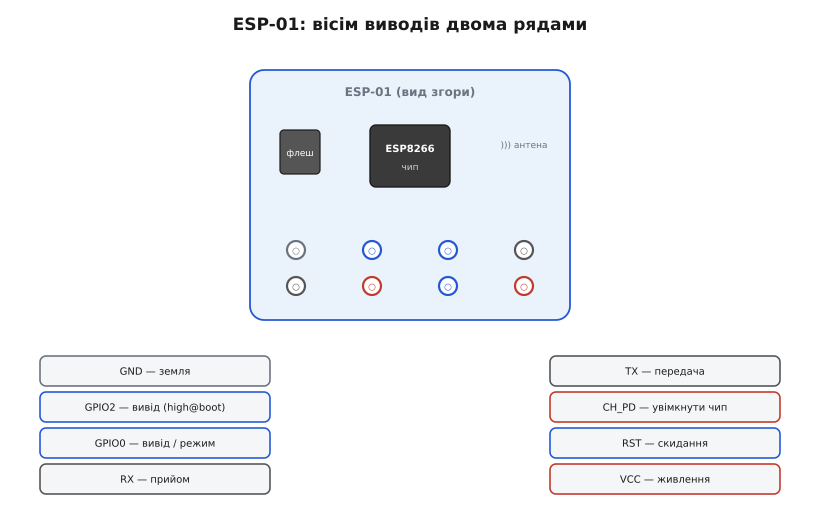
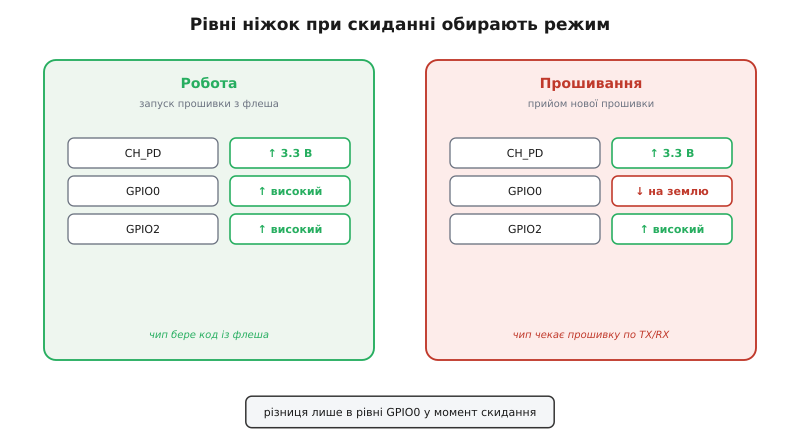
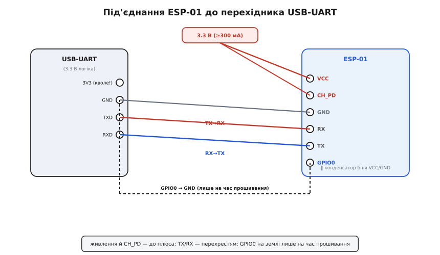

# ESP-01 (Wi-Fi, ESP8266)

<preknowlist>
- [Огляд мікроконтролера та архітектури SoC ESP8266](root:cat-hw-boards/esp8266-soc-architecture-overview) — Будова процесора Tensilica Xtensa L106, вбудований Wi-Fi-модем та внутрішня пам'ять DRAM/IRAM
- [Режими завантаження мікроконтролера ESP8266](root:cat-hw-boards/esp8266-boot-modes) — Принцип переключення між виконанням з Flash-пам'яті та завантаженням через UART
- [Конфігураційні виводи завантаження ESP8266](root:cat-hw-boards/esp8266-boot-strapping-pins) — Правила підтяжки виводів GPIO0, GPIO2 та CH_PD під час подачі живлення або скидання
</preknowlist>

## Мініатюрний модуль та його будова

Плата ESP-01 — це найвідоміший компактний носій для надання пристроям бездротового зв'язку Wi-Fi. На відміну від безкорпусного чипа, [огляд мікроконтролера ESP8266](root:cat-hw-boards/esp8266-soc-architecture-overview) представлено на цій платі у супроводі зовнішньої флеш-пам'яті @@en|SPI Flash@@ (англ. @@en|Serial Peripheral Interface Flash@@) ємністю 512 кБ або 1 МБ та друкованої антени.

На платі відсутній апаратний перетворювач USB-UART, тому спілкування з комп'ютером або зовнішніми контролерами відбувається через дворядну 8-контактну гребінку 2×4. Усередині чипа працює 32-бітне ядро Tensilica Xtensa L106 та трансивер Wi-Fi 2.4 ГГц. Невеликий обсяг флеш-пам'яті обмежує розмір прошивки та створює бар'єри для бездротового оновлення.

## Розпіновка та стани при завантаженні

Для підключення периферії модуль ESP-01 надає вісім контактів, розміщених на компактній гребінці.

*Гребінка 2×4. Верхній ряд — земля, GPIO2, GPIO0 і приймання RX; нижній — передавання TX, CH_PD (увімкнення чипа), скидання RST і живлення 3.3 В. Кольором виділено групи: живлення (червоне/зелене), послідовний порт (сірий) і три керувальні лінії стану завантаження (сині). Доступні вашому коду як звичайні виводи — лише GPIO0 і GPIO2.*

Під час подачі живлення або скидання апаратний завантажувач зчитує логічні рівні контрольних ліній. Вивід `CH_PD` (увімкнення чипа) та `RST` мають бути підтягнуті до високого рівня 3.3 В.

*Дві колонки — два стани при старті. Робота: CH_PD і GPIO0 високі, GPIO2 високий — чип завантажується з флеша й виконує прошивку. Прошивання: GPIO0 притиснутий до землі під час скидання — чип входить у завантажувач і чекає нову прошивку по TX/RX. Різниця — лише в рівні GPIO0 у момент скидання.*

Загальні [режими завантаження ESP8266](root:cat-hw-boards/esp8266-boot-modes) визначаються станом виводу `GPIO0`: високий рівень запускає програму з флеш-пам'яті, а низький — переводить модуль у режим завантажувача. Оскільки виводи `TX`/`RX` задіяні під послідовну шину, для користувацької периферії лишаються лише виводи `GPIO0` та `GPIO2`, що вимагає враховувати [конфігураційні виводи ESP8266](root:cat-hw-boards/esp8266-boot-strapping-pins) при розробці схем.

## Особливості живлення та логічні рівні

Модуль ESP-01 живиться строго від напруги 3.3 В. Під час роботи радіопередавача Wi-Fi струм споживання зростає імпульсними сплесками до 300–500 мА. Спроба живити плату від кволих виходів 3.3 В сторонніх контролерів спричиняє просідання напруги та спрацьовування систем скидання. Для надійної роботи застосовують лінійний стабілізатор @@en|LDO@@ (англ. @@en|Low Dropout@@) з керамічним конденсатором 100 нФ безпосередньо біля контактів живлення.

Вхідний контакт `RX` розрахований на логічний рівень 3.3 В і не має захисту від 5-вольтових сигналів. При спілкуванні з 5-вольтовою периферією на лінію `RX` встановлюють резистивний дільник напруги. Натомість вихід `TX` генерує рівень 3.3 В, який надійно розпізнається більшістю 5-вольтових мікроконтролерів без додаткових узгоджувачів.

## Режими роботи та процедура прошивання

Модуль підтримує два режими використання: як Wi-Fi-модем під керуванням текстових AT-команд або як автономний мікроконтролер із власною прошивкою. Для завантаження коду модуль підключають до комп'ютера через мости [esp-01-programmer-adapters](root:cat-hw-boards/esp-01-programmer-adapters) або стандартні перехідники USB-UART.

*Живлення 3.3 В — на VCC і CH_PD (обидва до плюса). GND — спільна. TX перехідника йде на RX плати, RX перехідника — на TX плати (перехрестя). GPIO0 з'єднаний із землею — це вводить чип у режим прошивання; після заливки цей провід знімають. Поряд із живленням — конденсатор, що гасить сплески струму радіо.*

Сигнальні лінії `TX` та `RX` підключають перехресно. Перед скиданням лінію `GPIO0` притискають до землі, а після завершення прошивання відключають. Удосконалений модуль [ESP-01S (Wi-Fi, ESP8266)](root:cat-hw-boards/esp-01s) відрізняється наявністю вбудованих резисторів підтяжки на лініях `CH_PD`, `RST` та `GPIO0`, що спрощує схемотехніку підключення.
