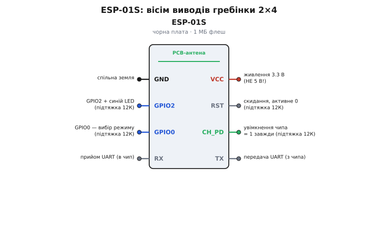
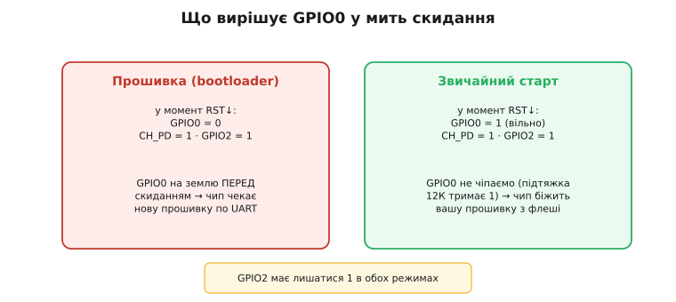
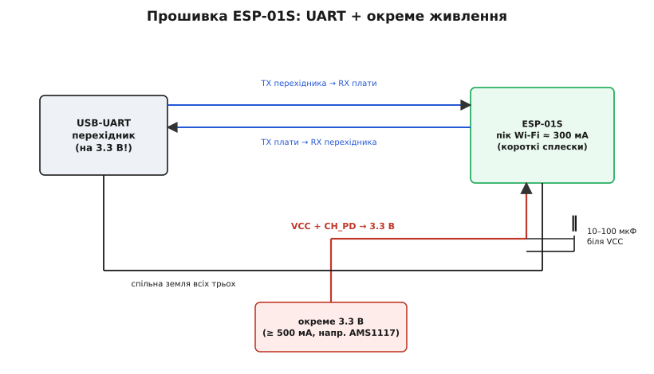

# ESP-01S (Wi-Fi, ESP8266)

<preknowlist>
- [Огляд мікроконтролера та архітектури SoC ESP8266](root:cat-hw-boards/esp8266-soc-architecture-overview) — будову чипа ESP8266, його 32-бітне процесорне ядро та організацію пам'яті
- [Режими завантаження мікроконтролера ESP8266](root:cat-hw-boards/esp8266-boot-modes) — принципи вибору режимів виконання коду чи завантажувача за рівнями на виводах під час скидання
</preknowlist>

## Призначення та відмінності модуля ESP-01S

Додавання мережевого зв'язку до компактних пристроїв часто вимагає мінімальних габаритів та низької вартості. Модуль @@en|ESP-01S@@ вирішує цю проблему, надаючи плату з підтримкою @@en|Wi-Fi@@. Важливо розрізняти сам [мікроконтролер ESP8266](root:cat-hw-boards/esp8266-soc-architecture-overview) типу @@en|SoC@@ (англ. *System on Chip* — система на чипі) та готову плату-носій @@en|ESP-01S@@.

У порівнянні зі старою версією [модуля ESP-01](root:cat-hw-boards/esp-01), плата @@en|ESP-01S@@ має 1 МБ флеш-пам'яті та вбудовані підтягувальні резистори 12 кОм на керувальних лініях. Наявність 1 МБ пам'яті має критичне практичне значення: вона дозволяє розділити накопичувач на два слоти й здійснювати @@en|FOTA@@ (англ. *Firmware Over-The-Air* — оновлення прошивки по повітрю, від англ. *firmware* — прошивка та *air* — повітря), коли новий код завантажується у вільну область прямо під час роботи старої версії. На старих модулях із 512 КБ флеш-пам'яті розмістити два образи прошивки одночасно було неможливо, що робило безпечне [оновлення прошивки по повітрю](root:cat-hw-boards/esp8266-fota-update) недосяжним без прямого фізичного підключення до програматора. Головним обмеженням плати залишається наявність лише двох вільних виводів @@en|GPIO0@@ та @@en|GPIO2@@ (англ. *General Purpose Input/Output*). Для аналізу інших варіантів виконання існує [огляд сімейства модулів](root:cat-hw-boards/esp-01-module-family-overview).

## Будова та призначення виводів плати

Плата @@en|ESP-01S@@ містить чип @@en|ESP8266@@, мікросхему флеш-пам'яті та друковану антену. Усі зв'язки виведено на дворядну 8-контактну гребінку.

*Дворядна гребінка містить лінії живлення, послідовного порту UART та керування завантаженням.*

Розпіновка включає живлення `VCC` і `GND`, послідовний порт @@en|UART@@ з лініями `RX` і `TX`, а також керувальні входи `CH_PD` (англ. *Chip Power Down* — вимкнення живлення чипа) і `RST` (англ. *Reset* — скидання). Завдяки вбудованій підтяжці на `CH_PD` та `RST` чип стартує стабільно без зовнішніх резисторів. Синій світлодіод підключено до лінії `GPIO2` із керуванням активним низьким рівнем.

## Режими завантаження та вивід GPIO0

Під час скидання мікроконтролер перевіряє стан керувальних ліній для вибору режиму роботи.

*Комбінація логічних рівнів на лініях GPIO0, GPIO2 та CH_PD визначає режим виконання коду або прошивання.*

Якщо в мить скидання лінія `GPIO0` вільна (підтягнута до високого рівня), чип починає [виконання програми з флеш-пам'яті](root:cat-hw-boards/esp8266-boot-modes). Якщо `GPIO0` притиснуто до землі `GND`, пристрій входить у режим завантажувача й чекає новий код по @@en|UART@@. Згідно з описом [конфігураційних виводів завантаження](root:cat-hw-boards/esp8266-boot-strapping-pins), лінія `GPIO2` під час скидання також має перебувати у високому стані.

## Вимоги до живлення та логіки

Передача даних по @@en|Wi-Fi@@ викликає короткочасні пікові сплески струму до 300 мА. Слабке джерело 3.3 В викликає просідання напруги та перезавантаження чипа через спрацьовування @@en|brownout@@ (англ. *brownout* — падіння напруги нижче норми). Для стабілізації паралельно шині живлення ставлять керамічний конденсатор 0.1 мкФ та електролітичний на 10–100 мкФ.

Усі лінії плати працюють від 3.3 В і не толерантні до 5 В. При підключенні до 5-вольтової периферії лінію `RX` обов'язково підключають через дільник напруги або узгоджувач рівнів.

## Схема підключення та заливка прошивки

Для завантаження коду в @@en|ESP-01S@@ модуль підключають до перехідника @@en|USB-UART@@ із логікою 3.3 В.

*Схема комутування ліній RX, TX, CH_PD та GPIO0 з джерелом живлення й перехідником.*

Лінії послідовного порту з'єднують навхрест: `TX` модуля — з `RX` перехідника, а `RX` — з `TX`. Для переходу в режим прошивання `GPIO0` з'єднують із землею і подають імпульс скидання на `RST`. Детальний рецепт запису прошивки описує довідник на [оновлення прошивки та прошивання ESP-01](root:cat-hw-boards/esp01-firmware-flashing), а для комфортної розробки використовують спеціальні [адаптери-програматори](root:cat-hw-boards/esp-01-programmer-adapters).
