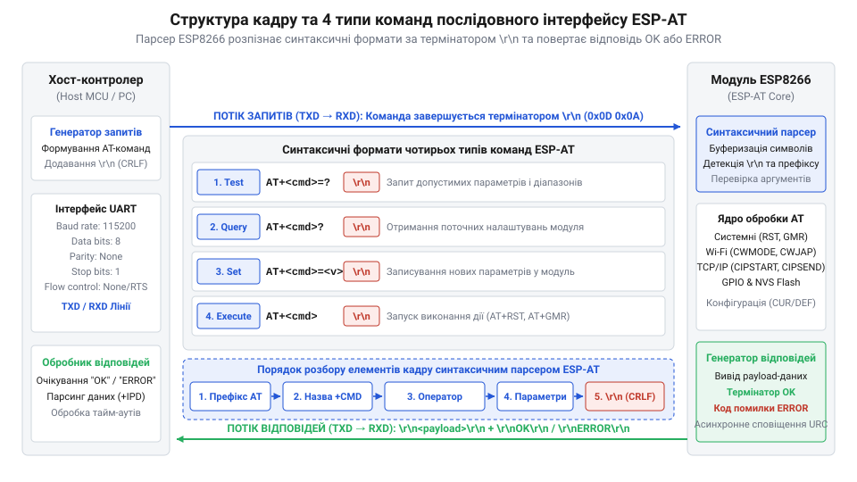
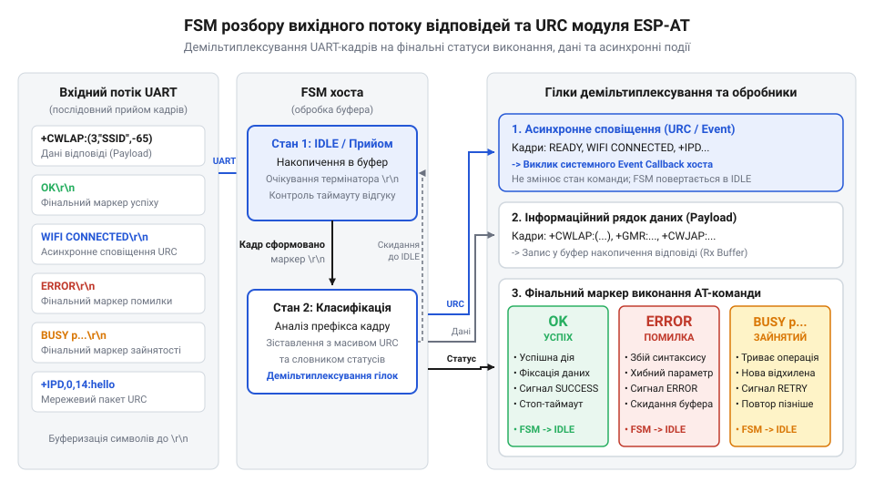

# Довідник базових команд та відповідей синтаксичного стека ESP-AT

<preknowlist>
- [Архітектура та будова прошивки Espressif AT для ESP8266](root:cat-hw-boards/esp8266-at-firmware-architecture) — внутрішню структуру прошивки ESP-AT, організацію командного парсера та взаємодію з підсистемою UART.
- [Апаратні FIFO-буфери інтерфейсу UART в ESP8266](root:cat-hw-boards/esp8266-uart-hardware-fifo) — принципи функціонування апаратного послідовного порту UART, налаштування баудрейту та буферизацію символів.
- [ESP-01 (Wi-Fi, ESP8266)](root:cat-hw-boards/esp-01) — апаратні виводи підключення модуля ESP-01, лінії TXD/RXD та вимоги до стабільності живлення.
</preknowlist>

## Проблема неупорядкованого послідовного зв'язку UART

Фізичний інтерфейс @@en|UART@@ (англ. @@en|Universal Asynchronous Receiver-Transmitter@@ від лат. @@la|universalis@@ — загальний та грец. @@el|asynchronos@@ — неузгоджений у часі) передає дані у вигляді безперервної послідовності байтів без внутрішньої структури пакетів чи заголовків. Коли мікроконтролер надсилає команди до модуля @@en|ESP8266@@ через лінії @@en|TXD@@ і @@en|RXD@@, приймальний буфер отримує лише сирий потік символів. Без чітко визначених меж між окремими повідомленнями мікроконтролер не здатний визначити, де закінчується переданий запит, де починається відповідь пристрою і чи належать отримані байти до запитаних даних, чи до випадкових завад послідовній лінії.

Відсутність єдиного стандарту структурування даних призводить до критичних помилок під час обміну. Якщо керуюча програма очищає приймальний буфер за фіксованим запізненням часу, виникає загроза втрати даних через непередбачувані затримки обробки в мікроконтролері. Натомість тривале очікування символів змушує програму блокувати виконання інших задач або потрапляти в безкінечний @@en|таймаут@@ (англ. @@en|timeout@@ — вичерпаний час). Ситуація ускладнюється тим, що пристрій може виводити службову інформацію під час перезавантаження або відключатися від мережі. Якщо не виділити специфічні розділювачі, управляючий контролер сприйматиме будь-які випадкові байти як успішне виконання команд.

Для усунення цієї невизначеності застосовують текстовий @@en|протокол@@ (грец. @@el|protokollon@@ — перший аркуш, скріплений печаткою) @@en|Espressif AT@@. Він створює суворий синтаксичний контракт для двостороннього зв'язку через послідовний порт. Протокол запроваджує обов'язкові обмежувачі кадрів, які називаються @@en|термінаторами@@ (від лат. @@la|terminare@@ — обмежувати), та стандартизовані маркери завершення операцій. Кожна команда надсилається у формі відкритого тексту й завершується унікальною послідовністю спецсимволів. Це дає змогу внутрішній прошивці модуля чітко відокремлювати один запит від іншого.

Завдяки синтаксичному контракту хост-система отримує можливість будувати детермінований розбір відповідей. Коли управляючий мікроконтролер знає точну структуру кадру, він може потоково зчитувати вхідні байти через [апаратні буфери послідовного порту](root:cat-hw-boards/esp8266-uart-hardware-fifo) до моменту появи фінального термінатора. Зі свого боку модуль @@en|ESP8266@@ гарантує повернення чітко визначених слів підтвердження стану або повідомлень про помилки. Це повністю усуває невизначеність тривалості зв'язку й дає змогу будувати надійні вбудовані системи на базі компактної [плати модуля ESP-01](root:cat-hw-boards/esp-01), де внутрішня [архітектура прошивки ESP-AT](root:cat-hw-boards/esp8266-at-firmware-architecture) гарантує стабільний розбір вхідного потоку.

## Синтаксичні типи команд та термінатори

Надійність текстового обміну досягається суворим класифікуванням синтаксичних конструкцій. Назва @@en|AT-команд@@ походить від префікса `AT` (скорочення від англ. @@en|Attention@@ — увага), який слугує сигналом для внутрішнього командного парсера пристрою про початок нового текстового запиту. Усі команди в синтаксичному стеку @@en|ESP-AT@@ поділяються на чотири чітко розрізнювані типи: тестові, опитувальні, встановлювальні та виконувані. Кожен тип має власну синтаксичну форму та специфічне призначення під час взаємодії з модулем.

Тестові команди мають вид `AT+CMD=?` і призначені для з'ясування списку підтримуваних параметрів та діапазонів їхніх значень без зміни поточного стану системи. Опитувальні команди записуються як `AT+CMD?` і повертають поточні налаштування модуля, встановлені у системній пам'яті. Встановлювальні команди форматуються у вигляді `AT+CMD=param1,param2,...` і слугують для запису конкретних параметрів користувача. Виконувані команди мають вигляд `AT+CMD` і запускають внутрішній алгоритм чи функціональну операцію пристрою із зумовленими за замовчуванням параметрами.


*Двонапрямлений потік даних UART між хостом та ESP8266 з ілюстрацією синтаксису чотирьох типів команд та термінаторів кадру.*

Обов'язковою умовою прийняття кадру внутрішнім парсером є наявність термінаторів кадру `\r\n`. Символ `\r` (англ. @@en|Carriage Return@@, повернення каретки, @@en|ASCII@@-код `0x0D`) та символ `\n` (англ. @@en|Line Feed@@, переведення рядка, @@en|ASCII@@-код `0x0A`) разом утворюють обмежувач @@en|CRLF@@. Без цієї послідовності внутрішній @@en|парсер@@ (англ. @@en|parser@@ від лат. @@la|pars@@ — частина) не вважає рядок завершеним і продовжує очікувати вхідні байти, що призводить до відхилення запиту після вичерпання внутрішнього буфера.

```text
Запит тестовий:     AT+CWMODE=?\r\n
Відповідь модуля:   +CWMODE:(1-3)\r\n\r\nOK\r\n

Запит опитувальний:  AT+CWMODE?\r\n
Відповідь модуля:   +CWMODE:1\r\n\r\nOK\r\n

Запит встановлення:  AT+CWMODE=1\r\n
Відповідь модуля:   OK\r\n

Запит виконання:     AT+RST\r\n
Відповідь модуля:   OK\r\n
```

Форматування слів та параметрів всередині встановлювальних команд вимагає дотримання суворих правил типів даних. Строкові значення передаються обов'язково у подвійних лапках, наприклад `"SSID_NAME"`, тоді як числові параметри передаються без лапок у десятирічному форматі. Якщо команда приймає декілька параметрів, вони розділяються комами. Якщо один із необов'язкових параметрів пропускається, його позицію позначають комою без значення між розділювачами, як-от `AT+CIPSTART="TCP","192.168.1.10",80,,1`. Некоректне розставляння лапок або порушення кількості розділювачів викликає синтаксичну помилку, оскільки вичерпний [огляд базової системи AT-команд](root:cat-hw-boards/esp8266-at-command-set-overview) строго регламентує структуру кожного запиту.

## Стандартні формати відповідей та помилки

Після прийняття та синтаксичного аналізу кадру прошивка модуля повертає текстову відповідь, яка завершується статусним маркером. Стандартна відповідь складається з ехо-повтору команди (якщо увімкнено відповідний режим), корисного навантаження із запитаними даними, порожнього рядка-розділювача `\r\n` та кінцевого статусного слова. Основними статусними маркерами є `OK`, `ERROR` та `BUSY p...`. Маркер `OK\r\n` підтверджує успішну обробку та виконання запиту, тоді як `ERROR\r\n` інформує про наявність синтаксичної помилки, передачу некоректних параметрів або збій у виконанні внутрішньої операції.

Коли пристрій зайнятий виконанням довготривалого процесу, наприклад скануванням доступних мереж @@en|Wi-Fi@@ або встановленням з'єднання, повторні запити від хоста призводять до повернення статусу `busy p...` (англ. @@en|busy processing@@ — зайнятий обробкою). Повернення цього маркера означає, що внутрішній потік виконання блоковано фоновим завданням, і управляючий мікроконтролер повинен призупинити надсилання нових команд до завершення поточної операції. Тільки після того, як фоновий процес поверне підсумковий результат, модуль знову зможе обробляти вхідні запити.


*Схема станційного автомата (FSM) розбору вихідного потоку відповідей ESP-AT із виділенням статусних маркерів та асинхронних сповіщень.*

Окрему категорію вихідних даних становлять асинхронні системні сповіщення, відомі як @@en|URC@@ (англ. @@en|Unsolicited Result Code@@ — незапитаний код результату). На відміну від синхронних відповідей, які надходять безпосередньо у відповідь на команду хоста, кадри @@en|URC@@ генеруються підсистемою модуля спонтанно при зміні системного стану. До таких повідомлень належать рядки `ready` під час старту пристрою, `WIFI CONNECTED`, `WIFI GOT IP` при реєстрації у мережі або `CLOSED` при розриві мережевого сокета.

```text
// Приклад відповіді з даними та маркером OK:
AT+CWLAP\r\n
+CWLAP:(3,"Home_AP",-55,"00:11:22:33:44:55",1)\r\n
\r\n
OK\r\n

// Приклад сповіщення про зайнятість пристрою:
AT+CWLAP\r\n
BUSY p...\r\n

// Приклад асинхронного сповіщення URC:
WIFI CONNECTED\r\n
WIFI GOT IP\r\n
```

Обробка вихідного потоку вимагає від програмного забезпечення хоста побудови спеціалізованого станційного автомата. Оскільки асинхронне повідомлення @@en|URC@@ може вклинитися у потік даних безпосередньо перед або під час очікування відповіді на надіслану команду, приймальний парсер повинен постійно аналізувати префікси рядків. Якщо вхідний рядок збігається з відомим @@en|URC@@-шаблоном, він передається у фоновий обробник подій, тоді як решта рядків акумулюється в буфері синхронної відповіді до приходу підтвердження `OK` або `ERROR`. Так само детально функціонує [потоковий розбір асинхронних кадрів](root:cat-hw-boards/esp8266-at-ipd-parser) під час прийому мережевих пакетів даних.

## Базові системні команди керування модулем

Керування робочим станом та перевірка функціональності модуля здійснюються за допомогою п'яти базових системних команд: `AT`, `AT+RST`, `AT+GMR`, `ATE` та `AT+RESTORE`. Команда `AT` використовується як базовий тестовий інструмент перевірки фізичного зв'язку по порту @@en|UART@@. Надсилання цього запиту дає змогу переконатися, що пристрій підключено коректно, швидкість обміну узгоджена, а командний парсер перебуває в активному стані й готовий до прийняття складніших інструкцій. У разі успіху модуль відповідає простою послідовністю `OK\r\n`.

Команда `AT+RST` ініціює програмне перезавантаження мікроконтролера @@en|ESP8266@@. Після отримання цієї команди модуль негайно відповідає `OK\r\n`, після чого скидає своє процесорне ядро та перезапускає систему. Під час стартапу первинний завантажувач виводить у послідовний порт службові логи на нестандартній швидкості 74880 біт/с, що сприймається терміналом хоста як хаотичні символи, якщо порт налаштовано на швидкість 115200 біт/с. Після завершення ініціалізації периферії прошивка надсилає асинхронне сповіщення `ready\r\n` вже на стандартній робочій швидкості, засвідчуючи повну готовність до роботи.

```text
// Запит інформації про версію прошивки (AT+GMR):
AT+GMR\r\n
AT version:1.7.4.0(May 11 2020 19:13:04)\r\n
SDK version:3.0.4(6673611)\r\n
compile time:May 27 2020 09:37:07\r\n
Bin version(v1.7.4)\r\n
\r\n
OK\r\n

// Вимкнення відображення ехо-символів (ATE0):
ATE0\r\n
OK\r\n
```

Для отримання вичерпних даних про поточну версію програмного забезпечення застосовують команду `AT+GMR`. Вона виводить чотири ключові параметри системи: версію синтаксичного стека @@en|ESP-AT@@, версію @@en|SDK@@ (англ. @@en|Software Development Kit@@ — набір засобів розробки), точну дату й час компіляції прошивки, а також версію бінарного образа. Опитування версії є обов'язковим кроком при розробці автоматизованого програмного забезпечення хоста, оскільки різні версії прошивки можуть мати відмінності у наборі додаткових параметрів та алгоритмах роботи.

Команда `ATE` керує виведенням ехо-символів у послідовний канал. При надсиланні `ATE1` модуль повертає кожний отриманий символ назад хосту перед виведенням відповіді, що зручно при відлагодженні в інтерактивному терміналі. Проте для автоматичного розбору мікроконтролером режим ехо є небажаним, оскільки він подвоює трафік і засмічує приймальний буфер. Тому після старту системи контролер зазвичай надсилає команду `ATE0` для вимкнення ехо. Для повного скидання конфігурації до заводських параметрів слугує команда `AT+RESTORE`. Вона повністю очищує збережені у @@en|флеш-пам'яті@@ налаштування (параметри @@en|Wi-Fi@@, конфігурацію порту) і перезавантажує модуль у початковий стан, як описують [режими завантаження мікроконтролера](root:cat-hw-boards/esp8266-boot-modes) та стандартизована процедура [оновлення прошивки та прошивання](root:cat-hw-boards/esp01-firmware-flashing).

## Конфігурування UART та тимчасові налаштування

Параметри послідовного зв'язку між хостом та модулем @@en|ESP8266@@ налаштовуються за допомогою команд `AT+UART_CUR` та `AT+UART_DEF`. Обидві команди приймають одинаковий набір із п'яти числових параметрів, розташованих у чіткій послідовності: `<baudrate>,<databits>,<stopbits>,<parity>,<flow_control>`. Параметр `<baudrate>` визначає швидкість передачі в бітах за секунду (наприклад 9600, 115200 або 921600 біт/с). Параметри `<databits>` (5–8 біт), `<stopbits>` (1–3, де 1 означає 1 стоп-біт, 2 — 1.5, 3 — 2 стоп-біти), `<parity>` (0 — відсутня, 1 — непарність, 2 — парність) та `<flow_control>` (0 — вимкнено, 1 — @@en|RTS@@, 2 — @@en|CTS@@, 3 — @@en|RTS/CTS@@) задають низькорівневу конфігурацію кадру.

Головна відмінність між цими командами полягає у місці збереження змін. Команда `AT+UART_CUR` (скорочення від англ. @@en|current@@ — поточний) здійснює тимчасове переналаштування параметрів інтерфейсу в оперативній пам'яті @@en|RAM@@ (англ. @@en|Random Access Memory@@). Нові параметри набирають чинності негайно після повернення статусного слова `OK`, проте при перезавантаженні або вимкненні живлення вони втрачаються, і модуль повертається до збережених раніше конфігурацій. Натомість команда `AT+UART_DEF` (скорочення від англ. @@en|default@@ — за замовчуванням) записує нові значення у нелетку @@en|флеш-пам'ять@@, роблячи їх основними для всіх наступних сесій роботи.

```text
// Тимчасова зміна швидкості на 921600 біт/с у RAM:
AT+UART_CUR=921600,8,1,0,0\r\n
OK\r\n

// Збереження стандартної швидкості 115200 біт/с у флеш-пам'ять:
AT+UART_DEF=115200,8,1,0,0\r\n
OK\r\n
```

Використання тимчасової команди `AT+UART_CUR` дає змогу безпечно динамічно підвищувати швидкість обміну для швидкого пересилання великих обсягів даних без ризику передчасного зносу осередків флеш-пам'яті багаторазовими циклами перезапису. При зміні швидкості обміну виникає ризик втрати зв'язку між контролером та модулем через розсинхронізацію. Для уникнення цієї проблеми розробляють чіткий алгоритм: спочатку хост надсилає команду `AT+UART_CUR` на поточній швидкості (наприклад 115200 біт/с), очікує підтвердження `OK`, після чого переналаштовує власний апаратний модуль @@en|UART@@ на нову швидкість (наприклад 921600 біт/с) і перевіряє зв'язок надсиланням тестової команди `AT`.

Якщо перевірка зв'язку на новій швидкості проходить успішно, система може продовжити роботу або зафіксувати налаштування командою `AT+UART_DEF`. Такий гнучкий підхід дає змогу оптимально адаптувати параметри послідовного порту під специфічні вимоги вбудованої системи, зважаючи на те, як влаштована загальна [архітектура SoC ESP8266](root:cat-hw-boards/esp8266-soc-architecture-overview) та які апаратні ресурси виділено під обробку послідовних переривань.