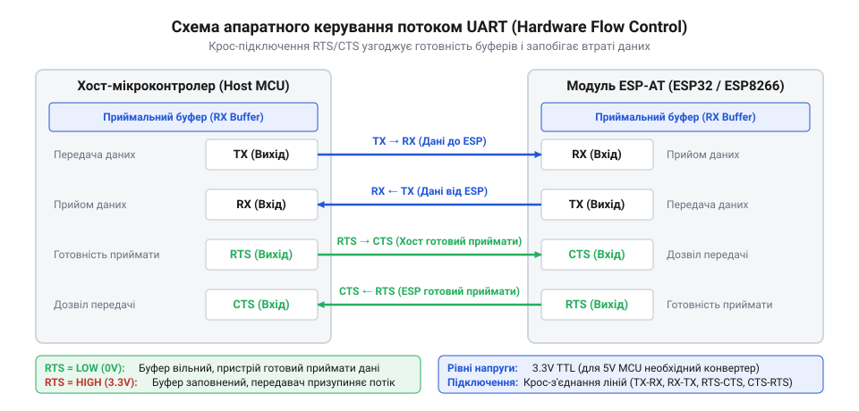
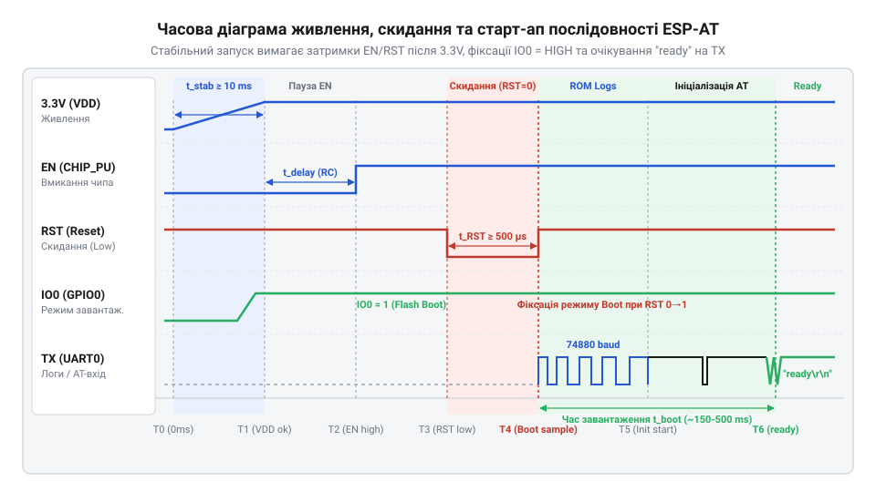

# Апаратний інтерфейс підключення ESP-AT: розводка, рівні та керування потоком

<preknowlist>
- [Конфігураційні виводи завантаження ESP8266](root:cat-hw-boards/esp8266-boot-strapping-pins) — Значення логічних рівнів на виводах GPIO0, GPIO2 та GPIO15 під час скидання для вибору режиму завантаження з SPI Flash.
- [Апаратні FIFO-буфери інтерфейсу UART в ESP8266](root:cat-hw-boards/esp8266-uart-hardware-fifo) — Принципи функціонування внутрішніх буферів RX/TX FIFO та апаратна генерація порогів спрацьовування сигналів RTS і CTS.
- [Архітектура та будова прошивки Espressif AT для ESP8266](root:cat-hw-boards/esp8266-at-firmware-architecture) — Загальні принципи організації AT-інтерфейсу та стандартні параметри послідовного з'єднання хоста з модулем.
</preknowlist>

## Проблема нестабільності зв'язку через послідовний порт

Спроба прямого з'єднання модуля з прошивкою ESP-AT до хост-мікроконтролера стандартними лініями прийому та передачі даних часто закінчується апаратною нестабільністю: пристрій втрачає окремі байти при передачі, виводить «сміттєві» символи, раптово перезавантажується або зависає в момент інтенсивного мережевого обміну. На перший погляд здається, що послідовний інтерфейс (англ. @@en|UART@@, від *Universal Asynchronous Receiver-Transmitter* — універсальний асинхронний приймач-передавач) вимагає лише схрещення ліній прийому й передачі, однак пряме електричне з'єднання ігнорує ключові фізичні інваріанти напівпровідникової системи.

Основна причина виникнення хаотичних помилок полягає у потрійній невідповідності апаратного тракту. Перший чинник — електричний: більшість традиційних мікроконтролерів працюють із 5-вольтовою логікою @@en|TTL@@ (англ. @@en|Transistor-Transistor Logic@@), тоді як мікроконтролер ESP8266 виготовлений за технологічним процесом 3.3 В. Подача 5-вольтового сигналу на вхідний вивід модуля спричиняє пробій або паразитне живлення через вбудовані захисні @@en|ESD@@-діоди (англ. @@en|Electrostatic Discharge@@), що спотворює фронти імпульсів та призводить до температурного деградування кристала. Другий чинник — динамічний: під час високрозхідного бездротового обміну по Wi-Fi внутрішній апаратний буфер модуля наповнюється значно швидше, ніж хост-контролер встигає опрацьовувати асинхронні повідомлення. За відсутності механізму апаратного призупинення передавача виникає переповнення буфера (англ. @@en|buffer overflow@@), через що частина вхідного потоку некоректно відкинута. Третій чинник — конфігураційний: керуючі лінії вибору режимів та скиду пристрою, залишені у висячому стані без фіксованого потенціалу, збирають електромагнітні завади (англ. @@en|EMI@@, від *Electromagnetic Interference*), змушуючи модуль довільно переходити в режим прошивання або перезапускатися.

Осмислення цих фізичних обмежень показує, що надійне підключення модулів із прошивкою ESP-AT вимагає комплексного проєктування апаратного інтерфейсу. Для усунення збоїв необхідно правильно реалізувати розводку сигнальних ліній із підтримкою керування потоком, розрахувати схеми електричного узгодження логічних рівнів, а також забезпечити жорстку фіксацію станів керуючих виводів у часі. Розуміння цієї неминучості створює підґрунтя для розгляду [архітектури AT-прошивки Espressif](root:cat-hw-boards/esp8266-at-firmware-architecture) та вивчення принципової розводки сигнальних ліній і функціонування апаратних сигналів керування потоком.

## Розводка ліній UART та апаратний потік

Гарантована передача кадрів без втрати байтів між хост-контролером і модулем ESP-AT спирається на чотирипровідну топологію інтерфейсу @@en|UART@@. Базовий двопровідний зв'язок включає лінію передачі даних TX (англ. @@en|Transmit@@) та лінію прийому RX (англ. @@en|Receive@@). Для запобігання втратам даних при високій швидкості обміну (англ. @@en|baud rate@@) до них додають лінії апаратного керування потоком (англ. @@en|flow control@@): RTS (англ. @@en|Request To Send@@ — запит на передачу) та CTS (англ. @@en|Clear To Send@@ — дозвіл на передачу). 

Топологія з'єднання вимагає суворого кросування сигналів між пристроями. Вихід TX хост-контролера підключається до входу RX модуля ESP-AT, а вхід RX хоста — до виходу TX модуля. Аналогічно кросуються лінії керування потоком: вихід RTS хоста з'єднується з входом CTS модуля, а вихід RTS модуля — з входом CTS хоста.


*Принципова схема крос-підключення сигнальних ліній UART та апаратного handshake між хостом і модулем ESP-AT.*

Механізм апаратного узгодження (англ. @@en|handshake@@, від *hand* — рука і *shake* — тиснути, тобто рукостискання) працює на рівні цифрової логіки приймальних буферів. Усередині мікроконтролера ESP8266 встановлено апаратний FIFO-буфер (англ. @@en|FIFO@@, від *First In, First Out* — першим зайшов, першим вийшов) обсягом 128 байтів. Коли модуль приймає Wi-Fi пакети і формує асинхронний потік команд, вхідний FIFO-буфер хоста або приймальний буфер модуля швидко заповнюється. За замовчуванням, коли рівень заповнення буфера досягає налаштованої межі (наприклад, 100 байтів), апаратна периферія модуля автоматично піднімає свій вихід RTS у стан логічної одиниці (високий рівень 3.3 В).

Хост-контролер, зчитуючи високий рівень на своєму вході CTS, миттєво призупиняє видачу наступних байтів із передавача на межі поточного кадру. Як тільки програмний стек модуля опрацьовує накопичені байти й [апаратний буфер FIFO](root:cat-hw-boards/esp8266-uart-hardware-fifo) звільняється нижче порогового значення, лінія RTS автоматично знижується до логічного нуля (низький рівень 0 В). Це слугує для хоста сигналом до відновлення передачі. Такий самий зворотний процес відбувається, коли хост не встигає зчитувати асинхронні кадри під час [обробки кадру IPD](root:cat-hw-boards/esp8266-at-ipd-parser) або при виконанні [двофазної передачі AT+CIPSEND](root:cat-hw-boards/esp8266-at-cipsend-handshake): хост виставляє свій RTS у високий стан, зупиняючи передавач модуля ESP-AT і блокуючи переповнення власного приймача.

## Електричні рівні 3.3V та узгодження ліній

Правильна розводка сигнальних ліній не гарантує стабільності, якщо електричні потенціали передавача й приймача знаходяться в різних логічних діапазонах. Інтерфейс мікроконтролера ESP8266 розрахований на логічні рівні 3.3 В @@en|CMOS@@. Для цього стандарту порогова напруга логічного нуля `V_IL` не повинна перевищувати 0.8 В, а мінімальна напруга логічної одиниці `V_IH` становить 2.0 В. Вихідні рівні модуля складають `V_OL` ≤ 0.4 В та `V_OH` ≥ 2.6 В відповідно. Максимально припустима напруга на виводах @@en|GPIO@@ (англ. @@en|General-Purpose Input/Output@@) становить 3.6 В.

Пряме підключення виходу TX 5-вольтового хост-контролера (напруга одиниці `V_OH` ≈ 4.3–5.0 В) до входу RX модуля ESP-AT створює струмове перевантаження. Струм починає протікати через паразитичні діоди захисту від статичної електрики на шину живлення 3.3 В модуля, викликаючи локальне підвищення напруги (англ. @@en|latch-up effect@@ — ефект засувки) або вихід виводу з ладу.

Для безпечного пониження напруги сигналу від 5V-хоста до 3.3V-входу ESP-AT застосовують резистивний дільник напруги. Схема складається з двох послідовно з'єднаних резисторів: верхнього `R1` (між TX хоста та RX модуля) і нижнього `R2` (між RX модуля та спільною шиною GND). Вихідна напруга `V_out` розраховується за формулою:

```
V_out = V_in × R2 / (R1 + R2)
```

При виборі номіналів `R1 = 1.8 kΩ` та `R2 = 3.3 kΩ` для вхідного сигналу `V_in = 5.0 V` вихідна напруга становить:

```
V_out = 5.0 × 3300 / (1800 + 3300)
      = 5.0 × 3300 / 5100
      ≈ 3.23 V
```

Отримане значення 3.23 В ідеально вкладається в діапазон допустимих значень для входів ESP8266. Однак під час вибору опору резисторів слід враховувати паразитну ємність (англ. @@en|parasitic capacitance@@) друкованого монтажу та виводів. Занадто високі опори (наприклад, понад 10 кОм) у поєднанні з ємністю лінії утворюють пасивний фільтр нижніх частот, який завалює фронти цифрового сигналу на високих швидкостях передачі (921600 біт/с). Тому сумарний опір дільника обирають у межах від 2 кОм до 5 кОм.

Для високошвидкісного або двонапрямного зв'язку замість резисторів використовують активний перетворювач рівнів (англ. @@en|level shifter@@) на польових @@en|MOSFET@@-транзисторах (англ. @@en|Metal-Oxide-Semiconductor Field-Effect Transistor@@, наприклад BSS138) з підтягувальними резисторами 10 кОм до шин 3.3 В та 5 В. Що стосується зворотної лінії — виходу TX модуля ESP-AT до входу RX 5V-хоста, то напруга логічної одиниці модуля `V_OH` ≈ 3.3 В зазвичай перевищує поріг розпізнавання високого рівня більшості 5V-мікроконтролерів (`V_IH` ≈ 3.0 В для AVR при VCC = 5 В), тому цю лінію можна підключати напряму або через буферний активний шифтер для підвищення завадостійкості при використанні [модулів ESP-01](root:cat-hw-boards/esp-01) у промислових умовах, які детально розглянуті в [огляді SoC ESP8266](root:cat-hw-boards/esp8266-soc-architecture-overview).

## Керуючі лінії EN, RST та IO0

Стабільна робота прошивки ESP-AT залежить не лише від сигнального тракту UART, а й від електричного стану конфігураційних ліній керування живленням, скидом та вибором режимів завантаження. До основних керуючих виводів належать лінії `EN` (або `CHIP_EN` / `CH_PD`), `RST` (зовнішній скид) та `IO0` (GPIO0).

Вивід `EN` (англ. @@en|Enable@@ — увімкнення) є входом активації внутрішнього лінійного регулятора напруги (англ. @@en|LDO@@, від *Low Drop-Out*) та аналогових блоків мікроконтролера. Для нормальної роботи модуля на цей вивід повинен безперервно подаватися високий логічний рівень (3.3 В). Якщо лінію `EN` підтягнути до землі (0 В), кристал переходить у режим глибокого вимкнення із споживанням струму менше 10 мкА. Для забезпечення стабільного запуску вивід `EN` підтягують до шини 3.3 В через резистор підтяжки (англ. @@en|pull-up@@) номіналом `10 kΩ`.

Вивід `RST` (англ. @@en|Reset@@ — скид) керує апаратним скиданням цифрового ядра мікроконтролера. Сигнал є інверсним (активний низький рівень). Хоча всередині кристала присутній слабкий підтягувальний резистор, зовнішнє коло скиду вимагає обов'язкового встановлення підтяжки `10 kΩ` до 3.3 В та керамічного конденсатора ємністю `100 nF` на землю GND. Такий ланцюг утворює просте інтегрувальне @@en|RC-коло@@ (англ. @@en|RC circuit@@, від *Resistor-Capacitor*), яке фільтрує високочастотні завади у лінії скиду та запобігає спалахам самовільних перезавантажень пристрою.

Вивід `IO0` (GPIO0) належить до групи конфігураційних виводів завантаження (англ. @@en|bootstrapping pins@@). Стан цього виводу фіксується внутрішньою логікою кристала безпосередньо у момент підйому фронту сигналу на лінії `RST`. Якщо під час скидання на `IO0` присутній високий рівень (логічна 1), мікроконтролер переходить у стандартний режим виконання програми з зовнішньої SPI Flash-пам'яті, розгортаючи прошивку ESP-AT. Якщо ж `IO0` притягнутий до землі (логічний 0), пристрій входить у режим завантажувача (англ. @@en|bootloader@@) для оновлення прошивки через UART. Супутні конфігураційні виводи `IO2` (GPIO2) та `IO15` (GPIO15) також вимагають жорсткого зафіксованого стану: `IO2` підтягується до 3.3 В (підтяжка `10 kΩ`), а `IO15` підтягується до землі через резистор (англ. @@en|pull-down@@) номіналом `10 kΩ`.

Залишення керуючих ліній у висячому стані без фіксованого потенціалу призводить до того, що високий вхідний опір виводів @@en|CMOS@@ реагує на найменші електромагнітні наводки, змушуючи модуль хаотично перезавантажуватися або злітати в режим прошивання. Правильний вибір підтягувальних резисторів номіналом `10 kΩ` забезпечує достатній струм фіксації потенціалу (~0.33 мА) і завадостійкість, детально описану в матеріалах про [конфігураційні виводи завантаження ESP8266](root:cat-hw-boards/esp8266-boot-strapping-pins), [режими завантаження мікроконтролера](root:cat-hw-boards/esp8266-boot-modes) та [архітектуру завантажувача ESP8266](root:cat-hw-boards/esp8266-bootloader-architecture).

## Часові діаграми старту та пробудження пристрою

Правильно спроєктовані кола підтяжок і керування вимагають дотримання суворих часових затримок у прошивці хост-контролера під час подачі живлення, апаратного скидання та пробудження модуля ESP-AT. Ігнорування часових інтервалів призводить до того, що хост починає надсилати AT-команди ще до того, як внутрішній завантажувач і стек AT-прошивки завершать ініціалізацію апаратного UART.


*Часова діаграма сигналів увімкнення, апаратного скидання та виходу модуля в стан готовності прийому команд.*

Послідовність сигналів під час початкового старту або апаратного скидання підпорядковується чіткому часовому регламенту. Спочатку напруга живлення VCC повинна стабілізуватися на рівні 3.3 В. Сигнал увімкнення `EN` виставляється у високий рівень за часовий інтервал `t_EN >= 10 ms` до або одночасно з відпусканням лінії `RST`. Для надійного скидання всіх внутрішніх регістрів імпульс низького рівня на лінії `RST` повинен утримуватися хостом щонайменше `t_RST >= 100 µs` (на практиці, при використанні RC-кола, тривалість становить від 10 до 50 мс).

У момент переходу лінії `RST` з низького рівня у високий (наростаючий фронт) логічні рівні на лініях `IO0`, `IO2` та `IO15` повинні бути повністю стабільними і утримуватися ще протягом щонайменше `t_hold >= 10 ms`. Після відпускання `RST` мікроконтролер ESP8266 запускає первинний ROM-завантажувач. На цьому етапі вихід TX модуля спочатку видає системний лог завантаження на нестандартній швидкості 74880 біт/с. Лише після цього управління передається основним компонентам AT-прошивки, які ініціалізують робочий UART на швидкості 115200 біт/с і виводять текстове повідомлення `ready

`. 

Для запобігання втраті перших команд прошивка хоста повинна контролювати лінію RX та очікувати текстовий рядок `ready

` або витримувати фіксовану паузу затримки `t_ready >= 500 ms` після відпускання лінії `RST` перед відправкою першої текстової команди `AT

`. Аналогічна часова затримка витримується і при виході з режимів зниженого енергоспоживання (англ. @@en|sleep mode@@): після подачі імпульсу пробудження хост витримує паузу `t_wake >= 20 ms` для стабілізації внутрішнього тактового генератора PLL перед відновленням активного обміну.

Для ілюстрації керування лінією скиду та витримування необхідних часових затримок нижче наведено приклад коду для хост-мікроконтролера.

:::tabs
@tab C (ESP-IDF)
:::code api-esp-at-hardware-interface/c/esp-idf/esp-at-hardware-reset.c
@tab C++ (Arduino)
:::code api-esp-at-hardware-interface/cpp/arduino/espathardwarereset.cpp
:::

Використання вимірювальних приладів, таких як осцилограф чи логічний аналізатор, дозволяє легко верифікувати зазначені часові співвідношення та діагностувати апаратні збої зв'язку при роботі з [модулями ESP-01S](root:cat-hw-boards/esp-01s) або процедурах [оновлення прошивки ESP-01](root:cat-hw-boards/esp01-firmware-flashing).