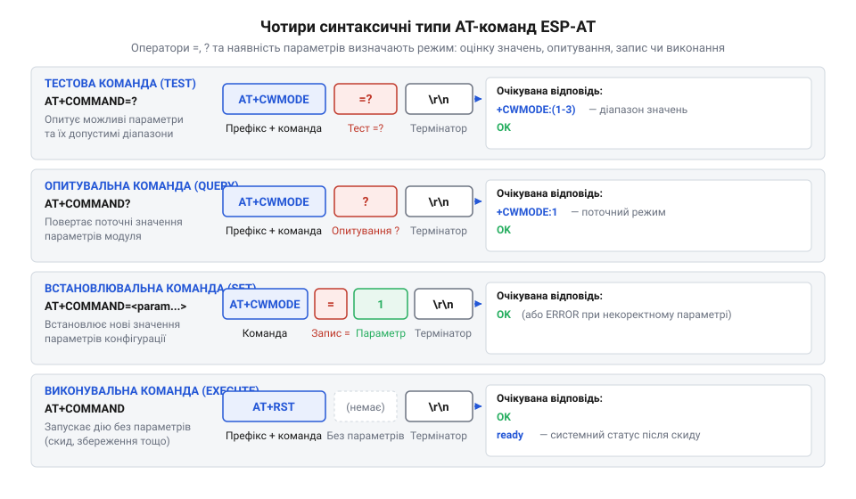
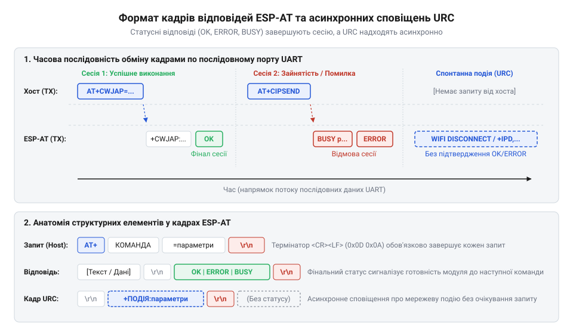
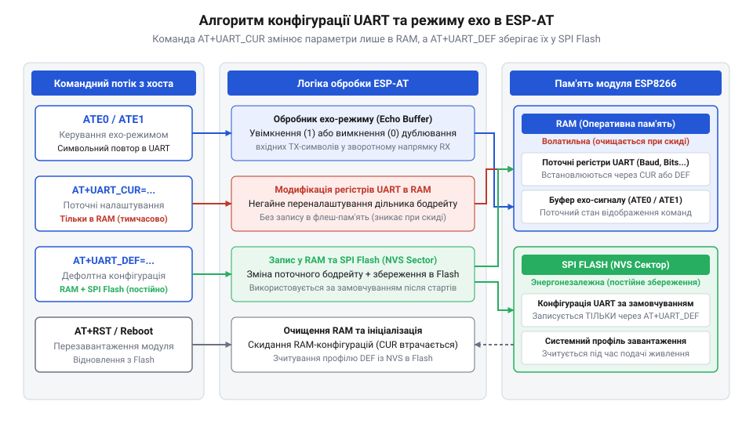
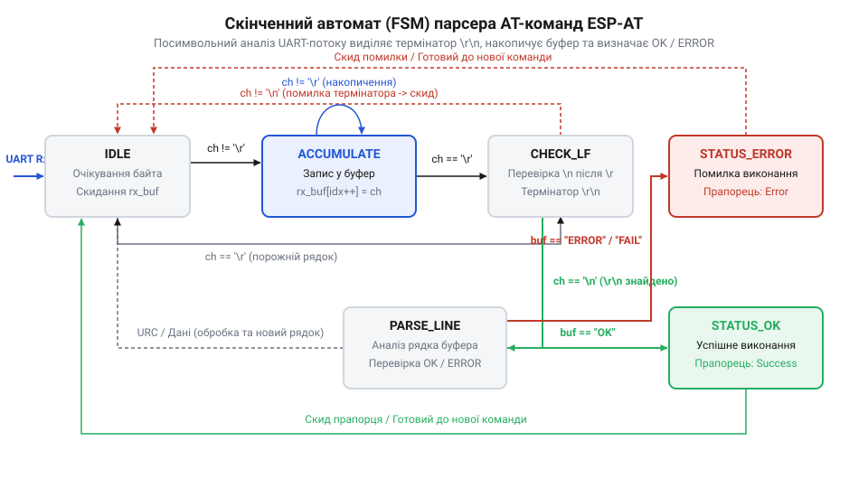

# Огляд базового командного інтерфейсу ESP-AT

<preknowlist>
- [Архітектура та будова прошивки Espressif AT для ESP8266](root:cat-hw-boards/esp8266-at-firmware-architecture) — загальні принципи організації AT-командного фреймворку Espressif та концепцію обробки послідовного потоку даних у прошивці
- [Апаратні FIFO-буфери інтерфейсу UART в ESP8266](root:cat-hw-boards/esp8266-uart-hardware-fifo) — принципи буферизації символів на фізичному рівні UART та параметри налаштування швидкості передачі даних (Baud Rate)
- [Огляд мікроконтролера та архітектури SoC ESP8266](root:cat-hw-boards/esp8266-soc-architecture-overview) — базову організацію периферійних блоків SoC та роль виділеного послідовного порту UART0 у системній взаємодії з хостом
- [Огляд сімейства Wi-Fi модулів ESP-01 та ESP-01S](root:cat-hw-boards/esp-01-module-family-overview) — фізичну розводку сигнальних ліній TX/RX та особливості підключення модулів до послідовного порту мікроконтролера
</preknowlist>

## Чому бездротовий модуль розсинхронізовується з хостом

Уявіть типову розробницьку ситуацію: головний @@en|host@@-мікроконтролер надсилає текстовий запит до [бездротового модуля ESP-01](root:cat-hw-boards/esp-01), сподіваючись отримати відповідь про стан підключення, але у відповідь отримує лише мовчанку, тишу в лінії або набір незрозумілих символів. Ви повторно надсилаєте той самий текстовий рядок, і раптом модуль повертає помилку або взагалі зависає у невизначеному стані. Намагання керувати мережевим копроцесором шляхом довільного відправлення байтів через послідовний інтерфейс неминуче призводить до хаосу та розсинхронізації двох незалежних обчислювальних систем.

Головна причина цієї проблеми полягає у фізичній та протокольній природі послідовного порту @@en|UART@@ (від англ. *Universal Asynchronous Receiver-Transmitter* — універсальний асинхронний приймач-передавач). Інтерфейс @@en|UART@@ є асинхронним потоковим середовищем: він передає дані побітово без спільної лінії тактування та без вродженого поняття "пакета" чи "кадру". У стані спокою сигнальна лінія перебуває під високим логічним рівнем 3.3 В (стан @@en|MARK@@). Початок передачі кожного байта знаменується перепадом напруги з високого рівня на низький — спадним фронтом стартового біта (стан @@en|SPACE@@). Після цього приймальний мобільний трансивер відраховує часові інтервали на основі власного внутрішнього генератора тактової частоти й зчитує 8 бітів даних посередині кожного бітового інтервалу, завершуючи прийом високим рівнем стопового біта (@@en|Stop Bit@@). Стандартна конфігурація @@en|ESP-AT@@ використовує режим `8N1` (8 бітів даних, без біта парності @@en|Parity Bit@@, 1 стоповий біт).

Якщо швидкість передачі даних (@@en|Baud Rate@@) у генераторах @@en|host@@-контролера та мережевого модуля має навіть незначне відхилення (понад 2.5%), накопичена часова похибка призводить до того, що приймач зчитує рівні бітів у невірний момент часу. В результаті виникає помилка кадрування (@@en|Framing Error@@), коли стоповий біт виявляється логічним нулем замість одиниці, а зчитаний байт перетворюється на спотворене сміття.

Коли дані надходять через [апаратні буфери FIFO](root:cat-hw-boards/esp8266-uart-hardware-fifo) послідовного порту, приймач записує символи в байтовий масив. Буфер прийому пристрою має обмежений обсяг (наприклад, 128 байтів у периферійному блоці @@en|UART0@@ [мікроконтролера ESP8266](root:cat-hw-boards/esp8266-soc-architecture-overview)). Якщо @@en|host@@ надсилає тривалий потік даних без зупинки, а процесорне ядро модуля в цей момент зайняте обробкою переривань від Wi-Fi радіотракту або записами в систему flash-пам'яті, внутрішній буфер неминуче переповнюється (стан @@en|Buffer Overflow@@). Вхідні байти починають втрачатися, руйнуючи цілісність командного рядка. Без використання апаратного керування потоком даних (ліній @@en|RTS/CTS@@) або протокольних пауз контролер втрачає зв'язок із модулем.

У програмному драйвері приймача байти з апаратного буфера переносяться в програмний кільцевий буфер за допомогою обробника переривань (@@en|ISR@@, від англ. *Interrupt Service Routine* — процедура обробки переривань) або через прямий доступ до пам'яті (@@en|DMA@@, від англ. *Direct Memory Access*). Якщо програма @@en|host@@-мікроконтролера реалізована через затримки `delay()` або заблокована іншою задачею операційної системи реального часу (наприклад, @@en|FreeRTOS@@), кільцевий буфер також переповнюється. За відсутності жорстко регламентованого протоколу кадрування обробник переривань не може визначити, де закінчується один командний пакет і починається наступний, що робить розбірку даних у фоновому режимі неможливою.

Іншою критичною проблемою є відсутність кадрових меж у самому потоці байтів. Без однозначно визначеного протокольного термінатора приймальна сторона не знає, у який саме момент слід припинити накопичення символів у буфері та передати накопичений масив внутрішньому синтаксичному аналізатору (@@en|parser@@). Якщо @@en|host@@ надсилає дві команди поспіль без очікування відповіді, обидва рядки зливаються в один суцільний масив. Внутрішній @@en|parser@@ модуля намагається розібрати цей злитий масив як єдину команду і неминуче повертає статусний код помилки, оскільки синтаксис виявляється порушеним.

Для розуміння часових обмежень розрахуємо тривалість передачі одного байта при стандартному налаштуванні порту (8 біт даних, 1 стартовий біт, 1 стоповий біт, без паритету — 8N1). Загальна кількість бітів у кадрі одного символу `N_frame` становить:

```
N_frame = N_start + N_data + N_stop
        = 1 + 8 + 1                     [підстановка стандартних параметрів 8N1]
        = 10                            [загальна кількість бітів кадру]
```

Тривалість передачі одного байта `T_byte` при швидкості 115200 бод розраховується за формулою:

```
T_byte = N_frame ÷ Baud_Rate
       = 10 ÷ 115200                   [підстановка бітів кадру та швидкості]
       ≈ 0.0000868 с                   [розрахунок у секундах]
       = 86.8 мкс                      [переведення у мікросекунди]
```

Отримане значення показує, що кожен байт передається фізичною лінією всього за 86.8 мікросекунд. Командний рядок із 20 символів проходить через @@en|UART@@ за 1.73 мілісекунди. Проте внутрішній обробник прошивки пристрою потребує додаткового часу на виділення динамічної пам'яті, синтаксичний дешифратор та виклик функцій бездротового стека. Якщо @@en|host@@ не контролює стан готовності модуля й надсилає наступну команду до завершення обробки попередньої, виникає асинхронне накладання кадрів. Повний математичний розрахунок часових затримок і вибір безпечних інтервалів описано в матеріалі про [розрахунок таймаутів UART](root:cat-hw-boards/esp-at-command-set-overview/math-uart-timing-and-timeouts.md).

Фізичні характеристики сигнальних ліній також справляють безпосередній вплив на стабільність обміну. Працюючи з електричними рівнями 3.3 В TTL, відсутність спільного заземлення (@@en|GND@@) або занадто довгі з'єднувальні дроти спричиняють індуктивні наводки та паразитивну ємність ліній @@en|TXD@@ і @@en|RXD@@. Це призводить до завалювання фронтів імпульсів, що виражається у появі системних помилок. Детальний опис електричних вимог та розводки сигнальних ліній висвітлено в [апаратному інтерфейсі підключення](root:cat-hw-boards/esp-at-command-set-overview/api-esp-at-hardware-interface.md).

Командна мова @@en|AT@@ (від англ. *Attention* — увага) виникла ще у 1981 році, коли інженер Ден Гейз (англ. *Dennis Hayes*) розробив систему керування для модема @@en|Hayes Smartmodem 300@@. Головною інновацією було використання послідовного тексту замість додаткових фізичних ліній керування: префікс @@en|AT@@ на початку кожного рядка перемикав модем у режим виконання команд. Компанія Espressif адаптувала цю перевірену десятиліттями концепцію для своїх бездротових систем на кристалі, створивши стек @@en|ESP-AT@@. Сучасна прошивка @@en|ESP-AT@@ перетворила складні мережеві Wi-Fi та @@en|Bluetooth@@ стеки [огляду родини ESP8266](root:cat-hw-boards/esp8266-family-overview) та @@en|ESP32@@ на простий текстовий інтерфейс. Це дозволяє розробникам керувати бездротовим зв'язком із будь-якого мікроконтролера через стандартні команди @@en|UART@@, уникнувши потреби реалізовувати протоколи @@en|TCP/IP@@ чи @@en|WPA2/WPA3@@ у власному коді, як детальніше розглянуто в [огляді екосистеми ESP-AT](root:sys-fw/esp-at-firmware-ecosystem-overview). AT@@ (від англ. *Attention* — увага) | Для налаштування бездротового обміну за допомогою Bluetooth-команд дивіться матеріал про [керування Bluetooth LE та Classic за допомогою ESP-AT](root:sys-fw/esp-at-ble-bluetooth-commands).

Для забезпечення узгодженої роботи між @@en|host@@-контролером і бездротовим копроцесором потрібен строгий протокольний регламент. Кожен командний запит повинен мати детерміновану синтаксичну структуру, обов'язково завершуватися двобайтовим маркером кінця рядка `\r\n` (@@en|CRLF@@, від англ. *Carriage Return / Line Feed* — повернення каретки та переведення рядка) і передбачати обов'язкову фазу очікування термінального статусу (@@en|OK@@, @@en|ERROR@@ або @@en|BUSY@@) перед надсиланням наступного пакета. Розуміння цієї синтаксичної архітектури відкриває шлях до побудови надійних алгоритмів керування.

## Специфікація чотирьох синтаксичних типів AT-команд

Щоб усунути будь-яку двозначність під час обміну даними через послідовний порт, текстовий стек @@en|ESP-AT@@ спирається на суворо регламентовану синтаксичну граматику. Будь-яка команда керування починається з текстового префікса @@en|AT+@@ (або базового символу @@en|AT@@ для найпростіших системних перевірок) і належить до одного з чотирьох синтаксичних типів. Тип команди визначається наявністю та комбінацією двох спеціальних синтаксичних операторів: знака дорівнює `=` та знака питання `?`. Залежно від обраного типу, модуль виконує розвідку доступних параметрів, читання поточного стану, запис нової конфігурації або безпосереднє виконання системної дії.

Першим типом є **тестова команда** (англ. *Test Command*), яка формується додаванням комбінації `=?` після імені команди: `AT+<Name>=?`. Призначення тестового запиту — надати розробникові або автоматизованому парсеру повний список допустимих параметрів, діапазони числових значень та підтримувані типи даних без внесення будь-яких змін у поточну конфігурацію пристрою. Наприклад, якщо @@en|host@@-контролер надсилає запит `AT+CWMODE=?`, прошивка модуля повертає діапазон можливих режимів Wi-Fi: `+CWMODE:(1-3)`, після чого видає підтверджувальний статус @@en|OK@@. Це дозволяє програмі на боці @@en|host@@ динамічно перевіряти можливості конкретної версії прошивки та адаптувати свою логіку до доступного функціоналу.

Другим типом є **опитувальна команда** (англ. *Query Command*), яка записується додаванням знака питання `?` безпосередньо після назви команди: `AT+<Name>?`. Цей тип слугує для зчитування поточних активних параметрів модуля, які зберігаються в оперативній пам'яті @@en|RAM@@ або неенергонезалежній @@en|Flash@@-пам'яті. У відповідь на опитувальний запит `AT+CWMODE?` модуль повертає поточне значення параметра, наприклад `+CWMODE:1` (режим станції), завершуючи відповідь статусом @@en|OK@@. Опитувальні команди є абсолютно безпечними для системного стану, оскільки вони виконують операцію виключно в режимі читання (@@en|Read-Only@@) і застосовуються для періодичної верифікації конфігурації.

Третім типом є **встановлювальна команда** (англ. *Set Command*), яка використовується для зміни конфігураційних параметрів і має синтаксис з оператором дорівнює `=`: `AT+<Name>=<param1>,<param2>,...`. За допомогою встановлювальних команд розробник задає ім'я Wi-Fi мережі, пароль, параметри сокетів або швидкість послідовного порту. Форматування параметрів підпорядковується суворим синтаксичним правилам:
- Рядкові параметри (@@en|String@@) обов'язково беруться в подвійні лапки: `"SSID_NAME"`. Якщо всередині рядка необхідно передати спеціальні символи (лапки чи бекслеш), вони екрануються символом `\`, наприклад `\"` та `\\`. - Числові параметри (@@en|Integer@@) записуються без лапок у десятковій формі: `1`, `80`, `115200`. - Якщо команда має декілька параметрів, вони розділяються комами без пробілів. Якщо якийсь необов'язковий параметр пропускається, кома-роздільник зберігається (наприклад, `AT+CMD=1,,3`), щоб утримати позиційну структуру масиву параметрів. У цьому разі модуль застосовує значення за замовчуванням для пропущеної позиції. Якщо пропускаються всі кінцеві параметри, додаткові коми не ставляться.

Якщо передані значення виходять за допустимий діапазон або мають некоректний тип, модуль відхиляє конфігурацію й повертає кодований статус помилки @@en|ERROR@@ або `+CME ERROR: <code >`. Якщо @@en|host@@ намагається надіслати нову встановлювальну команду під час виконання попередньої тривалої операції (наприклад, підключення до Wi-Fi точки `AT+CWJAP`), прошивка відхиляє запит і повертає статус @@en|busy p...@@ (від англ. *busy processing* — зайнятий обробкою). Отримавши @@en|BUSY@@, @@en|host@@ повинен зробити часову паузу та повторити спробу.

Четвертим типом є **виконувана команда** (англ. *Execute Command*), яка записується без синтаксичних операторів `=` чи `?`: `AT+<Name>`. Виконувані команди ініціюють внутрішні алгоритми модуля, які не потребують вхідних параметрів користувача. Прикладами є команди перезавантаження пристрою `AT+RST`, зчитування інформації про версію прошивки `AT+GMR` або повернення до заводських налаштувань `AT+RESTORE`. Наочне співвідношення синтаксичних типів зображено на діаграмі.


*Синтаксична структура чотирьох типів AT-команд ESP-AT: відмінності між запитами параметрів, зчитуванням, встановленням та виконанням.*

Вирішальну роль у функціонуванні всіх чотирьох типів команд відіграють протокольні термінатори кінця рядка. Кожен командний рядок, що передається від @@en|host@@-мікроконтролера до модуля @@en|ESP-AT@@, має суворо завершуватися двома байтами: `\r` (символ повернення каретки @@en|Carriage Return@@, ASCII `0x0D`) та `\n` (символ переведення рядка @@en|Line Feed@@, ASCII `0x0A`). Сукупність `\r\n` (@@en|CRLF@@) слугує атомарним сигналом для внутрішнього буфера @@en|UART@@, який сповіщає про повну збірку командного кадру та дає команду синтаксичному @@en|parser@@ розпочати обробку. Якщо @@en|host@@ надсилає лише символ `\n` або лише `\r`, модуль вважає рядок непідготовленим і продовжує очікувати другий байт термінатора до моменту таймауту.

Всі відповіді від модуля @@en|ESP-AT@@ до @@en|host@@-контролера також обрамляються термінаторами `\r\n`. Структура типової відповіді виглядає наступним чином:

```text
\r\n+<COMMAND>:<data>\r\n\r\nOK\r\n
```

Окрім прямих статусних відповідей на команди, прошивка пристрою може надсилати асинхронні сповіщення (@@en|URC@@, від англ. *Unsolicited Result Code* — незапитуваний код результату), такі як `WIFI CONNECTED` або `+IPD` при надходженні мережевих пакетів. Вони також кадруються символами `\r\n`, що вимагає від парсера здатності відокремлювати поточний статус запиту від спонтанних подій.

Розуміння синтаксичного типу дозволяє програмісту побудувати детермінований алгоритм парсингу на боці головного контролера. Коли @@en|host@@ надсилає опитувальну чи встановлювальну команду, скінченний автомат парсера заздалегідь знає, чи слід очікувати рядок з інформаційним префіксом `+<COMMAND>:`, чи модуль обмежиться лише фінальним статусом @@en|OK@@ або @@en|ERROR@@. Огляд усіх базових команд наведено у [довіднику базових команд](root:cat-hw-boards/esp-at-command-set-overview/api-esp-at-basic-commands.md), а практичні приклади тестування команд доступні в інструкції з [первинного налаштування у терміналі](root:cat-hw-boards/esp-at-command-set-overview/proj-esp-at-terminal-config.md).

Для ілюстрації розглянемо приклад реалізації формування та відправки різних типів @@en|AT@@-команд з @@en|host@@-мікроконтролера.

:::tabs
:::code esp-at-command-set-overview-d/c/esp-idf/send-at-command.c
:::code esp-at-command-set-overview-d/cpp/arduino/setupatdriver.cpp
:::

Використання суворого кадрування та чітке розділення команд за чотирма синтаксичними типами гарантує надійну синхронізацію між @@en|host@@-контролером та бездротовим модулем @@en|ESP-AT@@. Це є необхідною передумовою для побудови надійного [скінченного автомата парсингу](root:cat-hw-boards/esp-at-command-set-overview/proj-esp-at-host-parser-fsm.md), який обробляє статуси та асинхронні повідомлення пристрою.

## Формати статусних відповідей та асинхронних сповіщень

Уявіть ситуацію, коли головний @@en|host@@-мікроконтролер надсилає до модуля @@en|ESP-AT@@ встановлювальну команду підключення до бездротової мережі `AT+CWJAP="Home_AP","SecretPass"`. Процес автентифікації у Wi-Fi мережі та отримання мережевої адреси може тривати від кількох сотень мілісекунд до кількох секунд залежно від зашумленості радіоефіру. Якщо @@en|host@@-програма витримає фіксовану часову затримку і одразу надішле наступну команду, не знаючи, чи завершилося підключення, обмін даними зламається. Без чіткого механізму сповіщення про завершення обробки запиту керування послідовним портом перетворюється на гадання.

Для розв'язання цієї проблеми командний стек @@en|ESP-AT@@ впроваджує детерміновану систему статусних відповідей та асинхронних подій. Кожна відповідь модуля обрамляється протокольними термінаторами `\r\n` (@@en|CRLF@@) і ділиться на два принципово різних класи: прямі статусні відповіді на командні запити та незапитувані сповіщення про події (@@en|URC@@, від англ. *Unsolicited Result Code* — незапитуваний код результату).

Коли @@en|host@@ надсилає будь-яку команду, модуль спочатку повертає інформаційне тіло відповіді (якщо це опитувальний або тестовий запит), а завершує транзакцію одним із трьох термінальних статусних маркерів:

1. **Маркер успішного виконання `OK\r\n`** — сигналізує про те, що команда успішно розпізнана синтаксичним аналізатором, вхідні параметри відповідають допустимим діапазонам, а заявлена операція виконана в повному обсязі. Отримання статусу `OK` є для скінченного автомата @@en|host@@-контролера сигналом до закриття поточної транзакції та дозволом на відправку наступної команди.

2. **Маркер помилки `ERROR\r\n`** — вказує на те, що команду не вдалося виконати. Це трапляється через синтаксичну помилку в командному рядку, відсутність обов'язкових лапок, вихід параметрів за допустимі межі або апаратну відмову (наприклад, спробу підключитися до неіснуючої точки доступу). У розширеному режимі конфігурації модуль замість лаконічного `ERROR` повертає деталізований код `+CME ERROR: <code>`, де числовий код дозволяє @@en|host@@-контролеру точно ідентифікувати причину збою (недостатньо пам'яті, помилка автентифікації тощо).

3. **Маркер зайнятості `BUSY p...\r\n`** (або `busy processing...\r\n`) — повідомляє, що внутрішній процесорний стек модуля в цей момент зайнятий виконанням попередньої тривалої асинхронної операції (наприклад, фоновим скануванням мереж `AT+CWLAP` чи встановленням криптографічного з'єднання) і не може прийняти новий запит. Отримання статусу `BUSY` вимагає від @@en|host@@-контролера призупинити відправку нових команд і повторити спробу через визначений таймаут.

Окрім прямих відповідей на запити, прошивка пристрою генерує асинхронні сповіщення @@en|URC@@. Ці повідомлення виникають спонтанно під впливом зовнішніх подій у бездротовому середовищі або системних процесів модуля. Прикладами @@en|URC@@ є повідомлення `WIFI CONNECTED` та `WIFI GOT IP` при успішній реєстрації в мережі, `WIFI DISCONNECT` у разі втрати сигналу, рядок `ready` після програмного чи апаратного перезавантаження пристрою, а також кадр `+IPD,<link_id>,<len>:<data>` при надходженні мережевих даних через сокет.

Головна складність обробки @@en|URC@@ полягає в тому, що асинхронне сповіщення може надійти в лінію @@en|UART@@ у будь-який момент часу — навіть у проміжку між відправкою встановлювальної команди з боку @@en|host@@ та отриманням фінального статусу `OK`. Часову послідовність таких подій і структуру кадрів показано на діаграмі.


*Часова послідовність передачі командного кадру та відповідного потоку відповідей ESP-AT: розділення синхронних статусів OK, ERROR, BUSY та асинхронних сповіщень URC у потоці UART.*

Для надійної обробки вхідного потоку даних програма @@en|host@@-мікроконтролера повинна відокремлювати розбір термінаторів рядка від керування станом транзакції. Низькорівневий буфер накопичує символи до виявлення послідовності `\r\n`. Після цього отриманий рядок аналізується класифікатором:
- Якщо рядок відповідає маркерам `OK`, `ERROR` або `BUSY`, оновлюється стан поточного командного запиту. - Якщо рядок починається з відомих префіксів @@en|URC@@ (наприклад, `+IPD` або `WIFI`), він передається у фоновий обробник мережевих подій, як детально розглянуто в матеріалі про [потоковий розбір асинхронних кадрів +IPD](root:cat-hw-boards/esp8266-at-ipd-parser) та під час реалізації [протоколу двофазної передачі даних](root:cat-hw-boards/esp8266-at-cipsend-handshake). - Якщо рядок містить корисні дані відповіді (наприклад, `+CWMODE:1`), вони зберігаються у буфері результату поточної транзакції.

Такий підхід запобігає блокуванню парсера та усуває ризик переповнення буфера при одночасному надходженні статусів і мережевих пакетів. Детальніше принципи побудови таких систем висвітлено в інструкції з [розробки скінченного автомата парсингу](root:cat-hw-boards/esp-at-command-set-overview/proj-esp-at-host-parser-fsm.md) та описі [керування мережевими з'єднаннями](root:sys-fw/esp-at-wifi-control).

Нижче наведено приклад коду класифікації вхідних рядків @@en|UART@@ для виділення статусів та @@en|URC@@.

:::tabs
:::code esp-at-command-set-overview-d/c/esp-idf/parse-at-line.c
:::code esp-at-command-set-overview-d/cpp/arduino/parseatline.cpp
:::

Чітке виділення статусних відповідей дозволяє @@en|host@@-контролеру безпечно переходити до конфігурації системних параметрів порту без ризику втрати синхронізації.

## Керування системними параметрами та послідовним портом

Після побудови парсера статусних відповідей постає питання первинної ініціалізації та конфігурації самого бездротового модуля. За замовчуванням прошивка @@en|ESP-AT@@ працює на швидкості 115200 бод із включеним відображенням символів (ехо-режимом). Проте малопотужні 8-бітні @@en|host@@-мікроконтролери (наприклад, сімейства @@en|AVR@@) при використанні програмного @@en|UART@@ або низьких тактових частот не завжди здатні стабільно працювати на такій швидкості через накопичення похибок бодрейту. З іншого боку, високопродуктивні контролери @@en|STM32@@ потребують підвищення швидкості до 921600 бод для швидкої передачі мережевого трафіку. Зміна налаштувань порту наосліп може призвести до "зацегловування" сесії, коли модуль і @@en|host@@ починають говорити на різних швидкостях і втрачають зв'язок.

Для безпечного керування пристроєм прошивка надає базову групу системних команд, яка дозволяє перевіряти наявність зв'язку, зчитувати параметри версії, скидати пристрій, керувати ехо-режимом та змінювати конфігурацію @@en|UART@@ у волотильній або постійній пам'яті:

1. **Перевірка зв'язку `AT`** — найпростіша виконувана команда. При її надсиланні модуль не виконує жодних апаратних дій, а лише перевіряє роботу синтаксичного аналізатора і повертає статус `OK`. Команда `AT` використовується @@en|host@@-контролером під час старту для підтвердження того, що модуль підключений, заживлений і налаштований на однакову швидкість передачі.

2. **Програмний скид `AT+RST`** — виконувана команда перезавантаження системного ядра. Після її отримання модуль негайно повертає `OK\r\n`, очищує внутрішні буфери та ініціює перезапуск мікроконтролера. Під час завантаження пристрій виводить у лінію @@en|UART@@ службовий лог завантажувача (на відлагоджувальній швидкості 74880 бод для ESP8266 або 115200 бод для ESP32), після чого видає асинхронне сповіщення `ready\r\n` на робочій швидкості порту. Особливості старту та обробки логів висвітлено у матеріалах про [архітектуру завантажувача ESP8266](root:cat-hw-boards/esp8266-bootloader-architecture) та [режими завантаження мікроконтролера](root:cat-hw-boards/esp8266-boot-modes).

3. **Зчитування системної інформації `AT+GMR`** — повертає текстовий блок із детальною інформацією про версію прошивки @@en|ESP-AT@@, версію @@en|SDK@@ core, дату та час компіляції, а також хеш комміта репозиторію. Це дозволяє @@en|host@@-програмі програмно верифікувати можливості модуля перед початком роботи.

4. **Відновлення заводських налаштувань `AT+RESTORE`** — очищує неенергонезалежне сховище @@en|NVS@@ (від англ. *Non-Volatile Storage* — неенергонезалежне сховище), скидає всі збережені Wi-Fi профілі, повертає швидкість порту до дефолтних 115200 бод та перезавантажує модуль. Детальніше процеси відновлення та прошивання розглянуто у статті про [оновлення прошивки ESP-01](root:cat-hw-boards/esp01-firmware-flashing).

5. **Керування ехо-режимом `ATE0` та `ATE1`** — командує модулю дублювати (ехо `ATE1`) або не дублювати (без ехо `ATE0`) вхідні символи командного рядка у вихідний потік @@en|UART@@. За замовчуванням після скиду активний режим `ATE1`. Проте для @@en|host@@-мікроконтролерів ехо-символи створюють зайве навантаження на обробник переривань та ускладнюють розбір відповідей. Тому першою дією під час ініціалізації є надсилання команди `ATE0\r\n` для відключення ехо.

Ключовим аспектом конфігурування послідовного порту є розділення тимчасових змін у оперативній пам'яті @@en|RAM@@ та постійного запису у неенергонезалежну @@en|SPI Flash@@ пам'ять. Для цього використовуються дві команди: `AT+UART_CUR` (англ. *Current* — поточний) та `AT+UART_DEF` (англ. *Default* — за замовчуванням).

Синтаксис обох команд є ідентичним:
`AT+UART_CUR=<baudrate>,<databits>,<stopbits>,<parity>,<flow_control>`
`AT+UART_DEF=<baudrate>,<databits>,<stopbits>,<parity>,<flow_control>`

Параметри задаються числовими значеннями:
- `<baudrate>` — швидкість обміну в бодах (від 9600 до 4608000). - `<databits>` — кількість бітів даних (стандартно `8`). - `<stopbits>` — кількість стопових бітів (`1` — 1 біт, `2` — 1.5 біта, `3` — 2 біти). - `<parity>` — перевірка парності (`0` — відсутня, `1` — непарність @@en|Odd@@, `2` — парність @@en|Even@@). - `<flow_control>` — апаратне керування потоком (`0` — вимкнено, `1` — @@en|RTS@@, `2` — @@en|CTS@@, `3` — @@en|RTS/CTS@@).

Різниця між цими командами полягає у фізичному місці збереження налаштувань. Зміна через `AT+UART_CUR` вносить зміни виключно в регістри периферійного контролера @@en|UART@@ в пам'яті @@en|RAM@@. Це дозволяє безпечно протестувати нову швидкість: якщо на новій швидкості зв'язок зламається, після вимкнення живлення або скиду модуль автоматично повернеться до попередньої робочої конфігурації. Натомість команда `AT+UART_DEF` перезаписує конфігураційний сектор @@en|SPI Flash@@, роблячи нові параметри постійними для всіх наступних вмикань. Оскільки ресурс запису flash-пам'яті обмежений (близько 100 000 циклів перезапису), для частих змін швидкості слід застосовувати саме `AT+UART_CUR`.

Алгоритм безпечної зміни швидкості зв'язку показано на блок-схемі.


*Блок-схема алгоритму зміни параметрів послідовного порту через AT+UART_CUR та AT+UART_DEF: взаємодія між оперативною пам'яттю RAM та неенергонезалежною SPI Flash.*

Перехід на нову швидкість вимагає від @@en|host@@-контролера дотримання суворого порядку дій:
1. @@en|host@@ надсилає команду `AT+UART_CUR=921600,8,1,0,0\r\n` на поточній швидкості (наприклад, 115200 бод). 2. Модуль обробляє запит і надсилає підтвердження `OK\r\n` на ПОТОЧНІЙ швидкості (115200 бод), після чого відразу перебудовує свій апаратний делитель частоти @@en|UART@@ на 921600 бод. 3. @@en|host@@ очікує повного виходу статусних байтів `OK\r\n` із власного приймального буфера, після чого переналаштовує свій периферійний модуль @@en|UART@@ на нову швидкість 921600 бод. 4. @@en|host@@ надсилає тестовий запит `AT\r\n` на новій швидкості 921600 бод і перевіряє отримання відповіді `OK\r\n`. 5. Якщо відповідь `OK` отримано успішно, @@en|host@@ за потреби надсилає `AT+UART_DEF=921600,8,1,0,0\r\n` для збереження швидкості у flash-пам'яті.

Повний перелік параметрів та додаткових прапорців наведено у [довіднику базових команд](root:cat-hw-boards/esp-at-command-set-overview/api-esp-at-basic-commands.md), практичне застосування описано у посібнику з [первинного налаштування у термінальній програмі](root:cat-hw-boards/esp-at-command-set-overview/proj-esp-at-terminal-config.md), а вимоги до схемотехніки висвітлено в [апаратному інтерфейсі підключення](root:cat-hw-boards/esp-at-command-set-overview/api-esp-at-hardware-interface.md).

Нижче наведено приклад коду на C та C++ для ініціалізації модуля, відключення ехо та безпечного перемикання швидкості @@en|UART@@.

:::tabs
:::code esp-at-command-set-overview-d/c/esp-idf/esp-at-init-and-change-baud.c
:::code esp-at-command-set-overview-d/cpp/arduino/initandchangebaud.cpp
:::

Опанування базових команд системного керування та правил безпечної конфігурації порту дає повний контроль над апаратним станом модуля @@en|ESP-AT@@. Це створює надійну основу для розробки повнофункціонального скінченного автомата парсера на хост-мікроконтролері.

## Принципи побудови парсера команд для хоста

Практична реалізація взаємодії з бездротовим модулем @@en|ESP-AT@@ на боці головного @@en|host@@-мікроконтролера стикається із суворими реаліями обробки послідовного потоку даних у реальному часі. Навіть володіючи знаннями про всі синтаксичні типи команд та формати статусних відповідей, розробник неминуче стикається з асинхронністю, затримками в лінії та фрагментацією байтів. Послідовний інтерфейс @@en|UART@@ надсилає дані побайтово, і паузи між окремими символами можуть варіюватися від кількох мікросекунд до десятків мілісекунд через обробку внутрішніх переривань прошивки модуля чи функціонування @@en|Wi-Fi@@-радіотракту. Спроби читати відповіді простими блокуючими функціями з фіксованими затримками або очікувати повний рядок за один виклик функції прийому призводять до втрати символів, зависання програми або пропускання важливих асинхронних сповіщень.

Для усунення втрат даних на фізичному рівні першим рубежем обробки вхідного потоку є створення програмного кільцевого буфера (@@en|Ring Buffer@@, від англ. *Ring Buffer* — кільцевий або циркулярний буфер). Обробник переривань прийому послідовного порту (@@en|ISR@@, від англ. *Interrupt Service Routine* — процедура обробки переривань) або механізм прямого доступу до пам'яті (@@en|DMA@@) підхоплює кожен новий байт із [апаратних буферів FIFO](root:cat-hw-boards/esp8266-uart-hardware-fifo) і негайно записує його в масив оперативної пам'яті @@en|RAM@@ за вказівником запису `head`. Основна програма у фоновому циклі зчитує та обробляє символи за вказівником читання `tail`. Завдяки обранню розміру буфера у вигляді степеня двійки (наприклад, 256 або 512 байтів), обчислення індексів виконується через швидку бітову операцію `(index & (BUFFER_SIZE - 1))`, що повністю виключає використання повільного ресурсомісткого ділення за модулем `%`. Це дозволяє @@en|host@@-контролеру гарантовано зберегти вхідні символи навіть під час виконання інтенсивних обчислювальних задач.

Отримавши безперервний потік символів із кільцевого буфера, вищий рівень парсера повинен відновити кадрову структуру командних відповідей. Байти зчитуються поодинці й накопичуються у проміжному текстовому масиві до моменту виявлення послідовності двох протокольних термінаторів: `\r` (ASCII `0x0D`) та `\n` (ASCII `0x0A`). Зчитування пари `\r\n` (@@en|CRLF@@) знаменує завершення формування чергового текстового кадру. Накопичений рядок замикається null-термінатором `\0` і передається на синтаксичний дешифратор. У разі надходження порожніх рядків `\r\n`, які часто розділяють блоки даних у форматі `\r\n+CMD:...\r\n\r\nOK\r\n`, парсер відфільтровує їх і не витрачає обчислювальні ресурси на аналіз порожніх масивів.

Надійний парсер не може покладатися виключно на факт отримання маркерів `\r\n`. Через завади на лініях [апаратного інтерфейсу підключення](root:cat-hw-boards/esp-at-command-set-overview/api-esp-at-hardware-interface.md), випадковий перезапуск модуля чи падіння зв'язку відповідь від пристрою може затриматися або виявитися спотвореною. Для запобігання безкінечному блокуванню @@en|host@@-програми реалізується двочасова система таймаутів (@@en|Timeout@@, від англ. *Timeout* — граничний час очікування):
1. **Міжсимвольний (інтервальний) таймаут** — контролює допустиму часову паузу між двома сусідніми байтами одного рядка. Якщо після прийому чергового символу наступний не надходить упродовж заданого вікна (наприклад, 20–50 мс), парсер скидає накопичений незавершений рядок, запобігаючи злиттю фрагментів різних відповідей. 2. **Таймаут виконання команди** — визначає максимальний інтервал очікування фінального транзакційного статусу (@@en|OK@@, @@en|ERROR@@ або @@en|BUSY@@) після відправки запиту. Для простих системних перевірок цей параметр становить 100–500 мс, тоді як для мережевих операцій підключення до точок доступу чи відкриття [мережевих сокетів TCP/UDP](root:cat-hw-boards/esp01-tcp-udp-sockets) він збільшується до 5–15 секунд.

Математичний розрахунок часових параметрів обміну та визначення безпечних інтервалів детально висвітлено у матеріалі про [розрахунок таймаутів UART](root:cat-hw-boards/esp-at-command-set-overview/math-uart-timing-and-timeouts.md).

Найбільш стійкою та ресурсоощадною архітектурою реалізації парсера для @@en|host@@-мікроконтролера є скінченний автомат (@@en|FSM@@, від англ. *Finite State Machine* — скінченний автомат). Логіка його функціонування розподіляється на чітко розмежовані дискретні стани:
- `STATE_IDLE` — стан спокою, в якому автомат очікує передачі нової команди від керуючого алгоритму. - `STATE_WAIT_RESPONSE` — накопичення байтів із кільцевого буфера та виділення рядків за термінатором `\r\n`. - `STATE_PARSE_LINE` — класифікація сформованого рядка. Якщо рядок починається з префікса `+` або містить текстові події (наприклад, `WIFI CONNECTED`), він ідентифікується як асинхронне сповіщення (@@en|URC@@) і передається у фоновий обробник подій, наприклад для [потокового розбору кадрів +IPD](root:cat-hw-boards/esp8266-at-ipd-parser). Якщо рядок відповідає маркерам `OK`, `ERROR` чи `BUSY`, автомат фіксує підсумковий результат команди. - `STATE_COMPLETE` — успішне завершення командної сесії та передача збережених даних вищому рівню. - `STATE_TIMEOUT` — фіксація перевищення часу очікування та ініціалізація процедури повторного запиту або скиду.

Конструкцію та взаємозв'язок станів парсера зображено на діаграмі.


*Схема станів скінченного автомата парсера хост-мікроконтролера: переходи між накопиченням символів у буфері, виділенням термінаторів рядка та фіксацією статусу OK або ERROR.*

Нижче наведено приклад реалізації скінченного автомата парсингу AT-відповідей із кільцевим буфером на мовах C та C++.

:::tabs
:::code esp-at-command-set-overview-d/c/esp-idf/ring-buffer-push.c
:::code esp-at-command-set-overview-d/cpp/arduino/atstate.cpp
:::

Опанування алгоритмів буферизації, кадрування та побудови скінченних автоматів підсумовує вивчення базового командного інтерфейсу @@en|ESP-AT@@. Створена архітектура парсера дає розробникові надійний інструмент для переходу до складніших завдань: [керування Wi-Fi мережами](root:sys-fw/esp-at-wifi-control), побудови [прозорих TCP/IP каналів](root:sys-fw/esp-at-tcp-ip-networking) та інтеграції автономних пристроїв @@en|IoT@@. ESP-AT@@. | Якщо вам потрібно розширити набір команд чи зібрати власний образ прошивки, перегляньте керівництво про [збірку прошивки ESP-AT та створення власних AT-команд](root:sys-fw/esp-at-custom-firmware-build).

Детальний практичний розбір проєктування FSM наведено у матеріалі про [розробку скінченного автомата парсингу](root:cat-hw-boards/esp-at-command-set-overview/proj-esp-at-host-parser-fsm.md). Повний перелік базових синтаксичних структур доступний у [довіднику базових команд](root:cat-hw-boards/esp-at-command-set-overview/api-esp-at-basic-commands.md), а інструкції з відлагодження порту зібрано в посібнику з [первинного налаштування у термінальній програмі](root:cat-hw-boards/esp-at-command-set-overview/proj-esp-at-terminal-config.md).