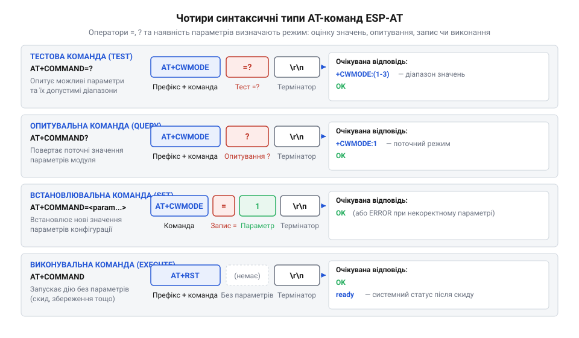
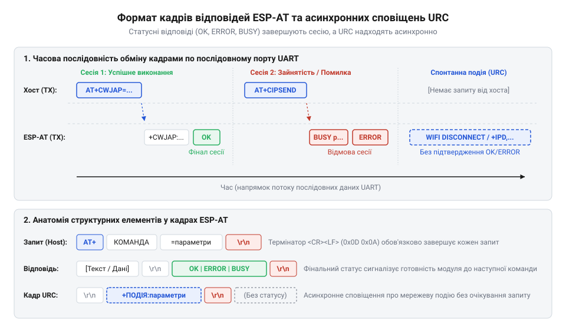
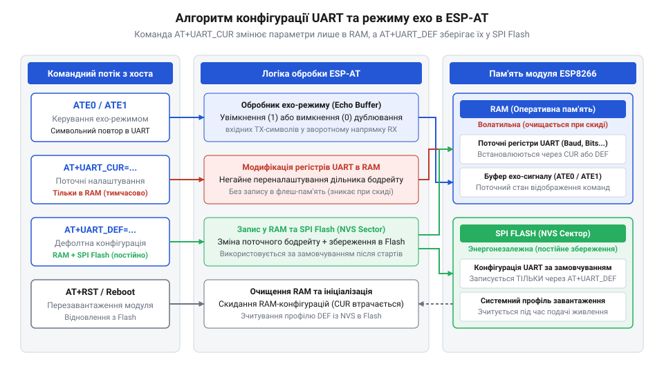
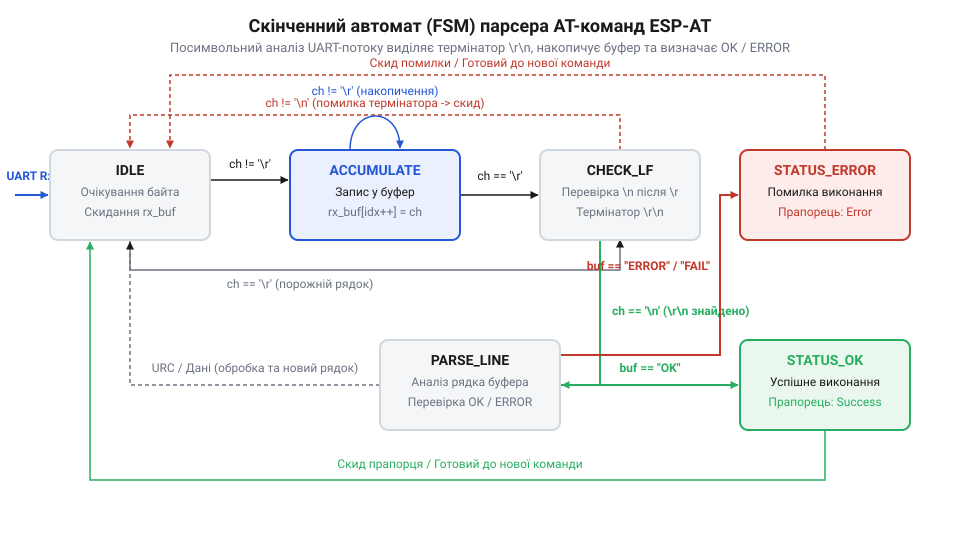

# Огляд базового командного інтерфейсу ESP-AT

<preknowlist>
- [Архітектура та будова прошивки Espressif AT для ESP8266](root:cat-hw-boards/esp8266-at-firmware-architecture) — загальні принципи організації AT-командного фреймворку Espressif та концепцію обробки послідовного потоку даних у прошивці
- [Апаратні FIFO-буфери інтерфейсу UART в ESP8266](root:cat-hw-boards/esp8266-uart-hardware-fifo) — принципи буферизації символів на фізичному рівні UART та параметри налаштування швидкості передачі даних (Baud Rate)
- [Огляд мікроконтролера та архітектури SoC ESP8266](root:cat-hw-boards/esp8266-soc-architecture-overview) — базову організацію периферійних блоків SoC та роль виділеного послідовного порту UART0 у системній взаємодії з хостом
- [Огляд сімейства Wi-Fi модулів ESP-01 та ESP-01S](root:cat-hw-boards/esp-01-module-family-overview) — фізичну розводку сигнальних ліній TX/RX та особливості підключення модулів до послідовного порту мікроконтролера
</preknowlist>

## Чому бездротовий модуль розсинхронізовується з хостом

Коли керуючий мікроконтролер надсилає байти до бездротового модуля через лінії TX та RX, зв'язок часто переривається або пристрій втрачає керованість. Асинхронний інтерфейс @@en|UART@@ (від англ. *Universal Asynchronous Receiver-Transmitter* — універсальний асинхронний приймач-передавач) не має спільного сигналу тактування. Передача спирається лише на швидкість обміну @@en|Baud Rate@@, тому розбіжність генераторів спричиняє зміщення бітових інтервалів і спотворення символів.

Хаос поглиблюється фрагментацією даних у [апаратних буферах переривань](root:cat-hw-boards/esp8266-uart-hardware-fifo). Без межевого покажчика приймальний стек не розрізняє межі команд, а вхідні байти зливаються зі службовими повідомленнями модуля. Без уніфікованих @@en|термінаторів@@ обмін перетворюється на хаотичний потік, де хост втрачає контроль над станом вузла.

Проблему розв'язує текстовий стек @@en|ESP-AT@@, що створює детермінований протокол «запит — відповідь». Префікс @@en|AT-команда@@ (від англ. *Attention* — увага) дозволяє адаптеру модуля відрізнити керування від мережевих байтів, а синтаксис [командного стека прошивки](root:cat-hw-boards/esp8266-at-firmware-architecture) розділяє керування на чотири операційні типи.

## Специфікація чотирьох синтаксичних типів AT-команд

Текстовий стек @@en|ESP-AT@@ розділяє керування на чотири синтаксичні типи. Це дозволяє хосту безпечно зчитувати конфігурацію, перевіряти параметри й змінювати режим роботи без ризику подати невалідну команду.

Синтаксичний розбір спирається на знаки `=` та `?`. Тестова команда (@@en|Test command@@) `AT+CMD=?` запитує список доступних параметрів та їхні діапазони. Опитувальна команда (@@en|Query command@@) `AT+CMD?` повертає поточні налаштування. Встановлювальна команда (@@en|Set command@@) `AT+CMD=<param1>,<param2>` змінює конфігураційні змінні. Виконувальна команда (@@en|Execute command@@) `AT+CMD` запускає внутрішню процедуру модуля без зміни довготривалих параметрів.

*Синтаксична структура чотирьох типів AT-команд та відповідних операторів.*

Щоб елементи [архітектури периферійного SoC](root:cat-hw-boards/esp8266-soc-architecture-overview) розпізнали завершення фрази, кожен командний рядок має завершуватися двобайтовим маркером @@en|CRLF@@ (від англ. *Carriage Return / Line Feed*): `\r` (`0x0D`) та `\n` (`0x0A`). Цей @@en|термінатор@@ (від лат. *terminare* — обмежувати, закінчувати) сигналізує @@en|парсеру@@ модуля закрити буфер і розпочати синтаксичний аналіз рядка.

## Формати статусних відповідей та асинхронних сповіщень

Будь-яка @@en|AT-команда@@ викликає текстовий транзакційний фрейм, що завершується термінальним статусом (@@en|terminal status@@). Маркер OK підтверджує успішне виконання, ERROR вказує на синтаксичну помилку чи недопустимий параметр, а BUSY p... сигналізує про зайнятість пристрою й забороняє нові запити.

Окремо від відповідей модуль спонтанно надсилає асинхронні сповіщення @@en|URC@@ (від англ. *Unsolicited Result Code* — незапитуваний код результату). Вони повідомляють про мережеві чи системні події: втрату з'єднання WIFI DISCONNECT, отримання IP-адреси WIFI GOT IP або перезавантаження 
eady.

*Формати статусних термінальних відповідей та асинхронних сповіщень URC.*

Під час [потокового розбору даних](root:cat-hw-boards/esp8266-at-ipd-parser) @@en|парсер@@ хоста має відрізняти відповідь на запит від сповіщення @@en|URC@@. Сприйняття рядка WIFI CONNECTED за статус відповіді блокує шину або хибно скидає @@en|таймаут@@ очікування OK.

## Керування системними параметрами та послідовним портом

Первинна діагностика модуля розпочинається з @@en|AT-команд@@. Запит `AT` перевіряє зв'язок (відповідь `OK`), `AT+RST` перезапускає прошивку, `AT+GMR` повертає версію та дату збірки ПЗ, а `AT+RESTORE` відновлює заводські налаштування.

Режим командного ехо `ATE1` за замовчуванням дублює вхідні байти в лінію TX хоста. Команда `ATE0` вимикає зворотну трансляцію символів, спрощуючи розбір вхідного потоку на мікроконтролері.

*Порядок перевірки зв'язку, налаштування ехо-режиму та збереження параметрів UART.*

Зміна швидкості @@en|Baud Rate@@ після [підключення бездротового модуля](root:cat-hw-boards/esp-01-module-family-overview) вимагає обережності через ризик втрати зв'язку. Команда `AT+UART_CUR` змінює параметри @@en|UART@@ тимчасово в оперативній пам'яті @@en|RAM@@, що дозволяє відновити контроль перезавантаженням. Команда `AT+UART_DEF` записує налаштування у неенергонезалежну @@en|flash-пам'ять@@ (від англ. *flash memory* — миттєва пам'ять), роблячи їх постійними для наступних сесій.

## Принципи побудови парсера команд для хоста

Приймальний алгоритм хоста враховує асинхронність і фрагментацію байтів @@en|UART@@. Щоб уникнути втрат у перериваннях, вхідний потік спрямовується у @@en|кільцевий буфер@@ (від англ. *ring buffer* — кільцевий накопичувач). Він відокремлює прийом від розбору та не блокує основний цикл.

Розбір кадру виконує скінченний автомат станів (від англ. *state machine* — машина станів). Байти накопичуються до термінатора @@en|CRLF@@, після чого @@en|парсер@@ зіставляє рядок із маркерами `OK`, `ERROR` чи сповіщеннями @@en|URC@@.

*Схема станів хост-парсера для виділення термінаторів та обробки таймаутів.*

Стійкість обміну забезпечує обробка @@en|таймаутів@@. Для кожного запиту хост запускає таймер. Якщо модуль не повертає маркер `OK` чи `ERROR` за заданий інтервал, автомат скидає буфер і повертає хост у початковий стан для повторної відправки чи [двофазного узгодження](root:cat-hw-boards/esp8266-at-cipsend-handshake).