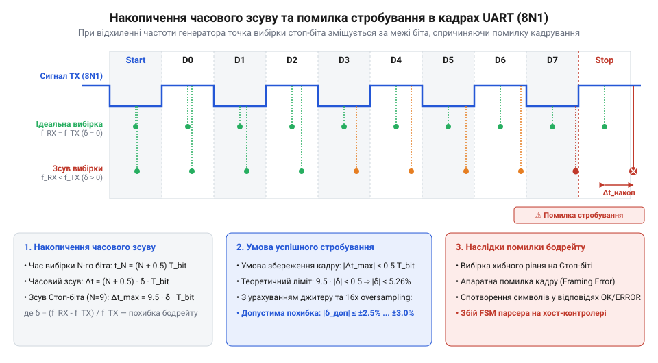
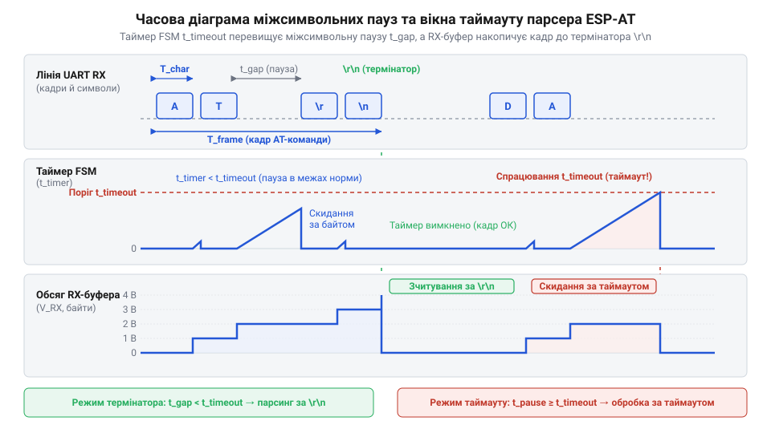

# Математика таймінгів UART та розрахунок таймаутів парсера AT-команд

<preknowlist>
- [Огляд базової системи AT-команд мікроконтролера ESP8266](root:cat-hw-boards/esp8266-at-command-set-overview) — синтаксис та класи команд ESP-AT, формати відповідних рядків OK/ERROR та асинхронних сповіщень
- [Апаратні FIFO-буфери інтерфейсу UART в ESP8266](root:cat-hw-boards/esp8266-uart-hardware-fifo) — розмір та пороги спрацьовування переривань апаратних FIFO-буферів прийому й передачі UART ESP8266
- [Архітектура та будова прошивки Espressif AT для ESP8266](root:cat-hw-boards/esp8266-at-firmware-architecture) — принципи обробки команд у системній черзі прошивки, взаємодія з драйвером UART та операційною системою FreeRTOS
- [Потоковий розбір асинхронних кадрів +IPD в AT-прошивці ESP8266](root:cat-hw-boards/esp8266-at-ipd-parser) — механіка формування та передачі асинхронних кадрів +IPD із мережевими даними через UART
</preknowlist>

## Чому парсер AT-команд втрачає дані

Під час інтеграції Wi-Fi модулів ESP8266, як-от [ESP-01](root:cat-hw-boards/esp-01) або [ESP-01S](root:cat-hw-boards/esp-01s), з керуючим хост-мікроконтролером надсилання рядка AT повертає очікуваний токен OK. Проте в умовах мережевого обміну — при розборі потокових даних кадру +IPD або виконанні [двофазного протоколу AT+CIPSEND](root:cat-hw-boards/esp8266-at-cipsend-handshake) — зв'язок починає ламатися. Хост-мікроконтролер спорадично втрачає окремі байти, отримує спотворені символи або передчасно перериває прийом за таймаутом.

Початкова гіпотеза, що достатньо встановити однакову швидкість передачі — @@en|Baud Rate@@ (англ. *Baud Rate*, на честь французького інженера Еміля Бодо, фр. *Baudot* + англ. *rate* — швидкість), наприклад 115200 @@en|baud@@, і додати фіксовану затримку delay(100), ігнорує асинхронну природу інтерфейсу @@en|UART@@ (англ. *Universal Asynchronous Receiver-Transmitter*, від лат. *universalis* — загальний, грец. *asynchronos* — неузгоджений у часі, лат. *recipere* — отримувати, *transmittere* — передавати). У лінії @@en|UART@@ немає спільної шини тактування: приймач відновлює часову сітку кадру за спадним фронтом стартового біта, спираючись на власний генератор.

Складність поглиблюється тим, що зовнішній @@en|crystal oscillator@@ (англ. *crystal oscillator*, від грец. *krystallos* — лід, кристал + лат. *oscillare* — розгойдуватися) ESP8266 піддається дрейфу частоти через зміну температури кристалу, пульсації живлення та стрибки струму Wi-Fi передавача. Це руйнує синхронність дискретизації бітів. Крім того, сама [архітектура прошивки Espressif AT](root:cat-hw-boards/esp8266-at-firmware-architecture) під керуванням операційної системи @@en|FreeRTOS@@ та мережевого стека @@en|lwIP@@ перериває вивантаження даних із [апаратних FIFO-буферів UART](root:cat-hw-boards/esp8266-uart-hardware-fifo) для обробки пакетів, утворюючи флуктуючі міжсимвольні паузи.

Випадкові затримки унеможливлюють використання фіксованих констант у коді. Нерозважливо обраний таймаут призводить до двох крайностей: або хост занадто довго блокує виконання програми, або парсер перериває прийом на міжсимвольній паузі. Щоб побудувати надійний скінченний автомат — @@en|FSM@@ (англ. *finite-state machine*) — для розбору [базової системи AT-команд](root:cat-hw-boards/esp8266-at-command-set-overview), необхідно побудувати строгу математичну модель часових параметрів передачі кадрів через інтерфейс @@en|UART@@.

## Математична модель кадрування інтерфейсу UART

Часові параметри послідовного зв'язку спираються на тривалість одного біта `T_bit` (англ. *bit* від *binary digit* — двійкова цифра) інтерфейсу @@en|UART@@, обернено пропорційну швидкості `f_baud` (англ. @@en|Baud Rate@@).

Тривалість біта `T_bit` дістаємо як обернену величину до швидкості `f_baud`:

    T_bit = 1 / f_baud

Рівняння визначає тривалість сигналу у секундах.

Для стандартної швидкості 115200 @@en|baud@@ ESP-AT обчислюємо `T_bit`:

    T_bit = 1 / 115200
          = 0.000008680555... s     [ділення одиниці на частоту в Гц]
          ≈ 8.681 μs                [у мікросекунди]

Один біт триває 8.681 μs.

Дані передаються асинхронними кадрами. У режимі 8N1 кадр містить 1 стартовий біт @@en|Start Bit@@ (`N_start`), 8 бітів даних @@en|Data Bits@@ (`N_data`), 0 бітів паритету @@en|Parity Bit@@ (`N_parity`) та 1 стоповий біт @@en|Stop Bit@@ (`N_stop`). Кількість бітів `N_bits` дорівнює:

    N_bits = N_start + N_data + N_parity + N_stop
           = 1 + 8 + 0 + 1          [сумування бітів кадру 8N1]
           = 10 біт                 [загальний обсяг кадру]

Кадр 8N1 містить 10 бітових інтервалів.

Повний час передачі одного символу `T_frame` отримуємо множенням кількості бітів `N_bits` на тривалість біта `T_bit`:

    T_frame = N_bits · T_bit
            = N_bits / f_baud       [підстановка T_bit = 1 / f_baud]

Вираз пов'язує формат кадру зі швидкістю.

Для швидкості 115200 baud обчислюємо тривалість кадру `T_frame`:

    T_frame = 10 / 115200
            = 0.00008680555... s     [ділення бітів на швидкість]
            ≈ 86.806 μs              [у мікросекунди]

Передача кадру триває 86.806 μs.

Фізичну пропускну здатність лінії `R_byte` у байтах за секунду обчислюємо діленням швидкості `f_baud` на кількість бітів `N_bits`:

    R_byte = f_baud / N_bits
           = 115200 / 10            [обчислення для 115200 baud]
           = 11520 Б/с              [ефективна швидкість в Б/с]

Лінія передає максимум 11520 байтів за секунду.

Ефективність кадрування `η_frame` отримуємо відношенням бітів даних `N_data` до обсягу кадру `N_bits`:

    η_frame = N_data / N_bits
            = 8 / 10                [відношення корисних бітів до загальних]
            = 0.8 (80%)             [ефективна частка корисних даних]

Накладні витрати становлять 20%: кожні 10 бітів несуть 1 байт даних. Тривалість кадру `T_frame ≈ 86.806 μs` дає базовий квант обміну, проте дрейф тактування спотворює `T_bit`, що ставить питання про похибку стробування.

## Розрахунок граничного допуску відхилення бодрейту

Асинхронний приймач @@en|UART@@ розпізнає початок кадру за спадним перепадом @@en|Start Bit@@, скидає лічильник і стробує сигнал посередині кожного бітового інтервалу для стійкості до завад. Для цього модуль застосовує надлишкову дискретизацію — @@en|over-sampling@@ (англ. *over-sampling*, від англ. *over* — понад + *sample* — вибірка) з частотою 16 · f_baud.

Часовий момент стробування 	_sample(N) для N-го біта кадру (N = 0 — @@en|Start Bit@@, N = 1..8 — біти даних, N = 9 — @@en|Stop Bit@@) обчислюємо за формулою:

    t_sample(N) = (N + 0.5) · T_bit

Вираз визначає центр N-го бітового інтервалу.

Для стопового біта (N = 9) 10-бітного кадру момент стробування становить:

    t_sample(9) = (9 + 0.5) · T_bit
                = 9.5 · T_bit       [обчислення центру інтервалу стоп-біта]

Точка стробування припадає на 9.5 · T_bit.

*Часова діаграма стробування 10-бітного кадру UART (8N1) із накопиченням часового зсуву через відхилення частоти генератора: зміщення точок вибірки при критичній похибці Baud Rate.*

Відносну похибку швидкості E_baud через розбіжність частот приймача _RX і передавача _TX обчислюємо як:

    E_baud = (f_RX - f_TX) / f_TX

Вираз визначає відносний дрейф швидкості.

Накопичений часовий зсув стробування Δt_drift(N) на N-му біті становить:

    Δt_drift(N) = (N + 0.5) · T_bit · E_baud

Похибка накопичується з кожним бітом.

Монотонне накопичення робить найкритичнішим @@en|Stop Bit@@ (N = 9). Якщо зсув Δt_drift(9) перевищить ±0.5 · T_bit, вибірка вийде за межі стоп-біта, викликаючи апаратну помилку кадрування — @@en|Framing Error@@ (англ. *Framing Error*, від давньоангл. *fremman* — будувати + лат. *error* — блукання, помилка).

При 16-кратному @@en|over-sampling@@ фазування стартового біта додає невизначеність ±0.5 / 16 = ±0.03125 · T_bit. Умову зчитування стоп-біта показує нерівність:

    |9.5 · T_bit · E_baud| + 0.03125 · T_bit < 0.5 · T_bit

Нерівність обмежує сумарне зміщення точки стробування.

Граничне відхилення швидкості E_baud_max виводимо покроково:

    9.5 · |E_baud| < 0.5 - 0.03125  [віднімання похибки фазування over-sampling]
    9.5 · |E_baud| < 0.46875        [обчислення чистого часового допуску]
    |E_baud_max| < 0.46875 / 9.5    [ділення на часове плече стоп-біта]
    |E_baud_max| < 0.04934 (4.93%)   [гранична сумарна похибка двох пристроїв]

Теоретична сумарна похибка швидкості обмежена рівнем **±4.93%**. З урахуванням ємності лінії та джиттера трансиверів практичний допуск становить **±4.5%**.

Якщо внутрішній @@en|RC oscillator@@ ESP8266 через нагрівання має дрейф **±2.5%**, апаратний таймер хоста має забезпечувати точність @@en|Baud Rate@@ не гіршу за **±2.0%**. Межа синхронізації кадру дозволяє перейти до розрахунку міжсимвольних затримок у потоці AT-команд.

## Математика міжсимвольних затримок ESP-AT прошивці

Розрахунок тривалості кадру `T_frame` створює ілюзію, що час передачі рядка залежить лише від кількості символів та швидкості @@en|Baud Rate@@. На практиці байти надходять дискретними групами з міжсимвольними паузами — @@en|inter-character delay@@ (англ. *inter-character delay*, від лат. *inter* — між + грец. *charakter* — риса, символ + англ. *delay* — затримка). Перша фізична причина пачок — функціонування [апаратних FIFO-буферів UART](root:cat-hw-boards/esp8266-uart-hardware-fifo) в ESP8266.

Апаратний буфер передачі @@en|FIFO@@ (англ. *FIFO*, скорочення від *First In, First Out* — першим зайшов, першим вийшов) в ESP8266 має обсяг `N_fifo = 128` байтів. Доки буфер містить дані, трансивер вивантажує байти в лінію @@en|UART@@ безперервно з інтервалом `T_frame`. Тривалість вивантаження заповненого буфера `T_fifo_flush` становить:

    T_fifo_flush = N_fifo · T_frame
                 = 128 · 86.806 μs          [підстановка тривалості кадру для 115200 baud]
                 ≈ 11.111 ms                [час вивантаження 128 байтів з FIFO]

Вираз визначає час безперервної передачі пачки.

Друга вагоміша причина пауз — [архітектура прошивки Espressif AT](root:cat-hw-boards/esp8266-at-firmware-architecture) під керуванням операційної системи @@en|FreeRTOS@@ та [мережевого стека lwIP](root:cat-hw-boards/lwip-architecture-esp8266). Під час формування відповіді текстовий потік генерується фрагментами. Між заповненнями @@en|FIFO@@ операційна система виконує перемикання контексту — @@en|context switch@@ (англ. *context switch*, від лат. *contextus* — з'єднання + англ. *switch* — перемикання) — або обробляє системний такт — @@en|tick@@ (англ. *tick* — системний такт) тривалістю `T_tick = 10 ms`. Крім того, Wi-Fi переривання викликають витиснення — @@en|preemption@@ (англ. *preemption*, від лат. *praeemptio* — випереджальний викуп, витиснення) — завдання парсера AT-команд потоком @@en|lwIP@@.

Вихідний потік символів розпадається на окремі пачки — @@en|burst@@ (англ. *burst* — спалах, пачка даних). Максимальну міжсимвольну паузу між пачками `t_gap_max` обчислюємо як суму затримок ОС й стека:

    t_gap_max = T_sched + T_lwIP + T_refill

Тут `T_sched` — затримка планувальника @@en|FreeRTOS@@ (1..10 ms), `T_lwIP` — час мережевих переривань (до 30 ms), а `T_refill` — час генерації блоку в AT-рушії. Рівняння задає граничний інтервал тиші між пачками.

Для `M` байтів відповіді та `k = ⌈M / N_fifo⌉` пачок загальний час передачі `T_total_trans` дістаємо за формулою:

    T_total_trans = M · T_frame + (k - 1) · t_gap_max

Формула враховує чистий час кадрування та накопичені міжсимвольні паузи.

Розрахуємо тривалість передачі `M = 256` байтів при 115200 @@en|baud@@ (`k = 2` пачки, `t_gap_max = 10 ms`):

    T_total_trans = 256 · (10 / 115200) + (2 - 1) · 10 ms
                  = 256 · 0.086806 ms + 10 ms   [підстановка T_frame та міжсимвольної паузи]
                  = 22.222 ms + 10 ms           [сумування чистого часу кадрування та паузи]
                  = 32.222 ms                   [загальна тривалість обміну у лінії]

Зіставивши чистий час кадрування `22.222 ms` із реальним `32.222 ms`, бачимо, що паузи додають понад 45% часу. Ігнорування цих затримок призводить до передчасного розриву прийому, що робить математичне обчислення граничних таймаутів критично необхідним.

## Обчислення мінімальних таймаутів очікування відповідей

При проектуванні драйвера обміну з ESP8266 призначення єдиного фіксованого таймауту — @@en|timeout@@ (англ. *timeout*, від англ. *time* — час + *out* — вихід, вичерпання) — на кшталт `delay(100)` чи `1000 ms` ігнорує реальний час виконання команд всередині модуля. Фіксована затримка блокує програму хоста при втраті кадру або призводить до хибного відсікання відповіді під час обчислень [базової системи AT-команд](root:cat-hw-boards/esp8266-at-command-set-overview).

Гарантований мінімальний таймаут очікування відповіді `T_timeout` обчислюється за моделлю, що враховує час обробки команд `T_process` (затримку алгоритму SoC ESP8266 до виходу першого байта), тривалість кадрування `N_resp · T_frame`, міжсимвольні паузи `t_gap_max` для `N_chunks = ⌈N_resp / N_fifo⌉` пачок вивантаження та запас `T_margin` (50..500 ms) на дрейф швидкості `E_baud` і флуктуації мережі:

T_timeout = T_process + (N_resp · T_frame) + (N_chunks - 1) · t_gap_max + T_margin

Розрахунок `T_timeout` для чотирьох категорій AT-команд:

**1. Випробувальні та системні команди (`AT`, `AT+GMR`, `AT+RST`)**
Для базових команд обробка виконується в оперативній пам'яті за `T_process ≈ 1..5 ms`, а розмір відповіді `\r\nOK\r\n` зі службовими токенами становить `N_resp ≈ 64` байти (`N_chunks = 1`).

T_timeout_basic = 5 ms + (64 · 0.0868 ms) + 0 ms + 50 ms
                = 5 ms + 5.555 ms + 50 ms   [підстановка складових]
                = 60.555 ms ≈ 70 ms         [мінімальне часове вікно очікування]

**2. Мережеві команди конфігурації Wi-Fi (`AT+CWLAP`, `AT+CWJAP`)**
Підключення до точки доступу `AT+CWJAP` вимагає сканування ефіру, рукостискання та отримання IP-адреси, через що `T_process` становить 3000..15000 ms. При обсязі відповіді `N_resp ≈ 128` байтів обчислимо `T_timeout_wifi`:

T_timeout_wifi = 15000 ms + (128 · 0.0868 ms) + 10 ms + 1000 ms
               = 15000 ms + 11.111 ms + 10 ms + 1000 ms [підстановка складових]
               = 16021.111 ms ≈ 16 s                   [граничний таймаут підключення]

**3. Передача даних через сокети (`AT+CIPSEND`, `+IPD`)**
Обмін через [мережеві сокети TCP/UDP](root:cat-hw-boards/esp01-tcp-udp-sockets) та [захищені SSL/TLS з'єднання](root:cat-hw-boards/esp8266-at-ssl-tls) залежить від мережевого запізнення — @@en|round-trip time@@ (англ. *round-trip time*, від англ. *round-trip* — туди й назад + *time* — час) `RTT` — та процедури узгодження — @@en|handshake@@ (англ. *handshake*, від англ. *hand* — рука + *shake* — потиск). Для кадру `L = 1460` байтів (`N_chunks = ⌈1460 / 128⌉ = 12`) при запізненні `RTT_max = 3000 ms` обчислимо `T_timeout_data`:

T_timeout_data = RTT_max + (L · T_frame) + (11 · t_gap_max) + T_margin
               = 3000 ms + (1460 · 0.0868 ms) + (11 · 10 ms) + 500 ms
               = 3000 ms + 126.728 ms + 110 ms + 500 ms  [обчислення для кадру 1460 Б]
               = 3736.728 ms ≈ 4 s                       [гарантоване вікно сокета]

**4. Бездротове оновлення прошивки FOTA (`AT+CIUPDATE`)**
Процедура [оновлення прошивки по повітрю (FOTA)](root:cat-hw-boards/esp8266-fota-update) — @@en|FOTA@@ (англ. *FOTA*, скорочення від *Firmware Over-The-Air* — оновлення прошивки по повітрю) — охоплює завантаження образу ~512 КБ та стирання й запис секторів SPI Flash. Сумарний час обробки `T_process` досягає 90 s.

T_timeout_fota = 90000 ms + (524288 · 0.0868 ms) + 30000 ms
               = 90000 ms + 45511.2 ms + 30000 ms   [підстановка часу стирання та завантаження]
               = 165511.2 ms ≈ 180 s (3 min)        [граничний таймаут FOTA]

Диференційований розрахунок часових вікон створює чіткі межі для налаштування системних таймерів і приймальних буферів хоста.

## Розрахунок буферів та таймінгів автомата парсингу

Отримані значення тривалості кадрів, міжсимвольних пауз та граничних таймаутів дозволяють запроектувати архітектуру потокового парсера на хост-мікроконтролері. Прийом даних здійснюється асинхронно через переривання або DMA у кільцевий буфер — @@en|ring buffer@@ (англ. *ring buffer*, від англ. *ring* — кільце + давньофр. *bufe* — удар), який також називають круговим буфером — @@en|circular buffer@@ (англ. *circular buffer*, від лат. *circularis* — круговий + давньофр. *bufe* — удар). Якщо місткість буфера недостатня, новий входжувальний потік перевищить швидкість вибірки головного циклу й спричинить втрату даних при виконанні процедури [потоковий розбір асинхронних кадрів +IPD](root:cat-hw-boards/esp8266-at-ipd-parser).

*Часова діаграма міжсимвольних пауз, накопичення даних у кільцевому RX-буфері та вікна таймауту FSM-парсера хоста: моменти вивантаження буфера та порівняння часового порогу t_char_timeout із граничним вікном T_timeout.*

Мінімальний обсяг кольцевого буфера хоста `S_buf` залежить від пропускної здатності шини `R_byte = f_baud / N_bits`, періоду опитування головного циклу програми (або кванта диспатчинг-завдання) `T_poll` та обсягу апаратного @@en|FIFO@@ модуля передачі:

S_buf ≥ R_byte · T_poll + N_fifo

Обчислимо мінімальний розмір `S_buf` для швидкості 115200 @@en|baud@@ (`R_byte = 11520 B/s`), якщо головний цикл хоста має період опитування `T_poll = 20 ms`:

S_buf_min = 11520 B/s · 0.020 s + 128 Б
          = 230.4 Б + 128 Б            [сумування накопичення за період опитування та обсягу FIFO]
          = 358.4 Б                    [розрахунковий поріг місткості]

Для забезпечення стійкості застосовують коефіцієнт запасу `1.5` і округлюють значення до найближчого ступеня двійки: `S_buf = 512 Б` (або `2048 Б` при обробці повних мережевих кадрів `+IPD` розміром 1460 байтів).

Другим ключовим параметром скінченного автомата — @@en|FSM@@ — є часовий поріг виявлення вільної лінії — @@en|idle line@@ (англ. *idle line*, від англ. *idle* — холостий, вільний + лат. *linea* — лінія) — `t_char_timeout`. Цей поріг визначає тривалість тиші в лінії після останнього прийнятого байта, яка сигналізує про завершення пачки або повного кадру відповіді. Для надійної кадриції значення `t_char_timeout` повинно строго задовольняти подвійній математичній нерівності:

t_gap_fifo_refill < t_char_timeout < T_timeout

Тут `t_gap_fifo_refill` — мікросекундна затримка між байтами всередині однієї пачки при повторному заповненні регістра передачі (типово 2..5 ms). Виведемо оптимальне значення `t_char_timeout`:

t_char_timeout = k_idle · T_frame + t_gap_fifo_refill

Приймаючи `k_idle = 3.5` (стандартне часове вікно тиші), обчислимо поріг для швидкості 115200 @@en|baud@@:

t_char_timeout = 3.5 · 0.0868 ms + 5 ms
               = 0.3038 ms + 5 ms     [обчислення 3.5 біт-таймів та паузи поповнення FIFO]
               = 5.304 ms ≈ 10 ms     [практичний поріг кадриції для FSM]

Алгоритм скінченного автомата парсингу спирається на два таймери: таймер міжсимвольної тиші (скидається при кожному прийнятому байті) та таймер загального запізнення команди (запускається при відправці `\r\n`). Нижче наведено ідіоматичну реалізацію кольцевого буфера та контролю таймінгів автомата на мовах C та C++.

:::tabs
:::code math-uart-timing-and-timeouts/c/esp-idf/at-parser-process-rx.c
:::code math-uart-timing-and-timeouts/cpp/arduino/fsmstate.cpp
:::

Математична модель міжсимвольних затримок, диференційованих таймаутів та параметрів RX-буфера гарантує побудову повністю асинхронного та стійкого автомата розбору ESP-AT команд, що унеможливлює зависання системи або втрату даних при будь-яких режимах роботи модуля.
