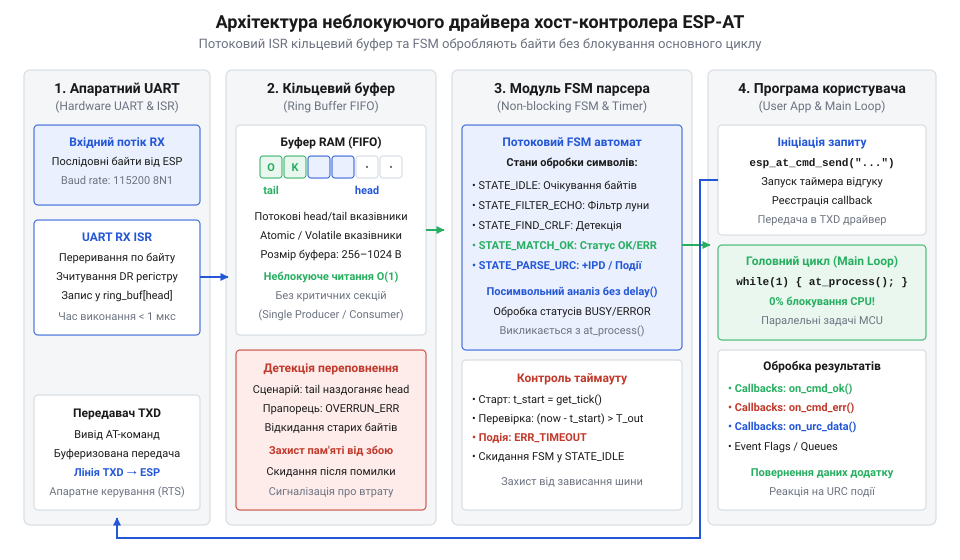
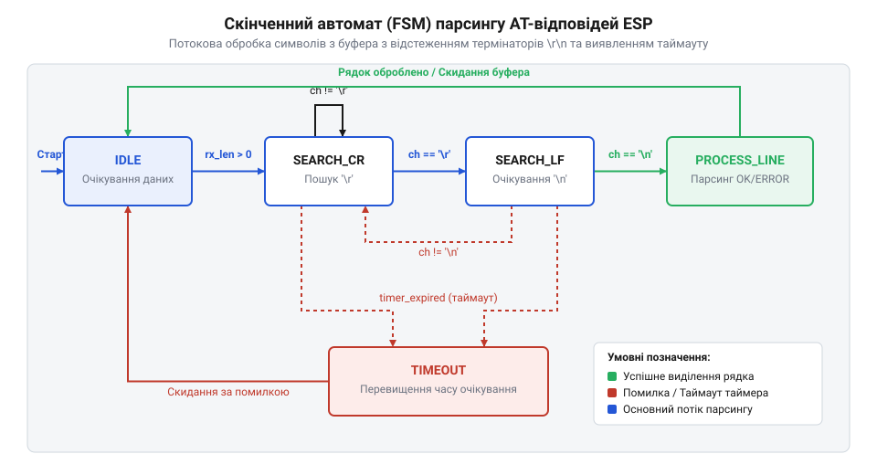

# Розробка скінченного автомата парсингу ESP-AT відповідей на C/C++

<preknowlist>
- [Огляд базової системи AT-команд мікроконтролера ESP8266](root:cat-hw-boards/esp8266-at-command-set-overview) — синтаксис текстових AT-команд, формат стандартних відповідей (OK, ERROR) та правило обробки ехо-символів
- [Апаратні FIFO-буфери інтерфейсу UART в ESP8266](root:cat-hw-boards/esp8266-uart-hardware-fifo) — специфіка буферизації байтів у послідовному порту та робота переривань прийому даних
- [Архітектура та будова прошивки Espressif AT для ESP8266](root:cat-hw-boards/esp8266-at-firmware-architecture) — принципи формування статусних відповідей та асинхронних сповіщень модуля
- [Потоковий розбір асинхронних кадрів +IPD в AT-прошивці ESP8266](root:cat-hw-boards/esp8266-at-ipd-parser) — формат та особливості надходження вхідних мережевих даних +IPD під час роботи з сокетами
</preknowlist>

## Проблема блокуючого очікування AT відповідей

Спроба організувати взаємодію між хост-мікроконтролером та бездротовим модулем @@en|ESP8266@@ через послідовний порт за допомогою простих синхронних функцій зчитування байтів майже завжди призводить до нестабільної роботи вбудованої системи. Коли програма контролера надсилає командний рядок @@en|AT@@ (наприклад, команду приєднання до бездротової мережі `AT+CWJAP="SSID","PASS"`), вона очікує отримати підтверджувальний статус (лат. @@la|status@@, від @@la|stare@@ — перебувати в стані) виконання від модуля. Якщо розробник реалізує це очікування через простий блокуючий цикл на кшталт `while (!uart_available()); char c = uart_read();`, основний потік виконання програми повністю зупиняється на весь час обробки запиту периферійним пристроєм.

Час відповіді @@en|ESP8266@@ є принципово недетермінованим. Базова перевірка зв'язку `AT` повертає відповідь за 2–5 мілісекунд, тоді як процедура авторизації в мережі @@en|Wi-Fi@@, отримання мережевої адреси по @@en|DHCP@@ або встановлення розширеного захищеного з'єднання може тривати від кількох сотень мілісекунд до 5–10 секунд. Під час цього блокуючого вікна очікування хост-контролер втрачає здатність реагувати на будь-які зовнішні події: зчитувати аналогові сенсори, опитувати кнопки інтерфейсу користувача, обслуговувати періодичні таймери та оновлювати апаратний сторожовий таймер (@@en|Watchdog Timer@@). У результаті спрацьовує сторожовий скидач і мікроконтролер аварійно перезавантажується, або ж система пропускає важливі вхідні дані.

Додатково апаратна периферія послідовного інтерфейсу @@en|UART@@ (англ. @@en|Universal Asynchronous Receiver-Transmitter@@ — універсальний асинхронний приймач-передавач) приймає байти асинхронно та зберігає їх у невеликому внутрішньому буфері первинного накопичення @@en|FIFO@@ (англ. @@en|First In, First Out@@ — першим прийшов, першим пішов), ємність якого в мікроконтролерах зазвичай становить від 16 до 128 байтів. Якщо хост-контролер заблокований виконуваним затримковим циклом і не встигає вчасно вигребти байти з регістру прийому, виникає апаратне переповнення (@@en|buffer overflow@@), через що частина символів відповіді втрачається, а текстовий кадр спотворюється. Вивчення специфіки буферизованого прийому описано в статті про [апаратні FIFO-буфери UART](root:cat-hw-boards/esp8266-uart-hardware-fifo).


*Схема архітектури неблокуючого драйвера хост-контролера: взаємодія апаратного UART, ISR кільцевого буфера, модуля FSM та програми користувача.*

Для усунення блокувань у розробці вбудованих систем застосовують подійно-орієнтовану асинхронну архітектуру. Прийом кожного окремого байта з апаратного порту покладається на обробник апаратного переривання (лат. @@la|interruptio@@, від @@la|interrumpere@@ — переривати) — @@en|ISR@@ (англ. @@en|Interrupt Service Routine@@). Переривання миттєво зчитує байт із апаратного регістра UART та поміщає його в потокобезпечний кільцевий буфер (англ. @@en|Ring Buffer@@) типу @@en|SPSC@@ (Single-Producer Single-Consumer). Приймальне переривання виступає єдиним виробником, що зсуває індекс запису `head`, а основний цикл програми (`main loop`) виступає споживачем, зчитуючи байти за індексом `tail` у неблокуючому режимі.

Структура даних та механізм потокобезпечного кільцевого буфера мовою @@en|C@@ реалізуються без використання важких блокуючих м'ютексів за рахунок розділених atomic-індексів або атомарних операцій читання/запису:

:::code proj-esp-at-host-parser-fsm/c/include/ring_buffer.h 23-29

Функції запису байта в перериванні `ring_buffer_push` та вилучення байта в основному циклі `ring_buffer_pop` працюють за логікою оновлення кільцевих індексів по модулю ємності буфера:

:::code proj-esp-at-host-parser-fsm/c/src/ring_buffer.c 40-81

Така розв'язка дозволяє розділити часові домени прийому даних та їх аналізу. Апаратне переривання гарантує збереження кожного вхідного символу в пам'яті, а основна програма вигрібає накопичений масив байтів тоді, коли має вільний квант процесорного часу, продовжуючи паралельно виконувати всі інші задачі керування. Детальний порядок формування статусних відповідей викладено у статті про [систему AT-команд ESP8266](root:cat-hw-boards/esp8266-at-command-set-overview).

## Архітектура та стани автомата парсингу

Накопичивши вхідні байти в кільцевому буфері, хост-контролер повинен розібрати вхідний потік символів та виділити з нього завершені текстові рядки й термінальні статуси. Використання традиційних функцій обробки рядків типу `strstr()` або `scanf()` вимагає наявності в пам'яті повного суцільного кадру відповіді, що призводить до перевитрати оперативної пам'яті та створює ризик переповнення буфера. Замість цього використовується скінченний автомат (грец. @@el|automatos@@ — саморушний, самодіючий) або @@en|FSM@@ (англ. @@en|Finite State Machine@@), який виконує посимвольний аналіз потоку в міру його надходження з кільцевого буфера.

Логіка FSM-автомата парсера спирається на чітко визначений граф станів. Автомат послідовно аналізує вхідний байт за байтом, змінюючи свій внутрішній стан відповідно до знайдених розділювальних символів та статусних слів.


*Діаграма станів FSM-автомата парсингу ESP-AT відповідей: порядок переходів під час накопичення символів, розпізнавання \r\n та обробки таймауту.*

Архітектура автомата містить п'ять базованих станів, оголошених у переліку `esp_at_state_t`:

1. `ESP_AT_STATE_IDLE` — стан спокою. Автомат перебуває в цьому стані в очікуванні початку нового рядка відповіді. Початкові символи переводу рядків `\r` (Carriage Return, `0x0D`) та `\n` (Line Feed, `0x0A`), які часто передують відповіді в протоколі ESP-AT, у цьому стані ігноруються. Отримання першого друкованого символу переводить FSM у стан накопичення. 2. `ESP_AT_STATE_SEARCH_CR` — стан накопичення символів рядка. Вхідні байти послідовно записуються у внутрішній масив `line_buf`. Стан триває доти, доки у вхідному потоці не з'явиться символ повернення каретки `\r`. Знайшовши `\r`, автомат переходить до перевірки наступного термінатора. 3. `ESP_AT_STATE_SEARCH_LF` — стан перевірки термінаторного символу. Автомат очікує, що наступним байтом буде символ переносу рядка `\n`. Якщо символ підтверджується, кадр вважається повністю сформованим (`\r\n`), і автомат переходить у стан аналізу рядка. Якщо замість `\n` надходить інший символ, він додається до буфера, і FSM повертається у стан `SEARCH_CR`. 4. `ESP_AT_STATE_PROCESSING_LINE` — стан лексичного аналізу. Сформований рядок передається в функцію виділення статусів `OK`, `ERROR`, `FAIL` або `BUSY`. Після завершення аналізу автомат автоматично скидається в стан `IDLE`. 5. `ESP_AT_STATE_TIMEOUT_RECOVERY` — стан відновлення за часом. Спрацьовує, якщо модуль не надіслав завершального статусу протягом встановленого інтервалу. Автомат примусово очищає внутрішній буфер та повертається в початковий стан.

У мові @@en|C@@ реалізація неблокуючого FSM-автомата будується на основі таблиці станів (`state_table`) — масиву вказівників на функції-обробники. Виклик обробника за індексом поточного стану виконується за сталий час $O(1)$ без використання розгалужених операторів `if-else` або `switch-case`:

:::code proj-esp-at-host-parser-fsm/c/include/esp_at_parser.h 28-35

Для захисту від нескінченного очікування при апаратному збої модуля або обриві лінії зв'язку FSM-драйвер містить неблокуючий механізм контролю таймаутів. Під час відправки команди функція `esp_at_parser_start_command` фіксує початкову мітку часу `command_start_time_ms` та встановлює допустимий інтервал очікування `timeout_period_ms`. В основному циклі програми регулярно викликається функція `esp_at_parser_check_timeout`, яка порівнює поточний системний час без блокування виконання.

Порівняємо реалізацію неблокуючого обробника потоку symbols та перевірки таймаутів на мовах @@en|C@@ та @@en|C++@@:

:::tabs
@tab C
:::code proj-esp-at-host-parser-fsm/c/src/esp_at_parser.c 86-135
@tab C++
:::code proj-esp-at-host-parser-fsm/cpp/src/esp_at_parser.cpp 38-71
:::

Опис стандартів статусних відповідей та структури прошивки модуля викладено в статті про [архітектуру прошивки Espressif AT](root:cat-hw-boards/esp8266-at-firmware-architecture).

## Виділення слів та фільтрація ехо-символів

Після того як FSM-автомат успішно розпізнав термінатор `\r\n` та сформував цілісний текстовий рядок у буфері `line_buf`, починається етап лексичного аналізу. Вбудовані системи вимагають обробки рядків без застосування динамічного виділення пам'яті (`malloc`/`free` у C або постійного перерозподілу `std::string` у C++), оскільки постійне створення тимчасових об'єктів у купі призводить до її фрагментації (англ. @@en|heap fragmentation@@) та аварійного зупину контролера.

Першим завданням лексичного розбору є фільтрація дубльованих ехо-символів (англ. @@en|echo@@). За замовчуванням у прошивках Espressif активовано режим ехо-трансляції (`ATE1`), при якому модуль повертає хосту кожний отриманий байт надісланої AT-команди (наприклад, рядок `AT+GMR\r\n`). Парсер порівнює накопичений рядок із текстом надісланої команди або пропускає вхідне ехо, не сприймаючи його як корисне інформаційне навантаження чи термінальний статус.

Друге завдання — розпізнавання статусних термінаторів виконання команди:
* `OK` — успішне завершення виконання AT-команди;
* `ERROR` або `FAIL` — синтаксична помилка або збій виконання операції;
* `BUSY p...` або `BUSY s...` — повідомлення про те, що модуль зайнятий обробкою попереднього мережевого запиту або з'єднання.

Виявлення слів `OK` або `ERROR` скидає прапорець очікування відповіді `is_waiting_response` в `false`, сповіщає програму користувача через відповідний функціональний колбек `on_ok` чи `on_error` та переводить FSM-автомат у стан `IDLE`.

Окрім прямих відповідей на команди, модуль @@en|ESP8266@@ може надсилати спонтанні асинхронні сповіщення (Unsolicited Result Codes, @@en|URC@@), які виникають незалежно від дій хоста. До таких сповіщень належать системні кадри готовності (`ready`), статуси підключення до мережі (`WIFI CONNECTED`, `WIFI GOT IP`), а також вхідні мережеві кадри сокетів `+IPD`.

При надходженні кадрів даних `+IPD` (формату `+IPD,<link_id>,<len>:<data>`) парсер виділяє префікс, передає службові параметри у виділений обробник і переключає режим зчитування на прямий прийом бінарного потоку заданої довжини. Детальний механізм потокового розбору кадрів даних розкрито у статті про [потоковий розбір асинхронних кадрів +IPD](root:cat-hw-boards/esp8266-at-ipd-parser).

Реалізація аналізу виділеного рядка мовою @@en|C@@ з викликом реєстрованих колбеків статусів виконується наступним чином:

:::code proj-esp-at-host-parser-fsm/c/src/esp_at_parser.c 228-260

Для забезпечення безпеки пам'яті в об'єктно-орієнтованій реалізації на мові @@en|C++@@ застосовується шаблон @@en|RAII@@ (Resource Acquisition Is Initialization) через охоронний клас `RxBufferGuard`, який автоматично очищає тимчасові буфери рядків при виході з області видимості.

Порівняємо повну інтеграцію FSM-парсера в основний цикл програми на C та C++:

:::tabs
@tab C
:::code proj-esp-at-host-parser-fsm/c/src/main.c 77-151
@tab C++
:::code proj-esp-at-host-parser-fsm/cpp/src/main.cpp 28-92
:::

Послідовність взаємодії хоста з модулем при двофазній передачі даних детально описується в статті про [протокол двофазної передачі AT+CIPSEND](root:cat-hw-boards/esp8266-at-cipsend-handshake).

## Програмна реалізація таймаутів та помилок

Під час передачі даних через послідовні апаратні інтерфейси у реальних вбудованих системах завжди існує ризик виникнення фізичних завад: електромагнітних наводок, неспівпадіння швидкостей передачі (англ. @@en|baud rate@@), переповнення апаратного буфера, апаратного обриву лінії або раптового зависання периферійного модуля. Коли програма хост-мікроконтролера надсилає командний рядок @@en|AT@@ до модуля @@en|ESP8266@@, вона очікує отримати підтверджувальний статус (наприклад, `OK` або `ERROR`). Однак якщо вхідні байти кадру відповіді спотворюються або модуль зависає під час виконання запиту, підтверджувальна термінаторна послідовність `\r\n` не надходить зовсім.

Без застосування захисного часового ліміту — таймауту (англ. @@en|timeout@@ — вичерпання відведеного часу) — скінченний автомат (англ. @@en|FSM@@) надовго застрягне в проміжному стані очікування символів (наприклад, `ESP_AT_STATE_SEARCH_CR` або `ESP_AT_STATE_SEARCH_LF`). При цьому логіка парсера вважає, що команда все ще обробляється, а прапорець очікування відповіді `is_waiting_response` залишається у значенні `true`. Це унеможливлює відправку наступних команд та блокує весь канал зв'язку. Для запобігання фатальним зависанням драйвера реалізують інтеграцію системного таймера (англ. @@en|timer@@, від @@en|time@@ — час) та механізм аварійного скидання стану.

Контроль таймаутів реалізується в неблокуючому режимі без зупинки основного циклу програми. Для цього FSM-парсер використовує лічильник системного квока або джерело часу хост-контролера, яке повертає поточний час у мілісекундах (`get_system_time_ms()` у @@en|C@@ або системна функція часу в @@en|C++@@). У момент відправки AT-команди за допомогою функції `esp_at_parser_start_command()` (або `sendCommand()` у @@en|C++@@) драйвер фіксує початкову мітку часу `command_start_time_ms` та записує граничний інтервал очікування `timeout_period_ms`.

У кожній ітерації головного циклу програма викликає функцію `esp_at_parser_check_timeout()`, яка виконує неблокуючу перевірку тривалості очікування. Перед формулюванням умови визначаємо величину вичерпаного часу `elapsed` як різницю між поточним системним моментом та міткою старту:

```
elapsed = current_time - command_start_time_ms
```

Якщо обчислена різниця `elapsed >= timeout_period_ms`, час очікування вважається вичерпаним. Використання віднімання беззнакових 32-бітних цілих чисел гарантує коректний розрахунок інтервалу навіть при переповненні апаратного лічильника системного таймера (англ. @@en|overflow@@).

```
elapsed = current_time - command_start_time_ms
```

Якщо обчислена різниця $\text{elapsed} \ge \text{timeout\_period\_ms}$, час очікування вважається вичерпаним. Використання віднімання беззнакових 32-бітних цілих чисел гарантує коректний розрахунок інтервалу навіть при переповненні апаратного лічильника системного таймера (англ. @@en|overflow@@).

При виявленні таймауту автомат виконує наступні процедури відновлення:
1. Переводить стан FSM у `ESP_AT_STATE_TIMEOUT_RECOVERY` або `ParserState::IDLE`;
2. Скидає прапорець очікування відповіді `is_waiting_response` у значення `false`;
3. Сповіщає програму користувача через зареєстрований колбек (англ. @@en|callback@@ — зворотний виклик) `on_timeout` або статусну функцію зі статусом `ESP_AT_STATUS_TIMEOUT` (`AtStatus::TIMEOUT`);
4. Примусово очищає вбудовані буфери рядків за допомогою функції `esp_at_parser_reset()`.

Іншою небезпечною винятковою ситуацією є переповнення буфера (англ. @@en|buffer overflow@@) накопичення рядка. Якщо через завади у вхідному потоці тривалий час не надходить термінатор `\r\n`, кількість накопичених символів може перевищити максимальну ємність масиву (`ESP_AT_LINE_BUF_SIZE` у C або `MAX_LINE_BUFFER_SIZE` у C++). Щоб уникнути пошкодження оперативної пам'яті, FSM аналізує довжину рядка на кожному кроці `process_byte`. У разі досягнення межі буфер негайно скидається, автомат переходить у стан помилки та повертає статус `ESP_AT_STATUS_ERROR`.

У реалізації на мові @@en|C++@@ для забезпечення безпеки пам'яті під час виняткових ситуацій застосовується шаблон @@en|RAII@@ (англ. @@en|Resource Acquisition Is Initialization@@ — отримання ресурсу є ініціалізацією) через захисний клас `RxBufferGuard`. При виході з області видимості деструктор об'єкта `RxBufferGuard` автоматично очищає буфер `m_lineBuffer`, запобігаючи витоку спотворених даних у наступні кадри.

Порівняємо оголошення статусів та реалізацію неблокуючої обробки таймаутів та скидання FSM мовами @@en|C@@ та @@en|C++@@:

:::tabs
@tab C
:::code proj-esp-at-host-parser-fsm/c/include/esp_at_parser.h 40-46
:::code proj-esp-at-host-parser-fsm/c/src/esp_at_parser.c 69-84
:::code proj-esp-at-host-parser-fsm/c/src/esp_at_parser.c 116-144
@tab C++
:::code proj-esp-at-host-parser-fsm/cpp/include/esp_at_parser.hpp 37-74
:::code proj-esp-at-host-parser-fsm/cpp/src/esp_at_parser.cpp 175-191
:::

Своєчасне виявлення помилок та скидання FSM дозволяє хост-контролеру зберігати працездатність навіть при апаратних збоях безпровідного модуля. Правила формування статусних відповідей розкрито в статті про [систему AT-команд ESP8266](root:cat-hw-boards/esp8266-at-command-set-overview), а архітектуру статусного реагування викладено в огляді про [прошивки Espressif AT](root:cat-hw-boards/esp8266-at-firmware-architecture).

## Інтеграція FSM у неблокуючий драйвер

Проєктування модульного драйвера (англ. @@en|driver@@, від @@en|drive@@ — керувати) вимагає об'єднання апаратного прийому байтів, кільцевого буфера та скінченного автомата розбору в єдиний цілісний програмний модуль. У системі реального часу прийом вхідних даних від послідовного порту @@en|UART@@ покладається на обробник переривання (англ. @@en|ISR@@ — @@en|Interrupt Service Routine@@). Переривання працює як постачальник у потокобезпечному буфері типу @@en|SPSC@@ (англ. @@en|Single-Producer Single-Consumer@@), додаючи кожен отриманий байт у буфер через функцію `ring_buffer_push()`.

Основний цикл програми (`main loop`) виступає споживачем накопичених даних. У кожній ітерації циклу викликається функція обробки `esp_at_parser_process_buffer()` (або `parser.update()` у @@en|C++@@). Цей метод у неблокуючому циклі `while` вилучає байти з кільцевого буфера за допомогою `ring_buffer_pop()` і передає їх посимвольно в FSM-парсер.

Оскільки функція вилучення байта з буфера повертає `false`, як тільки буфер порожніє, обробник негайно повертає керування в основний цикл. Це забезпечує високу чутливість системи та гарантує виконання інших задач контролера без затримок.

Архітектурний зв'язок FSM-автомата з програмою користувача будується на подійно-орієнтованій моделі через систему функцій зворотного виклику — колбеків (англ. @@en|callback@@). Драйвер підтримує два типи подій:
1. **Термінальні статуси відповідей**: при виконанні відправленої команди автомат виділяє завершальні рядки `OK`, `ERROR` або `BUSY`. Після виявлення статусу автомат вимикає прапорець `is_waiting_response`, повертається у стан `ESP_AT_STATE_IDLE` та викликає відповідний реєстраційний обробник `on_ok`, `on_error` або `on_busy`. 2. **Асинхронні сповіщення (URC)**: спонтанні повідомлення модуля @@en|ESP8266@@ (Unsolicited Result Codes, @@en|URC@@), такі як системне сповіщення `ready`, статуси мережі `WIFI CONNECTED`, `WIFI GOT IP` або вхідні пакети даних `+IPD`, виділяються обробником без порушення циклу очікування активної команди та передаються у виділений колбек URC.

У мові @@en|C@@ реєстрація колбеків виконується через функції `esp_at_parser_register_callbacks()` та `esp_at_parser_register_line_callback()` із передачею контекстного вказівника `void *user_data`. У мові @@en|C++@@ застосовуються сучасні об'єктні обгортки `std::function` та `std::string_view` (`setStatusCallback`, `setUrcCallback`), що дозволяє підключати лямбда-вирази та методи класів.

Простежимо повну інтеграцію FSM-парсера та кільцевого буфера в основний цикл програми мовами @@en|C@@ та @@en|C++@@:

:::tabs
@tab C
:::code proj-esp-at-host-parser-fsm/c/src/main.c 82-134
@tab C++
:::code proj-esp-at-host-parser-fsm/cpp/src/esp_at_parser.cpp 38-47
:::code proj-esp-at-host-parser-fsm/cpp/src/main.cpp 31-90
:::

Наведена неблокуюча архітектура дозволяє інтегрувати розроблений драйвер як у прості циклічні прошивки без операційної системи (англ. @@en|bare-metal@@), так і в багаторазові задачі операційних систем реального часу (@@en|RTOS@@). Особливості буферизації даних у послідовному порту детально висвітлено у статті про [апаратні FIFO-буфери UART](root:cat-hw-boards/esp8266-uart-hardware-fifo), розбір мережевих пакетів сокетів описано в матеріалі про [кадрів даних +IPD](root:cat-hw-boards/esp8266-at-ipd-parser), а тонкощі двофазної передачі наведено в статті про [протокол двофазної передачі AT+CIPSEND](root:cat-hw-boards/esp8266-at-cipsend-handshake).