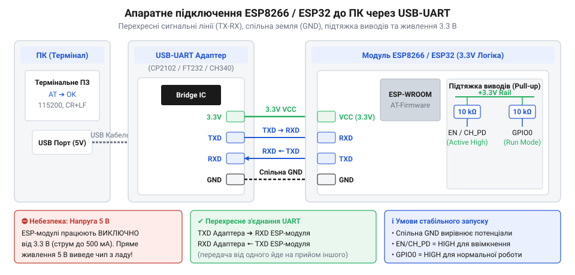

# Первинне налаштування та діагностика ESP-AT через термінальну програму

<preknowlist>
- [Режими завантаження мікроконтролера ESP8266](root:cat-hw-boards/esp8266-boot-modes) — призначення логічних рівнів на GPIO0, GPIO2 та GPIO15 для переведення чипа в режим нормального завантаження з flash-пам'яті (UART Flash Boot).
- [Огляд базової системи AT-команд мікроконтролера ESP8266](root:cat-hw-boards/esp8266-at-command-set-overview) — загальний синтаксис та класифікацію AT-команд (тестові, опитувальні, встановлення, виконання).
- [esp-01-programmer-adapters](root:cat-hw-boards/esp-01-programmer-adapters) — особливості розпіновки USB-UART програмних адаптерів та схеми подачі живлення на ESP-модулі.
</preknowlist>

## Проблема первинного зв'язку з пристроєм

Перша спроба зв'язку з модулем @@en|ESP8266@@ або @@en|ESP32@@ через @@en|USB-UART адаптер@@ (від англ. *Universal Serial Bus* — універсальна послідовна шина та *Universal Asynchronous Receiver-Transmitter* — універсальний асинхронний приймач-передавач) часто закінчується невдачею: на тестову @@en|AT-команду@@ `AT` термінал відповідає мовчанням, хаотичними символами або циклічним перезавантаженням.

Причини збоїв — апаратні та програмні. На апаратному рівні плаваючі стани виводів завантаження викликають циклічне перезавантаження, а 5-вольтові сигнали на 3.3-вольтових входах спотворюють фронти або пошкоджують каскади.

З програмного боку завадою є неузгоджена швидкість у бодах (англ. *Baud rate*) та відсутність термінатора. Інтерпретатор @@en|ESP-AT@@ очікує послідовність повернення каретки @@en|CR@@ (від англ. *Carriage Return*) і переводу рядка @@en|LF@@ (від англ. *Line Feed*) — без них буфер не розпізнає команду. Вимкнене ехо @@en|ATE@@ (від англ. *AT Echo*) приховує введені символи, імітуючи зависання.

Розв'язання цих проблем вимагає послідовного налаштування схеми підключення та параметрів терміналу.

## Апаратне підключення та вимоги живлення

Побудова надійного послідовного каналу між ПК та мікроконтролером починається з узгодження ліній зв'язку та стабільного живлення. При підключенні [модуля ESP-01](root:cat-hw-boards/esp-01) або іншої плати серії @@en|ESP8266@@ до @@en|USB-UART адаптера@@ забезпечують перехресну комутацію сигнальних провідників. Передавач адаптера @@en|Tx@@ (від англ. *Transmit*) підключається до приймача модуля @@en|Rx@@ (від англ. *Receive*), а приймач адаптера @@en|Rx@@ — до передавача модуля @@en|Tx@@. Обов'язковим є з'єднання заземлення @@en|GND@@ (від англ. *Ground*) обох пристроїв для створення єдиного опорного потенціалу.

Вимоги до живлення є критичним чинником стабільності. Під час ініціалізації бездротового трансивера або відправки даних струм споживання мікроконтролера зростає імпульсно до 200–500 мА. Вбудовані регулятори @@en|LDO@@ (від англ. *Low Dropout Regulator*) дешевих @@en|USB-UART адаптерів@@ розраховані лише на 50–100 мА. Спроба живити ESP безпосередньо від виводу 3.3 В адаптера викликає просідання напруги нижче 3.0 В та системне скидання по напрузі @@en|PoR@@ (від англ. *Power-on Reset*). Для запобігання цьому модулю потрібне окреме джерело живлення 3.3 В із шунтуючими конденсаторами (електролітичним 100 мкФ для низькочастотних кидків струму та керамічним 0.1 мкФ для високочастотних завад).

Логічні рівні сигнальних ліній @@en|ESP8266@@ та @@en|ESP32@@ відповідають стандарту 3.3 В. Якщо @@en|USB-UART адаптер@@ працює з 5-вольтовою логікою, безпосереднє підключення його лінії @@en|Tx@@ до входу @@en|Rx@@ модуля пошкодить кристал. Для безпечного зниження напруги на лінії @@en|Rx@@ застосовують резистивний дільник (наприклад, 1 кОм та 2 кОм) або мікросхеми перетворювачів рівнів.

Правильне фіксування логічних станів потрібне для вибору [режимів завантаження](root:cat-hw-boards/esp8266-boot-modes). Для виконання прошивки з пам'яті (режим @@en|UART Flash Boot@@) вивід `CH_PD` (`EN`) підтягують до 3.3 В через резистор 10 кОм. Відповідно до специфікації [конфігураційних виводів](root:cat-hw-boards/esp8266-boot-strapping-pins), `GPIO0` та `GPIO2` підтягують до 3.3 В, а `GPIO15` — до @@en|GND@@. Використання [програмних адаптерів](root:cat-hw-boards/esp-01-programmer-adapters) дозволяє автоматизувати цю підтяжку за допомогою вбудованої обв'язки.


*Схема підключення адаптера USB-UART до ESP-модуля з узгодженням сигналів Tx/Rx, окремим живленням 3.3 В та підтяжкою стропувальних виводів GPIO.*

## Конфігурація термінатора та ехо-режиму

Після збирання електричної схеми налаштовують термінальне програмне забезпечення на ПК. Першим кроком є вибір системного @@en|COM-порту@@, який операційна система присвоює підключеному адаптерові. Заводське налаштування послідовного порту для офіційної прошивки @@en|ESP-AT@@ становить: швидкість 115200 бод, 8 біт даних, без перевірки парності, 1 стоп-біт (`8N1`), апаратне керування потоком вимкнено.

Ключовим моментом у конфігурації термінального софту є правило обробки завершення рядків. Під час роботи з [системою AT-команд](root:cat-hw-boards/esp8266-at-command-set-overview) командний інтерпретатор сканує вхідний потік байт за байтом. Вбудований парсер приймає символи у вхідний буфер і розпочинає аналіз лише після послідовного зчитування керуючого байта `0x0D` (символ `\r`, @@en|CR@@), а за ним `0x0A` (символ `\n`, @@en|LF@@). У терміналі суворо вибирають режим `Both CR & LF` або `CRLF`. Без цих символів пристрій зберігає текст у буфері й чекає далі без відповіді.

Для перевірки зв'язку надсилають команду:

```text
AT
```

У разі успішного сигналу модуль повертає відповідь:

```text
OK
```

Якщо символи `AT` при введенні не відображаються, але після натискання клавіші @@en|Enter@@ з'являється `OK`, у модулі вимкнено локальне ехо. За керування ним відповідає команда `ATE`:
- `ATE1` — вмикає ехо, дублюючи кожен байт з лінії @@en|Rx@@ у лінію @@en|Tx@@, щоб користувач бачив введений текст. - `ATE0` — вимикає ехо, повертаючи у відповідь лише результат виконання (`OK` або `ERROR`).

Вимкнення ехо (`ATE0`) є стандартною вимогою для управляючих програм: воно звільняє хост від фільтрації дубльованих команд із вхідного потоку. З урахуванням [буферів FIFO](root:cat-hw-boards/esp8266-uart-hardware-fifo) послідовного порту, вимкнення ехо також зменшує навантаження на апаратний буфер передачі модуля та спрощує розбір текстових відповідей.

## Діагностика стану та параметрів UART

Отримавши стабільну відповідь `OK` на команду `AT`, інженер переходить до повноцінного аналізу системного стану модуля та налаштування параметрів зв'язку під потреби конкретного проєкту. Первинна діагностика версії апаратного й програмного забезпечення здійснюється за допомогою опитувальної команди запиту версії:

```text
AT+GMR
```

У відповідь мікроконтролер виводить розширений блок системної інформації, який містить версію прошивки @@en|ESP-AT@@, версію комплекту розробки @@en|SDK@@ (від англ. *Software Development Kit*), дату та час компіляції бінарного образу, а також інформацію про виробника. Аналізуючи [архітектуру AT-прошивки](root:cat-hw-boards/esp8266-at-firmware-architecture), можна визначити наявність підтримки конкретних команд та обсяг доступних системних ресурсів.

Для виконання програмного перезавантаження мікроконтролера використовується команда:

```text
AT+RST
```

Після її надсилання пристрій негайно скидає свій стан і виводить у послідовний порт лог стартового завантажувача (англ. *Bootloader*). Огляд логу завантаження дозволяє оцінити причину перезавантаження (наприклад, нормальне програмне скидання чи аварійне просідання живлення) та підтвердити успішне завершення ініціалізації системних служб появою підсумкового рядка `ready`.

Конфігурація параметрів послідовного порту @@en|UART@@ є гнучкою і розділяється на два режими: тимчасову зміну та постійне збереження у flash-пам'яті. За тимчасове налаштування параметрів відповідає команда:

```text
AT+UART_CUR=<baudrate>,<databits>,<stopbits>,<parity>,<flow_control>
```

Де параметри приймають такі значення:
- `<baudrate>` — швидкість передачі в бодах (наприклад, 9600, 19200, 38400, 57600, 115200 або 230400);
- `<databits>` — кількість біт даних у кадрі (значення `8` відповідає 8 бітам);
- `<stopbits>` — кількість стоп-бітів (`1` — 1 стоп-біт, `2` — 2 стоп-біти);
- `<parity>` — перевірка парності (`0` — відсутня, `1` — непарність @@en|Odd@@, `2` — парність @@en|Even@@);
- `<flow_control>` — апаратне керування потоком (`0` — вимкнено, `1` — @@en|RTS@@, `2` — @@en|CTS@@, `3` — @@en|RTS & CTS@@).

При виконанні `AT+UART_CUR=9600,8,1,0,0` модуль негайно змінює швидкість роботи поточного сеансу в @@en|RAM@@ (від англ. *Random Access Memory* — оперативна пам'яті) на 9600 бод і повертає `OK` вже на новій швидкості. Після перезавантаження або відключення живлення пристрій відновить свої початкові заводські налаштування.

Якщо необхідно зберегти нові параметри @@en|UART@@ на постійній основі, застосовують команду `AT+UART_DEF` з аналогічним синтаксисом. Вона записує конфігураційний профіль у неенергонезалежну пам'яті @@en|NVS@@ (від англ. *Non-Volatile Storage*), завдяки чому модуль буде автоматично ініціалізувати послідовний порт із новими параметрами під час кожного наступного включення живлення. Для поглибленого вивчення механізму розрахунку дільників тактової частоти та налаштування нестандартних швидкостей обміну даними дивіться матеріал про [конфігурацію нестандартних швидкостей UART в ESP-AT](root:cat-hw-boards/esp-at-custom-baud-rates).

Для автоматизації процесу діагностики та динамічного переналаштування параметрів послідовного порту розроблено Python-клієнт на базі бібліотеки @@en|PySerial@@:

:::code proj-esp-at-terminal-config/py/esp_at_client.py

Виконуючий скрипт ілюструє покроковий алгоритм перевірки зв'язку, зчитування системної інформації, тимчасової зміни швидкості обміну та її подальшого відновлення:

:::code proj-esp-at-terminal-config/py/main.py

Програмний клас `ESPATClient` інкапсулює очищення вхідного буфера перед відправкою команди, додавання термінатора `\r\n`, по-рядковий розбір відповідей та обробку термінальних статусів `OK` і `ERROR`, що гарантує надійність обміну даними.

## Алгоритм усунення типових несправностей

Навіть при ретельному дотриманні інструкцій під час первинного налаштування інженер може зіткнутися з апаратними або конфігураційними відхиленнями. Для швидкого виявлення причин несправностей рекомендується дотримуватися системної покрокової методики діагностики.

Всі типові проблеми первинного підключення можна систематизувати за їхніми явними симптомами та методами усунення:

1. **Нечитабельні символи («сміття») при старті чипа:**
   - *Симптом:* Під час подачі живлення або скидання у консолі з'являється блок хаотичних символів, після чого зв'язок зникає або продовжується некоректно. - *Причина:* Для мікроконтролера @@en|ESP8266@@ стартовий завантажувач РОМ (англ. *Read-Only Memory*, @@en|ROM@@) виводить первинні діагностичні повідомлення на нестандартній швидкості 74880 бод. Ця швидкість обумовлена тактуванням від кварцового резонатора 26 МГц. Якщо термінальна програма налаштована на стандартні 115200 бод, стартовий лог відображається як нечитабельний шум, але подальша робота прошивки @@en|ESP-AT@@ відбувається коректно. Якщо ж і після стартового логу символи залишаються спотвореними, це свідчить про некоректно обрану швидкість @@en|Baud rate@@ або відсутність спільного заземлення @@en|GND@@. 2. **Повна відсутність відповіді від модуля ( silence ):**
   - *Симптом:* Надсилання команд `AT` не викликає жодної реакції у вікні термінальної програми. - *Причина:* Найчастіше це викликано відсутністю термінатора `\r\n` у налаштуваннях термінального софту, помилковим підключенням ліній `Tx` і `Rx` (пряме підключення `Tx-Tx` замість перехресного `Tx-Rx`), або залишенням виводу `CH_PD` (`EN`) у непідключеному («плаваючому») стані. Також слід перевірити, чи правильно обрано номер системного @@en|COM-порту@@. 3. **Циклічне перезавантаження чипа ( Bootloop ):**
   - *Симптом:* У консоль безперервно виводяться повідомлення типу `rst cause:2, bootmode:(3,6)` або `rst cause:4`. - *Причина:* Повідомлення `rst cause:4` вказує на спрацювання апаратного сторожового таймера через просідання напруги живлення під час пікових навантажень Wi-Fi трансивера. Оцінка стану джерела живлення вимагає перевірки напруги безпосередньо на виводах модуля за допомогою осцилографа або мультиметра та встановлення додаткових фільтруючих конденсаторів. Замикання виводу `GPIO0` на землю під час роботи також викликає циклічний збій завантаження. 4. **Втрата окремих символів або помилки кадрів ( Frame Error ):**
   - *Симптом:* Відповіді модуля обриваються на півслові або з'являються випадкові помилки `ERROR`. - *Причина:* Довгі неекрановані провідники сигнальних ліній, наявність високочастотних завад або переповнення вхідного буфера модуля. Використання виваженої методики [прошивання модуля](root:cat-hw-boards/esp01-firmware-flashing) дозволяє виключити пошкодження самої прошивки.

Застосування покрокового алгоритму діагностики (перевірка живлення -> перевірка з'єднання землі -> перевірка стропування GPIO -> вибір швидкості 115200 -> включення CRLF) гарантує швидке та надійне введення мікроконтролера в експлуатацію перед його інтеграцією у складні мережеві проєкти.