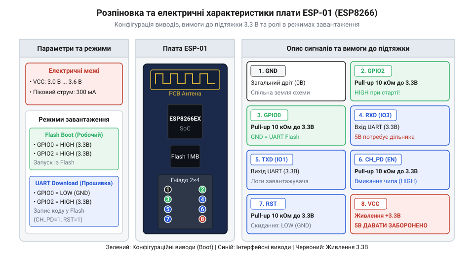
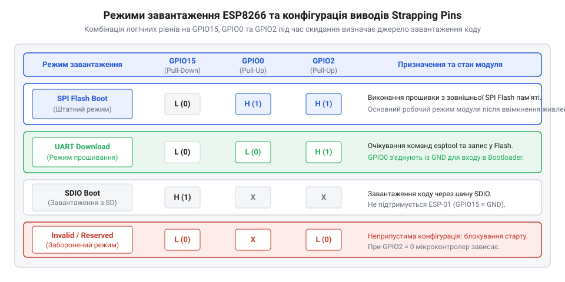

# Апаратна конфігурація виводів та режими завантаження ESP-01

<preknowlist>
- [ESP-01 (Wi-Fi, ESP8266)](root:cat-hw-boards/esp-01) — призначення та відмінності виводів модуля
- [Режими завантаження мікроконтролера ESP8266](root:cat-hw-boards/esp8266-boot-modes) — загальна концепція принципів завантаження чипа ESP8266EX
- [Конфігураційні виводи завантаження ESP8266](root:cat-hw-boards/esp8266-boot-strapping-pins) — роль страпувальних ліній GPIO під час скидання
</preknowlist>

## Призначення виводів та електричні характеристики

Мікроконтролерний модуль [ESP-01](root:cat-hw-boards/esp-01) виконаний у компактному формфакторі з восьмиконтактним дворядним роз'ємом кроком 2.54 мм. Основу модуля складає системний чип @@en|ESP8266EX@@ (англ. *System on Chip*, системний кристал зі вбудованим радіотрактом Wi-Fi). Схема виводів плати включає лінії живлення, послідовного інтерфейсу та служби керування станом мікроконтролера. 

Живлення плати здійснюється через контакт `VCC` від джерела постійного струму номінальною напругою 3.3 В (допустимий діапазон становить від 3.0 В до 3.6 В). Використання напруги 5 В безпосередньо призводить до незворотного виходу з ладу кристала. Контакт `GND` слугує спільним провідником схеми. Послідовний інтерфейс @@en|UART@@ (англ. *Universal Asynchronous Receiver-Transmitter*, універсальний асинхронний приймач-передавач) виведений на контакти `TXD` (вивід `GPIO1`) та `RXD` (вивід `GPIO3`). Сигнальні виводи `GPIO0` та `GPIO2` призначені для вводу-виводу загального призначення, а також виконують роль @@en|strapping pins@@ (англ. *strapping pins*, конфігураційні виводи вибору режимів завантаження при скиданні). Лінія `CH_PD` (також позначена як `EN`, англ. *Chip High/Power Down*) відповідає за апаратне вмикання кристала: високий рівень активує внутрішній стабілізатор напруги, а низький — переводить модуль у режим глибокого сну зі споживанням струму менше 10 мкА. Лінія `RST` забезпечує апаратний скид (англ. *Reset*) при подачі низького логічного рівня.

*Призначення та електричні обмеження контактів дворядного роз'єму плати ESP-01.*

Усі цифрові входи та виходи модуля працюють суворо в діапазоні рівнів 3.3 В @@en|CMOS@@ (англ. *Complementary Metal-Oxide-Semiconductor*, комплементарна структура метал-оксид-напівпровідник). Входи `GPIO` не є стійкими до напруги 5 В (англ. *5V tolerant*). Внутрішній захист входів кристала @@en|ESP8266EX@@ реалізовано за допомогою захисних діодів @@en|ESD@@ (англ. *Electrostatic Discharge*, електростатичний розряд), які підключені між лінією виводу та шинами `VCC` і `GND`. При подачі сигналу з амплітудою 5 В верхній захисний діод відкривається у прямому напрямку, пропускаючи струм із лінії 5 В у внутрішню шину живлення 3.3 В. Це спричиняє пробій діода від перегріву та незворотне термічне пошкодження вхідного буфера кристала. Максимально припустимий струм, який може безперервно протікати через один вивід входу-виходу, становить 12 мА. Крім того, ефективне керування енергоспоживанням та досягнення мінімального струму в режимі глибокого сну (від англ. @@en|Deep Sleep@@, глибокий сон) на рівні близько 10 мкА безпосередньо залежить від стану лінії `CH_PD` та підтяжки `RST`. Коли лінію `CH_PD` притягнуто до `GND`, внутрішні силові ключі кристала повністю вимикаються, зупиняючи споживання більшості вузлів, а якісна зовнішня підтяжка лінії `RST` до `VCC` запобігає виникненню плаваючих потенціалів на затворах транзисторів і паразитного витоку струму. На відміну від більших платок серії, кристал @@en|ESP8266EX@@ всередині [ESP-01](root:cat-hw-boards/esp-01) має вивід `GPIO15`, який не виведений на зовнішній роз'єм, але внутрішньо притягнутий до `GND` через підтягувальний резистор @@en|pull-down@@ (англ. *pull-down*, підтяжка до землі) номіналом 10 кОм прямо на друкованій платі модуля.

Внутрішня фіксація виводу `GPIO15` до землі безпосередньо на платі [ESP-01](root:cat-hw-boards/esp-01) звільняє користувача від необхідності додавати зовнішній підтягувальний резистор для цієї страпувальної лінії. Однак відсутність доступних контактів `GPIO4`, `GPIO5` та `GPIO12`–`GPIO14` обмежує апаратний інтерфейс модуля лише двома вільними виводами загального призначення (`GPIO0` та `GPIO2`), які одночасно беруть участь у виборі конфігурації завантаження. Це вимагає ретельного проектування зовнішньої периферії, щоб підключені датчики чи виконавчі пристрої не порушували потрібні логічні рівні під час подачі живлення чи скидання мікроконтролера.

## Конфігураційні виводи та комбінації режимів завантаження

Під час подачі живлення або зняття низького рівня з лінії `RST` первинний ROM-завантажувач кристала ESP8266EX зчитує логічні рівні на трьох конфігураційних виводах: `GPIO0`, `GPIO2` та `GPIO15`. Отримані напруги визначають, з якого саме джерела мікроконтролер почне виконання програмного коду.

Для стабільного старту вивід `GPIO15` повинен обов'язково перебувати під низьким логічним рівнем (0 В), що апаратно реалізовано всередині розведення плати [ESP-01](root:cat-hw-boards/esp-01). Вивід `GPIO2` під час скидання повинен утримуватися під високим логічним рівнем (3.3 В). Режим завантаження визначається станом виводу `GPIO0`: якщо під час імпульсу скидання на `GPIO0` зафіксовано низький рівень, модуль переходить у режим `UART Download mode` для запису нової прошивки через послідовний порт. Якщо на `GPIO0` присутній високий рівень, модуль вмикає режим `Flash Boot mode` і починає виконання робочої програми зі зовнішньої мікросхеми [SPI Flash](root:cat-hw-boards/esp-01-module-family-overview).

*Комбінації логічних рівнів на конфігураційних виводах для вибору апаратного режиму завантаження.*

Плаваючі рівні на підтягувальних виводах (англ. *floating pins*, незафіксовані входи під впливом завад) є найпоширенішою причиною самовільного зависання модуля. Якщо вивід `GPIO2` під час скидання опиниться в землі, або `GPIO15` підніметься до високого рівня, завантажувач перейде в непідтримуваний режим `SDIO mode` (завантаження з SD-карти), що призведе до циклічного блокування виконання прошивки. Для надійного зчитування конфігурації ROM-завантажувачем логічні рівні на страпувальних виводах повинні бути стабільно зафіксовані ще до спаду сигналу скидання та утримуватися в незмінному стані впродовж часу фіксації `t_hold` тривалістю не менше 10 мс після наростання фронту на лінії `RST`. Занадто ранній відпуск кнопки програмування `GPIO0` до завершення спаду фронту `RST` викликає зчитування невизначеного проміжного стану та збій переходу в режим прошивки.

## Схемотехніка обв'язки та номінали підтягувальних резисторів

Для забезпечення надійного запуску та запобігання збоям [режимів завантаження ESP8266](root:cat-hw-boards/esp8266-boot-modes) зовнішня схемотехнічна обв'язка модуля ESP-01 повинна містити зовнішні підтягувальні резистори @@en|pull-up@@ (англ. *pull-up*, підтяжка до шини живлення). 

Входи `CH_PD` та `RST` підключають до шини живлення 3.3 В через підтягувальні резистори номіналом 10 кОм. Для реалізації кнопки апаратного перезапуску паралельно лінії `RST` встановлюють тактову кнопку `S1`, яка при натисканні замикає лінію на `GND`. Вивід `GPIO2` підтягують до 3.3 В резистором 10 кОм. Вивід `GPIO0` підключають до 3.3 В через резистор 10 кОм, а для переведення в режим прошивання додають кнопку `S2` або тумблер на землю `GND`.

Підключення ліній послідовного порту при програмуванні через 5-вольтні [програматори та адаптери](root:cat-hw-boards/esp-01-programmer-adapters) вимагає обов'язкового узгодження рівнів @@en|level shifting@@ (англ. *level shifting*, узгодження логічних рівнів). Лінія `TXD` адаптера з вихідною напругою 5 В не повинна подаватися безпосередньо на вхід `RXD` модуля ESP-01. Для зниження амплітуди сигналу застосовують резистивний дільник напруги. Вибір конкретних номіналів `R1` та `R2` зумовлений компромісом між споживаним струмом та паразитною вхідною ємністю лінії `RXD` (поблизу 10–15 пФ). Занадто високі опори (наприклад, 100 кОм) утворюють з вхідною ємністю @@en|RC circuit@@ (англ. *resistor-capacitor circuit*, резистивно-ємнісний ланцюг) із тривалою сталою часу, що завалює прямокутні фронти імпульсів та заважає обміну на високих швидкостях послідовного порту понад 115200 бод. Оптимальні номінали `R1` = 1 кОм та `R2` = 2 кОм забезпечують мізерний струм навантаження 1.67 мА та зберігають гострі фронти сигналів для швидкостей аж до 921600 бод. Розрахунок вихідної напруги виконується за формулою:

        U_out = U_in × (R2 / (R1 + R2))
        = 5.0 × (2000 / (1000 + 2000))       [підстановка R1=1кОм, R2=2кОм]
        = 3.33 В                             [безпечний рівень CMOS 3.3В]

Лінія `TXD` модуля ESP-01 видає амплітуду 3.3 В, яка надійно розпізнається 5-вольтними приймачами `RXD` більшості адаптерів послідовного порту без додаткових дільників. Для компенсації імпульсних просідань напруги під час увімкнення передавача Wi-Fi безпосередньо біля контактів живлення `VCC` та `GND` додають керамічний конденсатор ємністю 0.1 мкФ паралельно з електролітичним конденсатором ємністю від 10 мкФ до 100 мкФ.

## Діагностика помилок запуску за повідомленнями завантажувача

При подачі живлення первинний ROM-завантажувач кристала видає короткий дамп системного стану у послідовний порт `TXD` (`GPIO1`). Системна інформація передається на нестандартній швидкості `74880 бод`, оскільки тактова частота опорного кварцового резонатора становить 26 МГц. Якщо монітор послідовного порту налаштовано на стандартну швидкість 115200 бод, ці повідомлення відображаються як некоректні символи (англ. *garbage text*).

Головним показником успішності конфігурації завантаження є рядок `boot mode:(sys_boot, strapping)`, де перше число вказує на розпізнаний апаратний режим:

- `boot mode:(3,N)` — успішний старт у режимі виконання коду з Flash-пам'яті (`GPIO15=0`, `GPIO2=1`, `GPIO0=1`).
- `boot mode:(1,N)` — активний режим програмування через послідовний порт `UART Download mode` (`GPIO15=0`, `GPIO2=1`, `GPIO0=0`).
- `boot mode:(0,N)` або `boot mode:(2,N)` або `boot mode:(6,N)` — апаратна помилка конфігурації [страпувальних виводів завантаження](root:cat-hw-boards/esp8266-boot-strapping-pins), за якої завантажувач намагається прочитати SD-карту або виконувати код із незапитаної пам'яті.

Додатково рядок `rst cause:N` пояснює фізичну причину скидання мікроконтролера. Значення `rst cause:1` відповідає первинному ввімкненню живлення, `rst cause:2` свідчить про натискання кнопки скидання на лінії `RST`. Код `rst cause:3` вказує на програмне скидання @@en|software watchdog@@ (англ. *software watchdog timer*, програмний сторожовий таймер), викликане тривалим блокуванням виконання основного циклу без передачі керування операційній системі (відсутність викликів `yield()` чи `delay()`). Код `rst cause:4` означає спрацьовування апаратного сторожового таймера @@en|watchdog@@ (англ. *hardware watchdog timer*, апаратний сторожовий таймер): часті перезавантаження з кодом `rst cause:4` безпосередньо вказують на просідання напруги живлення 3.3 В нижче критичного порогу під час пікового споживання Wi-Fi-тракта. Значення `rst cause:5` свідчить про плановий вихід модуля з режиму глибокого сну за сигналом таймера чи зовнішнього імпульсу.
