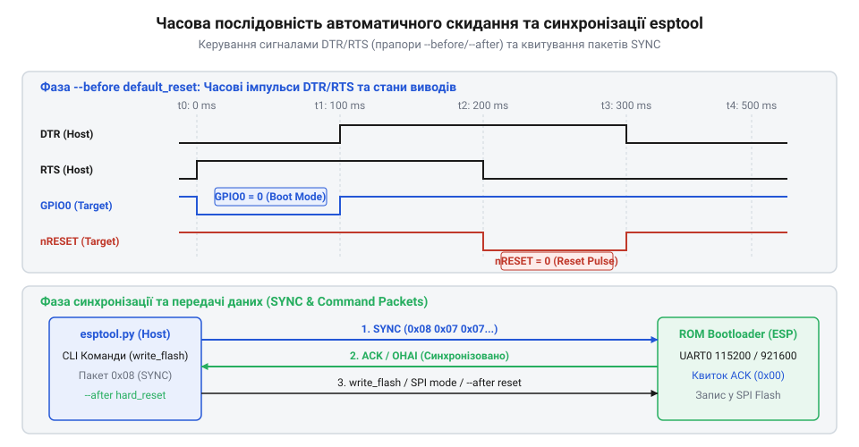
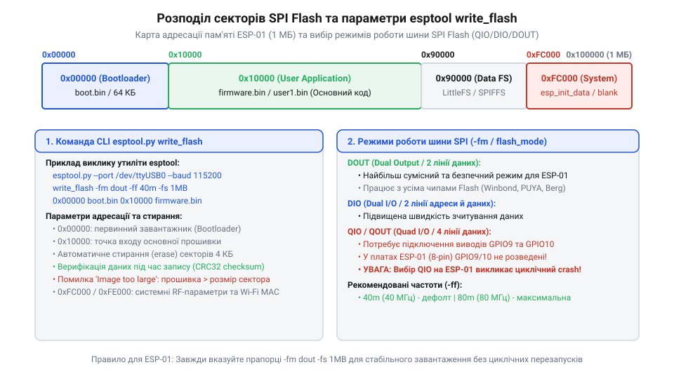

# Програмний інтерфейс та команди консольної утиліти esptool

<preknowlist>
- [ESP-01 (Wi-Fi, ESP8266)](root:cat-hw-boards/esp-01) — призначення виводів та базові параметри модуля
- [Режими завантаження мікроконтролера ESP8266](root:cat-hw-boards/esp8266-boot-modes) — комбінації логічних рівнів GPIO0 та GPIO2 для входу в режим UART Download
- [esp-01-programmer-adapters](root:cat-hw-boards/esp-01-programmer-adapters) — схемотехніка підключення USB-UART мостів та схеми автозавантаження
</preknowlist>

## Запити прошивання та бар'єри ручного завантаження

Під час масового розгортання або автоматизованої розробки пристроїв на базі [мікроконтролера ESP8266](root:cat-hw-boards/esp8266-soc-architecture-overview) постає завдання швидкого й надійного запису виконаного бінарного коду в зовнішню пам'ять. На відміну від класичних мікроконтролерів із вбудованою флеш-пам'яттю, чип пам'яті підключається через послідовний периферійний інтерфейс (від англ. @@en|Serial Peripheral Interface@@, SPI) — @@en|SPI Flash@@. Щоб записати в неї новий вміст, кристалу необхідно зупинити виконання основної програми й активувати системний завантажувач масочної ПЗП (від англ. @@en|Read-Only Memory bootloader@@, @@en|ROM-завантажувач@@).

Утрапити у відповідні [режими завантаження мікроконтролера](root:cat-hw-boards/esp8266-boot-modes) можна лише в момент скидання системного живлення або подачі низького імпульсу на вивід скидання (від англ. @@en|Reset@@, @@en|RESET@@). Для цього треба встановити [конфігураційні виводи завантаження](root:cat-hw-boards/esp8266-boot-strapping-pins) у чітко визначені логічні рівні. Зокрема, вивід @@en|GPIO0@@ під час скидання мусить бути притягнутий до логічного нуля (маси), тоді як виводи @@en|GPIO2@@ та @@en|GPIO15@@ зберігають логічну одиницю та нуль відповідно. У разі використання ручного перемикання розробник змушений утримувати фізичну кнопку на лінії @@en|GPIO0@@, короткочасно натискати кнопку @@en|RESET@@, і лише після цього запускати програму запису.

Такий ручний процес має суттєві недоліки. Він уповільнює цикл розробки, створює високий ризик людської помилки під час послідовності натискань і швидко зношує тактові кнопки. Крім того, ручний перехід повністю унеможливлює використання автоматизованих систем збирання та тестування (від англ. @@en|Continuous Integration / Continuous Deployment@@, @@en|CI/CD@@).

Для подолання цих обмежень використовують консольну утиліту @@en|esptool.py@@. Вона виступає програмним містком між командним рядком персонального комп'ютера та внутрішнім @@en|ROM-завантажувачем@@. Використовуючи керуючі лінії послідовного порту та спеціалізовані [адаптери програматорів модуля](root:cat-hw-boards/esp-01-programmer-adapters), утиліта автоматично переводить кристал у режим завантаження через послідовний порт (від англ. @@en|Universal Asynchronous Receiver-Transmitter Download Mode@@, @@en|UART Download Mode@@) без участі людини.

## Архітектура з'єднання та параметри послідовного порту

Утиліта @@en|esptool.py@@ керує процесом прошивання шляхом надсилання пакетів даних через послідовний порт (від англ. @@en|Universal Asynchronous Receiver-Transmitter@@, @@en|UART@@). Для встановлення зв'язку з пристроєм у командному рядку вказують параметри підключення за допомогою прапорців `-p` (або `--port`) та `-b` (або `--baud`). Основний синтаксис виклику має наступну форму:

```bash
esptool.py -p COM3 -b 115200 --before default_reset --after hard_reset chip_id
```

Прапор `-p` вказує назву системного послідовного порту (наприклад, `COM3` у @@en|Windows@@ або `/dev/ttyUSB0` у @@en|Linux@@). Прапор `-b` визначає швидкість обміну (від англ. @@en|baud rate@@) у бодах. Початковий @@en|ROM-завантажувач@@ працює на фіксованій швидкості 115200 бод. Проте після первинного з'єднання утиліта завантажує в оперативну пам'ять мікроконтролера (від англ. @@en|Random Access Memory@@, @@en|RAM@@) малогабаритну програму-посередник (від англ. @@en|RAM stub loader@@, @@en|stub-завантажувач@@). Після цього швидкість порту може бути безпечно підвищена до 460800 або 921600 бод, що суттєво скорочує час запису великих файлів. Докладніше про архітектуру та командний функціонал малогабаритного коду читайте у статті про [програмний завантажувач esptool](root:sf-devices/esptool-stub-flasher).


*Алгоритм автоматичного скидання мікроконтролера та узгодження швидкості обміну перед передачею даних.*

Автоматичне перемикання режимів реалізоване через апаратні лінії керування потоком послідовного моста: запит на передачу (від англ. @@en|Request to Send@@, @@en|RTS@@) та готовність термінала даних (від англ. @@en|Data Terminal Ready@@, @@en|DTR@@). Підключаючи популярний [модуль ESP-01](root:cat-hw-boards/esp-01) до комп'ютера через схемотехніку @@en|NodeMCU@@, лінії @@en|DTR@@ та @@en|RTS@@ підключають через NPN-транзистори до виводів @@en|RESET@@ та @@en|GPIO0@@.

Послідовність автозавантаження регулюється прапором `--before`. За умовчанням використовується режим `default_reset`: утиліта спочатку опускає лінію @@en|DTR@@ у низький стан (що притягує @@en|GPIO0@@ до нуля), а потім формує низький імпульс на лінії @@en|RTS@@ (що скидає лінію @@en|RESET@@). Коли лінія @@en|RESET@@ повертається до високого рівня, кристал зчитує стан @@en|GPIO0@@=0 і входить у @@en|UART Download Mode@@. Після закінчення роботи прапор `--after` вказує подальшу поведінку: `hard_reset` виконує звичайне перезавантаження кристала для запуску нової прошивки, а `no_reset` залишає пристрій у стані очікування.

## Ідентифікація кристала та зчитування системної інформації

Перш ніж виконувати операції запису або очищення пам'яті, доцільно провести перевірку апаратної цілісності пристрою та зчитати його ідентифікаційні параметри. Для цього в @@en|esptool.py@@ передбачено команди `chip_id`, `read_mac` та `flash_id`.

Команда `chip_id` запитує унікальний ідентифікатор кристала, який формується на основі його апаратних характеристик:

```bash
esptool.py -p /dev/ttyUSB0 chip_id
```

Для отримання повної фізичної адреси мережевого адаптера використовують команду `read_mac`. Вона зчитує унікальну @@en|MAC-адресу@@ (від англ. @@en|Media Access Control address@@), випалену на етапі виробництва у внутрішній одноразово програмованій пам’яті електронних запобіжників (від англ. @@en|electronic fuse@@, @@en|efuse@@):

```bash
esptool.py -p /dev/ttyUSB0 read_mac
```

Найбільш критичною для подальшого прошивання є команда `flash_id`. Вона надсилає запит специфікації @@en|JEDEC ID@@ (від англ. @@en|Joint Electron Device Engineering Council ID@@) безпосередньо до чипа @@en|SPI Flash@@:

```bash
esptool.py -p /dev/ttyUSB0 flash_id
```

У відповідь утиліта виводить трибайтний код виробника та характеристики пам'яті. Перший байт визначає ідентифікатор виробника (наприклад, `0xef` для @@en|Winbond@@ або `0xc8` для @@en|GigaDevice@@), а наступні байти показують тип пам'яті та її ємність. На основі цих даних @@en|esptool.py@@ розраховує точний обсяг Flash-пам'яті (наприклад, 1 МБ або 4 МБ). Отримання цієї інформації дає змогу уникнути помилок під час вибору адресного простору для такої плати, як [компактна плата ESP-01S](root:cat-hw-boards/esp-01s), аналізуючи загальний [огляд сімейства модулів](root:cat-hw-boards/esp-01-module-family-overview).

## Очищення та посторінковий запис прошивки

Робота з флеш-пам’яттю вимагає дотримання апаратних правил адресації та попередньої підготовки секторів. Усі операції зміни вмісту @@en|SPI Flash@@ виконуються блоками, які відповідають розміру мінімального фізичного сектора стирання — 4096 байтів (4 КБ).

Для повного скидання вмісту пам'яті застосовують команду `erase_flash`. Вона записує значення `0xFF` в усі сектори чипа, що необхідно під час зміни розмітки таблиці розділів або коли відсутня можливість виконувати [оновлення прошивки по повітрю](root:cat-hw-boards/esp8266-fota-update):

```bash
esptool.py -p COM3 -b 460800 erase_flash
```

Якщо потрібно зберегти існуючу прошивку або налаштування перед очищенням, використовують команду `read_flash`. Вона вивантажує дамп пам'яті за вказаною початковою адресою та заданим розміром:

```bash
esptool.py -p COM3 -b 460800 read_flash 0x00000 0x100000 backup_flash.bin
```

Запис нових бінарних образів здійснюється командою `write_flash`. Вона приймає параметри режиму роботи шини SPI `-fm` (`--flash_mode`) та частоти тактування `-ff` (`--flash_freq`), після чого вказуються пари «адреса-файл»:

```bash
esptool.py -p COM3 -b 460800 write_flash -fm dio -ff 40m 0x00000 boot_v1.7.bin 0x01000 user1.bin 0x3fc000 esp_init_data_default.bin
```


*Розподіл блоків пам'яті та вирівнювання адрес бінарних файлів за межами 4 КБ секторів.*

Режим роботи шини SPI підбирається відповідно до розводки друкованої плати. Існують чотири основні режими:
1. `@@en|qio@@` (від англ. @@en|Quad I/O@@) — передача адрес і даних по чотирьох лініях (найшвидший режим, вимагає підключення виводів @@en|GPIO9@@ та @@en|GPIO10@@);
2. `@@en|qout@@` (від англ. @@en|Quad Output@@) — адреса передається по одній лінії, дані — по чотирьох;
3. `@@en|dio@@` (від англ. @@en|Dual I/O@@) — передача адрес і даних по двох лініях (універсальний режим для більшості компактних модулів);
4. `@@en|dout@@` (від англ. @@en|Dual Output@@) — адреса передається по одній лінії, дані — по двох.

Головним інваріантом під час формування команди `write_flash` є вирівнювання початкових адрес бінарних файлів. Кожна адреса мусить бути кратною розміру сектора 0x1000 (4096 байтів), інакше при спробі запису відбудеться пошкодження суміжних даних.

## Діагностика помилок та верифікація контрольних сум

Під час роботи з утилітою @@en|esptool.py@@ розробники можуть стикатися з апаратними та програмними збоями. Швидке усунення проблем вимагає розуміння системних повідомлень про помилки та механізмів контролю цілісності.

Найпоширенішою помилкою під час встановлення підключення є повідомлення: `@@en|A fatal error occurred: Failed to connect to ESP8266: Timed out waiting for packet header@@`. Ця помилка виникає, коли @@en|esptool.py@@ не отримує відповіді на синхронізаційні пакети. Основні причини — мікроконтролер не увійшов у @@en|UART Download Mode@@ через некоректні рівні на виводах @@en|GPIO0@@ чи @@en|CH_PD@@, обрано не той послідовний порт, або відсутній спільний провід маси між програматором і платою.

Інша поширена апаратна помилка — `@@en|Invalid head of packet@@`. Вона свідчить про спотворення даних під час передачі через послідовну лінію. Причинами найчастіше є надто висока швидкість обміну `baud rate` при використанні довгих дротів без екранування, просідання напруги живлення 3.3 В у момент стрибків струму, або відсутність фільтруючих керамічних конденсаторів ємністю 0.1 мкФ безпосередньо біля виводів живлення кристала.

Після завершення запису кожного блоку даних @@en|esptool.py@@ виконує автоматичну верифікацію цілісності. Для цього обчислюється хеш-сума за алгоритмом повідомлення дайджесту (від англ. @@en|Message Digest 5@@, @@en|MD5@@). Утиліта порівнює обчислений хеш переданого файла з хешем, який розраховує @@en|stub-завантажувач@@ безпосередньо з зчитаних секторів @@en|SPI Flash@@.

У разі розбіжності виникає помилка `@@en|MD5 mismatch@@`. Вона сигналізує про фізичне пошкодження секторів пам'яті, невірний вибір режиму шини `-fm` (наприклад, спроба використати `qio` замість `dio`), або імпульсні завади на лінії живлення під час запису. Щоб усунути такі збої, слід зменшити швидкість передачі до 115200 бод, перевірити апаратні [схеми адаптерів програмування](root:cat-hw-boards/esp-01-programmer-adapters), переконатися в надійності джерела живлення та виконати повторне повне очищення пам'яті командою `erase_flash`.
