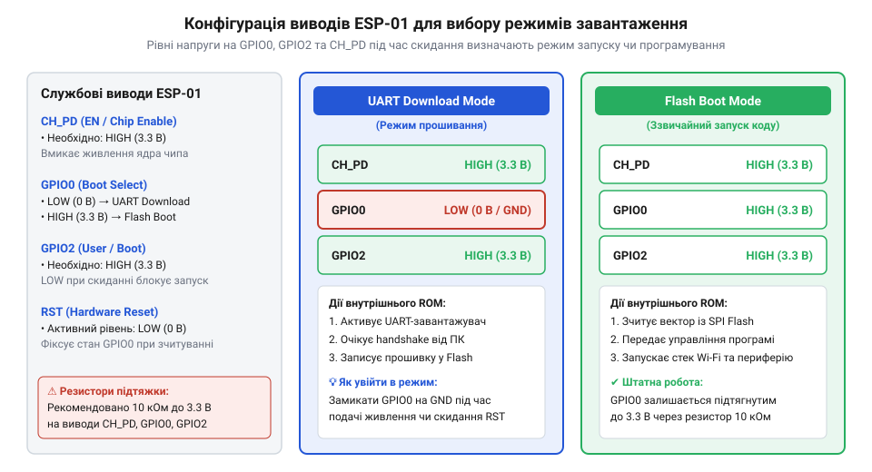
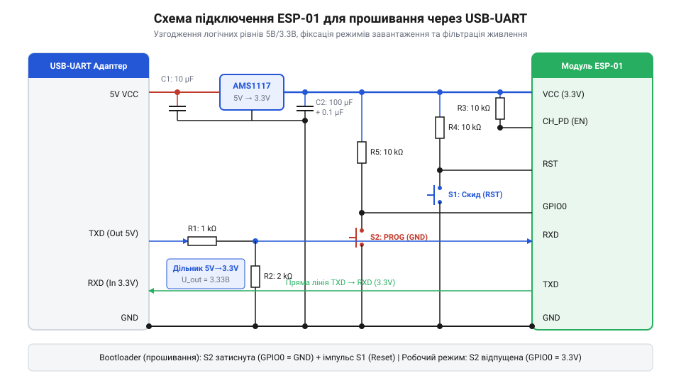
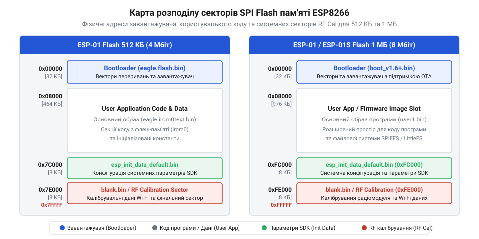
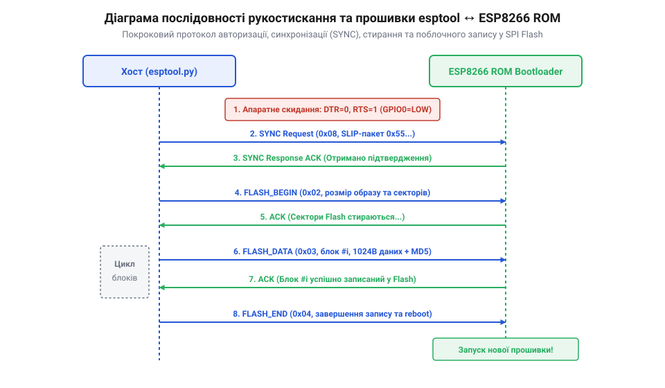
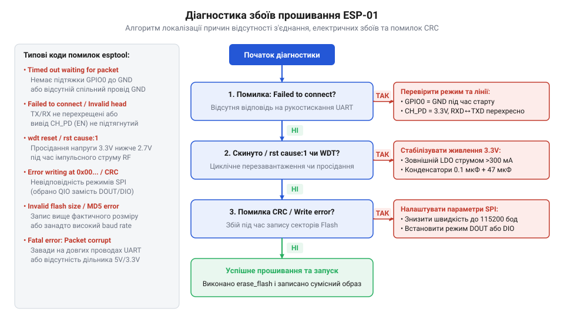

# Оновлення прошивки та прошивання ESP-01

<preknowlist>
- [ESP-01 (Wi-Fi, ESP8266)](root:cat-hw-boards/esp-01) — Базові апаратні характеристики модуля та призначення виводів
- [Режими завантаження мікроконтролера ESP8266](root:cat-hw-boards/esp8266-boot-modes) — Комбінації логічних рівнів для переведення у режим прошивання
- [esp-01-programmer-adapters](root:cat-hw-boards/esp-01-programmer-adapters) — Готові схемотехнічні рішення адаптерів для програмування
</preknowlist>

## Проблема застарілих прошивок та апаратні умови завантаження

У практичній розробці бездротових пристроїв модуль [ESP-01](root:cat-hw-boards/esp-01) на базі системної мікросхеми @@en|SoC@@ (англ. @@en|System on Chip@@ — система на кристалі) @@en|ESP8266@@ часто потрапляє до рук розробників із застарілими версіями заводської прошивки. Ранні версії програмного забезпечення, що реалізують керування через @@en|AT-команди@@ (англ. @@en|Attention commands@@ — команди привернення уваги), стикаються зі збоями під час підтримки сучасних протоколів безпеки, таких як [SSL/TLS з'єднання](root:cat-hw-boards/esp8266-at-ssl-tls), та демонструють нестабільну роботу при відкритті [мережевих сокетів TCP/UDP](root:cat-hw-boards/esp01-tcp-udp-sockets). Крім того, виявлені помилки в реалізації мережевого стека періодично призводять до зависання пристрою під час переповнення внутрішніх буферів. Докладно еволюцію програмного забезпечення розглядає [історія прошивок та інструментів ESP8266](root:cat-hw-boards/esp01-firmware-flashing/hist-esp8266-firmware-evolution.md).

Для усунення цих обмежень та переходу до сучасних програмних середовищ виникає потреба в повній заміні вмісту енергонезалежної пам'яті модуля. Запуск процедури оновлення вимагає переведення внутрішнього масочно-запрограмованого завантажувача @@en|ROM Bootloader@@ (англ. @@en|Read-Only Memory Bootloader@@) у спеціальний апаратний стан. Архітектура кристала ESP8266 визначає режим старту під час скидання за поєднаннями логічних рівнів на кількох ключових виводах, що детально описують [конфігураційні виводи завантаження](root:cat-hw-boards/esp8266-boot-strapping-pins).

Основними керуючими виводами є @@en|GPIO0@@ (англ. @@en|General-Purpose Input/Output@@ — вивід загального призначення), @@en|GPIO2@@ та вивід увімкнення @@en|CH_PD@@ (англ. @@en|Chip Power Down@@, також відомий як @@en|EN@@). Для активації режиму завантаження через послідовний порт @@en|UART Download mode@@ необхідно забезпечити підтяжку виводу GPIO0 до низького рівня заземлення @@en|GND@@ (англ. @@en|Ground@@) у момент подачі живлення або відпускання лінії скидання @@en|RST@@ (англ. @@en|Reset@@). Водночас вивід GPIO2 та лінія CH_PD мусять залишатися підтягнутими до високого логічного рівня 3.3 В. Специфікацію електричних рівнів та режимів фіксує [апаратний інтерфейс виводів ESP-01](root:cat-hw-boards/esp01-firmware-flashing/api-esp01-hardware-flashing-pinout-and-boot-modes.md).


*Конфігурація логічних рівнів на виводах ESP-01 під час вибору режимів завантаження з флеш-пам'яті та прошивання через UART.*

Якщо під час старту вивід GPIO0 залишається підтягнутим до високого рівня, внутрішній процесор виконує нормальний запуск із внутрішньої пам'яті у режимі @@en|SPI Flash Boot@@. Будь-яка нестабільність логічних рівнів або наявність плаваючих потенціалів на цих виводах призводить до випадкового вибору некоректного режиму, у якому завантажувач блокує роботу приймача UART або зупиняє виконання коду.

Критичною фізичною умовою безпомилкової фіксації обраного стану є дотримання мінімальної тривалості утримання лінії @@en|RST@@ (від @@en|Reset@@ — скидання) у низькому потенціалі. Апаратний завантажувач @@en|ROM Bootloader@@ (від @@en|Read-Only Memory Bootloader@@ — масочно-запрограмований завантажувач) зчитує та защепковує (англ. *latch* — зафіксувати, @@en|latch-in window@@ — вікно фіксації) логічні рівні з виводів завантаження строго під час зростання фронту напруги на лінії скидання — при переході потенціалу від 0 В до робочих 3.3 В. Механізм защепкування реалізовано на внутрішніх D-тригерах-засувках, які активуються компаратором напруги при досягненні порогу @@en|Vih@@ (від @@en|Input High Voltage@@ — вхідна напруга високого рівня, близько 2.0 В). Для гарантованого розряджання паразитної ємності фільтрувальних конденсаторів та стабілізації внутрішніх кіл тактування тривалість імпульсу низького рівня на лінії RST мусить становити щонайменше 100 мікросекунд (на практиці в програматорах утримується протягом 10–50 мілісекунд). За занадто короткого імпульсу скидання тригери-засувки зчитують перехідні процеси або неповністю розряджену ємність на виводі @@en|GPIO0@@, що призводить до збою синхронізації та передчасного виходу в режим поміхи, детально описаний у матеріалі про [режими завантаження мікроконтролера ESP8266](root:cat-hw-boards/esp8266-boot-modes).

## Апаратне підключення та електрична стабілізація

Успішна передача даних під час прошивання безпосередньо залежить від правильності схемотехнічного підключення модуля до персонального комп'ютера. Оскільки модуль ESP-01 позбавлений власного інтерфейсного перетворювача, для зв'язку використовують зовнішні [адаптери програмування ESP-01](root:cat-hw-boards/esp-01-programmer-adapters) або універсальні мікросхеми мостів USB-UART. При цьому принципово важливо враховувати, що всі виводи ESP8266 розраховані на логічний рівень 3.3 В і не є толерантними до напруги 5 В.

Подача сигналів із логічними рівнями 5 В безпосередньо на виводи RXD або TXD спричиняє пробій захисних діодів і незворотне пошкодження внутрішніх буферів чипа. Для безпечного сполучення виводу TXD 5-вольтового USB-UART адаптера з входом RXD модуля необхідно застосовувати резистивний дільник напруги або спеціалізовані мікросхеми перетворювачів рівнів. Схему узгодження сигналу та компоновку елементів описує [проєкт макетного адаптера ESP-01](root:cat-hw-boards/esp01-firmware-flashing/proj-esp01-flashing-adapter-breadboard-setup.md).

Другою критичною проблемою під час прошивання є забезпечення електричної стабільності кола живлення. Під час ініціалізації радіочастотного тракту @@en|RF@@ (англ. @@en|Radio Frequency@@) та калібрування передавача модуль ESP-01 споживає імпульсні струми амплітудою понад 300 мА. Вбудовані регулятори напруги @@en|LDO@@ (англ. @@en|Low Dropout Regulator@@) дешевих USB-UART адаптерів зазвичай не здатні забезпечити такий струм, що викликає глибокі короткочасні просідання напруги 3.3 В.


*Принципова схемотехніка обв'язки модуля ESP-01 із дільником напруги на лінії RX та фільтруючими конденсаторами живлення.*

Для запобігання апаратним перезавантаженням та зривам синхронізації рукостискання необхідно використовувати зовнішнє джерело живлення 3.3 В із достатнім запасом за струмом. Крім того, безпосередньо біля контактів живлення модуля @@en|VCC@@ (від @@en|Voltage at the Common Collector@@ — напруга живлення) та @@en|GND@@ (від @@en|Ground@@ — заземлення) слід встановлювати керамічний блокувальний конденсатор ємністю 0.1 мкФ для пригнічення високочастотних завад та паралельний тантал або електроліт ємністю 10–100 мкФ для компенсації низькочастотних кидків струму. При цьому критично важливим параметром електролітичного конденсатора є його еквівалентний послідовний опір @@en|ESR@@ (від @@en|Equivalent Series Resistance@@ — еквівалентний послідовний опір). Під час пікового кидка струму `ΔI = 400 мА` просідання напруги на паразитному опорі конденсатора обчислюється як `ΔV_ESR = ΔI · ESR`. Якщо обрати звичайний алюмінієвий електроліт із `ESR = 1.5 Ом`, спад напруги сягне `ΔV_ESR = 0.4 А · 1.5 Ом = 0.6 В`, що негайно викликає перезавантаження мікроконтролера за порогом @@en|Brownout Reset@@ (від @@en|Brownout Reset@@ — скидання при просіданні напруги). Для утримання просідання в межах допустимих 50 мВ необхідно застосовувати конденсатори з низьким опором @@en|Low ESR@@ (понад `ESR ≤ 0.12 Ом`). Необхідна ємність накопичувального конденсатора `C` розраховується з формули зв'язку заряду, імпульсного струму `ΔI`, його тривалості `Δt` та допустимого просідання напруги `ΔV`:

C = ΔI · Δt / ΔV
  = 0.4 А · 10 мкс / 0.1 В     [підстановка пікового струму 400 мА та просідання 100 мВ]
  = 40 мкФ                     [мінімальна резервна ємність шунтування]

При імпульсному сплеску споживання радіочастотного каскаду `ΔI = 400 мА` тривалістю `Δt = 10 мкс` та допустимому відхиленні живлення `ΔV = 100 мВ` (що запобігає виходу за межу спрацьовування захисту від зниження напруги @@en|Brownout Reset@@), розраховане значення `C = 40 мкФ` визначає нижню межу ємності. Використання стандартного конденсатора ємністю 47 мкФ або 100 мкФ з низьким еквівалентним послідовним опором @@en|ESR@@ (англ. @@en|Equivalent Series Resistance@@) повністю компенсує імпульсне споживання до моменту виходу джерела @@en|LDO@@ на стаціонарний режим регулювання.

## Архітектура SPI Flash та карта пам'яті ESP8266

Енергонезалежна пам'ять модуля ESP-01 реалізована на зовнішньому чипі мікросхеми @@en|SPI Flash@@ (англ. @@en|Serial Peripheral Interface Flash@@ — послідовна флеш-пам'ять інтерфейсу SPI), що підключається до системної шини процесора. У початкових ревізіях модулів встановлювали чипи обсягом 512 КБ (4 Мбіт), тоді як сучасніші версії модуля, як-от [ESP-01S](root:cat-hw-boards/esp-01s), комплектуються пам'яттю обсягом 1 МБ (8 Мбіт) або 2 МБ, про що детально описує [огляд сімейства модулів ESP-01](root:cat-hw-boards/esp-01-module-family-overview). Точний розподіл пам'яті визначається розміром секторів по 4 КБ та обраною схемою компоновки бінарних образів.

Уся область пам'яті розбита на службові та користувацькі зони. За адресою `0x00000` завжди розташовується первинний завантажувач прошивки @@en|bootloader@@, який виконує первинну ініціалізацію шини SPI та передає керування основному образу додатка. В залежності від того, чи використовується схема безпосереднього завантаження @@en|Non-OTA@@ чи підтримка [оновлення по повітрю FOTA](root:cat-hw-boards/esp8266-fota-update), адреси розміщення виконуваного коду користувача змінюються. Точні формули розрахунку зсувів секторів та розпіновки адрес висвітлює [математика адресації SPI Flash](root:cat-hw-boards/esp01-firmware-flashing/math-esp01-flash-memory-mapping-and-baudrate.md).


*Карта розміщення секторів завантажувача, образу прошивки, системних конфігурацій SDKInitData та збереження параметрів Wi-Fi для 512 КБ та 1 МБ SPI Flash.*

Особливу увагу слід приділяти останнім секторам пам'яті, де розміщуються системні дані виробника @@en|Espressif SDK@@ (англ. @@en|Software Development Kit@@ — набір засобів розробки програмного забезпечення). Сектор калібрування радіотракту @@en|esp_init_data_default.bin@@ та сектор збереження системних параметрів @@en|blank.bin@@ записуються за суворими адресами (наприклад, `0x7C000` та `0x7E000` для 512 КБ пам'яті або `0xFC000` та `0xFE000` для 1 МБ). Файл `esp_init_data_default.bin` є 128-байтовим бінарним масивом конфігурації високочастотного тракту @@en|RF PHY@@. У ньому байт 0 відповідає за вибір базової частоти кварцевого резонатора (26 МГц чи 40 МГц), байт 33 визначає максимально припустиму вихідну потужність підсилювача передавача @@en|PA@@ (від англ. @@en|Power Amplifier@@ — підсилювач потужності), байти 34–38 регламентують вихідні рівні для різних видів модуляції (BPSK, QPSK, QAM), а байт 107 задає значення підстроювальних ємностей для цифрової компенсації частотного зсуву кварцу. Під час старту мікроконтролера підпрограма ініціалізації SDK зчитує цей масив та конфігурує внутрішній синтезатор частот і підсилювачі. Спроба перезаписати ці зони незаповненими байтами `0xFF`, помилковий вибір частоти резонатора чи відсутність системних секторів призводить до того, що завантажувач зупиняє запуск чипа у циклічному перезавантаженні @@en|boot loop@@, або аналоговий радіотракт втрачає здатність підключатися до мережі Wi-Fi через збій калібрування.

Для збереження працездатності пристрою під час [оновлення прошивки по повітрю](root:cat-hw-boards/esp8266-fota-update) використовується двобанківська схема розбиття пам'яті @@en|FOTA@@ (англ. @@en|Firmware Over-The-Air@@ — бездротове оновлення прошивки). У цій конфігурації простір для користувацького коду ділиться на дві рівні області — @@en|OTA1@@ (із бінарним образом @@en|user1.bin@@) та @@en|OTA2@@ (з образом @@en|user2.bin@@). Коли мікроконтролер виконує програму з першого банку, завантажений з мережі новий образ записується у другий банк. Після успішної перевірки контрольної суми @@en|bootloader@@ перемикає прапор активного банку у службовому секторі, що забезпечує безпечний перезапуск чипа без ризику втрати працездатності при збої живлення. Проте така схема вдвічі зменшує гранично допустимий розмір образу прошивки, оскільки обидва банки разом із системними секторами мають повністю розміститися в обмеженому обсязі флеш-пам'яті.

## Запис прошивки та робота з утилітою esptool

Основною утилітою для взаємодії з завантажувачем ESP8266 є офіційний кросплатформенний консольний інструмент @@en|esptool@@, написаний мовою @@en|Python@@. Робота утиліти базується на протоколі рукостискання @@en|handshake@@ (англ. @@en|handshake@@ — підтвердження зв'язку), під час якого esptool надсилає спеціальну послідовність байтів для встановлення зв'язку з ROM-завантажувачем на базовій швидкості 115200 бод, після чого може перемикати швидкість обміну до 921600 бод. Параметри командного рядка та повний синтаксис фіксує [програмний інтерфейс esptool](root:cat-hw-boards/esp01-firmware-flashing/api-esptool-command-line-interface.md).

Перед записом нового програмного забезпечення рекомендується виконати повну процедуру стирання пам'яті командою `erase_flash`. Це усуває конфлікти між залишками старих секторів конфігурації та новою структурою пам'яті. Під час запису прошивки критично важливо правильно вказати режим роботи шини SPI: @@en|QIO@@ (англ. *Quad I/O*, чотирипровідне введення-виведення), @@en|QOUT@@ (англ. *Quad Output*, чотирипровідний вивід), @@en|DIO@@ (англ. *Dual I/O*, двопровідне введення-виведення) або @@en|DOUT@@ (англ. *Dual Output*, двопровідний вивід). Вибір режиму шини безпосередньо визначає розводку сигнальних ліній та пропускну здатність пам'яті при вичитуванні інструкцій у кеш-пам'ять процесора. На фізичному рівні шина SPI використовує чотири лінії даних `SD0`–`SD3`. У режимі @@en|DOUT@@ адреса передається по одній лінії `SD0` (сигнал `MOSI`), а зчитування даних відбувається паралельно по двох лініях `SD0` та `SD1` (`MISO`). У режимі @@en|DIO@@ дві лінії `SD0` та `SD1` працюють у двонапрямному режимі, передаючи по два біти за такт як під час встановлення адреси, так і під час читання даних. Режими @@en|QOUT@@ та @@en|QIO@@ залучають додаткові виводи `SD2` (лінія `WP#`) та `SD3` (лінія `HOLD#`): @@en|QOUT@@ надсилає адресу однією лінією, але вичитає дані одразу чотирма бітами за такт, тоді як @@en|QIO@@ транслює і адресу, і дані одночасно по всіх чотирьох лініях `SD0`–`SD3`, забезпечуючи максимальну продуктивність вибірки коду. Однак на більшості платок [ESP-01](root:cat-hw-boards/esp-01) виводи `SD2` та `SD3` апаратно не розведені від мікроконтролера до мікросхеми флеш-пам'яті, а виводи `WP#` та `HOLD#` жорстко підтягнуті до живлення. Спроба прошити модуль у режимах @@en|QIO@@ чи @@en|QOUT@@ при фізичній відсутності двох ліній призводить до зчитування сміттєвих бітів із непідключених виводів, викликає збій контрольних сум і вхід мікроконтролера в циклічне перезавантаження @@en|boot loop@@ (англ. *boot loop*, циклічний перезапуск), тому для цих платок єдино можливим рішенням є вибір режимів @@en|DIO@@ або @@en|DOUT@@, які знижують пікову швидкість вичитування на 30–40 %, але гарантують стабільну роботу.


*Часова діаграма взаємодії утиліти esptool із завантажувачем ESP8266 під час автовизначення флеші, стирання секторів та запису бінарних блоків.*

Для автоматизації рутинних операцій резервного копіювання та прошивання розробники створюють готові скрипти, що покроково завантажують бінарні файли за розрахованими адресами, про що детально розповідає [автоматичний скрипт esptool](root:cat-hw-boards/esp01-firmware-flashing/proj-esp01-automated-flashing-script-esptool.md). Поряд із консольними інструментами використовують графічну утиліту @@en|Flash Download Tool@@ від Espressif, яка дозволяє візуально налаштувати адреси запису, частоту SPI (40 МГц чи 80 МГц) та перевірити правильність контрольних сум @@en|CRC@@ (англ. @@en|Cyclic Redundancy Check@@ — циклічний надлишковий контроль) після завершення прошивання.

## Вибір типів прошивок та системна конфігурація

Заводська прошивка модуля @@en|ESP-01@@ із текстовим інтерфейсом @@en|AT-команд@@ призначена для керування Wi-Fi через зовнішній мікроконтролер, але вона перетворює потужний @@en|SoC@@ на простий бездротовий модем. Щоб виконувати користувацький код безпосередньо у модулі, розробники замінюють її на альтернативні програмні середовища. Опанувавши фізичний запис бінарних файлів, важливо навчитися добирати прошивку під конкретні апаратні обмеження модуля та правильно конфігурувати системні сектори флеш-пам'яті.

Аналізуючи [історію розвитку програмного забезпечення](root:cat-hw-boards/esp01-firmware-flashing/hist-esp8266-firmware-evolution.md), можна виділити чотири основні класи прошивок для @@en|ESP8266@@:

* **Заводська @@en|AT-прошивка@@** (від @@en|firmware@@ — мікропрограма) на базі @@en|Espressif SDK@@ — розвертає стек TCP/IP та обробляє текстові команди через @@en|UART@@. Зручна для швидкого додавання Wi-Fi до плати @@en|Arduino@@, але вимагає додаткового зовнішнього мікроконтролера.
* **@@en|NodeMCU@@** — прошивка з інтерпретатором мови @@en|Lua@@ та подієво-орієнтованою архітектурою. Дозволяє швидко створювати скрипти керування без повної компіляції проекту.
* **@@en|MicroPython@@** — повноцінне середовище @@en|Python 3@@, яке надає інтерактивну консоль @@en|REPL@@ та багату стандартну бібліотеку.
* **@@en|Arduino Core@@** (C/C++) — нативне середовище розробки, яке компілює C++ код безпосередньо у машинний код мікроконтролера, забезпечуючи найвищу швидкість виконання та найменші витрати пам'яті.

Вибір прошивки жорстко обмежений фізичним обсягом мікросхеми @@en|SPI Flash@@ (від @@en|flash@@ — спалах). Модулі @@en|ESP-01@@ випускаються у двох апаратних ревізіях: із мікросхемою обсягом 512 КБ (зазвичай плати блакитного кольору) та 1 МБ (плати чорного кольору та [компактні версії ESP-01S](root:cat-hw-boards/esp-01s)). Обсяг пам'яті 512 КБ недостатній для встановлення сучасного середовища @@en|MicroPython@@ або розміщення двох банків пам'яті для [бездротового оновлення FOTA](root:cat-hw-boards/esp8266-fota-update) (від @@en|Firmware Over-The-Air@@ — бездротове оновлення). Натомість плати з 1 МБ дозволяють розгортати складні проекти @@en|Arduino Core@@ та зберігати користувацьку файлову систему @@en|LittleFS@@. Точний [обчислювальний розподіл адрес](root:cat-hw-boards/esp01-firmware-flashing/math-esp01-flash-memory-mapping-and-baudrate.md) та обсягів системних секторів виконується на основі карти пам'яті чипа.

Системна конфігурація модуля вимагає запису не лише самого образу прошивки, а й службових бінарних файлів @@en|Espressif SDK@@:

1. **Завантажувач** (від @@en|bootloader@@ — завантажувач) (`boot_vX.X.bin`) — завантажується за адресою `0x00000` і здійснює початкову ініціалізацію обладнання та передачу керування основній програмі. Його [архітектура та режими старту](root:cat-hw-boards/esp8266-bootloader-architecture) визначають підтримку оновлень @@en|FOTA@@.
2. **Параметри ініціалізації @@en|RF@@** (`esp_init_data_default.bin`) — містять калібрувальні таблиці вихідної потужності передавача та частоти кварцового резонатора. Записуються в один із останніх секторів флеш-пам'яті (наприклад, `0xFC000` для 1 МБ).
3. **Очисна заповнюватись (`blank.bin`)** — бінарний файл, повністю заповнений байтами `0xFF`. Записується у сектори збереження налаштувань Wi-Fi для скидання кешу системних параметрів до заводського стану.

Для проектування власних додатків середовище @@en|Arduino Core@@ надає зручний абстрактний інтерфейс. У наведеному нижче прикладі показано ініціалізацію Wi-Fi з'єднання та виведення системної інформації про розмір пам'яті:

:::code esp01-firmware-flashing-d/cpp/arduino/setup.cpp

Некоректний вибір адреси запису системних секторів або спроба завантажити образ прошивки розміром 1 МБ у мікросхему 512 КБ призводить до постійного перезавантаження мікроконтролера по циклу (@@en|boot loop@@) з виведенням помилки завантажувача на швидкості 74880 бод. Найчастішою причиною аварійного зупину ядра у такому циклі є виняткова ситуація процесора @@en|Fatal exception (28)@@ (англ. @@en|LoadStoreError@@, помилка завантаження або збереження даних), яка виникає при спробі ядра зчитати інструкцію чи константу з неіснуючої флеш-адреси за межами фізичного кристала або при зверненні за невирівняним вказівником. При кожному перезапуску системний ROM-завантажувач скидає в консоль дампи регістрів `epc1`, `exccause` та вміст системного стека у вигляді шістнадцяткових адрес. Для швидкого виявлення конкретного рядка коду або збійної функції, що викликала збій, застосовують інструменти декодування дампів на кшталт @@en|EspExceptionDecoder@@ або консольну утиліту `xtensa-lx106-elf-addr2line`, яка зіставляє адреси зі стека з таблицею символів відкомпільованого бінарного файла.

Для організації енергонезалежного збереження користувацьких файлів та конфігураційних вебсторінок у пам'яті мікроконтролера застосовується спеціалізована файлова система @@en|LittleFS@@ (від англ. @@en|Little File System@@, маленька файлова система). На відміну від застарілої @@en|SPIFFS@@, її механізм оптимізовано для роботи зі сторінками та секторами @@en|SPI Flash@@: вона забезпечує автоматичне вирівнювання зносу (англ. @@en|wear leveling@@) фізичних блоків та захист від пошкодження даних при раптовому зникненні живлення завдяки транзакційній структурі @@en|copy-on-write@@. Під час збірки проєкту в середовищі @@en|Arduino Core@@ під файлову систему виділяється безперервний масив 4-кілобайтних секторів у кінці доступного користувацького простору — безпосередньо перед системними блоками конфігурації @@en|RF@@. Наприклад, у [платах ESP-01S](root:cat-hw-boards/esp-01s) з обсягом пам'яті 1 МБ під файловий простір зазвичай резервують від 64 КБ до 512 КБ (від 16 до 128 секторів по 4096 байтів у діапазоні адрес `0xBB000`–`0xFA000`). Практична особливість виділення секторів полягає у суворій прив'язці до стиранних блоків флеш-пам'яті, де мінімальна одиниця перезапису становить один сектор. При першому запуску пристрою виклик `LittleFS.begin()` перевіряє наявність сигнатури суперблока; якщо пам'ять містить незаписані байти `0xFF`, монтування завершується помилкою `false`. У такому разі розробник мусить виконати форматування викликом `LittleFS.format()` для створення таблиці блоків або завантажити готовий бінарний образ диска через плагін середовища розробки, який записує розмічену структуру секторів за точними адресами без ризику пошкодити суміжний код прошивки чи службові налаштування.

## Діагностика та усунення збоїв прошивання

Процес запису прошивки у модуль @@en|ESP-01@@ може перериватися або не розпочинатися взагалі через схемотехнічні помилки, нестабільне живлення або пошкодження даних під час передачі. Для швидкої локалізації проблеми розробник повинен вміти інтерпретувати повідомлення консольної утиліти @@en|esptool@@ та системні логи @@en|ROM@@-завантажувача.


*Алгоритм послідовної діагностики причин відсутності синхронізації, просідань живлення та помилок CRC.*

Всі апаратні та програмні збої процедури прошивання поділяються на три основні категорії:

### 1. Збій синхронізації рукостискання (від @@en|handshake failure@@ — збій рукостискання)
Якщо консольна утиліта повертає помилку `Fatal error: Failed to connect to ESP8266: Timed out waiting for packet header`, це означає, що завантажувач у @@en|ROM@@ не відповів на синхронізаційні пакети по інтерфейсу @@en|UART@@. Основні причини та шляхи усунення:

* **Модуль не переведено в режим завантаження.** Для активації @@en|UART Download mode@@ вивод @@en|GPIO0@@ повинен бути з'єднаний із шиною @@en|GND@@ у момент подачі живлення або імпульсу скидання на вивод @@en|RST@@. Детальний [перелік конфігураційних виводів](root:cat-hw-boards/esp8266-boot-strapping-pins) та [схема апаратної конфігурації](root:cat-hw-boards/esp01-firmware-flashing/api-esp01-hardware-flashing-pinout-and-boot-modes.md) описують вимоги до підтягувальних резисторів.
* **Відсутнє спільне заземлення.** Земляний вивод @@en|GND@@ адаптера @@en|USB-UART@@ повинен мати надійний електричний контакт із @@en|GND@@ модуля @@en|ESP-01@@.
* **Переплутані лінії RX та TX.** Лінія @@en|TX@@ адаптера має підключатися до @@en|RX@@ модуля, а @@en|RX@@ адаптера — до @@en|TX@@ модуля. Для зручності збирання ланцюгів можна зібрати [макетний адаптер на хлібній дошці](root:cat-hw-boards/esp01-firmware-flashing/proj-esp01-flashing-adapter-breadboard-setup.md).

### 2. Коричневе просідання напруги (від @@en|brownout reset@@ — просідання живлення)
Під час ініціалізації запису флеш-пам'яті або після скидання внутрішній радіомодуль @@en|ESP8266@@ активує каскади підсилювача потужності, споживаючи короткочасні імпульси струму до 300–400 мА. Якщо живлення подається від вбудованого регулятора @@en|LDO@@ дешевого адаптера @@en|USB-UART@@, напруга на лінії 3.3 В просідає нижче критичної межі 2.7 В. Це спричиняє спрацьовування захисту від зниження напруги та апаратне перезавантаження чипа. Для усунення проблеми необхідно:

* Паралельно виводам живлення @@en|VCC@@ та @@en|GND@@ модуля встановити керамічний конденсатор ємністю 0.1 мкФ та електролітичний конденсатор ємністю від 100 мкФ.
* Використовувати зовнішнє джерело живлення 3.3 В із вихідним струмом не менше 500 мА.

### 3. Пошкодження контрольних сум (від @@en|CRC mismatch@@ — розходження CRC) та збої SPI
Помилки вигляду `A fatal error occurred: MD5 of file does not match data in flash` свідчать про те, що дані записалися з помилками. Причини полягають у занадто високій частоті шини @@en|SPI@@ або некоректному режимі адресації мікросхеми пам'яті. Усунення збою виконується за допомогою [консольного інтерфейсу esptool](root:cat-hw-boards/esp01-firmware-flashing/api-esptool-command-line-interface.md):

* Знизити частоту шини @@en|SPI@@ з 80 МГц до 40 або 26 МГц прапорцем `--flash_freq 40m`.
* Змінити режим роботи @@en|SPI Flash@@ з @@en|QIO@@ на менш вимогливі режими @@en|DIO@@ або @@en|DOUT@@ прапорцем `--flash_mode dout`.
* Виконати повне очищення пам'яті командою `esptool.py erase_flash` перед повторним записом.

Приклад виклику команди відновлення та запису прошивки через [консольні та графічні інструменти](root:cat-hw-boards/flashing-tools-esptool-and-nodemcu-pyflasher) для модуля з 1 МБ пам'яті:

```bash
esptool.py --port COM3 --baud 115200 write_flash --flash_mode dout --flash_size 1MB 0x00000 firmware.bin
```

Автоматизувати процедуру очищення та прошивання можна за допомогою [готового скрипта автоматизації esptool](root:cat-hw-boards/esp01-firmware-flashing/proj-esp01-automated-flashing-script-esptool.md).

Для глибокого аналізу причин безкінечного циклічного перезавантаження розробник повинен налаштувати послідовний термінал на нестандартну швидкість `74880` бод, на якій системний @@en|ROM Bootloader@@ виводить початкові діагностичні логи. Ключовим параметром у звіті завантажувача є рядок `rst cause:X, bootmode:(Y,Z)`. Значення `rst cause` вказує на джерело скидання: `1` означає звичайне подання живлення, `2` — зовнішній імпульс на виводі `RST`, `4` свідчить про спрацьовування апаратного сторожового таймера @@en|Watchdog@@ (через заблокований основний цикл), а `5` вказує на програмне перезавантаження після фатального винятку. Другий параметр — `bootmode:(Y,Z)` — відображає зчитані логічні рівні конфігураційних виводів `GPIO15`, `GPIO0` та `GPIO2` в момент старту: перша цифра `Y` має дорівнювати `1` або `3` для режиму прошивання (де `GPIO0 = 0`) та `5` або `7` для звичайного старту з флеш-пам'яті (де `GPIO0 = 1`). Якщо значення `bootmode` відрізняється (наприклад, `(0,Z)` чи `(2,Z)`), причина полягає у помилкових підтяжках ліній `GPIO2` чи `GPIO15`, що детально описують [конфігураційні виводи завантаження](root:cat-hw-boards/esp8266-boot-strapping-pins) мікроконтролера.

Окрім програмних помилок завантажувача, значна частина фатальних збоїв прошивання зумовлена високим рівнем імпульсних наведень та недосконалістю лінії зв'язку. При використанні довгих дротів або безпайкових макетних плат між провідниками сигналів @@en|TX@@ та @@en|RX@@ виникає паразитний ємнісний зв'язок, що викликає перехресні наведення (англ. @@en|crosstalk@@, від @@en|cross@@ — перехресний та @@en|talk@@ — розмова). Стрімкі фронти сигналів передачі @@en|UART@@ зі швидкістю понад 115200 бод наводять сплески напруги на сусідній лінії, які сприймаються вхідним портом мікроконтролера як хибні стартові біти кадру або сміттєві символи. Ситуацію ускладнює наявність спільних контурів заземлення (англ. @@en|ground loop@@), де високий імпеданс довгого земляного провідника створює різницю потенціалів між «землями» моста та модуля під час струмових імпульсів Wi-Fi передавача. Для запобігання паразитним наведенням і забезпечення завадостійкості провідники даних екранують або чергують із земляними жилами у вигляді витої пари (англ. @@en|twisted pair@@), а лінію прийому @@en|RX@@ підтягують резистором 10 кОм до шини 3.3 В для утримання стабільного високого рівня в пасивному стані. Комплексний підхід до розведення друкованої плати та екранування сигналів розкрито в матеріалах [спеціалізованих адаптерів програмування](root:cat-hw-boards/esp-01-programmer-adapters) і специфікації [архітектури завантажувача ESP8266](root:cat-hw-boards/esp8266-bootloader-architecture).

Окрему групу складнодіагностованих збоїв становлять викривлення фронтів імпульсів та збої рамки кадру на високих швидкостях обміну (від 460800 бод і вище), викликані довгою лінією зв'язку. При використанні з'єднувальних шлейфів завдовжки понад 20–30 см між адаптером @@en|USB-UART@@ та модулем паразитна ємність і індуктивність провідників викликають відбиття (від лат. @@la|reflectio@@ — відбиття) сигналів та високочастотні коливання фронтів — так званий дзвін (англ. @@en|ringing@@). Для діагностики викривлень двоканальним осцилографом вимірюють затримку поширення сигналу `t_prop` між виходом перетворювача та ніжкою @@en|ESP-01@@, оцінюючи амплітуду викидів напруги. Для ліквідації відбиттів у розрив ліній @@en|TX@@ та @@en|RX@@ безпосередньо біля джерел сигналу встановлюють послідовні демпферні резистори номіналом 33–100 Ом. Таке узгодження імпедансу (англ. @@en|impedance matching@@) поглинає відбиту хвилю, гасить резонансні викиди та відновлює прямокутну форму логічних рівнів, забезпечуючи стабільне прошивання через [спеціалізовані адаптери програмування](root:cat-hw-boards/esp-01-programmer-adapters) навіть на граничних швидкостях шини.
