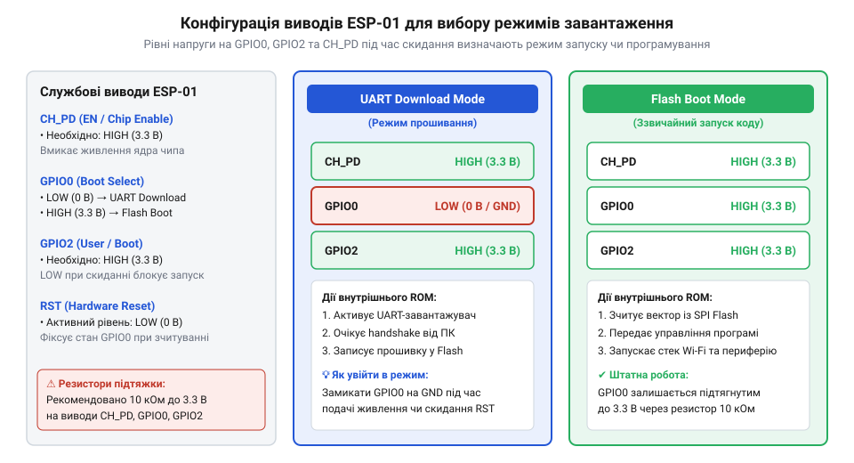
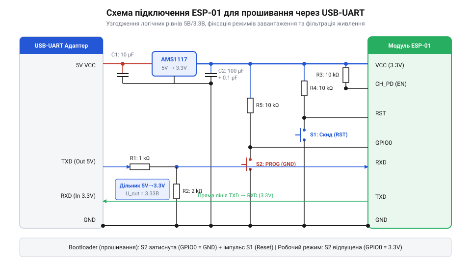
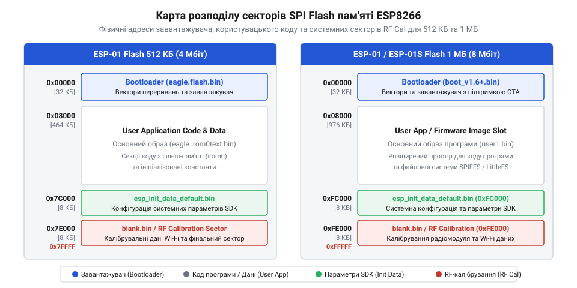
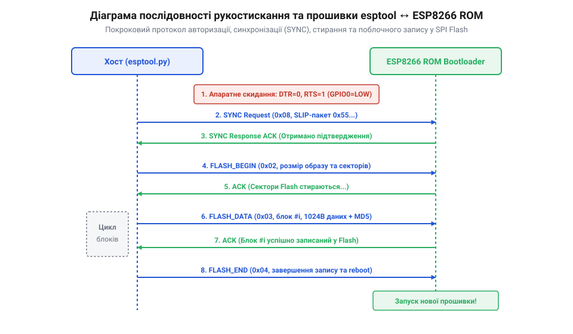
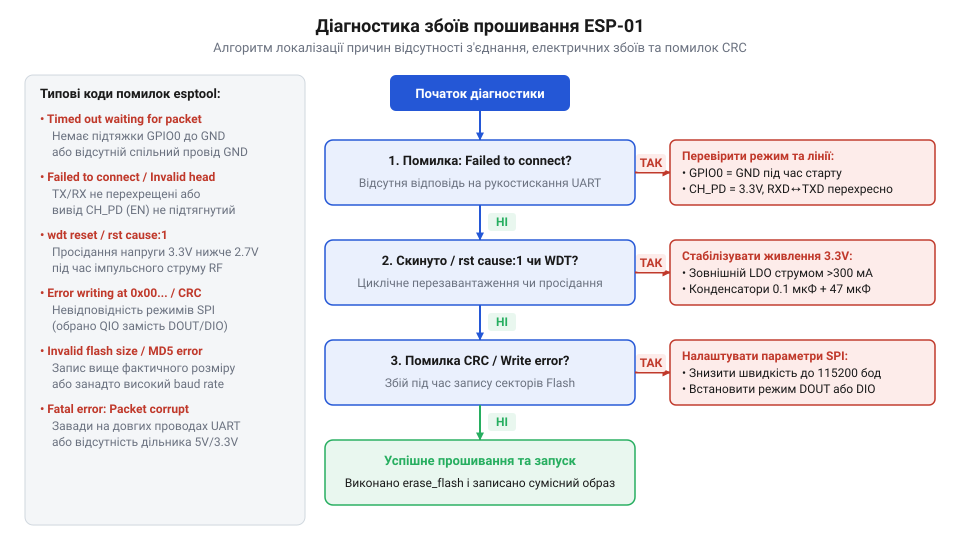

# Оновлення прошивки та прошивання ESP-01

<preknowlist>
- [ESP-01 (Wi-Fi, ESP8266)](root:cat-hw-boards/esp-01) — Базове призначення виводів та апаратна топологія модуля ESP-01
- [Режими завантаження мікроконтролера ESP8266](root:cat-hw-boards/esp8266-boot-modes) — Принцип підтяжки конфігураційних виводів для активації режимів завантаження
- [esp-01-programmer-adapters](root:cat-hw-boards/esp-01-programmer-adapters) — Будова та варіанти адаптерів програмування для узгодження логічних рівнів
</preknowlist>

## Апаратні умови активації режиму завантаження

Заводська прошивка бездротового модуля [ESP-01](root:cat-hw-boards/esp-01) часто містить застарілий стек [AT-команд](root:cat-hw-boards/esp8266-at-gpio-control), що викликає збої при підтримці сучасних протоколів шифрування. Для завантаження власного коду в системну мікросхему @@en|SoC@@ (англ. *System on Chip* — система на кристалі) @@en|ESP8266@@ необхідно перевести внутрішній @@en|ROM Bootloader@@ (від англ. *Read-Only Memory Bootloader* — завантажувач із постійної пам'яті) у спеціальний апаратний режим приймання даних через послідовний порт @@en|UART Download mode@@.

Вибір режиму старту здійснюється защепкуванням логічних рівнів на ключових виводах під час підйому фронту на лінії скидання @@en|RST@@ (від англ. *Reset* — скидання). Для активації режимів [завантаження мікроконтролера](root:cat-hw-boards/esp8266-boot-modes) вивід @@en|GPIO0@@ підтягують до низького рівня заземлення @@en|GND@@ (від англ. *Ground* — земля), а вивід увімкнення @@en|CH_PD@@ (англ. *Chip Power Down*) та вивід @@en|GPIO2@@ утримують під високим потенціалом 3.3 В.


*Конфігурація логічних рівнів на виводах ESP-01 під час вибору режимів завантаження з флеш-пам'яті та прошивання через UART.*

Критичною умовою надійної фіксації стану защепками є утримання низького імпульсу на лінії @@en|RST@@ протягом щонайменше 100 мікросекунд. Це гарантує повне розряджання паразитної ємності та стабільне зчитування потенціалу вхідними тригерами процесора при переході напруги через поріг спрацьовування.

## Електрична стабілізація та підключення програматора

Підключення модуля до персонального комп'ютера виконують через спеціалізовані [адаптери програмування](root:cat-hw-boards/esp-01-programmer-adapters) або конвертери @@en|USB-UART@@. Оскільки мікроконтролер @@en|ESP8266@@ працює від напруги 3.3 В і не є толерантним до 5 В, лінії прийому даних обов'язково узгоджують через резистивні дільники напруги для захисту вхідних діодів чипа.

Радіочастотний каскад модуля під час ініціалізації передавача споживає короткочасні імпульсні струми амплітудою до 400 мА. Спад напруги `ΔV_ESR` на власному опорі конденсатора обчислюється як добуток імпульсу струму `ΔI` на еквівалентний послідовний опір @@en|ESR@@ (від англ. *Equivalent Series Resistance* — еквівалентний послідовний опір):

```
ΔV_ESR = ΔI · ESR
       = 0.4 А · 0.1 Ом      [підстановка пікового струму 400 мА та опору Low ESR]
       = 0.04 В              [допустимий спад напруги 40 мВ]
```


*Принципова схемотехніка обв'язки модуля ESP-01 із дільником напруги на лінії RX та фільтруючими конденсаторами живлення.*

Використання конденсаторів із низьким опором @@en|Low ESR@@ ємністю від 47 мкФ запобігає глибокому просіданню живлення нижче межі 2.7 В та захищає систему від перезавантаження за порогом @@en|Brownout Reset@@ (від англ. *Brownout Reset* — скидання при просіданні живлення).

## Структура пам'яті та робота з esptool

Програмний код та конфігурація системи зберігаються у зовнішній енергонезалежній пам'яті @@en|SPI Flash@@ (англ. *Serial Peripheral Interface Flash*). За адресою `0x00000` розміщується первинний завантажувач @@en|bootloader@@, а системні сектори калібрування радіочастотного тракту записані в останніх блоках пам'яті.


*Карта розміщення секторів завантажувача, образу прошивки, системних конфігурацій SDKInitData та збереження параметрів Wi-Fi для 512 КБ та 1 МБ SPI Flash.*

Запис бінарних образів виконують консольною утилітою @@en|esptool@@. Під час прошивання важливо обирати режим шини @@en|DOUT@@ (англ. *Dual Output*) або @@en|DIO@@ (англ. *Dual I/O*). Спроба встановити чотирипровідний режим @@en|QIO@@ на платах [ESP-01](root:cat-hw-boards/esp-01) призводить до зчитування сміттєвих бітів через відсутність розведеніх ліній `SD2` та `SD3` і спричиняє циклічне перезавантаження @@en|boot loop@@.


*Часова діаграма взаємодії утиліти esptool із завантажувачем ESP8266 під час автовизначення флеші, стирання секторів та запису бінарних блоків.*

## Локалізація та усунення збоїв прошивання

Для діагностики апаратних збоїв послідовний термінал налаштовують на системну швидкість 74880 бод. Діагностичний рядок завантажувача `rst cause:X, bootmode:(Y,Z)` вказує причину скидання та стан [конфігураційних виводів](root:cat-hw-boards/esp8266-boot-strapping-pins). Значення `bootmode` з першою цифрою `1` або `3` підтверджує успішний вхід у режим прошивання.


*Алгоритм послідовної діагностики причин відсутності синхронізації, просідань живлення та помилок CRC.*

Викривлення кадру та помилки контрольних сум @@en|CRC@@ (від англ. *Cyclic Redundancy Check* — циклічний надлишковий контроль) на високих швидкостях виникають через паразитичні відбиття сигналу у довгих провідниках. Встановлення послідовних демпферних резисторів номіналом 33–100 Ом біля виводів ліній передачі поглинає відбиту хвилю та відновлює прямокутну форму логічних імпульсів.
