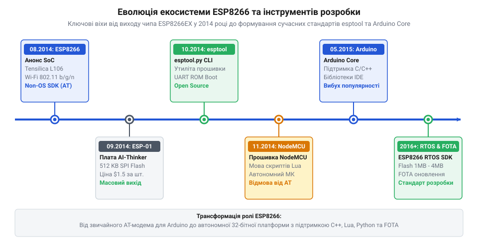
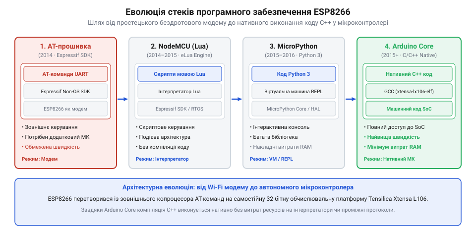

# Еволюція прошивок та інструментів завантаження ESP8266

<preknowlist>
- [ESP-01 (Wi-Fi, ESP8266)](root:cat-hw-boards/esp-01) — призначення виводів та базові характеристики модуля
- [Огляд мікроконтролера та архітектури SoC ESP8266](root:cat-hw-boards/esp8266-soc-architecture-overview) — архітектура 32-бітного ядра Tensilica Xtensa L106
</preknowlist>

## Революційний чип та міф про модем

У серпні 2014 року шанхайська компанія @@en|Espressif Systems@@ заснувала нову еру в DIY-електроніці, випустивши мікросхему `ESP8266EX`. До цього моменту додавання мережевого бездротового зв'язку @@en|Wi-Fi@@ до аматорського проєкту вимагало використання дорогих та масивних модулів вартістю від $20 до $50 (наприклад, на базі чипів Microchip або TI CC3000). Невеликий чип розміром 5×5 мм у корпусі @@en|QFN-32@@ пропонував повноцінний Wi-Fi стек за невидано низькою оптовою ціною близько $1–$2. Секрет такої компактності й дешевизни полягав у високоінтегрованій внутрішній топології кристала: обчислювальне ядро та апаратний Wi-Fi трансивер сполучалися через високошвидкісну матрицю системної шини @@en|AHB@@ (англ. *advanced high-performance bus*, вдосконалена системна шина високої продуктивності), яка напряму арбітрувала доступ до оперативної пам'яті SRAM за алгоритмом пріоритетного прямого доступу до пам'яті (англ. *direct memory access*, @@en|DMA@@). Системний арбітр шини надавав найвищий пріоритет апаратному мак-контролеру (англ. *media access control*, @@en|MAC@@) для буферизації мережевих кадрів, тоді як низькошвидкісні периферійні транзакції ізолювалися на окремій шині @@en|APB@@ (англ. *advanced peripheral bus*, розширена периферійна шина) через асинхронний шинний міст. Завдяки такому розділенню потоків процесорне ядро обробляло обчислювальні інструкції з пам'яті SRAM без мікросекундних затримок (англ. *bus stall*, зупинка шини) під час передачі бездротових пакетів, забезпечуючи паралельну роботу мережевого стека без блокування виконання програми.

Завдяки первинній заводській прошивці чипа у перші місяці після виходу виник поширений міф, ніби `ESP8266` — це лише простий послідовний бездротовий модем. Користувачі сприймали пристрій як периферію для класичного мікроконтролера, оскільки взаємодія відбувалася виключно через асинхронний послідовний порт [Керування GPIO виводами ESP8266 через AT-команди](root:cat-hw-boards/esp8266-at-gpio-control). Однак ця уява була хибною: усередині кремнієвого кристала працювало повноцінне високопродуктивне 32-бітне ядро [Огляд мікроконтролера та архітектури SoC ESP8266](root:cat-hw-boards/esp8266-soc-architecture-overview) @@en|Tensilica Xtensa L106@@ з тактовою частотою 80 МГц (і можливістю розгону до 160 МГц).

*Хронологічна часова шкала ключових етапів розвитку ESP8266 від анонсу чипа у 2014 році до релізу Arduino Core та esptool.*

Продуктивність обчислювального ядра `ESP8266` у рази перевищувала можливості популярних 8-бітних мікроконтролерів AVR (наприклад, ATmega328P у платах Arduino з її 16 МГц). Зрозумівши, що процесор моста може виконувати довільний користувацький код прямо на пристрої, ентузіасти відмовилися від використання зовнішнього контролера, перетворивши `ESP8266` з допоміжного інтерфейсного чипа на самостійну обчислювальну платформу.

## AI-Thinker та народження модуля ESP-01

Сама компанія Espressif Systems розробляла та продавала виключно безкорпусні мікросхеми (SoC). Для масового ринку розробників потрібна була готова плата з друкованою антеною, тактовим резонатором і зовнішньою флеш-пам'яттю. У вересні 2014 року китайська компанія @@en|AI-Thinker@@ створила та випустила першу друковану плату на базі `ESP8266EX`, яка отримала назву [ESP-01 (Wi-Fi, ESP8266)](root:cat-hw-boards/esp-01).

У зв'язку з плутаниною на ринку виник ще один спірний міф: тривалий час компанію AI-Thinker вважали розробником самого процесора `ESP8266`. Насправді ж AI-Thinker виступала виключно як системний інтегратор, що розвів компактну 8-контактну плату розміром 24.7×14.4 мм та встановив на неї мікросхему зовнішньої пам'яті @@en|SPI Flash@@ (англ. *Serial Peripheral Interface Flash*) обсягом 512 КБ (4 Мбіт).

Плату `ESP-01` проектували під вихідні вимоги асинхронного модема, що зумовило її перші апаратні обмеження. Дворядний роз'єм 2×4 з кроком 2.54 мм вивів лише два універсальних виводи загального призначення (`GPIO0` та `GPIO2`), а також лінії `TXD/RXD`, `CH_PD` (Chip Enable), `RST` та живлення 3.3V. Фізична розводка двошарової плати з щільним паралельним розміщенням доріжок у роз'ємі 2×4 створювала відчутну паразитну ємність (англ. *parasitic capacitance*, паразитне накопичення заряду між провідниками) порядку 15–25 пФ між сусідніми сигнальними лініями `GPIO0` та `TXD`. Під час апаратного скидання ця ємність разом із високоомним вхідним опором портів затримувала розряджання ліній, викликаючи тимчасову нестабільність логічних рівнів у момент фіксації стартового стану процесором. Найперші ревізії модулів виготовляли на синій друкованій платі й оснащували двома світлодіодами: червоним індикатором живлення та синім індикатором передачі даних по лінії `TXD`, мерехтіння якого при старті часто плутали зі збоєм завантаження. Це робило модуль неймовірно дешевим ($2–$3 на роздрібному ринку), але вимагало обов'язкового встановлення зовнішніх підтягуючих резисторів для компенсації паразитної ємності й забезпечення стабільного вибору режимів через [Конфігураційні виводи завантаження ESP8266](root:cat-hw-boards/esp8266-boot-strapping-pins).

## Від закритих SDK до NodeMCU та MicroPython

Початкове програмне забезпечення пристрою базувалося на закритому прошивочному комплекті @@en|Non-OS SDK@@ (англ. *software development kit*, комплект розробки програмного забезпечення), наданому компанією Espressif. Розробка під Non-OS SDK вимагала складного налаштування ланцюжка інструментів (англ. *toolchain*, крос-компілятор) @@en|GCC@@ під архітектуру Xtensa і повністю базувалася на асинхронних зворотних викликах (англ. *callback*, функція зворотного виклику). Замість класичного головного циклу `main()`, розробник реєстрував власні обробники подій мережі й таймерів, які системний цикл викликав уривками. Головна проблема такої архітектури полягала у вкрай обмеженому розмірі системного стека (англ. *stack memory*, стек-пам'ять) — всього близько 1.5 КБ для всіх користувацьких операцій. Спроба розмістити у зворотній функції локальний буфер великого розміру чи побудувати глибинний рекурсивний виклик миттєво спричиняла переповнення стека (англ. *stack overflow*, переповнення стека) та аварійне перезавантаження процесора із фатальною винятковою ситуацією `Fatal exception`, що створювало колосальні труднощі для розробників-початківців.

Для спрощення розробки у пізньому 2014 році спільнота відкритих проектів започаткувала альтернативні відкриті прошивки. Найвідомішим проривом став проект @@en|NodeMCU@@ (англ. *Node MicroController Unit*), який впровадив у прошивку `ESP8266` легкий інтерпретатор мови скриптів @@en|Lua@@. Завдяки NodeMCU розробники змогли керувати мережевими з'єднаннями та периферією через подійно-орієнтовані скрипти, які завантажувалися прямо в текстовому вигляді у пам'ять модуля. Паралельно розвивався проект @@en|MicroPython@@, який надав повноцінну систему команд @@en|REPL@@ (англ. *Read-Eval-Print Loop*) для виконання коду на мові Python 3.

Концепція неблокуючих подій у @@en|NodeMCU@@ революціонізувала підхід до створення домашньої автоматизації: замість традиційних для мікроконтролерів блокуючих циклів із затримками, прошивка реалізувала подійно-орієнтований асинхронний цикл (англ. @@en|event loop@@). При надходженні вхідного @@en|HTTP@@-запиту від браузера система генерувала подію та викликала відповідну функцію зворотного виклику, що дозволяло [модулю ESP-01](root:cat-hw-boards/esp-01) одночасно підтримувати зв'язок з роутером, опитувати датчики й повертати динамічні HTML-сторінки. Саме ця архітектура уможливила побудову перших автономних вебсерверів для розумного дому прямо на чіпі без залучення зовнішніх обчислювальних платформ.

*Схема еволюції стеків програмного забезпечення від AT-команд до нативної компіляції в Arduino Core.*

Для задоволення потреб складніших мережевих застосунків компанія Espressif згодом випустила @@en|RTOS SDK@@ на базі операційної системи реального часу @@en|FreeRTOS@@. Це дозволило розділити обробку бездротового стека Wi-Fi та виконання користувацьких задач у багатопотоковому середовищі. Поява скриптових та базованих на RTOS середовищ проклала шлях до перетворення `ESP8266` на повноцінну платформу для рішень Інтернету речей (IoT).

## Прорив Arduino Core та революція утиліт

Справжня революція у масовому використанні `ESP8266` відбулася у 2015 році, коли розробник Іван Ґрохотков (Ivan Grokhotkov) та спільнота відкритих проектів випустили аддон @@en|Arduino Core for ESP8266@@. Цей плагін повністю інтегрував підтримку архітектури Xtensa в середовище @@en|Arduino IDE@@, дозволивши розробникам використовувати звичний C++ код, бібліотеки та функції `digitalWrite()` чи `WiFi.begin()` без необхідності ручного виклику низькорівневих асинхронних функцій SDK. Модуль перетворився з бездротового периферійного пристрою на повноцінний самостійний мікроконтролер.

Паралельно відбулася революція інструментів прошивки. На початкових етапах завантаження бінарних образів виконували через нестабільні графічні утиліти під Windows (на кшталт *ESP8266 FLASHER* чи *XTCOM MULTIPROGRAMMER*), які часто збивали адреси секторів. Усе змінилося з появою відкритої консольної утиліти @@en|esptool.py@@ від Фредеріка Альберга (Fredrik Ahlberg) та Espressif Systems. Написана на мові Python, утиліта автоматизувала розпізнавання типів пам'яті, розрахунок швидкостей та керування лініями послідовного порту через [адаптери програматорів ESP-01](root:cat-hw-boards/esp-01-programmer-adapters) для переведення чипа в [режими завантаження ESP8266](root:cat-hw-boards/esp8266-boot-modes), ставши світовим стандартом. Головним схемотехнічним проривом `esptool.py` став алгоритм автоматичного скидання (англ. *auto-reset sequence*, послідовність автоматичного скидання): утиліта почергово подає сигнали керування @@en|DTR@@ (англ. *data terminal ready*, готовність термінала даних) та @@en|RTS@@ (англ. *request to send*, запит на передачу) через транзисторну пару адаптера. Спочатку сигнал `RTS` притискає вивід `RST` до землі, після чого `DTR` підтягує `GPIO0` до низького рівня; далі `RTS` відпускається, дозволяючи виводу `RST` піднятися до 3.3V, і процесор під час завантаження фіксує `GPIO0 = 0`, прозоро входячи в режим завантаження без використання фізичних кнопок. Крім того, `esptool.py` автоматично підлаштовує тактову частоту шини SPI (від 20 МГц до 80 МГц) та режим передачі даних (`QIO`, `DIO`, `DOUT`), гарантуючи стабільний запис бінарного образу.

## Еволюція завантажувачів та розширення SPI Flash

Із розширенням функціональності прошивок виявилося, що початковий обсяг флеш-пам'яті перших плат `ESP-01` у 512 КБ створює фізичний бар'єр для розвитку. Нові можливості, такі як [Оновлення прошивки ESP8266 по повітрю (FOTA)](root:cat-hw-boards/esp8266-fota-update), вимагали одночасного збереження двох робочих образів програми у пам'яті (Dual Bank FOTA), що потребувало щонайменше 1 МБ (8 Мбіт) або 4 МБ Flash-пам'яті.

Збільшення розмірів чипів пам'яті спричинило еволюцію внутрішнього завантажника @@en|bootloader@@ та карт розділів (partition maps). Ранні версії завантажника (*v1.1–v1.3*) підтримували лише некомбінований режим адресації та сталі адреси секторів системних налаштувань. З випуском завантажників серії *v1.6+* та нової апаратної ревізії [ESP-01S (Wi-Fi, ESP8266)](root:cat-hw-boards/esp-01s) обсяг Flash зрос до 1 МБ, а карти пам'яті змістили системні блоки @@en|RF Cal@@ та калiбраційні дані в останні чотири сектори фізичного обсягу чипа. Спроби записати сучасну прошивку без урахування розміру пам'яті викликали циклічні перезавантаження (boot loop), усунення яких вимагало повного очищення Flash та заливки відповідного завантажника.
