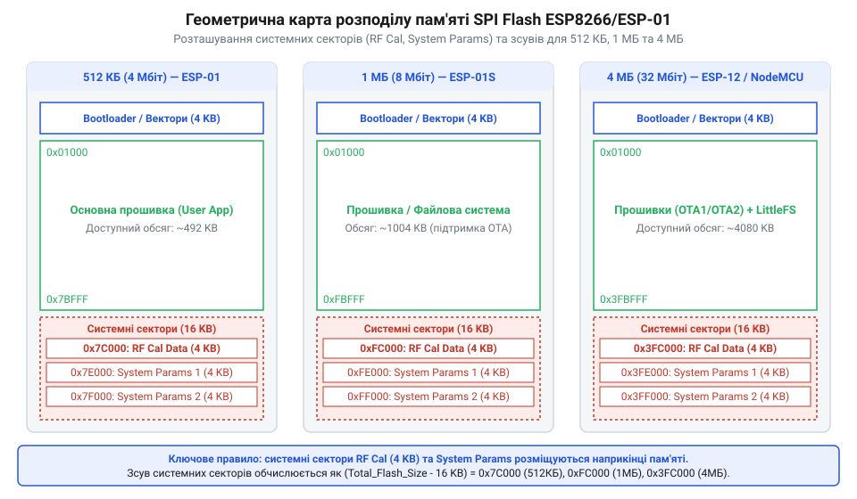
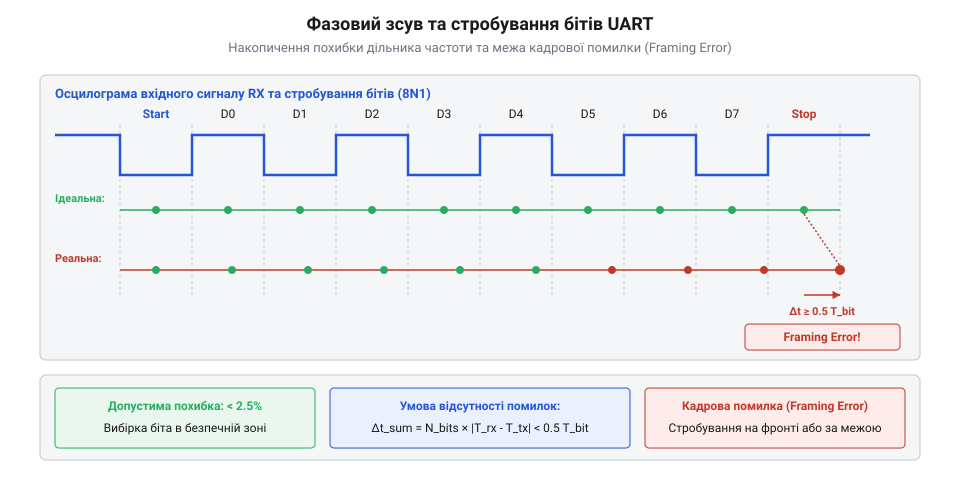

# Математика адресації SPI Flash та розрахунок швидкостей UART

<preknowlist>
- [ESP-01 (Wi-Fi, ESP8266)](root:cat-hw-boards/esp-01) — розуміння загальної апаратної організації модуля ESP-01 та розмірів вбудованої Flash-пам'яті
- [Огляд мікроконтролера та архітектури SoC ESP8266](root:cat-hw-boards/esp8266-soc-architecture-overview) — базове розуміння частоти тактування ядра (80/160 МГц) та роботи периферійних модулів SPI та UART
</preknowlist>

## Проблема нерозривності пам'яті та фазових помилок

Спроба завантажити новий бінарний образ у модуль [ESP-01](root:cat-hw-boards/esp-01) за довільними адресами часто призводить до непрацездатності пристрою. Мікроконтролер циклічно перезавантажується або зупиняє завантажувач усередині системи. Причина полягає у фізичній організації енергонезалежної пам'яті @@en|SPI Flash@@ (від англ. *Serial Peripheral Interface Flash*): вона розбита на нерозривні блоки та сектори фіксованого розміру. Запис даних вимагає попереднього стирання цілого сектора розміром 4096 байтів. Фізичний механізм стирання комірок спирається на квантовомеханічне тунелювання Фаулера — Нордгейма @@en|Fowler-Nordheim tunneling@@ (від прізвищ фізиків @@en|Fowler@@ та @@en|Nordheim@@ — тунелювання Фаулера — Нордгейма). При подачі високого потенціалу стирання (порядку 10–15 В) на плаваючий затвор @@en|floating gate@@ у тонкому шарі диелектричного оксиду кремнію `SiO₂` завтовшки 7–10 нм виникає надпотужне електричне поле `E ≈ 10` МВ/см. Під дією цього поля прозорість трикутного потенціального бар'єра зростає, дозволяючи високоенергетичним електронам тунелювати з плаваючого затвора назад у підкладку й повертати комірку в вихідний стан логічної одиниці `0xFF`. Проте багаторазове проходження електронів крізь кристалічну ґратку діелектрика генерує дефекти та пастки заряду. Часті цикли стирання незворотно деградують кристал оксиду, викликаючи накопичення ловильних центрів, що зміщує порогову напругу транзистора `V_th`, обмежує ресурс сектора приблизно 100 000 циклами та призводить до неможливості повністю вивести комірку у вихідний стан 0xFF. Якщо ж межі завантажуваного коду перетинають або перекривають службові зони зберігання калібрувальних параметрів радіомодуля чи таблиць векторів переривань, система остаточно втрачає цілісність конфігурації.

Паралельно з проблемами геометрії пам'яті виникають апаратні збої під час передачі даних по шині @@en|UART@@ (від англ. *Universal Asynchronous Receiver-Transmitter*). Оскільки тактування послідовного порту формується шляхом ділення системної частоти процесора, вибір високої швидкості завантаження (наприклад, 921600 біт/с) створює відносне відхилення частоти. Якщо часова похибка фазового зсуву при зчитуванні останнього біта в кадрі перевищує половину тривалості одного бітового інтервалу, приймач фіксує кадрову помилку @@en|framing error@@ (від англ. *frame* — кадр, *error* — помилка).

Без математичної моделі адресації пам'яті та розрахунку допустимих похибок тактування неможливо гарантувати стабільне оновлення прошивки. Потрібен точний алгоритм обчислення адресних зсувів системних секторів залежно від обсягу Flash-чипа та математичне визначення меж фазового розсинхрону бітів при передачі.

Ключовим аспектів фізичної структури @@en|SPI Flash@@ є співвідношення між сторінкою програмування `S_page` та сектором стирання `S_sec`. Хоча операція запису здійснюється посторінково блоками по 256 байтів, повернення комірок пам'яті з логічного нуля в одиницю можливе виключно на рівні цілого сектора `S_sec = 4096` байтів. Кількість сторінок усередині одного сектора `N_page` обчислюється як:

```
N_page = S_sec ÷ S_page
       = 4096 ÷ 256          [ділення обсягу сектора на розмір сторінки]
       = 16                  [кількість сторінок в одному секторі]
```

Через таке співвідношення заміна навіть одного 256-байтового фрагмента вимагає зчитування усіх 16 сторінок (4 КБ) в оперативну пам'ять, стирання всього сектора за адресою `A_sec` та послідовного повторного запису 16 сторінок. Будь-яка помилка обчислення адреси призводить до незворотного втрачання сусідніх 15 сторінок коду.

## Геометрична модель адресації SPI Flash

Фізична пам'ять @@en|SPI Flash@@ у модулях [серії ESP-01](root:cat-hw-boards/esp-01-module-family-overview) має сувору блочно-секторну структуру. Мінімальною одиницею стирання є сектор `S_sec`, обсяг якого фіксований і становить:

```
S_sec = 4096                 [розмір одного сектора у байтах (4 КБ)]
```

Загальний обсяг пам'яті `M_total` залежить від модифікації модуля і становить 512 КБ (524288 байтів), 1 МБ (1048576 байтів) у чорних платах [ESP-01S](root:cat-hw-boards/esp-01s) або 4 МБ (4194304 байти). Загальна кількість секторів у пам'яті `N_sec` обчислюється як відношення повного обсягу до розміру сектора:

```
N_sec = M_total ÷ S_sec      [підстановка розмірів пам'яті та сектора]
```

Для трьох стандартних конфігурацій обсягу пам'яті число секторів становить:

```
N_sec(512 КБ) = 524288 ÷ 4096 = 128
N_sec(1 МБ)   = 1048576 ÷ 4096 = 256
N_sec(4 МБ)   = 4194304 ÷ 4096 = 1024
```


*Геометричний розподіл секторів завантажувача, системних налаштувань Espressif SDK та службових зон RF Cal залежно від обсягу флеш-чипа.*

Будь-який системний сектор з індексом `k` (де індексація починається з `0` до `N_sec - 1`) має абсолютну початкову адресу `A_sec(k)`, яка виражається формулою:

```
A_sec(k) = k × S_sec         [абсолютна адреса початку k-го сектора]
```

Для флеш-чипів обсягом 4 МБ (4194304 байти, `N_sec = 1024`) сектор збереження конфігураційних налаштувань мережі @@en|Wi-Fi@@ `sys_param` розташовується за три сектори до кінця пам'яті, тобто за індексом `k_sys = N_sec - 3 = 1021`. Обчислимо його геометричну початкову адресу `A_sys`:

        k_sys
        = 1024 - 3               [індекс сектора налаштувань Wi-Fi для 4 МБ]
        = 1021                   [значення індексу сектора]

        A_sys
        = 1021 × 4096            [обчислення десятичного значення адреси]
        = 4182016                [байтова адреса у пам'яті]
        = 0x3FD000               [шістнадцяткове значення адреси]

У разі роботи із застарілими [модулями ESP-01](root:cat-hw-boards/esp-01) перших ревізій із обсягом пам'яті 512 КБ (524288 байтів, `N_sec = 128`), системний сектор `sys_param` зсувається на адресу `0x7D000`, а сектор @@en|RF Cal@@ (`k_rf = 128 - 4 = 124`) займає адресу `0x7C000`:

        k_rf
        = 128 - 4                [індекс сектора калібрування радіо]
        = 124                    [значення індексу сектора]

        A_rf
        = 124 × 4096             [обчислення десятичного значення адреси]
        = 507904                 [байтова адреса у пам'яті]
        = 0x7C000                [шістнадцяткове значення адреси]

При спробі записати прошивку, розраховану на 512 КБ, у 1 МБ чи 4 МБ чип без коригування цих зсувів, завантажувач шукатиме системні структури за неправильними адресами, що призведе до збоїв ініціалізації радіотракту.

```
k_sys = 1024 - 3
      = 1021                 [індекс сектора налаштувань Wi-Fi]

A_sys = 1021 × 4096
      = 4182016              [десяткова адреса початку сектора в байтах]
      = 0x3FD000             [переведення у шістнадцяткову систему]
```

Точне визначення адреси `0x3FD000` гарантує, що системна конфігурація безпровідного зв'язку не буде випадково пошкоджена при розміщенні файлової системи або прошивки користувача у великооб'ємних чипах.

```
A_sec(k) = k × S_sec         [абсолютна адреса початку k-го сектора]
```

Компанія @@en|Espressif@@ закріпила останні чотири сектори пам'яті під системні потреби системного набору розробки @@en|SDK@@ (від англ. *Software Development Kit*). Зокрема, сектор збереження системних параметрів радіотракту @@en|RF Cal@@ (від англ. *Radio Frequency Calibration*) розташовується за чотири сектори до кінця флеш-пам'яті, тобто за індексом `k_rf = N_sec - 4`.

Розрахуємо початкову адресу сектора `A_rf` для модуля з обсягом пам'яті 1 МБ (`M_total = 1048576` байтів, `N_sec = 256`):

**Обчислення адреси сектора RF Cal для 1 МБ Flash:**

```
k_rf = 256 - 4
     = 252                   [індекс сектора RF Cal]

A_rf = 252 × 4096
     = 1032192               [десятичне значення адреси в байтах]
     = 0xFC000               [переведення у шістнадцяткову систему]
```

Аналогічно вирішальним є розташування сектора налаштувань системного кешу `blank.bin`, що знаходиться за індексом `k_blank = N_sec - 2`. Для 1 МБ пам'яті адреса дорівнює:

```
A_blank = (256 - 2) × 4096
        = 254 × 4096
        = 1040384            [десятичне значення адреси]
        = 0xFE000            [переведення у шістнадцяткову систему]
```

При використанні архітектури [безпровідного оновлення FOTA](root:cat-hw-boards/esp8266-fota-update) (від англ. *Firmware Over-The-Air*) простір пам'яті ділиться на два рівні банки додатка `user1.bin` та `user2.bin`. Максимальний обсяг одного банку `S_app` для 1 МБ флеш-пам'яті з урахуванням завантажувача та системних секторів обчислюється як:

```
S_app = (N_sec - 16) ÷ 2 × S_sec
      = (256 - 16) ÷ 2 × 4096
      = 240 ÷ 2 × 4096
      = 120 × 4096
      = 491520               [максимальний розмір прошивки 480 КБ]
```

Таким чином, розрахована геометрична модель гарантує захист службових секторів від випадкового перезапису під час оновлення прошивки.

Для прямого виконання коду з пам'яті @@en|SPI Flash@@ процесорне ядро використовує шину інструкцій @@en|iBUS@@ (англ. @@en|Instruction Bus@@ — шина інструкцій), яка мапує вміст флеш-чипа в 32-бітний віртуальний адресний простір, що починається з базового зсуву `A_base = 0x40200000`. Лінійне співвідношення між фізичним зсувом у флеш-пам'яті `A_flash` та віртуальною адресою шини `A_ibus` виражається формулою:

        A_ibus
        = A_base + A_flash                       [формула мапування фізичної адреси Flash у простір iBUS]

Для прикладного образу додатка, розташованого за фізичним зсувом `A_flash = 0x10000` (64 КБ від початку пам'яті), віртуальна адреса виконання `A_ibus` обчислюється як:

        A_ibus
        = 0x40200000 + 0x10000                    [додавання базової адреси iBUS та фізичного зсуву]
        = 0x40210000                             [абсолютна адреса інструкцій у просторі iBUS]

Оскільки апаратне вікно кеша @@en|ICACHE@@ обмежує один прямо адресований банк обсягом 1 МБ (`0x40200000`–`0x402FFFFF`), при роботі з чипами пам'яті 4 МБ фізичні адреси вище межі `0x100000` (1 МБ) дзеркалюються через те саме вікно 1 МБ із використанням регістрового перемикання банків кешу `Cache_Read_Enable`. Це вимагає обчислення відносного зсуву всередині поточного банку `A_bank = A_flash mod 0x100000`, щоб запобігти збоям адресації інструкцій процесора.

## Математика дробових дільників швидкості UART

Передача даних по інтерфейсу @@en|UART@@ вимагає точного узгодження швидкості обміну між пристроями. У периферійному модулі мікроконтролера [ESP8266](root:cat-hw-boards/esp8266-soc-architecture-overview) частота генерації бітових інтервалів формується шляхом ділення системної частоти тактування шини `f_sys` (стандартно `f_sys = 80000000` Гц або 80 МГц) на числове значення дільника `DIV`.

Значення дільника `DIV` є дійсним числом і складається з цілочисельної частини `DIV_INT` (16 бітів) та дробової частини `DIV_FRAC` (4 біти, тобто 1/16 частка). Математичний зв'язок між цільовою швидкістю `B_target` у бітах на секунду (бод) та дільником задається формулою:

DIV = f_sys ÷ B_target        [обчислення теоретичного дільника]

На апаратному рівні дробова частина `DIV_FRAC` реалізується за допомогою 4-бітного акумулятора фази `@@en|Phase Accumulator@@` (від англ. *phase* — фаза, та *accumulator* — накопичувач). Замість формування строго фіксованого періоду для кожного біта, модулятор акумулятора додає `DIV_FRAC` на кожному тактовому кроці. Коли акумулятор переповнюється (перевищує 15), тривалість поточного бітового інтервалу апаратно подовжується на один системний такт `f_sys`. Це створює цифрове дизерингування тривалості бітів у часовій області: частина бітів передається за `DIV_INT` системних тактів, а частина — за `DIV_INT + 1` тактів. Внаслідок цього квантування виникає часовий джиттер `@@en|Jitter@@` (від англ. *jitter* — тремтіння, розсинхронізація), амплітуда якого прямо дорівнює періоду базової системної частоти `J_jitter = 1 / f_sys`. При частоті `f_sys = 80 МГц` піковий джиттер становить `12.5 нс`, а при `160 МГц` зменшується до `6.25 нс`, що є цілком безпечним для стійкості прийому даних.

```
DIV = f_sys ÷ B_target        [обчислення теоретичного дільника]
```

Оскільки дробова частина обмежується 4 бітами, дискретний дільник у регістрі `DIV_reg` обчислюється як округлення до найближчого кратного 1/16:

```
DIV_reg = round(DIV × 16) ÷ 16 [дискретизація з кроком 1/16]
```

Фактично отримана швидкість `B_actual` становить:

```
B_actual = f_sys ÷ DIV_reg    [реальна швидкість після дискретизації]
```

Відносне відхилення швидкості (похибка дільника) `E_baud` виражається у відсотках за формулою:

```
E_baud = (B_actual - B_target) ÷ B_target × 100 [відносне відхилення швидкості]
```

Обчислимо реальну швидкість та похибку для гранично високої швидкості завантаження `B_target = 921600` біт/с при базовій частоті шини `f_sys = 80000000` Гц (80 МГц) та при підвищеній частоті тактування ядра `f_sys = 160000000` Гц (160 МГц). Окрім того, розглянемо розрахунок похибки для нестандартної високої швидкості `B_target = 1500000` біт/с (1.5 Мбіт/с) при частоті 80 МГц: ідеальний дільник `DIV = 80000000 ÷ 1500000 = 53.3333...` дискретизується як `round(53.3333... × 16) ÷ 16 = 853 ÷ 16 = 53.3125`, що дає фактичну швидкість `B_actual = 80000000 ÷ 53.3125 = 1500586.17` біт/с і відносне відхилення `E_baud = +0.039 %`. Такий розрахунок показує, що навіть для нестандартних швидкостей 4-бітова дробова частина дільника утримує відхилення в межах частотних допусків приймача.

**Розрахунок дільника та похибки для 80 МГц (921600 біт/с):**

```
DIV = 80000000 ÷ 921600
    = 86.805555...           [теоретичний точний дільник]

DIV_frac_raw = 86.805555... × 16
             = 1388.8888...  [значення в 1/16 частках]

DIV_reg_int = round(1388.8888...) ÷ 16
            = 1389 ÷ 16
            = 86.8125        [дискретизований дільник регістру]

B_actual = 80000000 ÷ 86.8125
         = 921526.28         [фактична швидкість у біт/с]

E_baud = (921526.28 - 921600) ÷ 921600 × 100
       = -73.72 ÷ 921600 × 100
       = -0.008 %            [відносна похибка менше 0.01%]
```

Для порівняння проаналізуємо роботу модуля в режимі підвищеної системної частоти 160 МГц, яка вмикається під час інтенсивних обчислень.

**Розрахунок дільника та похибки для 160 МГц (921600 біт/с):**

```
DIV = 160000000 ÷ 921600
    = 173.611111...          [теоретичний точний дільник при 160 МГц]

DIV_frac_raw = 173.611111... × 16
             = 2777.7777...  [значення в 1/16 частках]

DIV_reg_int = round(2777.7777...) ÷ 16
            = 2778 ÷ 16
            = 173.625        [дискретизований дільник регістру]

B_actual = 160000000 ÷ 173.625
         = 921526.28         [фактична швидкість у біт/с]

E_baud = (921526.28 - 921600) ÷ 921600 × 100
       = -73.72 ÷ 921600 × 100
       = -0.008 %            [відносна похибка при 160 МГц]
```

Порівняльний розрахунок показує, що двократне збільшення тактової частоти подвоює значення дільника `DIV_reg` (з `86.8125` до `173.625`), однак залишає відносну похибку `E_baud = -0.008 %` ідентичною завдяки збереженню пропорції дискретизації дробової частини.

**Розрахунок дільника та похибки для 921600 біт/с:**

```
DIV = 80000000 ÷ 921600
    = 86.805555...           [теоретичний точний дільник]

DIV_frac_raw = 86.805555... × 16
             = 1388.8888...  [значення в 1/16 частках]

DIV_reg_int = round(1388.8888...) ÷ 16
            = 1389 ÷ 16
            = 86.8125        [дискретизований дільник регістру]

B_actual = 80000000 ÷ 86.8125
         = 921526.28         [фактична швидкість у біт/с]

E_baud = (921526.28 - 921600) ÷ 921600 × 100
       = -73.72 ÷ 921600 × 100
       = -0.008 %            [відносна похибка менше 0.01%]
```

Отримана похибка `E_baud = -0.008 %` є невагомою, однак апаратна точність також залежить від генератора [зовнішнього USB-UART адаптера](root:cat-hw-boards/esp-01-programmer-adapters).

## Межі фазового зсуву та вибір швидкості

Під час асинхронного приймання кадру @@en|UART@@ приймач фіксує спадаючий фронт старт-біта та здійснює вибірку кожної з подальших інформаційних комірок у центрі часового вікна біта. Для цього апаратний модуль приймача застосовує 16-кратне передискретизування @@en|oversampling@@ (англ. *oversampling* — передискретизування), розбиваючи один бітовий інтервал `T_bit` на 16 рівних часових тактів `t_tick = T_bit ÷ 16`. У момент виявлення спадаючого фронту старт-біта апаратний лічильник скидається в нуль (`t = 0`). Точний центр k-го бітового інтервалу припадає на 8-й такт надлічильника. Математичний зв'язок між 16-кратним опитуванням та моментом стробування `t_sample(k)` у центрі біта виражається як:

        t_sample(k)
        = (k × 16 + 8) × t_tick                  [індекс 8-го такта для k-го біта]
        = (k × 16 + 8) × (T_bit ÷ 16)            [підстановка тривалості такта t_tick = T_bit / 16]
        = (k + 8 ÷ 16) × T_bit                   [розкриття дужок та скорочення на 16]
        = (k + 0.5) × T_bit                      [підсумкова часова координата центру k-го біта]

Для надійного зчитування приймач виконує потрійну вибірку на 7-му, 8-му та 9-му тактах, застосовуючи алгоритм мажоритарного голосування @@en|majority voting@@ (англ. *majority voting* — голосування більшості). Дискретизація 16x обмежує початкову фазову похибку квантування фронту величиною `± 0.5 × t_tick = ± 0.03125 × T_bit` (3.125% від тривалості біта), що задає базовий запас стійкості приймача. Тривалість одного бітового інтервалу `T_bit` дорівнює:

        T_bit
        = 1 ÷ B_target                           [тривалість бітового інтервалу у секундах]

```
T_bit = 1 ÷ B_target         [тривалість бітового інтервалу у секундах]
```

Для кадру з розширеною структурою 8N1 (1 старт-біт, 8 біт даних, 1 стоп-біт, усього `N_bits = 10` бітів) вибірка останнього (стоп-біта) здійснюється у момент часу `t_sample`:

```
t_sample = (N_bits - 0.5) × T_bit [ідеальний момент вибірки останнього біта]
         = 9.5 × T_bit       [для 10-бітового кадру]
```


*Часова діаграма накопичення фазового зсуву при вибірці бітів кадру UART та розрахунок граничної межі допустимої похибки.*

Якщо між передавачем та приймачем існує відносна різниця частот `ΔE_total`, фазовий зсув часу вибірки `Δt_phase` на останньому біті накопичується пропорційно кількості переданих бітів:

```
Δt_phase = (N_bits - 0.5) × T_bit × (ΔE_total ÷ 100) [накопичений фазовий зсув]
         = 9.5 × T_bit × (ΔE_total ÷ 100)
```

Для гарантованого зчитування правильного логічного рівня точка вибірки не повинна виходити за межі часового вікна біта `± 0.5 × T_bit`. Додатково враховується технологічний асинхронний джиттер `J_async` (приблизно 5% тривалості біта). Математична умова відсутності кадрової помилки @@en|framing error@@ набирає вигляду:

```
|Δt_phase| + J_async < 0.5 × T_bit [умова відсутності кадрової помилки]
```

Підставивши значення `t_sample = 9.5 × T_bit` та `J_async = 0.05 × T_bit`, отримуємо гранично допустиме сумарне відхилення частоти `ΔE_max`:

```
9.5 × T_bit × (ΔE_max ÷ 100) + 0.05 × T_bit = 0.5 × T_bit [граничне рівняння]
9.5 × (ΔE_max ÷ 100) = 0.45 [скорочення T_bit та віднімання 0.05]
ΔE_max ÷ 100 = 0.45 ÷ 9.5    [виділення частотного відношення]
ΔE_max = 4.737 %             [максимально допустиме відхилення частоти]
```

Таким чином, сумарна похибка генерації частоти мікроконтролером [ESP-01S](root:cat-hw-boards/esp-01s) та мостом @@en|USB-UART@@ не повинна перевищувати `4.73 %`. Якщо адаптер має внутрішній @@en|RC-генератор@@ із розкидом параметрів понад `± 3 %`, безпечну швидкість завантаження слід обмежити значенням 115200 або 460800 біт/с.

При додаванні апаратного біта парності @@en|Parity@@ (від англ. @@en|parity bit@@ — біт парності) загальна довжина кадру зростає до `N_bits = 11` бітів (1 старт-біт, 8 бітів даних, 1 біт парності та 1 стоп-біт), що зміщує момент стробування останнього біта до `t_sample = 10.5 × T_bit`. Збільшення тривалості кадру призводить до більшого накопичення фазового зсуву, через що гранична похибка частоти `ΔE_max_parity` обчислюється з рівняння рівноваги вибірки. Натомість використання 2 стоп-бітів (режим 8N2) додає примусову паузу високого логічного рівня тривалістю в один додатковий бітовий інтервал `T_bit`. Цей розширений інтервал спокою дозволяє пристрою приймача повністю гасити накопичений фазовий зсув попереднього кадру та гарантовано відновлювати точно розраховану фазову синхронізацію по спадаючому фронту старт-біта наступного байта.

```
10.5 × T_bit × (ΔE_max_parity ÷ 100) + 0.05 × T_bit = 0.5 × T_bit [баланс вибірки для 11-бітового кадру]
10.5 × (ΔE_max_parity ÷ 100) = 0.45 [скорочення T_bit та врахування джиттеру]
ΔE_max_parity = (0.45 ÷ 10.5) × 100 [ізоляція відсоткового значення]
= 4.286 %                           [граничне допустиме відхилення]
```

Введення перевірки парності звужує допустимий допуск похибки генерації частоти з `4.74 %` до `4.29 %`, підвищуючи чутливість асинхронного каналу до джиттеру. При виборі нестандартних режимів обміну на граничних швидкостях таке додаткове звуження допуску вимагає прецизійного тактування, особливості якого реалізовано в [адаптерах програмування](root:cat-hw-boards/esp-01-programmer-adapters) для модулів ESP.
