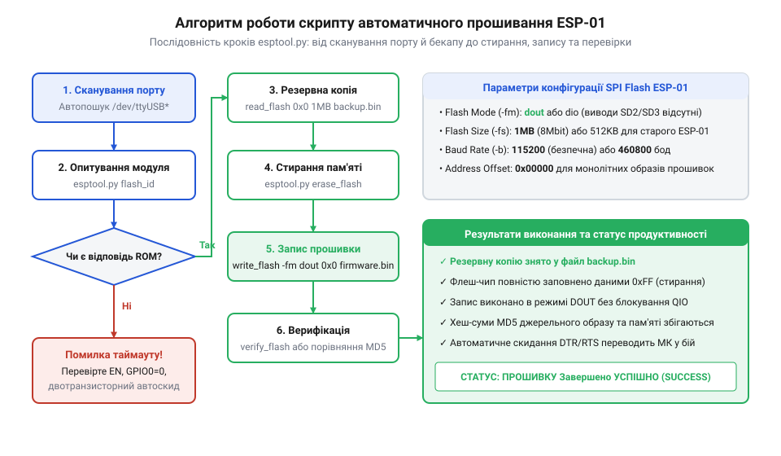

# Автоматизація резервного копіювання та прошивання ESP-01 через esptool

<preknowlist>
- [ESP-01 (Wi-Fi, ESP8266)](root:cat-hw-boards/esp-01) — Базові апаратні характеристики та розташування роз'ємів модуля ESP-01.
- [Режими завантаження мікроконтролера ESP8266](root:cat-hw-boards/esp8266-boot-modes) — Принцип підтяжки виводів для входу в режим програмування UART Bootloader.
- [esp-01-programmer-adapters](root:cat-hw-boards/esp-01-programmer-adapters) — Конструкція та принципи роботи USB-адаптерів і програматорів для ESP-01.
</preknowlist>

## Проблема ручного розгортання та рутинного прошивання

При масовій розробці пристроїв або серійному обслуговуванні бездротових модулів [ESP-01 (Wi-Fi, ESP8266)](root:cat-hw-boards/esp-01) ручне введення консольних команд утиліти @@en|esptool@@ (англ. @@en|esptool@@ — інструмент прошивання ESP) стає джерелом систематичних апаратних і програмних помилок. Завищення швидкості обміну (@@en|baud rate@@) на довгих з'єднувальних дротах призводить до спотворення байтів у процесі передачі, а помилковий зсув початкової адреси (@@en|offset@@) — наприклад, вказівка `0x10000` замість `0x00000` для монолітного бінарного образу — руйнує таблицю розділів і структуру внутрішньої шини @@en|SPI Flash@@. Найкритичнішою апаратною загрозою є випадковий перезапис або передчасне стирання останніх секторів флеш-пам'яті за адресами `0xFC000`–`0xFE000`. У секторі `0xFC000` розташовується системний блок початкової ініціалізації `esp_init_data_default.bin`, де зберігаються унікальні заводські конфігураційні таблиці та калібрувальні параметри @@en|RF@@-тракту (англ. @@en|Radio Frequency@@ — радіочастота), включаючи коефіцієнти підлаштування частоти опорного кварцового резонатора та струми підсилювача потужності @@en|Wi-Fi@@. За адресою `0xFE000` зберігається системна конфігураційна область `blank.bin` для робочих параметрів системи. Пошкодження або стирання цих секторів позбавляє приймач чутливості, збиває калібрування високочастотного синтезатора й призводить до фатальних помилок виклику системної функції ініціалізації аналогової периферії з нескінченним циклом апаратних перезавантажень чипа без можливості відновлення зв'язку без попередньо збереженого дампа.

Використання готових апаратних програматорів та [esp-01-programmer-adapters](root:cat-hw-boards/esp-01-programmer-adapters) суттєво спрощує комутацію ліній живлення та скидання, однак програмна частина вимагає суворого дотримання послідовності кроків. Для гарантії беззбійного програмування розробляється скрізний алгоритм автоматизації, який поєднує перевірку активних портів, створення резервного дампа пам'яті, повне очищення чипа та контрольний запис із верифікацією кодів повернення.

*Блок-схема алгоритму автоматизованого прошивання ESP-01: від виявлення порту та читання Chip ID до зняття дампа, стирання та верифікації.*

## Підготовка середовища та автовиявлення COM-порту

Першим етапом роботи автоматизованого скрипту є перевірка наявності потрібних системних утиліт та виявлення активного послідовного порту (`/dev/ttyUSB0` у Linux або `COM3` у Windows). Скрипт перевіряє доступність команд утиліти `esptool.py` у системному оточенні та запитує ідентифікаційні дані мікроконтролера командою `chip_id`. Перевірка дозволяє переконатися, що пристрій успішно переведено у [режими завантаження мікроконтролера ESP8266](root:cat-hw-boards/esp8266-boot-modes) із затиснутим на землю виводом `GPIO0`.

Слідом за первинною ідентифікацією виконується команда `flash_id`, яка зчитує 24-бітовий ідентифікатор @@en|JEDEC ID@@ (від англ. @@en|Joint Electron Device Engineering Council@@ — об'єднана рада з інженерії електронних пристроїв) та повертає ідентифікатор виробника (англ. @@en|Manufacturer ID@@) і обсяг встановленої мікросхеми флеш-пам'яті (зазвичай 1 МБ для сучасних модулів ESP-01). У шістнадцятковій відповіді утиліти перший байт показує код напівпровідникового фабриканта: наприклад, значення `0xEF` відповідає чипам @@en|Winbond@@ (серії W25Q80), код `0xC8` вказує на кристали @@en|GigaDevice@@ (серії GD25Q80), `0x20` належить @@en|Micron@@, а `0x85` — @@en|Puya@@. Наступні байти декодують тип пристрою та показник ємності (`0x14` позначає 1 МБ чи 8 Мбіт). Визначення Manufacturer ID є принциповим для автоматизованого скрипту, оскільки бюджетні чипи GigaDevice або Puya мають специфічну розводку банку регістрів статусу та можуть некоректно обробляти чотирибітовий режим @@en|QIO@@, вимагаючи примусового переведення в надійний режим @@en|DOUT@@. Нижче наведено базовий реалізований Bash-скрипт автоматизації:

:::code proj-esp01-automated-flashing-script-esptool/sh/flash_esp01.sh

Для інтеграції у кросплатформні Python-додатки або власні середовища розробки використовується високорівнева обгортка на базі модуля `subprocess` із контролем таймаутів. Архітектура представленого класу `ESP8266Flasher` ізолює прямий виклик консольної утиліти через `subprocess.run()`, що дозволяє прозоро перехоплювати стандартні потоки виведення `stdout` та `stderr` без заблокування системного середовища. Ключовим інваріантом надійності є покрокова обробка винятків: під час перевищення заданого ліміту часу виклику перехоплюється виняток `subprocess.TimeoutExpired` із фіксацією накопиченого виводу для діагностики зависань шини UART, при нецільових кодах повернення `esptool.py` (наприклад, при помилці синхронізації або кадровому збої) блок `subprocess.CalledProcessError` отримує точний код повернення `returncode` та повідомлення про помилку, а відсутність самої утиліти в оточенні відловлюється через `FileNotFoundError`. Усі операції повертають структурований дата-клас `FlashResult`, що дозволяє покроково контролювати стан виконання чипа та легко інтегрувати скрипт у конвеєри CI/CD:

:::code proj-esp01-automated-flashing-script-esptool/py/esp01_flasher.py

Для низькорівневого аналізу стану послідовного порту та обміну AT-командами на системному рівні C/C++ застосовуються спеціалізовані модулі драйвера:

:::tabs
:::code proj-esp01-automated-flashing-script-esptool/c/esp01_uart.h
:::code proj-esp01-automated-flashing-script-esptool/cpp/flasher.hpp
:::

:::tabs
:::code proj-esp01-automated-flashing-script-esptool/c/esp01_uart.c
:::code proj-esp01-automated-flashing-script-esptool/cpp/flasher.cpp
:::

:::tabs
:::code proj-esp01-automated-flashing-script-esptool/c/main.c
:::code proj-esp01-automated-flashing-script-esptool/cpp/main.cpp
:::

## Автоматизація дампа пам'яті та стирання Flash

Після успішної перевірки зв'язку з завантажувачем скрипт переходить до найвідповідальнішої апаратної операції — збереження повної резервної копії пам'яті. За допомогою команди `read_flash` із зазначенням початкової адреси `0x00000` та обсягу `0x100000` (1048576 байтів для 1 МБ чипа) створюється повний бінарний дамп флеш-пам'яті, де кінцева адреса обчислюється як сума початкового зсуву та розміру. Назва файла зазвичай містить часову мітку або унікальний ідентифікатор пристрою. При цьому важливу роль відіграє вибір швидкості обміну (англ. @@en|baud rate@@): стандартна швидкість 115200 бод забезпечує високу завадостійкість, але передача 1 МБ триває близько 90 секунд, тоді як підвищення швидкості до 460800 бод скорочує час зчитування до 22 секунд. Однак на високих швидкостях тривалість одного біта становить лише `2.17 мкс`, і використання довгих з'єднувальних провідників (понад 15–20 см) або макетних плат із високою паразитною ємністю ліній спричиняє завалювання фронтів сигналів. Це призводить до виникнення кадрових помилок (англ. @@en|framing error@@ — помилка обрамлення кадру) та збоїв передачі пакетів. Тому автоматизований конвеєр обирає компромісні 460800 бод лише для коротких якісних провідників і обов'язково здійснює перевірку цілісності зчитаного дампа: перевіряється відповідність розміру створеного файла байтовому еквіваленту `0x100000` та розраховується хеш-сума (SHA-256/MD5). Якщо файл пошкоджено або зчитування перервалося на середині, скрипт блокує перехід до стирання чипа (`erase_flash`), запобігаючи незворотній втраті заводських конфігураційних секторів.

Лише після підтвердження успішного створення резервної копії викликається команда `erase_flash`. Повне стирання всіх секторів пам'яті гарантує видалення залишкових конфігураційних даних файлової системи (@@en|SPIFFS@@ або @@en|LittleFS@@) та налаштувань @@en|Wi-Fi@@, запобігаючи непередбачуваним циклічним перезавантаженням після оновлення прошивки.

## Запис образів, режими SPI та перевірка

Фінальним кроком є запис нового бінарного образу у флеш-пам'ять командою `write_flash`. Критичним параметром при цьому є вибір режиму роботи шини SPI: для модулів ESP-01 рекомендується використовувати режим `dout` (@@en|Dual Output@@) або `dio` (@@en|Dual I/O@@), оскільки трасування [друкованої плати модуля](root:cat-hw-boards/esp-01) не завжди підтримує чотирипровідний режим `qio` (@@en|Quad I/O@@). Апаратне обмеження режиму `qio` зумовлене тим, що лінії керування захистом від запису та утримання пам'яті (`GPIO9`/`SPIHD` і `GPIO10`/`SPIWP`) на компактній 8-вивідній платі ESP-01 не розведені або мають високу паразитну ємність, через що чотирибітовий паралельний обмін призводить до збоїв зчитування команд та циклічних перезавантажень. Архітектурна відмінність між дволінійними режимами полягає у розподілі шини під час передачі фази адресації: у режимі `dout` код операції (@@en|opcode@@) та 24-бітна адреса цільового сектору передаються послідовно по єдиній лінії `MOSI` (@@en|Master Out Slave In@@), і лише зчитування даних здійснюється паралельно по двох лініях (`IO0` та `IO1`), тоді як у режимі `dio` по одній лінії надсилається тільки код операції, після чого і 24-бітна адреса, і самі дані транслюються паралельно по двох лініях (`IO0` та `IO1`), що прискорює фазу адресації, але вимагає строго симетричних характеристик провідників. Через наявність паразитної ємності та часового перекосу сигналів (@@en|propagation skew@@) на платах ESP-01 паралельна передача адреси в режимі `dio` може призводити до спотворення зчитуваних байтів, тому режим `dout` забезпечує найвищу стабільність роботи. Для гарантії цілісності записаної прошивки утиліта `esptool.py` використовує апаратний алгоритм підтвердження на основі контрольних сум SHA-256: після завершення передачі блоків даних завантажувач мікроконтролера обчислює хеш-суму записаного сегмента безпосередньо у флеш-пам'яті та порівнює її з логічним SHA-256 дайджестом локального бінарного файла. Лише за умови повної збігу криптографічних хешів процес прошивання вважається успішно верифікованим.

Запис здійснюється за адресою `0x00000` для суцільного бінарного образу. Завдяки верифікації кодів завершення після кожного виклику скрипт гарантує цілісність записаних даних. Після завершення прошивання модуль переводиться у режим звичайного виконання (вивід `GPIO0` підтягується до `VCC`), і виконується апаратний скид `RST` для запуску нової програми. Детальніше про вибір службових параметрів шини та роботу з додатковими командами читайте у [розширених командах утиліти esptool](root:cat-hw-boards/esp01-firmware-flashing/api-esptool-command-line-interface.md).
