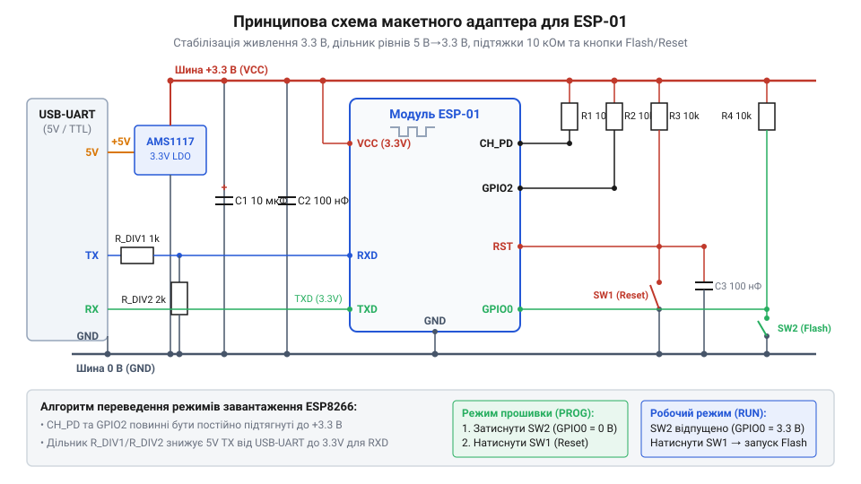
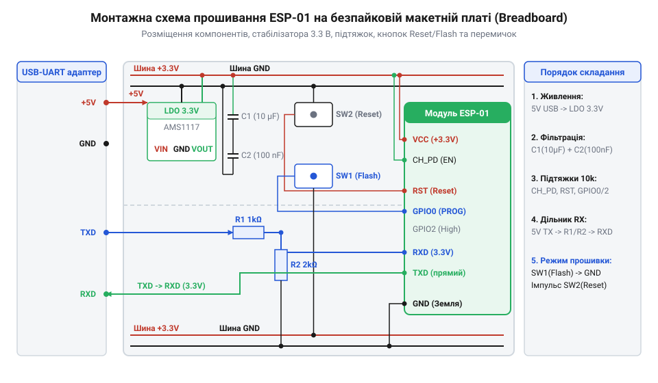

# Складання макетного адаптера для прошивання ESP-01

<preknowlist>
- [ESP-01 (Wi-Fi, ESP8266)](root:cat-hw-boards/esp-01) — цокольовка роз'єму 2x4, призначення виводів CH_PD, RST, GPIO0, GPIO2 та електричні параметри
- [Конфігураційні виводи завантаження ESP8266](root:cat-hw-boards/esp8266-boot-strapping-pins) — комбінації потенціалів на виводах під час скидання для вибору режиму завантаження UART
- [Режими завантаження мікроконтролера ESP8266](root:cat-hw-boards/esp8266-boot-modes) — вимоги до логічних рівнів для переходу мікроконтролера в режим прошивання
</preknowlist>

## Проблема прошивання ESP-01 без обв'язки

Пряме підключення компактного [модуля ESP-01](root:cat-hw-boards/esp-01) до перетворювача @@en|USB-UART@@ за допомогою гнучких дротів зазвичай призводить до хаотичних апаратних збоїв. Без спеціально спроєктованої макетної схеми пристрій потрапляє у нескінченні цикли перезавантажень, видає некоректні символи у послідовний порт або взагалі не реагує на спроби утиліт програмування встановити зв'язок із початковим завантажувачем @@en|bootloader@@ (англ. @@en|boot loader@@ — початковий програмний завантажувач).

Головною фізичною причиною такої нестабільності є невизначений стан сигнальних виводів. Як висвітлено в [огляді сімейства ESP-01](root:cat-hw-boards/esp-01-module-family-overview), виводи `CH_PD` (активація чипа), `RST` (скидання), `GPIO0` та `GPIO2` не мають достатньо потужних внутрішніх резисторів підтяжки. Якщо залишити їх без зовнішньої фіксації потенціалів, високочастотні наводки змушують мікроконтролер хаотично змінювати режим роботи. Згідно з вимогами до [конфігураційних виводів завантаження ESP8266](root:cat-hw-boards/esp8266-boot-strapping-pins), для надійного вибору режиму прошивання виводи `CH_PD` та `GPIO2` мусять бути стабільно підтягнуті до високого рівня 3.3V, тоді як `GPIO0` під час скидання має утримуватися в логічному нулі. Детальні правила комбінацій сигналів визначають [режими завантаження ESP8266](root:cat-hw-boards/esp8266-boot-modes).

Другим деструктивним чинником є дефіцит струму живлення. Вбудовані лінійні регулятори популярних мікросхем @@en|USB-UART@@ (як-от FT232RL чи CH340G) здатні віддавати не більше 30–50 мА. Проте під час ініціалізації передавача @@en|Wi-Fi@@ споживання модуля зростає імпульсами до 300–500 мА. У результаті напруга живлення глибоко просідає нижче критичного порогу 2.7V, викликаючи апаратний перезапуск @@en|brownout reset@@. Для усунення цих обмежень необхідно збирати спеціалізований макетний вузол, про що описують готові [адаптери для програмування](root:cat-hw-boards/esp-01-programmer-adapters).

Третім прихованим ризиком прямого підключення є логічна несумісність рівнів сигналів на лініях `RX` та `TX`. Деякі старі або бюджетні перетворювачі @@en|USB-UART@@ працюють із 5-вольтовою логікою на послідовному порту. Вхідні виводи мікроконтролера @@en|ESP8266@@ виконані за технологією @@en|CMOS@@ (від англ. *Complementary Metal-Oxide-Semiconductor* — доповняльна структура метал-оксид-напівпровідник) та розраховані на максимальне допустиме значення напруги 3.6 В. Подача сигналу 5 В на вхід `RXD0` змушує відкриватися внутрішні паразитичні захисні діоди виводу та викликає пробій або прискорену деградацію тонкого підзатворного діелектрика @@en|MOSFET@@-транзисторів у структурі [архітектури SoC ESP8266](root:cat-hw-boards/esp8266-soc-architecture-overview). Це спричиняє нестабільність прийому байтів під час прошивки або незворотне вигоряння периферійного модуля UART.

Таким чином, пряме підключення модуля без зовнішньої схеми обв'язування поєднує одразу три критичні ризики: хаотичну зміну режимів завантажувача через плаваючі потенціали на виводах, апаратні перезапуски від просідання напруги живлення та загрозу електричного пошкодження порту `UART` високовольтними сигналами. Для забезпечення стійкого програмування та безаварійної експлуатації [плати ESP-01](root:cat-hw-boards/esp-01) необхідно зібрати повноцінний макетний адаптер. Він має містити автономний лінійний регулятор напруги з каскадом фільтрувальних конденсаторів, резистивні кола фіксації потенціалів `CH_PD`, `RST`, `GPIO0` й `GPIO2`, тактові кнопки керування із придушенням брязкіту та засоби узгодження логічних рівнів, як це передбачено специфікою [програматорів для ESP-01](root:cat-hw-boards/esp-01-programmer-adapters).

## Розрахунок та монтування вузла живлення

Для забезпечення беззбійного живлення модуля на безпайковій макетній платі @@en|breadboard@@ монтується окремий регулятор 3.3V на базі мікросхеми @@en|AMS1117-3.3@@ (стабілізатор @@en|LDO@@ з малою різницею напруг). Розрахуємо теплову потужність `P_d`, яка розсіюється на стабілізаторі при живленні від шини 5.0V @@en|USB@@ за середнього струму споживання модуля `I_avg = 100` мА:

```
P_d = (V_in - V_out) × I_avg
= (5.0 - 3.3) × 0.10             [підстановка робочих напруг та середнього струму]
= 0.17 W                         [теплова потужність стабілізатора]
```

Значення 0.17 Вт є цілком безпечним для корпусу SOT-223 і не викликає перегріву елемента. Для компенсації імпульсних сплесків струму передавача та фільтрації високочастотних завад використовується паралельна комбінація трьох конденсаторів:

1. Вхідний ємкісний накопичувач: електролітичний чи танталовий конденсатор `C1 = 10` мкФ на вході 5V пригнічує низькочастотні пульсації лінії @@en|USB@@.
2. Вихідний накопичувач струму: танталовий конденсатор `C2 = 10...47` мкФ з низьким еквівалентним послідовним опором @@en|ESR@@ на виході 3.3V віддає накопичений заряд під час мікросекундних піків споживання @@en|Wi-Fi@@.
3. Високочастотний шунт: керамічний конденсатор `C3 = 0.1` мкФ (100 нФ) розміщується якнайближче до роз'єму модуля для фільтрації високочастотного шуму.


*Принципова схема макетного адаптера з вузлом стабілізації живлення та резисторами підтяжки.*

Монтаж на безпайковій платі починається зі встановлення регулятора @@en|AMS1117-3.3@@ та підключення загальної шини `GND`. Вихід 3.3V подається на бічні рейки живлення макетки, після чого безпосередньо між рейками 3.3V та `GND` встановлюються конденсатори `C2` та `C3`.


*Монтажна схема розташування AMS1117-3.3, фільтраційних конденсаторів та сигнальних дротів на безпайковій макетній платі.*

Перед першим встановленням модуля [ESP-01 (Wi-Fi, ESP8266)](root:cat-hw-boards/esp-01) обов'язково перевіряють напругу на рейці мультиметром, переконуючись у стабільних 3.30V. Лише після цього переходять до розводки кнопок скиду та сигнальних ліній `RX`/`TX`.

Окрему увагу під час монтування приділяють розміщенню шунтувального керамічного конденсатора `C3` ємністю 100 нФ (англ. @@en|decoupling capacitor@@ — шунтувальний розв'язувальний конденсатор). На відміну від танталового накопичувача `C2`, який поглинає тривалі мікросекундні піки споживання струму, керамічний конденсатор володіє мінімальною еквівалентною послідовною індуктивністю (англ. @@en|ESL@@ — еквівалентна послідовна індуктивність) та низьким @@en|ESR@@. Встановлення цього конденсатора безпосередньо біля штирьових виводів живлення `VCC` та `GND` модуля створює коротке коло для фільтрації високочастотних імпульсних наводок, які виникають під час швидкого перемикання цифрових затворів ядра та роботи високочастотного тактового генератора. Якщо знехтувати цим шунтом і віднести ємність подалі по макетній платі, паразитна індуктивність `L` провідників макетки під час крутих фронтів зміни струму `di/dt` викликає індуктивний спад напруги `V = L · (di/dt)`. Оскільки під час перемикання ключових каскадів швидкість зміни струму `di/dt` сягає сотень міліампер за наносекунду, на паразитній індуктивності виникає миттєвий імпульсний провал напруги живлення, що нівелює фільтрацію віддаленого конденсатора, спричиняючи збої виконання коду та помилки читання флеш-пам'яті при підключенні [модуля ESP-01](root:cat-hw-boards/esp-01).

## Складання кіл завантаження та кнопок

Після налаштування вузла живлення необхідно змонтувати лінії конфігурації завантажувача. Для стабільного запуску мікроконтролера виводи `CH_PD` (Chip Enable) та `RST` підтягуються до шини `3.3V` через окремі резистори опором 10 кОм. Виводи `GPIO0` та `GPIO2` також підтягуються резисторами 10 кОм до позитивної шини живлення. Це запобігає виникненню плаваючих потенціалів під час подачі живлення та забезпечує вибір [режимів завантаження мікроконтролера ESP8266](root:cat-hw-boards/esp8266-boot-modes) із вичитуванням коду з флеш-пам'яті за замовчуванням.

Для ручного переведення модуля в режим прошивання на безпайковій макетній платі (англ. @@en|breadboard@@ — макетна плата) встановлюються дві тактові кнопки (англ. @@en|tactile switch@@ — кнопка без фіксації): `RESET` між виводом `RST` та землею `GND`, а також `FLASH` між виводом `GPIO0` та `GND`. Щоб уникнути помилкових спрацьовувань від брязкіту контактів (англ. @@en|contact bounce@@ — брязкіт контактів), паралельно кожній кнопці встановлюється керамічний конденсатор ємністю `C = 100 нФ`, який разом із підтягувальним резистором `R = 10 кОм` утворює інтегрувальне @@en|RC-коло@@ (від англ. @@en|RC circuit@@ — резистивно-ємнісний ланцюг). Постійна часу цього ланцюга обчислюється як `τ = R · C` і становить `10⁴ Ω · 10⁻⁷ Ф = 1 мс`. Під час розмикання кнопки напруга відновлюється за експоненційним законом, досягаючи логічного порогу спрацьовування 2.0 В за час близько `0.7 мс`, що повністю згладжує високочастотний брязкіт механічних контактів тривалістю 1–5 мс. Застосування ж надмірно великої ємності (наприклад 10 мкФ) збільшило б `τ` до 100 мс, затягуючи фронт відновлення напруги й заважаючи чіткій фіксації рівнів під час скиду. Апаратне придушення брязкіту (англ. @@en|debounce@@ — придушення брязкіту) гарантує, що алгоритм входу в режим прошивання — затиснути кнопку `FLASH`, короткочасно натиснути `RESET` та відпустити `FLASH` — виконається без хибних повторних перезавантажень чи збоїв завантажувача.

Під час практичного монтування на макетній платі підтягувальні резистори та конденсатори придушення брязкіту розміщують якомога ближче до виводів модуля для мінімізації паразитної індуктивності провідників. Перед підключенням до ПК обов'язково контролюють потенціали на контактних ніжках за допомогою мультиметра в режимі вимірювання постійної напруги: у штатному стані на виводах `CH_PD`, `RST`, `GPIO0` та `GPIO2` має фіксуватися рівень 3.3 В. При натисканні кнопки `RESET` або `FLASH` відповідна лінія мусить надійно просідати до 0 В, а після відпускання — миттєво повертатися до вихідних 3.3 В. Окрему увагу приділяють виводу `GPIO0`: пряме з'єднання цієї лінії із землею без підтягувального резистора є небезпечним, оскільки в разі випадкового переконфігурування виводу на вихід у стан логічної одиниці під час виконання користувацького коду виникає коротке замикання крізь вихідний @@en|CMOS@@-транзистор [архітектури SoC ESP8266](root:cat-hw-boards/esp8266-soc-architecture-overview).

Окрім статичних коротких замикань, серйозну загрозу під час експериментів становить гаряче підключення (англ. @@en|hot-plugging@@ — підключення під напругою) сигнальних роз'ємів завантаження. Всередині напівпровідникових виводів чипа вбудовані захисні діоди від електростатичного розряду @@en|ESD@@ (від англ. @@en|Electrostatic Discharge@@ — електростатичний розряд), включені між контактом GPIO та шинами живлення 3.3 В і @@en|GND@@. Якщо підключати сигнальні лінії інтерфейсу @@en|USB-UART@@ або зовнішні підтяжки до модуля, у якого шину живлення 3.3 В або спільний провід заземлення ще не під'єднано, вихідна напруга 3.3 В із завантажувача потрапляє на вхідний вивід і відкриває верхній внутрішній захисний діод. Струм починає паразитно протікати крізь крихітний p-n перехід діода в знеструмлену шину живлення SoC. Оскільки ці захисні елементи розраховані лише на короткі імпульси й не витримують тривалого струму понад 10–20 мА, виникає локальне перегрівання напівпровідника, що призводить до незворотного термічного пробою діода або виклику паразитного тиристорного защіпання @@en|latch-up@@ (від англ. @@en|latch-up@@ — защіпання напівпровідникової структури), яке виводить з ладу порт [модуля ESP-01](root:cat-hw-boards/esp-01). Для запобігання такому руйнуванню послідовно в сигнальні лінії монтують струмообмежувальні резистори номіналом 470 Ом...1 кОм та дотримуються суворого порядку комутації: спершу підключають спільний провід GND і живлення, а лише потім — сигнальні роз'єми завантаження.

## Підключення перетворювача та перевірка прошивки

Останнім етапом складання макетного програматора є підключення інтерфейсних ліній послідовного порту. Вивід `TXD` модуля [ESP-01 (Wi-Fi, ESP8266)](root:cat-hw-boards/esp-01) з'єднується безпосередньо з входом `RXD` моста @@en|USB-UART@@. Лінія `TXD` моста підключається до входу `RXD` модуля через резистивний дільник напруги (1 кОм / 2 кОм), якщо адаптер працює з 5-вольтовими логічними рівнями, або напряму при використанні 3.3V адаптера. Спільна земля `GND` обох пристроїв мусить бути об'єднана.

Перевірка складеного адаптера виконується утилітою @@en|esptool@@. Після переведення модуля в режим програмування кнопками у консолі виконується команда зчитування ідентифікатора пам'яті:

```bash
esptool.py --port /dev/ttyUSB0 --baud 115200 flash_id
```

У разі виникнення помилки синхронізації `Timed out waiting for packet header` необхідно перевірити надійність контактів у макетній платі, наявність підтяжки на `CH_PD` та рівень напруги живлення під час натискання кнопки `RESET`. Успішна відповідь утиліти з відображенням `Chip ID` та обсягу пам'яті підтверджує готовність макетного адаптера до запису прошивки.

Якщо помилка повторюється, виконують ізольовану діагностику обладнання у режимі апаратної петлі @@en|loopback@@ (від англ. *loop* — петля, *back* — назад, @@en|loopback@@). Для цього мікроконтролер тимчасово виймають із роз'єму макетної плати та замикають між собою лінії `RXD` і `TXD` безпосередньо на виході перетворювача @@en|USB-UART@@. У будь-якій консольній утиліти послідовного порту (як-от @@en|PuTTY@@ або @@en|Minicom@@) відкривають відповідний порт і вводять довільний текст: якщо введені символи миттєво повертаються на екран через відлуння @@en|echo@@, це ґарантує справність самої мікросхеми перетворювача, кабелю та системного драйвера ПК. Відсутність символів свідчить про обрив провідників або вигоряння буферних каскадів адаптера, а коректне проходження петлі звужує пошук несправностей до кіл підтяжки [головного модуля ESP-01](root:cat-hw-boards/esp-01) або недотримання порядку входу у [режими завантаження ESP8266](root:cat-hw-boards/esp8266-boot-modes).
