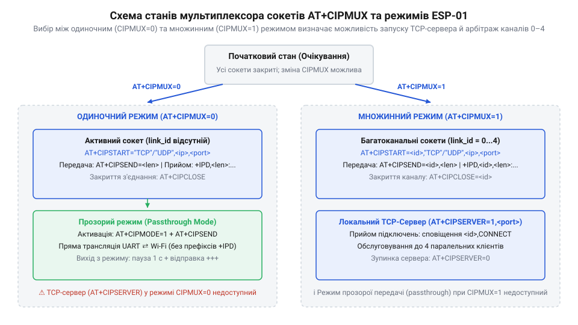

# Програмний довідник AT-команд керування сокетами TCP/UDP та парсингу +IPD

<preknowlist>
- [ESP-01 (Wi-Fi, ESP8266)](root:cat-hw-boards/esp-01) — розуміння апаратних обмежень обсягу пам'яті DRAM та розпіновки модуля.
- [Керування GPIO виводами ESP8266 через AT-команди](root:cat-hw-boards/esp8266-at-gpio-control) — базові знання синтаксису AT-команд та обробки відповідей OK і ERROR.
</preknowlist>

## Архітектура сокетів та режим мультиплексування

Побудова мережевих застосунків на компактній [платі ESP-01](root:cat-hw-boards/esp-01) вимагає надійного управління мережевими з'єднаннями (англ. @@en|socket@@, сокет, від давньофранц. @@fro|soc@@ — леміш). @@fro|soc@@ — леміш). Під час спроби відкрити кілька паралельних каналів зв'язку за допомогою базових команд @@en|AT@@ (англ. @@en|AT@@, від англ. @@en|attention@@ — увага) розробник часто стикається з відмовою прошивки та кодом помилки `link is not valid`. Така поведінка пояснюється тим, що за замовчуванням стек стежить за єдиним з'єднанням, а для паралельної обробки кількох потоків підсистему слід перевести в режим мультиплексування (англ. @@en|multiplexing@@, від лат. @@la|multiplex@@ — складений із багатьох частин).

Режим мультиплексування налаштовується командою `AT+CIPMUX=<mode>`. Значення `<mode>=0` встановлює одиночний режим з'єднання, у якому активним може бути лише один сокет. Цей режим є обов'язковим для налаштування наскрізного тунелювання (англ. @@en|passthrough mode@@, від англ. @@en|pass@@ — проходити та @@en|through@@ — наскрізь). Значення `<mode>=1` вмикає мультиплексний режим, що дозволяє відкривати до 5 незалежних сокетів із числовими ідентифікаторами каналу (англ. @@en|link ID@@) від `0` до `4`.

Спосіб обробки байтового потоку задається командою `AT+CIPMODE=<mode>`. Значення `AT+CIPMODE=0` призначає звичайний режим, у якому кожен вхідний або вихідний пакет супроводжується синтаксичними префіксами й командами керування. Значення `AT+CIPMODE=1` активує режим прозорого тунелювання, при якому всі дані з порту @@en|UART@@ напряму транслюються у відкритий сокет без додаткових службових полів.

*Схема станів мультиплексора сокетів AT+CIPMUX та переходів між клієнтським і серверним режимами, з якої видно порядок ініціалізації каналів.*

Ключовим апаратним обмеженням є те, що зміна значення `AT+CIPMUX` дозволена лише тоді, коли всі сокети закриті. Якщо спробувати змінити параметр при активному з'єднанні, прошивка поверне відмову `link is builded`. Докладніше про синтаксис налаштування апаратних ліній описано в статті про [Керування GPIO виводами ESP8266 через AT-команди](root:cat-hw-boards/esp8266-at-gpio-control). Розуміння цієї скінченної діаграми станів робить неминучим етап первинного налаштування контексту стека перед викликами команд встановлення зв'язку.

При спробі випадкової зміни конфігурації `AT+CIPMUX` під час відкритого з'єднання прошивка @@en|ESP-AT@@ відхиляє запит із текстовою відповіддю `link is builded` та підтвердженням `ERROR`, зберігаючи поточний стан і цілісність активних сокетів. Схожий захисний механізм спрацьовує і при спробі увімкнути режим прозорого тунелювання `AT+CIPMODE=1` за умов активного мультиплексування (`AT+CIPMUX=1`). Оскільки прозоре тунелювання вимагає нероздільного монопольного володіння шиною @@en|UART@@ для єдиного потоку, прошивка повертає помилку `ERROR`, вимагаючи попереднього вимкнення мультиплексування через `AT+CIPMUX=0` при повністю закритих мережевих каналах.

Для гарантії стабільної роботи системний обробник керуючого мікроконтролера мусить виконувати ініціалізацію конфігурації сокетів одразу після старту або скидання [модуля ESP-01](root:cat-hw-boards/esp-01). Послідовна відправка тестової команди `AT`, вибір режиму мультиплексування `AT+CIPMUX` та налаштування `AT+CIPMODE` ще до встановлення будь-яких мережевих з'єднань дозволяє зафіксувати потрібний контекст прошивки @@en|ESP-AT@@. Якщо під час передачі команди `AT+CIPMUX` виникає розрив послідовного зв'язку, апаратний таймаут або спотворення кадру шини @@en|UART@@, прошивка не повертає підтвердження `OK`, залишаючи стек у невизначеному стані. У такому разі програма хост-контролера мусить відстежувати таймаут відповіді, ініціювати апаратне або програмне скидання модуля та повністю повторити цикл початкової конфігурації з верифікацією готовності через `AT`, запобігаючи спробам відкриття сокетів на нестабільному каналі зв'язку.

## Встановлення з'єднань та запуск сервера

Після визначення режиму мультиплексування відкриття клієнтських сокетів здійснюється командою `AT+CIPSTART`. У режимі одиночного з'єднання (`CIPMUX=0`) команда приймає три обов'язкові аргументи: `AT+CIPSTART=<type>,<addr>,<port>`. У мультиплексному режимі (`CIPMUX=1`) першим параметром обов'язково додається номер каналу: `AT+CIPSTART=<link_id>,<type>,<addr>,<port>`. Параметр `<type>` приймає рядки `"TCP"` (англ. @@en|Transmission Control Protocol@@) або `"UDP"` (англ. @@en|User Datagram Protocol@@), параметр `<addr>` вказує цільову IP-адресу або доменне ім'я, а `<port>` задає номер порта віддаленого вузла.

Для розгортання локального мережевого вузла використовується команда запуску сервера `AT+CIPSERVER=<mode>[,<port>]`. Створення сервера можливе виключно при попередньо ввімкненому мультиплексуванні `AT+CIPMUX=1`. Передача параметра `<mode>=1` створює TCP-сервер на вказаному порту `<port>` (за замовчуванням 333), після чого модуль починає прослуховувати вхідні підключення й автоматично призначає вільні ідентифікатори `link_id` клієнтам. Виклик `<mode>=0` зупиняє роботу сервера й розриває всі активні з'єднання.

Для закриття активного сокета застосовується команда `AT+CIPCLOSE`. В одиночному режимі викликається безаргументна форма `AT+CIPCLOSE`, а в мультиплексному — вказується номер каналу `AT+CIPCLOSE=<link_id>`. Передача значення `AT+CIPCLOSE=5` у мультиплексному режимі примусово закриває всі відкриті сокети одночасно.

Для запобігання вичерпанню обмежених ресурсів оперативної пам'яті незадіяними з'єднаннями прошивка підтримує таймер неактивності сервера `AT+CIPSTO=<time>`. Ця команда задає максимально допустимий інтервал мовчання в секундах (від 0 до 7200), після закінчення якого прошивка автоматично розриває пасивну TCP-сесію для відповідного `link_id` і видає статусне повідомлення `<link_id>,CLOSED`. Якщо вказати значення `0`, автоматичне відключення вимикається повністю, що вимагатиме від керуючої програми явного відстеження стану клієнтів та ручного виклику `AT+CIPCLOSE` для звільнення сокетів.

У разі успішного встановлення з'єднання прошивка повертає рядок `<link_id>,CONNECT` та підтвердження `OK`. Якщо віддалений вузол недоступний або сталася помилка домену, прошивка надсилає текстові повідомлення `DNS Fail`, `CONNECT FAIL` або `ERROR`. При отриманні статусів помилок підсистема хост-контролера мусить виконувати повторне підключення за алгоритмом експоненційного запізнення, щоб уникнути перевантаження мережевого стека спалахами команд. Обробник витримує зростаючу часову паузу перед наступною спробою `AT+CIPSTART`, а після трьох послідовних невдалих спроб примусово закриває сокет через `AT+CIPCLOSE=<link_id>` для звільнення виділених дискрипторів прошивки @@en|ESP-AT@@ перед повторною ініціалізацією мережевого контексту.

## Передача даних та буферизація

Надсилання корисного навантаження у відкритий сокет виконується командою `AT+CIPSEND`. В одиночному режимі виклик має вигляд `AT+CIPSEND=<length>`, а в мультиплексному — `AT+CIPSEND=<link_id>,<length>`, де параметр `<length>` задає точну кількість байтів для відправки (максимум 2048 байтів за один виклик).

Отримавши команду `AT+CIPSEND`, прошивка перевіряє готовність буфера й повертає символ-запрошення `> `. Лише після появи цього символа хост-контролер має право передавати заданий масив байтів. Після вичитування вказаної кількості байтів модуль надсилає їх у мережу Wi-Fi й повертає рядок `Recv <length> bytes` із наступним підтвердженням `SEND OK` або `SEND FAIL`.

Для підвищення швидкодії без блокування шини @@en|UART@@ прошивка надає команду буферизованої відправки `AT+CIPSENDBUF=<link_id>,<length>`. На відміну від звичайного виклику, вона повертає номер сегмента в буфері та підтверджує прийом байтів до моменту їх реальної відправки в ефір, що дозволяє конвеєризувати передачу. Після прийому масиву модуль повертає рядок `<segment_id>,SEND OK`, фіксуючи успішне розміщення пакета у внутрішній черзі. Хост-контролер відстежує стан буферизації через асинхронні відповіді `+CIPSENDBUF:<link_id>,<segment_id>`, де статус показує завершення фізичної передачі кадру в мережу @@en|Wi-Fi@@. Якщо кільцевий буфер переповнюється або черга сегментів досягає ліміту, прошивка повертає відповідь `BUSY s...` або `ERROR`. У цьому разі керуючий мікроконтролер мусить призупинити надсилання наступних порцій, витримати часову паузу й повторити запит лише після вичищення черги та отримання чергового підтвердження відправки.

:::tabs
:::code api-esp-at-socket-commands/c/esp-idf/send-tcp-data.c
<!-- slide -->
:::code api-esp-at-socket-commands/cpp/esp-idf/atsocketclient.cpp
:::

У разі активації тунелювання (`AT+CIPMODE=1`) після виклику `AT+CIPSEND` та появи `> ` модуль переходить у безперервний режим. Для виходу з тунелювання хост-контролер робить паузу в 1 секунду, надсилає послідовність `+++` без символів переведення рядка `\r\n` і витримує ще 1 секунду паузи. Щоб запобігти випадковому розриву тунелю при передачі бінарних даних, прошивка @@en|ESP-AT@@ реалізує апаратний таймер інтервалу захисту (англ. @@en|guard time@@): послідовність з трьох символів `+++` розпізнається як команда виходу лише тоді, коли перед першим символом і після третього витримано сувору тишу на шині @@en|UART@@ тривалістю не менше 1000 мс. Якщо ж три символи плюса надходять у складі суцільного байтового потоку без захисних пауз по обидва боки, модуль транслює їх у сокет як звичайне корисне навантаження, виключаючи хибне переривання прозорого режиму.

## Парсинг +IPD та системні відповіді

Вхідні дані, що надходять із мережі Wi-Fi, транслюються прошивкою в порт @@en|UART@@ асинхронно у вигляді спеціального кадру `+IPD`. В одиночному режимі кадр має формат `+IPD,<len>:<data>`, а в мультиплексному — `+IPD,<link_id>,<len>:<data>`, де параметр `<len>` вказує кількість байтів корисного навантаження, що йдуть одразу після двокрапки.

*Формат кадру асинхронного вхідного пакета +IPD з розшифровкою полів ідентифікатора каналу, довжини та тіла даних.*

Окрім блоків даних, парсер хост-контролера мусить відстежувати системні асинхронні повідомлення про зміну стану сокетів:
- `ALREADY CONNECTED` — сповіщає про спробу відкрити вже активний канал `link_id`.
- `CLOSED` або `<link_id>,CLOSED` — інформує про закриття сокета віддаленим сервером або через таймаут.
- `+CIPSTATUS:<link_id>,<type>,<ip>,<port>,<tetype>` — повертає детальний стан сокета при виконанні діагностичного запиту `AT+CIPSTATUS`.

Для надійної обробки вхідного потоку програма хост-контролера будує скінченний автомат: при виявленні маркера `+IPD` парсер зчитує довжину `<len>`, виділяє з кільцевого буфера відповідну кількість байтів і лише після цього повертається до звичайного режиму розбору командних відповідей `OK` та `ERROR`.

При повільному вичитуванні даних через шину @@en|UART@@ або при роботі на низькій швидкості @@en|baud rate@@ кадр `+IPD` може надходити до хост-контролера фрагментованими порціями. Для запобігання втратам даних скінченний автомат після розбору префікса `+IPD,<len>:` фіксує лічильник залишкових байтів і переходить у режим прямої буферизації. У цьому режимі всі асинхронно отримані байти з апаратного буфера записуються безпосередньо в накопичувач без аналізу текстових маркерів `\r\n`, `OK` чи `CLOSED`. Скінченний автомат декрементує лічильник на довжину кожної зчитаної порції й повертається до звичайного текстового розбору лише після повного вичитування всіх `<len>` байтів, гарантуючи стійкість парсингу навіть при розривах потоку в портах керуючого мікроконтролера.
