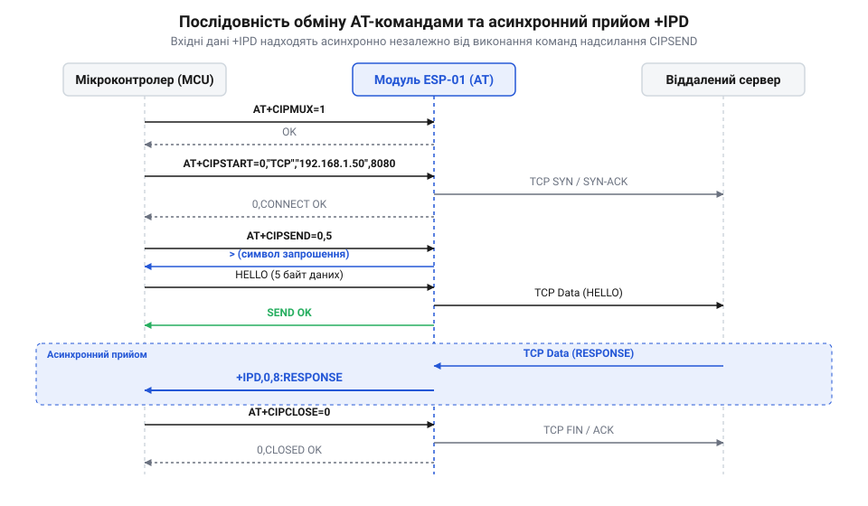

# Програмний довідник AT-команд керування сокетами TCP/UDP для ESP-01

<preknowlist>
- [ESP-01 (Wi-Fi, ESP8266)](root:cat-hw-boards/esp-01) — розуміння схемотехніки, виводів та підключення модуля ESP-01 до UART
- [Захищені SSL/TLS з'єднання в AT-прошивці ESP8266](root:cat-hw-boards/esp8266-at-ssl-tls) — відмінності між стандартними сокетами TCP/UDP та криптографічно захищеними SSL-сесіями
</preknowlist>

## Режими з'єднань та команда CIPMUX

Мережева взаємодія бездротового [модуля ESP-01](root:cat-hw-boards/esp-01) з зовнішнім світом базується на сокетах (від англ. @@en|socket@@ — мережевий гніздовий інтерфейс; @@en|сокет@@). При побудові прикладних систем виникає вибір між обслуговуванням одного виділеного каналу зв'язку та одночасною обробкою кількох паралельних потоків даних. У прошивці AT-команд [архітектури SoC ESP8266](root:cat-hw-boards/esp8266-soc-architecture-overview) цей режим визначається мультиплексуванням (від англ. @@en|multiplexing@@ — ущільнення/мультиплексування каналів; @@en|мультиплексування@@). Спроба відкрити кілька сокетів у режимі одиночного з'єднання викликає відмову системи з видачею апаратної помилки `link is build` або `ERROR`.

Конфігурація мультиплексування здійснюється базовою командною `AT+CIPMUX`. Прошивка підтримує два режими роботи:
- `0` — одиночне з'єднання (від англ. @@en|Single Connection Mode@@; @@en|одиночний режим@@). Модуль може утримувати лише один активний сокет (TCP або UDP). Цей режим є обов'язковим для активації прозорого безперервного передавання даних (від англ. @@en|Passthrough Mode@@ / @@en|Unvarnished Transmission@@);
- `1` — множинне з'єднання (від англ. @@en|Multiple Connections Mode@@; @@en|багатоканальний режим@@). Модуль підтримує одночасне відкриття до 5 сокетів із присвоєнням ідентифікаторів з'єднань (від англ. @@en|Connection ID@@; @@en|ID з'єднання@@) у діапазоні від `0` до `4`.

| Формат команди | Синтаксис AT-команди | Очікувана відповідь трансивера | Опис дії |
| :--- | :--- | :--- | :--- |
| Перевірка режиму | `AT+CIPMUX?` | `+CIPMUX:<mode>`<br>`OK` | Повертає поточний стан мультиплексора (`0` або `1`). |
| Встановлення режиму | `AT+CIPMUX=<mode>` | `OK` або `ERROR` | Задає режим (`0` — одиночний, `1` — багатоканальний). |

Головним апаратним обмеженням [модулів ESP-01S](root:cat-hw-boards/esp-01s) є обсяг внутрішньої оперативної пам'яті @@en|DRAM@@. При виборі багатоканального режиму (`AT+CIPMUX=1`) внутрішній стек протоколів @@en|LwIP@@ виділяє окремі управляючі блоки протоколів `@@en|PCB@@` (від англ. @@en|Protocol Control Block@@ — блок керування протоколом) та системні буфери кадрів `@@en|pbuf@@` під кожен з 5 сокетів (з ідентифікаторами `0–4`), що сумарно потребує близько 12–15 КБ динамічної купи (англ. @@en|heap@@). Якщо оперативна пам'ять фрагментована або вичерпана попередніми сесіями, виклик виділення пам'яті завершується збоєм і команда `AT+CIPMUX=1` повертає `ERROR`. Крім того, зміна режиму `AT+CIPMUX` дозволена лише за умови, коли всі мережеві сокети повністю закриті; наявність хоча б одного відкритого з'єднання у стані `@@en|ESTABLISHED@@` або `@@en|FIN_WAIT@@` блокує виконання команди з помилкою `link is build`. Для гарантованого перемикання розробник мусить виконати примусове закриття всіх активних каналів командним викликом `AT+CIPCLOSE` (у множинному режимі — `AT+CIPCLOSE=5` для закриття всіх лінків) та дочекатися підтверджень `CLOSED` від трансивера. Проте навіть після видачі `CLOSED` вивільнення структур `@@en|PCB@@` у купі відбувається не миттєво: стек @@en|LwIP@@ утримує сокет у стані вичікування (англ. *TIME_WAIT state*, від англ. *time* — час та *wait* — очікування, @@en|стан TIME_WAIT@@) протягом затримки `2–5 секунд` для очищення фантомних пакетів мережі (максимальний час життя сегмента, від англ. @@en|Maximum Segment Lifetime@@; @@en|MSL@@). Спроба негайно виконати `AT+CIPMUX` до завершення цього часового інтервалу спричиняє повторне відхилення команди через заблоковані буфери сокета.

## Відкриття та закриття сокетів

Для встановлення мережевого сеансу трансивер використовує команду `AT+CIPSTART`, яка підтримує протокол керування передачею (від англ. @@en|Transmission Control Protocol@@; @@en|TCP@@) та протокол користувацьких датаграм (від англ. @@en|User Datagram Protocol@@; @@en|UDP@@). Захищені сесії описують окремі [SSL/TLS з'єднання в AT-прошивці](root:cat-hw-boards/esp8266-at-ssl-tls). Залежно від встановленого режиму `AT+CIPMUX`, команда `AT+CIPSTART` приймає різну кількість аргументів:

Для одиночного режиму (`AT+CIPMUX=0`):
```text
AT+CIPSTART=<type>,<addr>,<port>[,<keep-alive>][,<local-port>][,<mode>]
```

Для багатоканального режиму (`AT+CIPMUX=1`):
```text
AT+CIPSTART=<link-id>,<type>,<addr>,<port>[,<keep-alive>][,<local-port>][,<mode>]
```

Опис аргументів команди `AT+CIPSTART`:
- `<link-id>` — числовий ідентифікатор сокета (`0–4`);
- `<type>` — рядок типу протоколу: `"TCP"` або `"UDP"`;
- `<addr>` — IP-адреса або доменне ім'я віддаленого вузла у лапках (наприклад, `"192.168.1.100"` або `"api.example.com"`);
- `<port>` — порт віддаленого хосту (`1–65535`);
- `<keep-alive>` — опціональний інтервал виявлення обриву TCP-з'єднання у секундах (`1–7200`);
- `<local-port>` — опціональний локальний порт UDP-сокета;
- `<mode>` — режим призначення UDP: `0` (зафіксований віддалений вузол), `1` (динамічна зміна адреси призначення при отриманні пакетів), `2` (фіксований локальний порт).

При виконанні `AT+CIPSTART` трансивер повертає статус `CONNECT` при успішному встановленні з'єднання або `DNS Fail` / `CLOSED` / `ERROR` при помилці. Стан усіх сокетів можна опитувати командою `AT+CIPSTATUS`. У разі отримання `DNS Fail` модуль вказує на збій резолюції домену через @@en|DNS@@ (англ. @@en|Domain Name System@@, від *domain* — домен, *name* — ім'я, та *system* — система), що вимагає від хост-контролера застосувати алгоритм з експоненційним відступом (англ. *exponential backoff*, від англ. *exponential* — показникові та *backoff* — відступ, @@en|експоненційний відступ@@): затримка між повторними спробами подвоюється (`1 с`, `2 с`, `4 с`) до трьох ітерацій, після чого перевіряється стан мережі командою `AT+CWJAP?`. Для виявлення «тихих» розривів TCP-сесії при тривалому простої використовується параметр `<keep-alive>`, який активує надсилання зондувальних пакетів (англ. *keep-alive probe*, від *keep* — утримувати, *alive* — живий, та *probe* — зонд, @@en|зонди keep-alive@@): якщо віддалений вузол не відповідає на зонди протягом вказаного інтервалу, стек @@en|LwIP@@ автоматично розриває сокет та видає в UART сповіщення `CLOSED`. Якщо віддалений сервер відхиляє сесію чи повертає некоректну відповідь, трансивер видає статус `CLOSED` або `ERROR`. Алгоритм обробки таких розривів на хості передбачає обов'язковий опит `AT+CIPSTATUS` для підтвердження вивільнення структур сокета в пам'яті перед повторним викликом `AT+CIPSTART`, що запобігає виникненню помилки `ALREADY CONNECTED` та витокам пам'яті в трансивері [модуля ESP-01](root:cat-hw-boards/esp-01).

Закриття активних сокетів виконується командою `AT+CIPCLOSE`. У багатоканальному режимі команда вимагає вказання ідентифікатора сокета `AT+CIPCLOSE=<link-id>`. Передача значення `AT+CIPCLOSE=5` у багатоканальному режимі ініціює одночасне закриття всіх 5 активних сокетів. Якщо сокет розривається віддаленим сервером, модуль надсилає в UART асинхронне повідомлення `<link-id>,CLOSED`.

## Передача даних та події IPD

Надсилання даних у мережевий сокет виконується командою `AT+CIPSEND`. Прошивка підтримує два основних методи відправки: узагальнений режим із вказанням довжини байтового масиву та режим прозорого підключення.

Для надсилання даних у звичайному режимі передають довжину блоку:
- В одиночному режимі: `AT+CIPSEND=<length>` (де `<length>` — обсяг даних до 2048 байтів);
- У багатоканальному режимі: `AT+CIPSEND=<link-id>,<length>`.

Після введення команди трансивер повертає символ запрошення `>`. Отримавши цей символ, хост-мікроконтролер надсилає точний обсяг байтів. Після завершення передачі модуль видає відповідь `SEND OK` або `SEND FAIL`. За наявності апаратного буфера можна використовувати команду `AT+CIPSENDBUF`, яка повертає підтвердження `Recv <length> bytes` та номер сегмента. Якщо хост затримує передачу після появі `>` і не вкладається у внутрішній таймаут (@@en|timeout@@; від англ. @@en|time out@@, зазвичай 10 секунд), трансивер анулює транзакцію, очищає проміжний буфер та повертає помилку `SEND FAIL`. При надсиланні великих блоків даних (до 2048 байтів) відсутність ліній апаратного керування потоком (@@en|hardware flow control@@; @@en|RTS/CTS@@) на стандартному роз'ємі ESP-01 створює ризик переповнення апаратного буфера @@en|FIFO@@ (обсягом 128 байтів) та виникнення помилок кадрування (@@en|framing error@@) на шині @@en|UART@@. У разі втрати хоча б одного байта або часового розриву між байтами трансивер чекає залишок масиву до вичерпання таймауту, після чого відхиляє весь пакет, тому передачу великих порцій даних варто розбивати на менші блоки або знижувати баудову швидкість UART.

Для виключення очікування запрошень застосовують режим прозорого передавання (від англ. @@en|unvarnished transmission@@ / @@en|passthrough mode@@). Він активується командою `AT+CIPMODE=1` за умови `AT+CIPMUX=0`. Після виконання `AT+CIPSEND` модуль входить у стан прямого мосту: усі байти з UART безпосередньо транслюються в мережевий сокет TCP. Для виходу з прозорого режиму надсилають послідовність `+++` із паузою у 1 секунду до та після неї.

Отримання вхідних даних із мережі відбувається асинхронно через кадрову подію `+IPD` (від англ. @@en|Incoming Packet Data@@; @@en|вхідні дані пакета@@):
- В одиночному режимі: `+IPD,<len>:<data>`
- У багатоканальному режимі: `+IPD,<id>,<len>:<data>`


*Показано часову діаграму та послідовність асинхронного передавання даних між мікроконтролером, трансивером ESP-01 та сервером.*

:::tabs
:::code api-esp01-at-command-tcp-udp-sockets-ref/c/esp-idf/parse-ipd-header.c
:::code api-esp01-at-command-tcp-udp-sockets-ref/cpp/arduino/ipdmessage.cpp
:::

## Створення сервера та таймаути

Модуль ESP-01 може виступати не лише мережевим клієнтом, а й локальним TCP-сервером. Створення локального сервера виконується командою `AT+CIPSERVER`.

Синтаксис команди створення сервера:
```text
AT+CIPSERVER=<mode>[,<port>]
```

Параметри команди:
- `<mode>` — `0` (деактивація та закриття сервера), `1` (створення та запуск сервера);
- `<port>` — опціональний номер слухаючого TCP-порту (за замовчуванням `333`).

Критичною передумовою для запуск сервера є попередня активація багатоканального режиму `AT+CIPMUX=1`. Спроба виконати `AT+CIPSERVER=1` при `AT+CIPMUX=0` викликає відмову з відповіддю `ERROR`. При підключенні зовнішнього клієнта модуль автоматично виділяє вільний сокет `0–4` і видає в UART сповіщення `<link-id>,CONNECT`.

Для захисту від неконтрольованого вичерпання доступних сокетів підключеними неактивними клієнтами використовують налаштування таймауту (від англ. @@en|timeout@@ — граничний інтервал очікування неактивності; @@en|таймаут неактивності@@). Конфігурація серверного таймауту здійснюється командою `AT+CIPSTO=<time>`, де параметр `<time>` задає період бездіяльності в секундах. Якщо підключений клієнт не надсилає кадрів протягом цього інтервалу, таймер стека @@en|LwIP@@ ініціює процедуру розриву з'єднання та асинхронно надсилає в лінію @@en|UART@@ сповіщення у форматі `<link_id>,CLOSED`. Це дає змогу вивільнити блок пам'яті сокета й повернути слухаючий TCP-сервер у стан готовності до прийому нових вхідних підключень, а зовнішній мікроконтролер отримує чіткий сигнал для скидання внутрішньої таблиці активних сесій.

```text
AT+CIPSTO=<time>
```

Параметр `<time>` задає час неактивності у секундах у діапазоні від `0` до `7200`. Якщо підключений клієнт не надсилає даних протягом цього інтервалу, сервер автоматично розриває сокет і вивільняє відповідний `<link-id>`. Встановлення значення `AT+CIPSTO=0` повністю вимикає автоматичне відключення, що не рекомендується для автономних систем через ризик швидкого зависання виділених каналів. При спробі відкрити новий сокет понад ліміт модуль повертає статус `ALREADY CONNECTED` або `BUSY s...`. Налаштування додаткових служб описують рекомендації з [керування GPIO через AT-команди](root:cat-hw-boards/esp8266-at-gpio-control).
