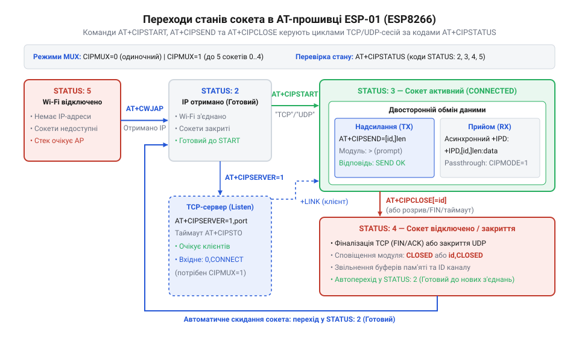
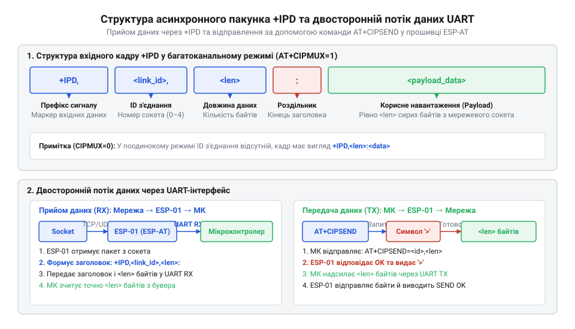

# Програмний довідник AT-команд керування TCP/UDP сокетами ESP-01

<preknowlist>
- [ESP-01 (Wi-Fi, ESP8266)](root:cat-hw-boards/esp-01) — базова схемотехніка, виводи та підключення модуля ESP-01 до послідовного порту UART
- [Захищені SSL/TLS з'єднання в AT-прошивці ESP8266](root:cat-hw-boards/esp8266-at-ssl-tls) — відмінності між відкритими сокетами TCP/UDP та криптографічно захищеними SSL-сесіями
- [Огляд сімейства Wi-Fi модулів ESP-01 та ESP-01S](root:cat-hw-boards/esp-01-module-family-overview) — апаратні особливості модулів серії ESP-01 для забезпечення стабільності UART-зв'язку
</preknowlist>

## Втрата даних без абстракції сокетів

Пряма передача даних між мікроконтролером і периферією через послідовний шинний інтерфейс здається найпростішим рішенням, доки обмін обмежений локальною платою. Проте спроба вивести сирий потік байтів безпосередньо у глобальну мережу швидко демонструє фундаментальну непридатність фізичної лінії зв'язку для роботи з мережевими протоколами. Коли мікроконтролер намагається відправляти дані через послідовний порт без узгодження параметрів сесії та керування потоком, будь-яка затримка на приймальній стороні призводить до того, що вхідний апаратний @@en|буфер@@ (від старофранцузького @@fro|bufe@@ — удар) переповнюється. В результаті байтовий потік втрачає цілісність, а пакети незворотно спотворюються.

Головна проблема фізичного послідовного порту @@en|UART@@ (англ. @@en|Universal Asynchronous Receiver-Transmitter@@) полягає у відсутності поняття кадрування та адресації на рівні передачі. Для апаратного контролера послідовний потік — це безперервна послідовність символів, у якій немає інформації про те, де починається чи закінчується логічне повідомлення і кому саме воно адресоване. Якщо до мережі одночасно звертається кілька віддалених вузлів, вхідні дані змішуються в єдиний хаотичний потік. Приймальна сторона не здатна визначити джерело конкретного пакета, повторно запросити втрачені байти або підтвердити успішний прийом без впровадження власного складного протоколу поверх апаратури.

Для вирішення цієї проблеми мережева прошивка [мікроконтролера ESP8266](root:cat-hw-boards/esp8266-soc-architecture-overview) містить внутрішній мережевий [стек LwIP](root:cat-hw-boards/esp-01) (англ. @@en|Lightweight IP@@). Він бере на себе низькорівневу обробку протоколів транспортного рівня @@en|TCP@@ (англ. @@en|Transmission Control Protocol@@) та @@en|UDP@@ (англ. @@en|User Datagram Protocol@@). Щоб надати хост-контролеру зручний інструмент керування цими мережевими ресурсами, прошивка @@en|ESP-AT@@ реалізує програмну абстракцію, яка називається мережевим @@en|сокетом@@ (англ. @@en|socket@@, від старофранцузького @@fro|soc@@ — леміш).

Абстракція сокета перетворює асинхронні текстові AT-команди, що надходять через порт @@en|UART@@ [модуля ESP-01](root:cat-hw-boards/esp-01), на повноцінні мережеві сесії. Прошивка самостійно контролює повторні відправки пакунків при втратах, перевіряє контрольними сумами цілісність даних і буферизує вхідну інформацію для кожного каналу окремо. Це звільняє зовнішній мікроконтролер від потреби реалізовувати у власному коді важкий мережевий стек, залишаючи йому лише функцію надсилання високорівневих команд і парсингу форматованих відповідей. Загальну структуру відповідей та синтаксис системних команд розкриває [огляд базового командного інтерфейсу ESP-AT](root:cat-hw-boards/esp-at-command-set-overview).

## Мультиплексування з'єднань та режим CIPMUX

Мережевий стек модуля @@en|ESP-01@@ може працювати у двох принципово різних режимах обслуговування сокетів: одиночному та багатоканальному. За вибір архітектури обробки підключень відповідає команда `AT+CIPMUX`. Усвідомлення різниці між цими режимами є критичним на етапі проектування системи, оскільки режим @@en|мультиплексування@@ (від латинського @@la|multiplex@@ — складний, багатократний) визначає синтаксис усіх наступних команд обміну даними та можливості модуля реалізовувати ролі клієнта чи сервера.

За замовчуванням після завантаження прошивки встановлено режим одиночного з'єднання `AT+CIPMUX=0`. У цьому стані модуль здатний утримувати лише один активний сокет — чи то клієнтський @@en|TCP@@-канал, чи один @@en|UDP@@-вузол. Перевагою одиночного режиму є спрощений синтаксис: під час відправлення або закриття сокета не потрібно вказувати числовий ідентифікатор каналу. Крім того, лише в одиночному режимі можлива активація прозорого режиму передачі даних. Проте такий підхід повністю блокує можливість паралельного обміну з кількома вузлами мережі.

```text
// Перевірка поточного режиму мультиплексування
AT+CIPMUX?
+CIPMUX:0
OK

// Переключення в режим підтримки кількох з'єднань
AT+CIPMUX=1
OK
```

Для створення складних мережевих вузлів використовують режим мультиплексування `AT+CIPMUX=1`. У багатоканальному режимі прошивка @@en|ESP-AT@@ паралельно виділяє та обслуговує до п'яти незалежних мережевих сокетів, позначаючи кожен із них числовим ідентифікатором @@en|link ID@@ у діапазоні від `0` до `4`. Завдяки цьому мікроконтролер може одночасно опитувати зовнішній веб-сервер, надсилати телеметрію на @@en|MQTT@@-брокер і приймати локальні конфігураційні запити.

Зміна режиму `AT+CIPMUX` дозволена лише тоді, коли всі сокети повністю закриті. Якщо в системі є хоча б одне активне з'єднання, спроба виконати `AT+CIPMUX=1` поверне помилку `link is builded`. Крім того, розгортання локального @@en|TCP@@-сервера принципово вимагає попереднього включення багатоканального режиму, оскільки сервер повинен мати можливість динамічно призначати вхідним клієнтам вільні ідентифікатори @@en|link ID@@ з доступного пулу. Для пристроїв [родини модулів ESP-01](root:cat-hw-boards/esp-01-module-family-overview) правильне налаштування `AT+CIPMUX` є першим обов'язковим кроком конфігурації мережевого стека.

## Ініціалізація та контроль стану сокетів

Створення мережевих сесій у прошивці @@en|ESP-AT@@ здійснюється за допомогою універсальної команди `AT+CIPSTART`. Залежно від вибраного режиму мультиплексування та транспортного протоколу, ця команда приймає різний набір параметрів, формуючи або надійне з'єднання @@en|TCP@@ з підтвердженням доставки, або швидкий датограмний сокет @@en|UDP@@ без встановлення постійної сесії.

У режимі одиночного підключення команда має синтаксис `AT+CIPSTART=<type>,<remote_IP>,<remote_port>`. Якщо ж активовано мультиплексування `AT+CIPMUX=1`, першим обов'язковим параметром передається ідентифікатор каналу @@en|link ID@@: `AT+CIPSTART=<link_ID>,<type>,<remote_IP>,<remote_port>`. Параметр `<type>` визначає тип сокета (`"TCP"` або `"UDP"`), після чого вказується мережева @@en|IP-адреса@@ призначення та номер віддаленого порту.

```text
// Створення TCP-клієнтського сокета на каналі 0 у режимі CIPMUX=1
AT+CIPSTART=0,"TCP","192.168.1.100",8080
0,CONNECT

OK

// Створення UDP-сокета з вказанням локального порту
AT+CIPSTART=1,"UDP","192.168.1.255",9000,1025,2
1,CONNECT

OK
```

Під час ініціалізації @@en|TCP@@-сокета прошивка модуля самостійно виконує процедуру трьохетапного мережевого @@en|рукостискання@@ (англ. @@en|handshake@@ — узгодження зв'язку) з віддаленим сервером. Якщо сервер досяжний і порт відкритий, модуль повертає відповідь `CONNECT` та `OK`. Для сокетів @@en|UDP@@ процедура рукостискання відсутня, тому сокет створюється миттєво. Додатковий параметр для @@en|UDP@@ дозволяє зафіксувати локальний порт пристрою та налаштувати режим прийому відповідних датограм від інших мережевих вузлів.


*Схема переходів між станами сокета в прошивці ESP-AT під час виконання AT-команд ініціалізації та опитування статусу.*

Для оперативної перевірки поточного стану мережевих ліній використовується команда `AT+CIPSTATUS`. У відповідь прошивка виводить загальний код стану мережевого адаптера та детальну таблицю відкритих сокетів. Отриманий код стану дозволяє контролеру чітко розрізняти етапи роботи пристрою в мережі:

- `2`: Модуль успішно отримав @@en|IP-адресу@@ від локальної точки доступу @@en|Wi-Fi@@.
- `3`: Створено хоча б один активний мережевий сокет (режим `CONNECT`).
- `4`: Усі створені раніше сокети закриті або відбувся розрив сесії.
- `5`: Модуль не підключений до бездротової мережі @@en|Wi-Fi@@.

Оригінальний стек прошивки дає змогу швидко відслідковувати статус сесій, запобігаючи спробам відправки даних у неіснуючі [відкритими TCP-сокетами](root:cat-hw-boards/esp8266-at-ssl-tls) чи втрачені канали зв'язку.

## Обмін даними та парсинг IPD

Після успішного відкриття сокетів модуль @@en|ESP-01@@ готовий до двостороннього обміну інформацією. Надсилання даних із мікроконтролера у мережу ініціюється командою `AT+CIPSEND`. Прошивка підтримує два основні режими передачі: звичайний (із попереднім вказанням довжини пакунка) та прозорий режим @@en|passthrough@@ (англ. @@en|passthrough mode@@ — наскрізний потік даних).

У звичайному режимі контролер надсилає команду `AT+CIPSEND=<length>` (в одиночному режимі) або `AT+CIPSEND=<link_ID>,<length>` (у багатоканальному). У відповідь модуль повертає символ запрошення `>`. Отримавши цей символ, мікроконтролер повинен передати у порт @@en|UART@@ чітко вказану кількість байтів `<length>`. Як тільки останній байт буфера надходить до модуля, прошивка формує мережевий кадр і надсилає його в ефір, повертаючи підтвердження `SEND OK`.

```text
// Відправка 5 байтів у канал 0
AT+CIPSEND=0,5
>
Response: SEND OK
```

Прозорий режим передачі активується командою `AT+CIPMODE=1` і працює виключно для одного @@en|TCP@@-клієнтського з'єднання при `AT+CIPMUX=0`. Після виконання `AT+CIPSEND` модуль переходить у стан наскрізної трансляції: будь-які байти, що надходять у @@en|UART@@, безпосередньо загортаються в @@en|TCP@@-пакети без додаткових командувань. Вихід із прозорого режиму здійснюється надсиланням послідовності `+++` з обов'язковою паузою в 1 секунду до та після її передачі.


*Структура вхідного повідомлення +IPD та послідовний потік даних між хост-контролером і модулем ESP-01.*

Прийом даних із мережі відбувається в асинхронному режимі. Коли віддалений вузол надсилає пакунок, модуль @@en|ESP-01@@ приймає його через мережевий стек і самостійно виводить у порт @@en|UART@@ у вигляді спеціального префіксного повідомлення `+IPD`. Формат вхідного повідомлення залежить від режиму мультиплексування:

- В одиночному режимі (`CIPMUX=0`): `+IPD,<len>:<data>`
- У багатоканальному режимі (`CIPMUX=1`): `+IPD,<link_ID>,<len>:<data>`

Алгоритм парсингу на мікроконтролері полягає у безперервному скануванні вхідного потоку @@en|UART@@ на наявність маркера `+IPD`. Зчитавши ідентифікатор каналу та числове значення довжини `<len>`, програма виділяє необхідну кількість байтів із послідовного буфера. Такий чіткий розподіл дозволяє впевнено керувати периферією [за допомогою AT-команд](root:cat-hw-boards/esp8266-at-gpio-control) навіть у разі надходження фрагментованих або високоінтенсивних мережевих даних.

## Розгортання сервера та керування таймаутами

Окрім клієнтських функцій, модуль @@en|ESP-01@@ здатний виступати в ролі мережевого @@en|TCP@@-сервера, приймаючи вхідні підключення від інших пристроїв локальної мережі. Для керування режимом сервера використовується команда `AT+CIPSERVER=<mode>[,<port>]`. Перший параметр визначає стан сервера (`0` — вимкнути, `1` — створити), а другий задає номер слухаючого порту (за замовчуванням використовується порт `333`).

Головною передумовою успішного запуску сервера є попереднє включення режиму мультиплексування `AT+CIPMUX=1`. Спроба запустити сервер при одиночному режимі `AT+CIPMUX=0` призведе до системної помилки `ERROR`. Це пояснюється тим, що сервер повинен мати можливість одночасно приймати кілька клієнтських сесій, призначаючи кожному новому підключенню вільний ідентифікатор @@en|link ID@@.

```text
// Включення багатоканального режиму
AT+CIPMUX=1
OK

// Запуск TCP-сервера на стандартному порту 80
AT+CIPSERVER=1,80
OK

// Сповіщення про вхідне підключення від клієнта
0,CONNECT
```

Коли зовнішній клієнт ініціює підключення до створеного сервера, прошивка @@en|ESP-AT@@ автоматично обирає найменший вільний ідентифікатор каналу (наприклад, `0`) і виводить у порт @@en|UART@@ сповіщення `<link_ID>,CONNECT`. З цього моменту мікроконтролер може надсилати дані цьому конкретному клієнту через `AT+CIPSEND=<link_ID>,<len>` або приймати від нього пакети через маркери `+IPD,<link_ID>,<len>:`.

Оскільки кількість одночасних з'єднань обмежена п'ятьма каналами, критично важливо своєчасно звільняти сокети неактивних або «зависших» клієнтів. За керування тривалістю бездіяльності відповідає команда налаштування @@en|таймауту@@ (англ. @@en|timeout@@ — границя часу очікування) `AT+CIPSTO=<timeout>`. Параметр задає час у секундах (від `0` до `7200`), після закінчення якого модуль автоматично розриває з'єднання, якщо з боку клієнта не спостерігається жодної мережевої активності. Встановлення значення `AT+CIPSTO=0` повністю вимикає автоматичне закриття сокетів за таймаутом, що не рекомендується для розробки пристроїв на базі [версії плати ESP-01S](root:cat-hw-boards/esp-01s).

## Завершення сесій та обробка збоїв

Грамотне завершення мережевих сесій та обробка виняткових ситуацій є запорукою стабільної роботи автономного мікроконтролерного пристрою. За примусове деініціалізоване закриття сокета зі сторони модуля відповідає команда `AT+CIPCLOSE`. Порядок її застосування залежить від налаштованого режиму мультиплексування та типу мережевої сесії.

У режимі одиночного з'єднання команда виконується без параметрів: `AT+CIPCLOSE`. Після відправки відповідного @@en|TCP@@-пакета з прапором `FIN` прошивка звільняє буфери і виводить відповідь `CLOSED` та `OK`. У багатоканальному режимі команда вимагає вказувати ідентифікатор конкретного сокета, який необхідно закрити: `AT+CIPCLOSE=<link_ID>`. Спеціальне значення `AT+CIPCLOSE=5` дозволяє одним викликом закрити всі п'ять активних каналів одночасно.

```text
// Закриття активного сокета на каналі 0
AT+CIPCLOSE=0
0,CLOSED

OK

// Реакція модуля на ініціативу віддаленого сервера
1,CLOSED
```

Процес закриття сесії може ініціюватися не лише мікроконтролером, а й віддаленим сервером або клієнтом. У такому разі прошивка @@en|ESP-AT@@ асинхронно виводить у послідовний порт текстове повідомлення вигляду `<link_ID>,CLOSED`. Хост-програма повинна негайно зафіксувати цю подію у власному становому автоматі і припинити будь-які спроби відправки даних у цей канал, оскільки наступні виклики `AT+CIPSEND` повертатимуть помилку `link is not valid`.

Окрім планового закриття, у реальних мережевих середовищах трапляються збої фізичного зв'язку, втрата сигналу @@en|Wi-Fi@@ або перезавантаження віддалених серверів. При цьому модуль виводить повідомлення `WIFI DISCONNECT` або `CONNECT FAIL`. Для підтримки відмовостійкості керуючий контролер повинен періодично аналізувати статус мережі через `AT+CIPSTATUS`. У разі виявлення завислих сесій необхідно провести їх коректну @@en|деініціалізацію@@ (від латинського @@la|initialis@@ — початковий) через `AT+CIPCLOSE`, після чого повторно ініціалізувати підключення. Такий комплексний підхід гарантує довготривалу стабільність роботи після [прошивання модуля ESP-01](root:cat-hw-boards/esp01-firmware-flashing).
