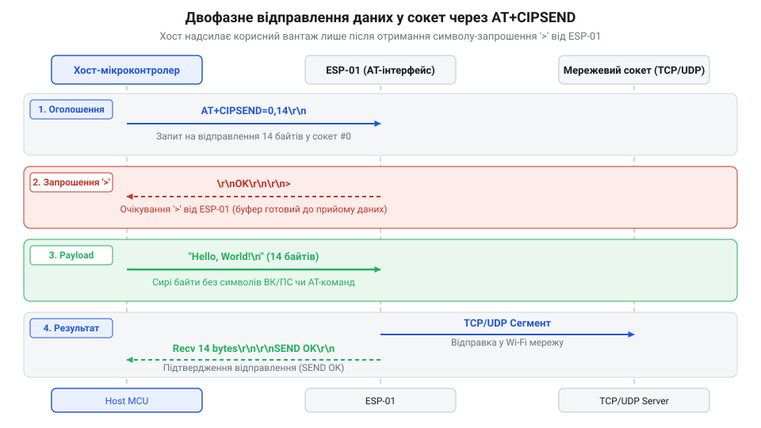
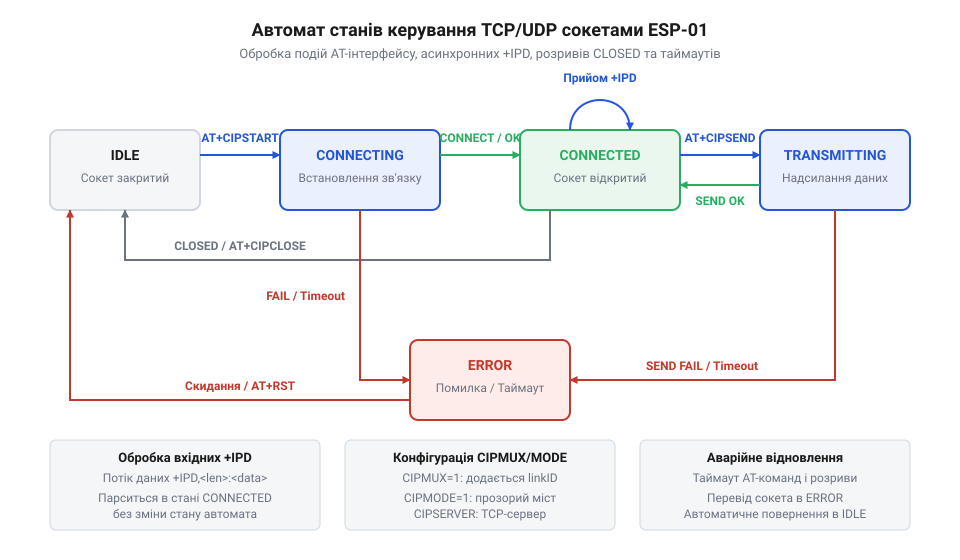

# Програмний інтерфейс AT-команд для керування TCP/UDP-сокетами ESP-01

<preknowlist>
- [Огляд базового командного інтерфейсу ESP-AT](root:cat-hw-boards/esp-at-command-set-overview) — синтаксис команд, формати відповідей OK/ERROR та організація обміну через UART
- [Архітектура мережевого стека lwIP у ESP8266](root:cat-hw-boards/lwip-architecture-esp8266) — основи функціонування TCP/UDP-сокетів та асинхронні події мережевого рівня
- [Потоковий розбір асинхронних кадрів +IPD в AT-прошивці ESP8266](root:cat-hw-boards/esp8266-at-ipd-parser) — базові принципи вихоплення асинхронних сповіщень про вхідні дані з послідовного порту
- [Протокол двофазної передачі даних AT+CIPSEND в ESP8266](root:cat-hw-boards/esp8266-at-cipsend-handshake) — принцип хендшейку передачі з очікуванням запрошення '>' та передачею фіксованого буфера
</preknowlist>

## Обмеження послідовного порту та мультиплексування

Фізичне підключення мікроконтролера до компактного [модуля ESP-01](root:cat-hw-boards/esp-01) виконується через послідовну лінію UART, яка має лише дві фізичні жили для приймання та передачі даних. У цьому повнодуплексному каналі хост-контролер змушений вирішувати складну задачу: в одному потоці символів змішуються синхронні службові відповіді на надіслані текстові команди та асинхронні транзитні пакети з зовнішньої мережі. Якщо хост запитує стан мережі, а в цей самий мікросекундний інтервал від віддаленого сервера надходить мережевий пакет, послідовний порт отримує перемішаний набір байтів. Без чітко визначених правил адресації керуюча програма хоста не здатна з'ясувати, чи належить вхідний байт службовій відповіді `OK`, чи це частина корисного навантаження від зовнішнього клієнта.

Для впорядкування цього потоку розробники прошивки реалізували фундаментальний механізм адресації даних, що визначає режим мультиплексування. Термін @@en|мультиплексування@@ (від лат. @@en|multiplex@@ — багатократний, складний) у контексті мережевого інтерфейсу означає здатність об'єднувати декілька логічних каналів зв'язку в один фізичний послідовний потік. У системі командування керування мережею спирається на концепцію сокета. Мережевий @@en|сокет@@ (від англ. @@en|socket@@ — гніздо, роз'єм) являє собою логічний кінцевий пункт мережевого з'єднання, який однозначно ідентифікується комбінацією транспортного протоколу, IP-адреси та номера порту. Оскільки внутрішня [архітектура мережевого стека lwIP](root:cat-hw-boards/lwip-architecture-esp8266) здатна обслуговувати одночасно кілька сокетів, командному інтерфейсу потрібна чітка вказівка, як саме маркувати кадри даних для кожного з них.

Режим роботи задається командою `AT+CIPMUX`. Вона приймає одне з двох значень:
* `AT+CIPMUX=0` — режим поодинокого з'єднання (одноз'єднувальний). У цьому режимі модуль може утримувати лише один активний сокет (TCP, UDP або SSL). Службові команди відправлення чи закриття не вимагають вказівки ідентифікатора каналу.
* `AT+CIPMUX=1` — режим множинного з'єднання (багатоз'єднувальний). Модуль дозволяє відкривати до 5 паралельних сокетів, кожному з яких апаратний стек призначає числовий ідентифікатор `link_id` у діапазоні від 0 до 4.

Перевірити поточний стан режиму мультиплексування можна запитом `AT+CIPMUX?`.

Головне граничне правило прошивки полягає в тому, що зміна режиму `AT+CIPMUX` є суворо незворотною під час активної мережевої сесії. Якщо в пам'яті модуля відкрито хоча б один сокет або запущено локальний TCP-сервер, спроба виконати команду `AT+CIPMUX=0` чи `AT+CIPMUX=1` завершиться негайною помилкою `ERROR`. Тому вибір конфігурації мультиплексування є першим обов'язковим кроком під час ініціалізації модуля після подачі живлення або скидання.

Обраний режим повністю змінює синтаксис усіх наступних команд керування сокетами під час обробки [командного інтерфейсу ESP-AT](root:cat-hw-boards/esp-at-command-set-overview). Порівняння форматів команд для двох режимів наведено в таблиці:

| Операція | Одноз'єднувальний режим (`CIPMUX=0`) | Багатоз'єднувальний режим (`CIPMUX=1`) |
| :--- | :--- | :--- |
| Відкриття сокета | `AT+CIPSTART="TCP","192.168.1.10",80` | `AT+CIPSTART=0,"TCP","192.168.1.10",80` |
| Передача даних | `AT+CIPSEND=12` | `AT+CIPSEND=0,12` |
| Закриття сокета | `AT+CIPCLOSE` | `AT+CIPCLOSE=0` |
| Вхідне сповіщення | `+IPD,12:hello world!` | `+IPD,0,12:hello world!` |

Таким чином, вибір `CIPMUX` визначає структуру всіх пакетів у послідовній лінії. Одноз'єднувальний режим спрощує парсер хоста, якщо пристрій працює як простий HTTP-клієнт. Багатоз'єднувальний режим є обов'язковим, якщо мікроконтролер має приймати вхідні підключення або паралельно опитувати кілька мережевих служб.

## Конфігурація та ініціалізація сокетних з'єднань

Після вибору режиму мультиплексування хост-мікроконтролер переходить до створення мережевих сокетів за допомогою універсальної команди `AT+CIPSTART`. Ця команда формує запити до внутрішнього мережевого стека на виділення ресурсів пам'яті та ініціалізацію сесії транспортного рівня.

Синтаксис команди відрізняється залежно від прапорця `CIPMUX`:
* В одноз'єднувальному режимі (`CIPMUX=0`):
  `AT+CIPSTART="<type>","<addr>",<port>[,<local_port>]`
* У багатоз'єднувальному режимі (`CIPMUX=1`):
  `AT+CIPSTART=<link_id>,"<type>","<addr>",<port>[,<local_port>]`

Параметр `<type>` визначає транспортний протокол і приймає значення `"TCP"` або `"UDP"`. Для обміну даними через захищений [канал SSL або TLS](root:cat-hw-boards/esp8266-at-ssl-tls) модуль використовує окремі варіанти команд або тип `"SSL"`. Параметр `<addr>` містить IP-адресу цільового вузла у вигляді рядка (наприклад, `"192.168.1.50"`) або його доменне ім'я (наприклад, `"api.example.com"`). Поле `<port>` вказує віддалений мережевий порт призначення.

При встановленні TCP-з'єднання стек модуля ініціює стандартний триетапний рукостискальний процес (@@en|триетапний хендшейк@@, від англ. @@en|three-way handshake@@). Хост-контролер має очікувати на відповідь інтерпретатора, яка складається з кількох рядків:
1. Сповіщення про стан з'єднання: `CONNECT` (або `<link_id>,CONNECT` у багатоз'єднувальному режимі).
2. Підтвердження успішного виконання AT-команди: `OK`.

Якщо віддалений вузол недоступний або відхилив запит підключення, модуль повертає `CONNECT FAIL` та `ERROR`. Якщо хост повторно викликає `AT+CIPSTART` для вже відкритого ідентифікатора `link_id`, прошивка генерує текстове застереження `ALREADY CONNECTED` та повертає `ERROR`.

Для протоколу UDP команда `AT+CIPSTART` не виконує мережевих хендшейків, оскільки UDP є протоколом без встановлення з'єднання. Замість цього команда лише створює внутрішню структуру сокета у стеку lwIP і закріплює віддалені реквізити. Для розширеного керування UDP-сокетом команда підтримує додаткові параметри:
`AT+CIPSTART=<link_id>,"UDP","<addr>",<port>,<local_port>,<udp_mode>`

Розглянемо значення цих параметрів:
* `<local_port>` — локальний порт хоста, на якому модуль слухає вхідні UDP-пакети. Якщо параметр опущено, стек призначає випадковий вільний порт.
* `<udp_mode>` — режим обробки адреси відправника при використанні UDP:
  * `0` (за замовчуванням) — цільова адреса й порт призначення жорстко зафіксовані значеннями `<addr>` та `<port>`.
  * `1` — адреса призначення сокета автоматично змінюється на адресу вузла, від якого надійшов останній вхідний UDP-пакет. Це необхідно для реалізації серверів відповіді (наприклад, DNS чи NTP-клієнтів), де віддалений порт відправника може відрізнятися від порту запиту.
  * `2` — адреса призначення залишається постійною, але локальний порт не змінюється протягом усієї сесії.

Приклад ініціалізації TCP-клієнта на сокеті 0 та UDP-слухача на сокеті 1:

:::tabs
```c|esp-idf
// Надсилання команд ініціалізації через UART під ESP-IDF
const char *cmd_tcp = "AT+CIPSTART=0,\"TCP\",\"192.168.1.100\",8080\r\n";
uart_write_bytes(UART_NUM_1, cmd_tcp, strlen(cmd_tcp));

// Ініціалізація UDP сокета 1 з фіксованим локальним портом 5000
const char *cmd_udp = "AT+CIPSTART=1,\"UDP\",\"192.168.1.255\",5000,5000,0\r\n";
uart_write_bytes(UART_NUM_1, cmd_udp, strlen(cmd_udp));
```
```cpp|arduino
// Надсилання команд ініціалізації в середовищі Arduino
Serial1.print("AT+CIPSTART=0,\"TCP\",\"192.168.1.100\",8080\r\n");

// Ініціалізація UDP сокета 1 з фіксованим локальним портом 5000
Serial1.print("AT+CIPSTART=1,\"UDP\",\"192.168.1.255\",5000,5000,0\r\n");
```
:::

Коректна ініціалізація вимагає від хоста перевірки підтвердження `OK` та контролю виникнення текстового маркера `CONNECT` перед переходом до відправлення даних.

## Режими та двофазний протокол відправлення

Після успішного відкриття сокета виникає задача передачі довільного бінарного або текстового масиву даних у мережу. Головна складність полягає в тому, що корисне навантаження може містити байти, які збігаються з символами керування AT-інтерфейсу (`\r`, `\n`, `AT+`). Щоб запобігти помилковій інтерпретації даних як нових команд, розробники прошивки впровадили спеціальний двофазний протокол відправлення.

Щоб відправити пакет даних, хост застосовує [двофазний протокол CIPSEND](root:cat-hw-boards/esp8266-at-cipsend-handshake), який узгоджує розмір буфера та час його передачі.

Двофазний процес відправлення за допомогою команди `AT+CIPSEND` відбувається за наступним алгоритмом:
1. **Фаза оголошення довжини.** Хост надсилає команду `AT+CIPSEND=<length>` (для `CIPMUX=0`) або `AT+CIPSEND=<link_id>,<length>` (для `CIPMUX=1`), де `<length>` — точний розмір буфера даних у байтах (максимум 2048 байтів на один пакет).
2. **Фаза підтвердження готовності.** Модуль опрацьовує параметр, виділяє внутрішній буфер у пам'яті lwIP і повертає в UART символ-запрошення `> ` (символ "більше" та пробіл).
3. **Фаза передачі сирого буфера.** Отримавши символ `>`, хост передає в послідовний порт рівно `<length>` байтів корисного навантаження без завершальних символів `\r\n` (якщо вони не є частиною самих даних).
4. **Фаза мережевого підтвердження.** Після отримання останнього `<length>`-го байта модуль блокує приймання команд, відправляє пакет у мережу й надсилає в UART підтвердження: `Recv <length> bytes` і рядок `SEND OK`.


*Підпис:* Часова послідовність етапів двофазного відправлення даних за допомогою AT+CIPSEND.

Критична пастка реалізації полягає в недотриманні часових інтервалів фази підтвердження. Якщо хост почав передавати байти корисного навантаження до того, як від модуля надійшов символ `>`, ESP-01 сприйме перші байти даних як продовження AT-команди й поверне `ERROR`.

Для задач із безперервним високим потоком даних (наприклад, моніторинг або тунелювання послідовного порту) двофазна overhead-команда на кожен пакет є неефективною. У цьому випадку використовується @@en|прозорий режим@@ (від англ. @@en|passthrough mode@@), який вмикається командою `AT+CIPMODE=1`.

Прозорий режим вимагає виконання трьох обов'язкових умов:
1. Режим мультиплексування має бути вимкнений (`AT+CIPMUX=0`).
2. Сокет має бути відкритий виключно за протоколом TCP (або одиночним UDP).
3. Після команди `AT+CIPSEND` модуль повертає символ `>` і повністю вимикає парсер AT-команд.

У прозорому режимі всі байти, що надходять у UART, негайно упаковуються в TCP-сегменти та відправляються в мережу. Для виходу з прозорого режиму назад у режим команд хост має передати спеціальну послідовність з трьох плюсів: `+++`.

Послідовність `+++` вимагає суворого дотримання часового захисного інтервалу (@@en|захисний інтервал@@, від англ. @@en|guard time@@):
* Протягом щонайменше 1000 мс до надсилання `+++` у послідовному порту має панувати повна тиша (жодного байта не надсилається).
* Три символи `+` мають бути передані впродовж не більше ніж 20 мс.
* Після `+++` протягом щонайменше 1000 мс не можна надсилати жодних байтів.
* Після символів `+++` НЕ можна надсилати символи переведення рядка `\r\n`.

Нехтування цими затримками призведе до того, що три плюси будуть відправлені в TCP-сокет як звичайні текстові дані, а модуль залишиться в прозорому режимі.

## Асинхронний розбір потокових сповіщень IPD

Мережеві дані від віддалених серверів чи клієнтів надходять у модуль ESP-01 асинхронно щодо роботи хост-мікроконтролера. Апаратний стек lwIP приймає мережевий кадр і негайно транслює його в послідовний порт UART у вигляді текстово-бінарного сповіщення з префіксом `+IPD`.

Формат префікса залежить від режиму конфігурації `CIPMUX`:
* В одноз'єднувальному режимі (`CIPMUX=0`): `+IPD,<len>:<data>`
* У багатоз'єднувальному режимі (`CIPMUX=1`): `+IPD,<link_id>,<len>:<data>`

Тут `<len>` означає кількість байтів корисного навантаження, що йдуть одразу після двокрапки `:`, а `<data>` — безпосередньо бінарний масив даних. Якщо увімкнено виведення додаткової інформації командою `AT+CIPDINFO=1`, у кадр додаються адреса та порт відправника: `+IPD,<link_id>,<len>,"<IP>",<port>:<data>`.

Головна проблема розбору кадрів `+IPD` полягає в тому, що бінарні дані `<data>` можуть містити абсолютно будь-які значення байтів, зокрема `0x0D` (`\r`), `0x0A` (`\n`), підстроки `OK`, `ERROR` або навіть нові префікси `+IPD`. Простий текстовий парсер, який звично читає UART до символу переведення рядка `\n`, повністю зламається: він сприйме байт `\n` усередині файлу чи зображення за кінець повідомлення і спробує виконувати наступні бінарні байти як текстові AT-відповіді.

Для уникнення розсинхронізації хост-мікроконтролер має використовувати побайтовий потоковий автомат станів (@@en|потоковий парсер@@, від англ. @@en|stream parser@@). Коректний [потоковий розбір IPD](root:cat-hw-boards/esp8266-at-ipd-parser) гарантує ізоляцію корисного навантаження від командних відповідей інтерпретатора.

Алгоритм автомата станів описується наступними кроками:
1. **Пошук префікса (`STATE_SEARCH`).** Парсер аналізує побайтово потік UART. Поки не виявлено послідовність `+IPD,`, усі байти вважаються частиною звичайних відповідей інтерпретатора (таких як `OK`, `ERROR`, `CONNECT`).
2. **Зчитування ID та довжини (`STATE_HEADER`).** Парсер накопичує цифри до коми (визначаючи `link_id`), а потім до двокрапки `:` (визначаючи число `len`).
3. **Пряме перехоплення буфера (`STATE_READ_PAYLOAD`).** Після двокрапки `:` автомат перемикає UART-лінійку в режим прямого лічильника. Наступні `len` байтів зчитуються в прийомний буфер без жодного аналізу їх вмісту чи пошуку символів `\r\n`.
4. **Завершення кадру (`STATE_COMPLETE`).** Після зчитування `len` байтів лічильник скидається, а автомат повертається в стан `STATE_SEARCH`.

Приклад реалізації потокового парсера кадрів `+IPD` мовами C та C++:

:::tabs
:::code api-esp01-at-tcp-udp-commands/c/parse-ipd-byte.c
:::code api-esp01-at-tcp-udp-commands/cpp/ipdparser.cpp
:::

Такий підхід повністю усуває загрозу помилкового розриву кадру через наявність спецсимволів у корисному навантаженні.

## Обслуговування сервера та асинхронних розривів

Модуль ESP-01 здатний функціонувати не лише як мережевий клієнт, але й як повноцінний TCP-сервер, приймаючи вхідні з'єднання від зовнішніх пристроїв. Для запуску режиму сервера обов'язковою передумовою є увімкнення багатоз'єднувального режиму (`AT+CIPMUX=1`).

Керування сервером здійснюється командою `AT+CIPSERVER=<mode>[,<port>]`:
* `<mode>`: `0` — закрити сервер; `1` — відкрити сервер.
* `<port>`: номер локального порту (за замовчуванням 333 або 80 залежно від версії прошивки).

Коли зовнішній клієнт підключається до сервера, стек lwIP автоматично призначає йому найменший вільний ідентифікатор `link_id` (від 0 до 4) і надсилає хосту асинхронне сповіщення `<link_id>,CONNECT`.

Для захисту ресурсів пам'яті від закинутих або неактивних з'єднань у прошивці передбачено серверний таймаут (@@en|серверний таймаут@@, від англ. @@en|server timeout@@). Він налаштовується командою `AT+CIPSTO=<seconds>`, де `<seconds>` задається в межах від 0 до 7200 секунд. Якщо підключений клієнт не передає даних протягом вказаного часу, модуль примусово закриває сокет і сповіщає хост рядком `<link_id>,CLOSED`.

Примусове закриття з'єднання з боку хоста виконується командою `AT+CIPCLOSE=<link_id>`. Щоб закрити всі активні сокети одночасно у багатоз'єднувальному режимі, використовується команда `AT+CIPCLOSE=5`.

Для надійної роботи в умовах реального ефіру хост-мікроконтролер повинен реалізувати скінченний автомат станів (@@en|автомат станів сокета@@, від англ. @@en|socket finite state machine@@). Якщо під час обміну стається [скидання внутрішнього завантажувача](root:cat-hw-boards/esp8266-bootloader-architecture), хост отримує службу асинхронних сміттєвих байтів, після чого стек переходить у початковий стан.


*Підпис:* Граф станів та асинхронні переходи автомата обслуговування мережевих сокетів на хост-мікроконтролері.

Головні стани та переходи автомата наведені нижче:
1. **IDLE (Бездіяльність).** Хост очищає прапорці та буфери. При необхідності виконується `AT+CIPSTART`. Перехід у `CONNECTING`.
2. **CONNECTING (Встановлення зв'язку).** Очікування відповідей `CONNECT` та `OK`. Якщо отримано `CONNECT FAIL` або `ERROR`, перехід у `ERROR`. При успіху — у `CONNECTED`.
3. **CONNECTED (З'єднання встановлено).** Сокет готовий до обміну. Отримання кадрів `+IPD` обробляється парсером. Якщо надходить сповіщення `CLOSED`, автомат повертається в `IDLE`.
4. **TRANSMITTING (Передача даних).** Надсилання `AT+CIPSEND`, очікування символу `>`, передача буфера, очікування `SEND OK`. Якщо замість `SEND OK` отримано `SEND FAIL` або `CLOSED`, передача скасовується, а сокет маркується як розірваний.
5. **ERROR (Обробка помилок).** Спроба закрити сокет через `AT+CIPCLOSE`, скидання прапорців і повернення у стан `IDLE`.

Коректна обробка асинхронних подій `CLOSED` та критичних таймаутів запобігає завистанню хоста при раптових розривах Wi-Fi зв'язку.
