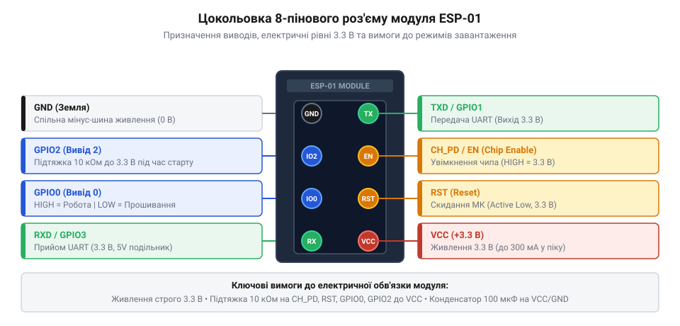
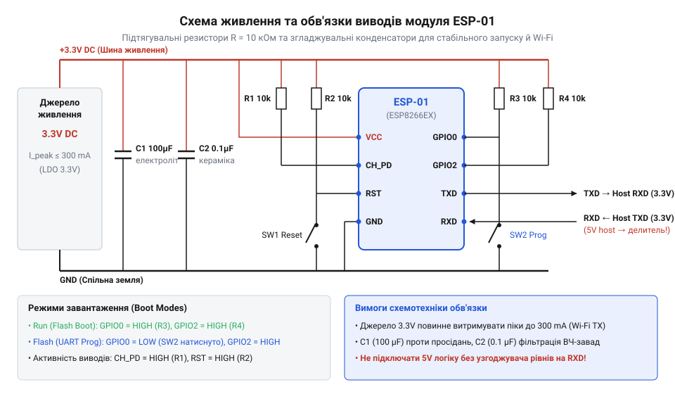

# Апаратний інтерфейс, цокольовка та електричні рівні модуля ESP-01

<preknowlist>
- [ESP-01 (Wi-Fi, ESP8266)](root:cat-hw-boards/esp-01) — конструктивні особливості та загальну будову плати модуля ESP-01
- [Конфігураційні виводи завантаження ESP8266](root:cat-hw-boards/esp8266-boot-strapping-pins) — логіку роботи strapping-пінів при скиданні та вимоги до режимів завантаження
- [Огляд мікроконтролера та архітектури SoC ESP8266](root:cat-hw-boards/esp8266-soc-architecture-overview) — електричні характеристики логічних рівнів 3.3V та параметри енергоспоживання
</preknowlist>

## Нестабільність живлення та збої старту

Пряме підключення компактного [модуля ESP-01](root:cat-hw-boards/esp-01) до розповсюджених 5-вольтних мікроконтролерних плат або недорогих USB-UART адаптерів часто завершується непередбачуваним зависанням пристрою, постійною втратою з'єднання та хаотичними циклічними перезавантаженнями (від англ. @@en|bootloop@@, від @@en|boot@@ — завантаження, та @@en|loop@@ — петля; @@en|циклічне перезавантаження@@). Інженери-початківці помилково вважають причиною таких апаратних збоїв дефекти прошивки або бракований мікроконтролер. Проте справжня фізична першопричина полягає в недотриманні жорстких вимог щодо пікового споживання струму та специфіки поведінки керуючих ліній бездротового трансивера.

Головна фізична пастка криється у високочастотному радіомодулі. Під час виконання процедур апаратного калібрування радіочастотного тракту (від англ. @@en|RF calibration@@, від @@en|radio frequency@@ — радіочастота, та @@en|calibration@@ — калібрування) та регулярного відправлення бекон-кадрів (від англ. @@en|beacon frame@@, від @@en|beacon@@ — маяк, та @@en|frame@@ — кадр) у складі [архітектури SoC ESP8266](root:cat-hw-boards/esp8266-soc-architecture-overview) бездротовий передавач Wi-Fi споживає імпульсний струм із короткочасними сплесками амплітудою до `300 мА` тривалістю від десятків мікросекунд до кількох мілісекунд. Стандартні виходи живлення `3.3 В`, вбудовані у популярні перетворювачі USB-UART на базі мікросхем CH340 або FT232, як і відповідні виходи плат Arduino Uno, живляться від малопотужних вбудованих регуляторів, які спроможні віддавати лише `50–100 мА` безперервного струму.

Коли бездротовий передавач вмикається, недостатня навантажувальна здатність джерела живлення викликає миттєве глибоке просідання напруги на шині `VCC`. Якщо напруга падає нижче критичного порогу `2.5 В`, спрацьовує внутрішній детектор просідання напруги живлення (від англ. @@en|brownout reset@@, від @@en|brownout@@ — просідання напруги, та @@en|reset@@ — скидання). Процесор апаратно скидає свій стан, перериває виконання коду та перезавантажується, виводячи в системний консольний лог службові повідомлення про збій `rst cause:1` (від англ. @@en|watchdog reset@@, від @@en|watchdog@@ — сторожовий таймер, та @@en|reset@@ — скидання) або `rst cause:6` (від англ. @@en|hardware reset@@, від @@en|hardware@@ — апаратне забезпечення, та @@en|reset@@ — скидання). Як тільки модуль намагається знову ініціалізувати Wi-Fi стек, радіопередавач повторно викликає сплеск струму, замикаючи нескінченний цикл аварійних перезавантажень.

Другим джерелом апаратних відмов є висячі виводи керування (від англ. @@en|floating pin@@, від @@en|float@@ — плавати, та @@en|pin@@ — вивід; @@en|висячий вивід@@). Керуючі входи увімкнення кристала `CH_PD` та апаратного скидання `RST` мають дуже високий вхідний імпеданс. Якщо залишити їх фізично непідключеними, на накопичену паразитну ємність друкованих провідників діють зовнішні електромагнітні завади й наведення. Внаслідок цього потенціал на виводах хаотично дрейфує між логічним нулем та одиницею, що призводить до самовільного вимкнення модуля або його спонтанного скидання.

Окрім ліній `CH_PD` та `RST`, внутрішній завантажувач мікроконтролера в момент підняття живлення опитує стан конфігураційних виводів `GPIO0` та `GPIO2`. Відсутність чіткої фіксації їхніх потенціалів змушує чип переходити у непідтримувані або незадокументовані режими старту. Для досягнення абсолютної стабільності роботи системи необхідно застосовувати стабілізоване джерело живлення напругою `3.3 В` з піковим струмом не менше `300–500 мА`, згладжувальний ємнісний фільтр безпосередньо біля коннектора плати та зовнішні підтягувальні резистори для всіх керуючих сигналів.

## Призначення та електричні параметри виводів

Фізична взаємодія [модуля ESP-01](root:cat-hw-boards/esp-01) із зовнішнім цифровим оточенням здійснюється через дворядний роз'єм (від англ. @@en|header@@, від @@en|head@@ — голова; @@en|дворядний роз'єм@@) із 8 виводами та стандартним кроком між контактами `2.54 мм`. Кожен вивід має строго визначену функцію, обмеження за напругою та гранично припустимим струмом.


*Розпіновка 8-контактного роз'єму модуля ESP-01 із зазначенням типу та функцій кожного виводу.*

Розглянемо детально електричне призначення та особливості експлуатації всіх 8 виводів модуля:

1. `VCC` — основна лінія живлення позитивного потенціалу. Номінальна робоча напруга становить `3.3 В`. Допустимий діапазон живлення лежить у вузьких межах від `3.0 В` до `3.6 В`. Абсолютний максимум становить `3.6 В`. Пряме підключення лінії `VCC` до джерела напруги `5 В` призводить до незворотного електричного пробою напівпровідникової структури SoC.

2. `GND` — спільна шина заземлення (`0 В`). Є опорним потенціалом для всіх живильних та сигнальних кіл системи.

3. `TXD` (`GPIO1`) — вихід послідовного інтерфейсу UART (від англ. @@en|transmitter@@ — передавач). Використовується для передачі даних від модуля до зовнішнього хост-контролера або комп'ютера, а також для виводу системних логів завантажувача на початковій швидкості `74880 біт/с`. Також може перераховуватись як вивід загального призначення (від англ. @@en|General-Purpose Input/Output@@, від @@en|general-purpose@@ — загального призначення, та @@en|input/output@@ — ввід/вивід; @@en|GPIO@@).

4. `RXD` (`GPIO3`) — вхід послідовного інтерфейсу UART (від англ. @@en|receiver@@ — приймач). Приймає команди та дані від зовнішніх пристроїв. Важливо пам'ятати, що цей вхід НЕ має апаратного захисту від підвищеної напруги (від англ. @@en|5V tolerant input@@) і розрахований виключно на логічні рівні `3.3 В`. Максимальна допустима напруга на вході становить `3.6 В`.

5. `CH_PD` (`CHIP_EN`) — вхід дозволу роботи чипа (від англ. @@en|Chip Enable@@, від @@en|chip@@ — мікросхема, та @@en|enable@@ — дозволяти). Для забезпечення активного робочого стану модуля на цей вивід обов'язково повинен подаватися високий логічний рівень `3.3 В`. При поданні низького рівня (`0 В`) внутрішні LDO-стабілізатори та тактовий генератор SoC вимикаються, а чип переходить у режим ультранизького енергоспоживання (до `10 мкА`).

6. `RST` — вхід апаратного скидання мікроконтролера (від англ. @@en|Reset@@, від @@en|re-set@@ — скидати наново). Активний рівень — низький (`0 В`). Усередині модуля вивід з'єднаний із лінією скидання процессора. Для нормальної роботи вивід утримується у високому стані `3.3 В`, а коротке замикання на `GND` викликає перезапуск пристрою.

7. `GPIO0` — універсальний цифровий вхід/вихід та конфігураційний вивід завантаження. Стан цього виводу під час зняття сигналу скидання `RST` визначає режим роботи: подача низького рівня (`0 В`) активує режим запису прошивки через UART, а подача високого рівня (`3.3 В`) запускає виконання програми з зовнішньої флеш-пам'яті.

8. `GPIO2` — універсальний цифровий вхід/вихід та додатковий конфігураційний вивід. Під час старту мікроконтролера на цьому виводі обов'язково має бути високий логічний рівень (`3.3 В`) як для робочого режиму, так і для режиму прошивання.

Електричні параметри цифрових виводів `GPIO` відповідають стандарту `3.3V LVTTL`. Максимальний струм, який може протікати через один вивід у режимі втікання або джерела (від англ. @@en|source/sink current@@), обмежений значенням `12 мА`. Перевищення цього струму викликає локальне перегрівання та деградацію вихідних транзисторів порту.

## Схемотехніка живлення та підтяжки виводів

Грамотна побудова апаратної обв'язки модуля ESP-01 вимагає розрахунку двох ключових вузлів: вторинного джерела живлення з високою динамічною віддачею та схемотехніки фіксації потенціалів керуючих виводів для гарантованого вибору режимів старту.

Джерело живлення проектується на базі лінійного стабілізатора з низьким падінням напруги (від англ. @@en|Low Dropout Regulator@@, від @@en|low@@ — низький, @@en|dropout@@ — падіння, та @@en|regulator@@ — регулятор; @@en|LDO-регулятор@@), такого як AMS1117-3.3 або LD1117-3.3, здатного видавати струм до `800–1000 мА`. Для компенсації пікових імпульсів споживання під час спрацьовування бездротового передавача паралельно шині живлення встановлюють двоступеневу групу згладжувальних конденсаторів:

1. Високочастотний керамічний конденсатор ємністю `0.1 мкФ` (`100 нФ`), розташований на мінімальній відстані до контактів `VCC` та `GND` модуля ESP-01. Він має низький еквівалентний послідовний опір (від англ. @@en|Equivalent Series Resistance@@; @@en|ESR@@) та шунтує високочастотні імпульсні завади.
2. Низькочастотний накопичувальний танталовий або електролітичний конденсатор ємністю від `100 мкФ` до `470 мкФ`. Він виконує роль локального резервуару енергії при сплесках струму.


*Принципова електрична схема живлення та обв'язки ліній CH_PD, RST, GPIO0 і GPIO2 модуля ESP-01.*

Оцінимо величину просідання напруги `ΔV` на накопичувальному конденсаторі ємністю `C = 100 мкФ` під час радіочастотного імпульсу споживання струму `I_peak = 300 мА` тривалістю `Δt = 1 ммс` (`0.001 с`):

```text
ΔV = (I_peak × Δt) ÷ C
   = (0.3 A × 0.001 s) ÷ 0.0001 F      [закон збереження електричного заряду Q = I·t = C·ΔV]
   = 0.0003 C ÷ 0.0001 F              [обчислення накопиченого заряду в кулонах]
   = 0.3 В                            [підсумкове просідання напруги на шині VCC]
```

Розрахунок показує, що з накопичувальним конденсатором `100 мкФ` напруга на шині `VCC` падає лише з `3.3 В` до `3.0 В`, що значно вище порогу спрацьовування детектора `brownout reset` (`2.5 В`) і гарантує безперебійну роботу.

Другий аспект обв'язки — забезпечення правильних станів виводів при старті. Виводи `CH_PD` та `RST` вимагають постійної зовнішньої підтяжки до лінії `3.3 В` через підтягувальні резистори (від англ. @@en|pull-up resistor@@, від @@en|pull up@@ — підтягувати вгору, та @@en|resistor@@ — резистор; @@en|підтягувальний резистор@@). Стандартний номінал резисторів становить `10 кОм`. Таке значення обмежує струм витоку на рівні `I = 3.3 В ÷ 10000 Ом = 0.33 мА` при примусовому замиканні лінії на землю, одночасно гарантуючи надійне подолання вхідного струму витоку порту (близько `1 мкА`).

Для конфігурації [режимів завантаження чипа](root:cat-hw-boards/esp8266-boot-modes) аналізуються [страпінг-виводи завантажувача](root:cat-hw-boards/esp8266-boot-strapping-pins). На платі ESP-01 вивід `GPIO15` апаратно затягнутий на `GND` зовнішнім SMD-резистором `10 кОм`. Конфігурація режимів старту регулюється станами `GPIO0` та `GPIO2`:

- **Робочий режим (SPI Flash Boot):** `GPIO0` підтягнуто до `3.3 В` через `10 кОм`, `GPIO2` підтягнуто до `3.3 В` через `10 кОм`.
- **Режим прошивки (UART Flashing Mode):** `GPIO0` замикається на `GND` під час подачі імпульсу скидання на `RST`, а `GPIO2` залишається підтягнутим до `3.3 В`.

Для зручності перемикання у принципову схему додають дві тактові кнопки (від англ. @@en|tactile switch@@; @@en|тактова кнопка@@): одну для короткого замикання `RST` на `GND` (кнопка Reset), а другу — для замикання `GPIO0` на `GND` (кнопка Flash). Правильно побудована схема унеможливлює випадкові помилки завантаження і детально застосовується у схемотехніці [спеціальних адаптерів для прошивання](root:cat-hw-boards/esp-01-programmer-adapters) та спрощує регулярний процес [оновлення прошивки модуля](root:cat-hw-boards/esp01-firmware-flashing).

## Узгодження UART та розробка схем

Підключення модуля ESP-01 до хост-контролерів із 5-вольтовою логікою (таких як Arduino Uno, Nano чи класичні мікроконтролери AVR) вимагає суворого схемотехнічного узгодження логічних рівнів послідовного інтерфейсу UART.

Оскільки вхід `RXD` модуля ESP-01 побудований за технологією `3.3V CMOS` і не має захисту від 5-вольтових сигналів, пряме підключення виходу `TX` 5-вольтового мікроконтролера призводить до відкриття внутрішнього паразитного діода захисту від електростатичного розряду (від англ. @@en|electrostatic discharge diode@@, від @@en|electrostatic discharge@@ — електростатичний розряд; @@en|ESD-діод@@). Через вхід починає протікати надмірний струм, що спричиняє термічне руйнування вхідного каскаду `GPIO3`.

Розглянемо два напрямки передачі сигналів:

1. **Напрямок ESP-01 TXD (3.3V) -> Host RX (5V):** Вихідний сигнал високого рівня `3.3 В` від модуля ESP-01 перевищує поріг розпізнавання логічної одиниці для 5-вольтової TTL-логіки (`V_IH = 2.0 В`). Тому лінію `TXD` модуля ESP-01 можна підключати безпосередньо до входу `RX` 5-вольтового мікроконтролера.
2. **Напрямок Host TX (5V) -> ESP-01 RXD (3.3V):** Вимагає примусового зниження амплітуди сигналу з `5 В` до безпечних `3.3 В`.

Найпростішим та найдоступнішим рішенням для зниження напруги сигнальної лінії є пасивний резистивний дільник напруги (від англ. @@en|resistive voltage divider@@, від @@en|resistive@@ — резистивний, @@en|voltage@@ — напруга, та @@en|divider@@ — дільник; @@en|резистивний дільник напруги@@). Схема будується на двох послідовно з'єднаних резисторах `R1` та `R2`.

Розрахуємо вихідну напругу дільника `V_out` при вхідній напрузі `V_in = 5.0 В` та номіналах `R1 = 1.0 кОм`, `R2 = 2.0 кОм`:

```text
V_out = V_in × (R2 ÷ (R1 + R2))
      = 5.0 В × (2000 Ом ÷ (1000 Ом + 2000 Ом))      [підстановка номіналів резисторів]
      = 5.0 В × (2000 ÷ 3000)                             [додавання опорів дільника]
      = 5.0 В × 0.6667                                    [обчислення коефіцієнта ділення]
      = 3.33 В                                            [підсумковий рівень напруги]
```

Принципова схема резистивного дільника для лінії `RXD` має наступну структуру:

```text
5V MCU TX ──[ R1 = 1.0 кОм ]──┬── ESP-01 RXD (3.3V)
                              │
                          [ R2 = 2.0 кОм ]
                              │
                             GND
```

Недоліком пасивного резистивного дільника є утворення паразитного RC-фільтра низьких частот (від англ. @@en|RC filter@@, від @@en|resistor-capacitor@@ — резистор-конденсатор; @@en|RC-фільтр@@) разом із вхідною ємністю порту та ємністю монтажу (близько `10–20 пФ`). На високих швидкостях передачі UART (понад `115200 біт/с`) фронти імпульсів закруглюються, що спроможне викликати спотворення кадрів даних.

Для високошвидкісних ліній або двонапрямного узгодження застосовують активний транзисторний конвертер рівнів (від англ. @@en|MOSFET level shifter@@, від @@en|MOSFET@@ — польовий транзистор, та @@en|level shifter@@ — конвертер рівнів; @@en|транзисторний конвертер рівнів@@) на базі малопотужного N-канального польового транзистора (наприклад, BSS138) та двох підтягувальних резисторів номіналом `10 кОм`. Такий конвертер гарантує круті фронти сигналів на швидкостях до `1–2 Мбіт/с`.

Підсумкова принципова схема апаратного підключення модуля ESP-01 включає стабілізатор `3.3 В` з конденсаторами `0.1 мкФ` та `100 мкФ`, підтяжки `10 кОм` на `CH_PD`, `RST`, `GPIO0`, `GPIO2`, кнопки скидання й прошивки, а також резистивний дільник на лінії `RXD`. Повний [огляд сімейства модулів](root:cat-hw-boards/esp-01-module-family-overview) показує, що новіші модифікації ESP-01S уже мають інтегровані на плату підтягувальні резистори, тоді як класичний ESP-01 вимагає описаної повного зовнішнього схемотехнічного обв'язки.
