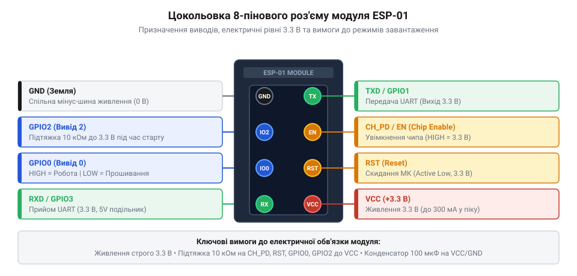
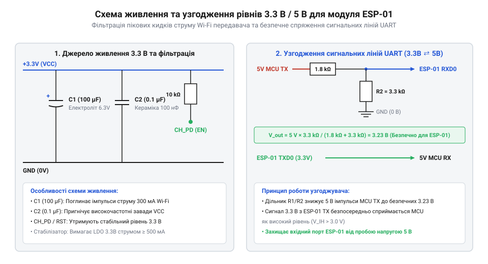

# Апаратний довідник цокольовки, ліній керування та живлення модуля ESP-01

<preknowlist>
- [ESP-01 (Wi-Fi, ESP8266)](root:cat-hw-boards/esp-01) — габаритні та конструктивні параметри модуля ESP-01
- [Конфігураційні виводи завантаження ESP8266](root:cat-hw-boards/esp8266-boot-strapping-pins) — логіка роботи strapping-пінів при скиданні
- [Огляд мікроконтролера та архітектури SoC ESP8266](root:cat-hw-boards/esp8266-soc-architecture-overview) — вимоги до логічних рівнів 3.3V та пікового струму
</preknowlist>

## Нестабільність живлення та помилки стартів

Підключення виносного [модуля ESP-01](root:cat-hw-boards/esp-01) до керуючих контролерів часто супроводжується непередбачуваними перезавантаженнями, збоями зв'язку по UART та блокуванням виконання коду. Першопричиною цих апаратних проблем є нерозуміння вимог щодо пікового споживання струму та специфіки сигнальних ліній шини завантаження.

При виконанні процедур радіочастотного калібрування (від англ. @@en|RF Calibration@@) та надсиланні бекон-пакетів (від англ. @@en|Beacon Packet@@) бездротовий передавач Wi-Fi у складі [архітектури SoC ESP8266](root:cat-hw-boards/esp8266-soc-architecture-overview) споживає короткочасні імпульсні струми з амплітудою до `200–300 мА` тривалістю в десятки мікросекунд. Звичайні перетворювачі USB-UART на базі мікросхем CH340 чи FT232 мають вбудовані лінійні регулятори напруги, розраховані лише на `50–100 мА`. Фізичний механізм збою обумовлений надвисокою швидкістю наростання струму (від англ. @@en|slew rate@@) під час увімкнення підсилювача потужності, коли струм стрибає на `ΔI = 280 мА` за час `dt ≈ 1 мкс`, що дає швидкість `dI/dt = 280 000 А/с` (`0.28 А/мкс`). Через повільний відгук лінійного регулятора на такі надшвидкі фронти весь імпульсний струм `I_pulse = 300 мА` вихоплюється безпосередньо з локальної блокираторної ємності `C_dec ≈ 1 мкФ`. Додатково напруга падає на еквівалентному послідовному опорі (англ. @@en|ESR@@, від @@en|Equivalent Series Resistance@@) за формулою `ΔV_ESR = I_pulse · R_ESR`; при виборі звичайного конденсатора з `R_ESR = 5 Ом` миттєвий ступінчастий спад досягає `1.5 В`. За час тривалості імпульсу `Δt = 10 мкс` спад напруги `ΔV` на блокираторному конденсаторі описується формулою `ΔV = (I_pulse × Δt) ÷ C_dec`:

```
ΔV = (0.3 × 0.00001) ÷ 0.000001
= 0.000003 ÷ 0.000001         [підстановка струму 0.3 А, тривалості 10 мкс та ємності 1 мкФ]
= 3.0                         [падіння напруги шини в вольтах під час імпульсу]
```

За відсутності зовнішньої накопичувальної ємності напруга живлення миттєво падає від номінальних `3.3 В` нижче критичного порогу `2.5 В`, викликаючи спрацьовування системного детектора просідання (від англ. @@en|brownout reset@@; від англ. *brownout* — часткове зниження напруги та *reset* — скидання) та перезавантаження процесора з видачею системного логу `rst cause:4` / `wdt reset`. Для компенсації цього розряду паралельно виводам живлення обов'язково встановлюють електролітичний або танталовий конденсатор ємністю `100–470 мкФ` із низьким еквівалентним послідовним опором (англ. @@en|ESR@@, від @@en|Equivalent Series Resistance@@; від лат. *aequus* — рівний та *series* — ряд).

Другою поширеною пасткою є висячі виводи керування (від англ. @@en|floating pins@@; @@en|висячі виводи@@). Виводи увімкнення `CH_PD` та скидання `RST` мають високий вхідний опір. Якщо залишити їх без зовнішньої підтяжки до лінії живлення `3.3 В`, паразитна ємність та наведення від довколишніх провідників спричиняють випадкові скидання або переведення чипа у режим глибокого сну. Окрім обов'язкового підтягування до шини живлення через резистор номіналом `10 кОм`, лінія `CH_PD` вимагає суворого дотримання часових затримок і повинна утримуватися у стабільно високому стані (HIGH) щонайменше `5–10 мс` після того, як напруга на шині `VCC` досягне номінального рівня `3.3 В`. Передчасне встановлення високого рівня на `CH_PD` до стабілізації внутрішніх підсистем та генератора тактової частоти SoC запобігає коректній ініціалізації вбудованої схеми скидання за живленням (від англ. @@en|Power-On Reset@@), викликаючи блокування внутрішнього ROM-завантажувача у невизначеному стані.

## Призначення виводів дворядного роз'єму

Для фізичного мовлення та комутації модуль ESP-01 оснащено 8-контактним дворядним роз'ємом із кроком `2.54 мм` (від англ. @@en|Dual In-line Package Header@@; @@en|дворядний роз'єм@@). Схема сигналів та розташування клем розрізняються від продуктивності та монтажу [модулів ESP-01S](root:cat-hw-boards/esp-01s).


*Показано розташування та призначення 8 виводів дворядного роз'єму модуля ESP-01.*

| Назва виводу | Тип виводу | Номінальна напруга | Функціональне призначення |
| :--- | :--- | :--- | :--- |
| `VCC` | Живлення | `3.0–3.6 В` | Основна лінія живлення модуля (номінал `3.3 В`). |
| `GND` | Земля | `0 В` | Спільний мінус системи та екранування. |
| `TXD` / `GPIO1` | Цифровий вихід | `3.3 В` | Передавач UART (TX) та вивід загального призначення. |
| `RXD` / `GPIO3` | Цифровий вхід | `3.3 В` | Приймач UART (RX) та вивід загального призначення. |
| `CH_PD` / `EN` | Вхід керування | `3.3 В` | Дозвіл роботи чипа (від англ. @@en|Chip Enable@@). Активний рівень — HIGH. |
| `RST` | Вхід керування | `3.3 В` | Апаратне скидання (від англ. @@en|Reset@@). Активний рівень — LOW. |
| `GPIO0` | Ввод-вивід / Strapping | `3.3 В` | Конфігурація режиму завантаження (LOW — прошивка, HIGH — старт з Flash). |
| `GPIO2` | Ввод-вивід / Strapping | `3.3 В` | Конфігураційний вивід завантаження (вимагає HIGH при старті). |

Всі вхідні та вихідні лінії працюють за стандартами логічних рівнів `3.3V LVTTL`. Максимальний вихідний струм на один вивід загального призначення (від англ. @@en|General-Purpose Input/Output@@; @@en|GPIO@@) не повинен перевищувати `12 мА`. При цьому сумарний вихідний струм усіх одночасно задіяних виводів обмежений внутрішньою розводкою шин кристала [архітектури SoC ESP8266](root:cat-hw-boards/esp8266-soc-architecture-overview) на рівні `120 мА`, перевищення якого викликає локальний перегрів та спад внутрішньої напруги. Еквівалентна схема вхідного каскаду містить два захисні ESD-діоди (від англ. @@en|electrostatic discharge protection diodes@@; @@en|ESD-діоди@@), підключені до шин `3.3 В` та `GND`, а також паразитну вхідну ємність біля `5–10 пФ`. При подачі напруги понад `3.8 В` верхній захисний діод відкривається та пропускає струм на шину живлення; якщо цей струм перевищує `10 мА`, виникає тепловий пробій напівпровідника. Вхідний електричний імпеданс (англ. *impedance*, від лат. *impedio* — перешкоджати, @@en|вхідний імпеданс@@) у вимкненому стані становить близько `10⁹ Ом`, що робить виводи чутливими до завад без зовнішньої підтяжки. Внутрішні підтягувальні резистори мають опір `40–50 кОм`, тому підключення низькоомного навантаження з вихідним опором драйвера зміщує вихідний рівень HIGH нижче порогового значення `2.64 В`, викликаючи збої логічного розпізнавання.

## Конфігурування режимів завантаження Boot Mode

При початковому подачі живлення або знятті сигналу з виводу `RST` внутрішній ROM-завантажувач оцінює логічні рівні на спеціальних конфігураційних виводах (від англ. @@en|strapping pins@@; @@en|strapping-виводи@@). Деталі функціонування цих ліній описують [конфігураційні виводи ESP8266](root:cat-hw-boards/esp8266-boot-strapping-pins) та огляд [режимів завантаження ESP8266](root:cat-hw-boards/esp8266-boot-modes).

На модулі ESP-01 режим стартапу визначається комбінацією двох доступних виводів `GPIO0` та `GPIO2` (лінія `GPIO15` апаратно підтягнута до землі резистором на друкованій платі модуля):

| Режим завантаження (Boot Mode) | Стан `GPIO0` | Стан `GPIO2` | Стан `GPIO15` | Опис режиму |
| :--- | :--- | :--- | :--- | :--- |
| **Flash Boot** (Робочий режим) | **HIGH (1)** | **HIGH (1)** | **LOW (0)** | Завантаження та виконання коду з зовнішньої флеш-пам'яті SPI Flash. |
| **UART Flashing** (Режим прошивки) | **LOW (0)** | **HIGH (1)** | **LOW (0)** | Активація завантажувача ROM для запису нової прошивки через UART. |
| **SD-Card Boot** (Резервний режим) | **LOW (0)** | **LOW (0)** | **HIGH (1)** | Невикористовуваний режим завантаження з картки пам'яті. |

Для забезпечення надійного вибору режиму застосовують підтягувальні резистори (від англ. @@en|pull-up resistor@@ / @@en|pull-down resistor@@). Виводи `GPIO0` та `GPIO2` підтягують до шини `3.3 В` через зовнішні резистори номіналом `10 кОм`. Необхідність у зовнішній підтяжці обумовлена тим, що внутрішні підтягувальні резистори чипа `ESP8266` є слабкими (близько `30`–`50 кОм`). Під час старту завантажувач фіксує рівні напруги при пороговому значенні високого рівня `V_IH ≥ 0.75 × V_DD` (`2.475 В`), тому будь-який зовнішній периферійний компонент із низьким опором до землі утворює з внутрішньою підтяжкою дільник напруги, знижуючи потенціал нижче порогу фіксації. Для переведення модуля в режим прошивання вивід `GPIO0` замикають на землю (GND) під час перезавантаження по лінії `RST`. Проте використання `GPIO0` та `GPIO2` як виводів загального призначення ускладнюється тим, що підключені периферійні пристрої можуть апаратно спотворити логічні рівні при старті. Якщо світлодіод підключити катодом до землі через резистор або сенсор притискатиме лінію до низького рівня під час скидання, напруга впаде нижче порогу `V_IH`, і модуль помилково перейде в режим прошивання чи збою завантаження замість виконання коду з флеш-пам'яті. Для запобігання фатальним збоям світлодіоди підключають за схемою активного низького рівня (від англ. @@en|active-low@@) анодом до шини `3.3 В`, а зовнішні сенсори ізолюють через підтягнуті транзисторні ключі або схеми з відкритим колектором, щоб вони не знижували напругу на виводах під час стартапу. Детальні схеми комутації демонструють [адаптери для прошивання ESP-01](root:cat-hw-boards/esp-01-programmer-adapters) та інструкції з [програмування ESP-01](root:cat-hw-boards/esp01-firmware-flashing).

## Схема живлення та узгодження рівнів

Стабільна експлуатація модуля ESP-01 у складі схем з 5-вольтними мікроконтролерами (наприклад, Arduino Uno/Nano) вимагає схемотехнічного узгодження живлення та логічних рівнів.

Джерело живлення має будуватися на базі окремого лінійного регулятора (від англ. @@en|Low Dropout Regulator@@; @@en|LDO-регулятор@@) або імпульсного перетворювача напруги з вихідним струмом не менше `500 мА` (наприклад, мікросхеми AMS1117-3.3 або AP2112K-3.3). Для компенсації пікових імпульсів споживання паралельно лінії `VCC` та `GND` встановлюють комбінацію конденсаторів:
- Керамічний конденсатор ємністю `0.1 мкФ` (100 нФ) поруч із виводами модуля для фільтрації високочастотних завад;
- Танталовий або електролітичний конденсатор ємністю `100–470 мкФ` для демпфування низькочастотних просідань під час спрацьовування передавача Wi-Fi.


*Показано принципову схему вузла живлення та двонапрямного узгоджувача рівнів напруги для ESP-01.*

Оскільки вивід `RXD` модуля ESP-01 не має апаратного захисту від напруги `5 В` (від англ. @@en|5V Tolerant Input@@), пряме підключення до 5V-виходів UART викличе фатальний пробій входів мікроконтролера. Для зниження амплітуди застосовують дільник напруги (від англ. @@en|voltage divider@@) або конвертер логічних рівнів (від англ. @@en|level shifter@@) на польових транзисторах. Проте резистивний дільник створює паразитний фільтр низьких частот (від англ. @@en|low-pass filter@@) у поєднанні із затворною ємністю вхідного каскаду та друкованих провідників (`C ≈ 15 пФ`). Якщо обрати високі опори плечей `10 кОм` та `20 кОм`, еквівалентний вихідний опір дільника `R_eq = (10 кОм · 20 кОм) ÷ (10 кОм + 20 кОм) ≈ 6.67 кОм` формує постійну часу `τ = R_eq · C = 6670 Ом · 15 пФ ≈ 100 нс`. При цьому тривалість наростання фронту (від англ. @@en|rise time@@) за рівнем 10%–90% становить `t_r ≈ 2.2 · τ ≈ 220 нс`. На високошвидкісних режимах обміну понад `115200 бод` (зокрема при `921600 бод`, де тривалість один-бітового інтервалу `T_bit ≈ 1085 нс`) таке затягування фронту деформує понад 20% часового вікна біта, викликаючи спотворення сигналу та помилки кадрування (від англ. @@en|framing error@@). Для збереження крутизни фронтів і стабільної роботи на високих швидкостях опір плечей зменшують до `1.0 кОм` та `2.0 кОм` (що знижує `R_eq` до `667 Ом`, а `t_r` — до `22 нс`) або застосовують активний конвертер на польових транзисторах, розкритий в [огляді SoC ESP8266](root:cat-hw-boards/esp8266-soc-architecture-overview):

```text
5V MCU TX ──[ 1.0 кОм ]──┬── ESP-01 RXD (3.3V)
                         │
                     [ 2.0 кОм ]
                         │
                        GND
```

Лінія `TXD` модуля ESP-01 надсилає сигнали з амплітудою `3.3 В`, що сприймається 5-вольтними мікроконтролерами як високий логічний рівень (поріг `2.0 В` для TTL-стандарту), тому лінію `TXD` можна підключати напряму до входу `RX` зовнішнього мікроконтролера. Конструктивні варіанти плат підсумовує [огляд сімейства ESP-01 та ESP-01S](root:cat-hw-boards/esp-01-module-family-overview).
