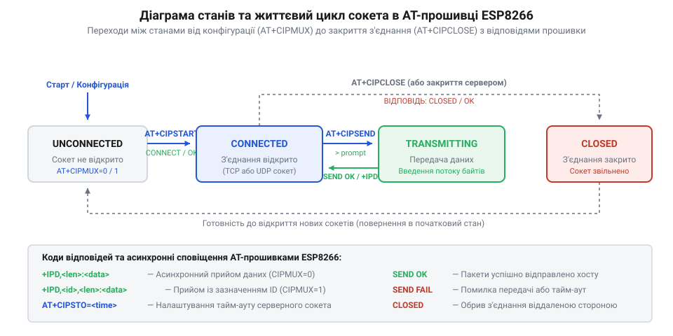
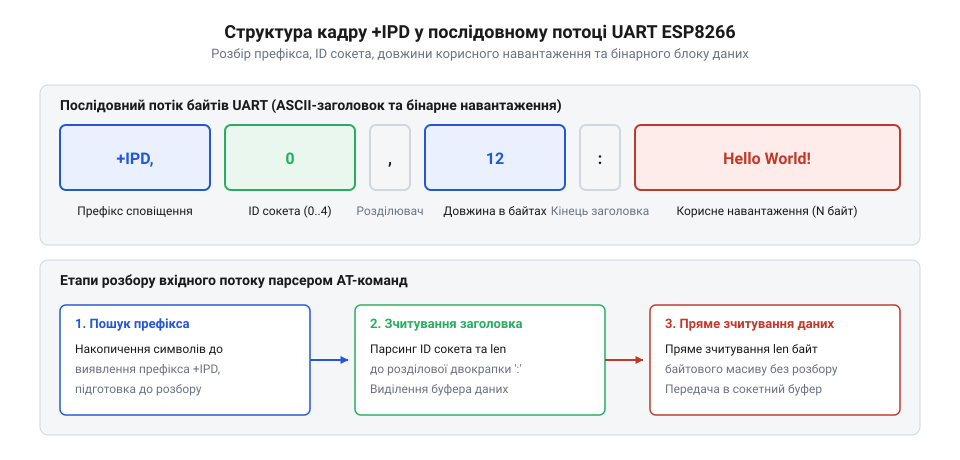

# Довідник AT-команд керування TCP/UDP сокетами у прошивці ESP8266

<preknowlist>
- [ESP-01 (Wi-Fi, ESP8266)](root:cat-hw-boards/esp-01) — Базову апаратну будову модуля ESP-01 та підключення послідовного інтерфейсу UART
- [Огляд мікроконтролера та архітектури SoC ESP8266](root:cat-hw-boards/esp8266-soc-architecture-overview) — Загальний розподіл оперативної пам'яті DRAM та обмеження обчислювальних ресурсів SoC
</preknowlist>

## Базова архітектура та режими сокетів AT

При інтеграції [модуля ESP-01](root:cat-hw-boards/esp-01) із зовнішнім мікроконтролером мережевий обмін здійснюється шляхом надсилання текстових команд інтерпретатору @@en|Espressif AT@@, який взаємодіє зі стеком @@en|LwIP@@ (англ. @@en|Lightweight IP@@ — легкий мережевий протокол IP) на [чипі ESP8266](root:cat-hw-boards/esp8266-soc-architecture-overview). Перед відкриттям мережевих з'єднань хост-контролер повинен встановити режим топології сокетів за допомогою команди `AT+CIPMUX` та режим передачі даних через `AT+CIPMODE`.

Команда `AT+CIPMUX` визначає кількість паралельних сокетних каналів:
* `AT+CIPMUX=0` — одиночний режим (англ. @@en|single connection mode@@). Модуль підтримує лише один активний сокет @@en|TCP@@ або @@en|UDP@@ без вказування ідентифікатора каналу в командах. Цей режим вимагає найменше пам'яті @@en|DRAM@@ (~3–5 КБ) і є єдиним режимом, у якому доступне прозоре тунелювання.
* `AT+CIPMUX=1` — мультиплексований режим (англ. @@en|multiple connections mode@@). При активації цього режиму прошивка виділяє в @@en|DRAM@@ статичну таблицю масиву з 5 слотів сокетів із жорстко зафіксованими @@en|ID@@ від 0 до 4. Для кожного слота стек @@en|LwIP@@ виділяє окрему управляючу структуру сокета — блок керування протоколом (англ. @@en|Protocol Control Block@@, @@en|PCB@@), яка зберігає координати з'єднання, черги кадрів та стан підтверджень сесії, що збільшує накладні витрати оперативної пам'яті (~12–20 КБ). Цей режим є обов'язковим для розгортання вбудованого @@en|TCP@@-сервера. Фізична обмеженість зміни режиму `AT+CIPMUX` за наявності активних сокетів зумовлена тим, що перемикання переформатовує внутрішню таблицю дескрипторів @@en|PCB@@ у пам'яті; знищення чи перебудова масиву під час активного трафіку призвела б до розриву вказівників стека @@en|LwIP@@ та аварійного перезавантаження мікроконтролера.

Зміна режиму `AT+CIPMUX` дозволяється лише тоді, коли всі мережеві з'єднання повністю закриті. Якщо в системі є хоч один активний сокет, прошивка повертає помилку `LINK IS BUILD` або `ERROR`.

Команда `AT+CIPMODE` визначає спосіб обробки байтів у послідовному порту @@en|UART@@ (англ. @@en|Universal Asynchronous Receiver-Transmitter@@ — універсальний асинхронний приймач-передавач):
* `AT+CIPMODE=0` — буферизований командний режим (англ. @@en|normal mode@@). Відправка здійснюється за оголошеною довжиною через `AT+CIPSEND`, а вхідні дані кадруються префіксом `+IPD`.
* `AT+CIPMODE=1` — прозорий режим передачі (англ. @@en|passthrough mode@@). Порт @@en|UART@@ перетворюється на мост безпосередньої відправки байтів у сокет без текстових команд. Підтримується лише при `AT+CIPMUX=0` для клієнтських сокетів. Вихід із прозорого режиму назад у командний стан здійснюється передачею спеціальної трисимвольної послідовності `+++` з суворим дотриманням апаратного захисного інтервалу (англ. @@en|guard time@@ — захисний часовий інтервал). Для спрацювання розриву тунелю лінія @@en|UART@@ повинна перебувати в стані повної тиші не менше 1000 мілісекунд до надсилання `+++`, пауза між окремими символами `+` не повинна перевищувати 20–50 мілісекунд, після чого вимагається ще 1000 мілісекунд тиші. Якщо під час префіксного або постфіксного інтервалу тиші на приймач надходить бодай один сторонній байт, апаратний таймер скидається, а символи `+++` транполюються в сокет як звичайний мережевий payload.

## Команди керування з'єднаннями та відправки

Для відкриття мережевих каналів використовується команда `AT+CIPSTART`. Синтаксис виклику залежить від обраного режиму `AT+CIPMUX`.

В одиночному режимі (`AT+CIPMUX=0`):
* `AT+CIPSTART="TCP","<remote_ip>",<remote_port>[,<keep_alive>]`
* `AT+CIPSTART="UDP","<remote_ip>",<remote_port>[,<local_port>,<udp_mode>]`

У мультиплексованому режимі (`AT+CIPMUX=1`):
* `AT+CIPSTART=<id>,"TCP","<remote_ip>",<remote_port>[,<keep_alive>]`
* `AT+CIPSTART=<id>,"UDP","<remote_ip>",<remote_port>[,<local_port>,<udp_mode>]`

Параметри команди мають суворі типи та діапазони:
* `<id>` — числовий ідентифікатор сокета від 0 до 4.
* `<remote_ip>` — текстовий рядок із віддаленою @@en|IP@@-адресою (наприклад, `"192.168.1.100"`) або доменним ім'ям.
* `<remote_port>` — ціле число від 1 до 65535, цільовий порт мережевого вузла.
* `<keep_alive>` — необв'язковий інтервал утримання @@en|TCP@@-сесії активною (від 1 до 7200 секунд).
* `<local_port>` — локальний порт модуля для @@en|UDP@@ (від 1 до 65535).
* `<udp_mode>` — режим обробки @@en|UDP@@-адресата: `0` (призначення не змінюється), `1` (прийом від будь-якого вузла), `2` (динамічне оновлення координат адресата за останнім отриманим пакетом).

При успішному підключенні прошивка видає `<id>,CONNECT` (у мультирежимі) та `OK`. Якщо сокет уже відкритий, повертається `ALREADY CONNECTED`.

Відправка даних виконується командою `AT+CIPSEND`:
* В одиночному режимі (`CIPMUX=0`): `AT+CIPSEND=<len>`
* У мультирежимі (`CIPMUX=1`): `AT+CIPSEND=<id>,<len>`

Після надсилання цієї команди прошивка перевіряє стан сокета й виводить у послідовний порт символ-запрошення `> `, що сигналізує про готовність приймати корисне навантаження. З цього моменту активується апаратний таймер очікування: якщо хост-мікроконтролер не почне передачу або не встигне відправити заявлені `<len>` байтів протягом тайм-ауту (від 1 до 10 секунд), прошивка скидає незавершений сеанс та повертає відповідь `ERROR`. Вивантаження великих кадрів обсягом до 2048 байтів здійснюється через внутрішній кільцевий буфер @@en|UART@@ (від англ. @@en|Universal Asynchronous Receiver-Transmitter@@ — універсальний асинхронний приймач-передавач) [модуля ESP-01](root:cat-hw-boards/esp-01). Оскільки обсяг внутрішньої оперативної пам'яті обмежений, кільцевий буфер вимагає безперервного потоку даних на вибраній швидкості зв'язку; затягування паузи між байтами спричиняє вичерпання тайм-ауту, а надто швидке переповнення буфера до моменту виділення блоків стеком @@en|LwIP@@ призводить до втрати байтів та відповіді `SEND FAIL`. Після успішного зчитування всього обсягу прошивка виводить `Recv <len> bytes` та підтверджує передачу повідомленням `SEND OK`.

Параметр `<len>` вказує кількість байтів для відправки (максимум 2048 байтів за один виклик). Після отримання команди прошивка виводить символ-запрошення `> `. Хост-мікроконтролер повинен передати рівно `<len>` байтів. Після вивантаження даних у буфер стек @@en|LwIP@@ надсилає відповідь `Recv <len> bytes` та після підтвердження мережею виводить `SEND OK`.

*Діаграма послідовності виклику AT-команд для керування життєвим циклом сокета.*

Закриття активного з'єднання здійснюється командою `AT+CIPCLOSE`:
* `AT+CIPCLOSE` — закриває єдиний сокет при `CIPMUX=0`.
* `AT+CIPCLOSE=<id>` — закриває вказаний сокет `0–4` при `CIPMUX=1`. Виклик `AT+CIPCLOSE=5` закриває всі відкриті канали одночасно.

## Налаштування TCP-сервера та часових інтервалів

Прошивка Espressif AT дозволяє перетворити модуль на вбудований @@en|TCP@@-сервер для прийому вхідних підключень від мережевих клієнтів.

Створення та зупинка сервера виконується командою `AT+CIPSERVER`:
* `AT+CIPSERVER=<mode>[,<port>]`

Параметри команди:
* `<mode>` — `1` для запуску сервера, `0` для зупинки сервера.
* `<port>` — порт прослуховування (за замовчуванням 3333, діапазон від 1 до 65535).

Перед запуском `AT+CIPSERVER=1` обов'язково має бути увімкнено мультиплексування (`AT+CIPMUX=1`), інакше прошивка поверне `ERROR`. При надходженні нового клієнтського підключення слухаючий сокет призначає клієнту найменший вільний ідентифікатор із діапазону 0–4 та виводить у послідовний порт сповіщення `<id>,CONNECT`. Якщо всі 5 слотів сокетів уже зайняті активними сесіями, стек @@en|LwIP@@ реалізує апаратний механізм відхилення нових клієнтів: при отриманні нового кадру ініціалізації з'єднання @@en|TCP SYN@@ стек перевіряє наявність вільних дескрипторів блоків керування протоколом (англ. @@en|Protocol Control Block@@, @@en|PCB@@). Не знайшовши вільного слота у таблиці, @@en|LwIP@@ миттєво повертає клієнту кадр скидання @@en|RST@@ (від англ. @@en|Reset@@ — скидання з'єднання) на транспортному рівні, відмовляючи в рукостисканні без виведення додаткових сповіщень у послідовний порт. При цьому розрив існуючої сесії (через штатну процедуру @@en|FIN/ACK@@ або спрацювання таймера `CIPSTO`) автоматично знищує дескриптор @@en|PCB@@, вивільняє кадрові буфери з оперативної пам'яті @@en|DRAM@@ та видає сповіщення `<id>,CLOSED`, що повертає вивільнений індекс у список доступних для нових вхідних запитів.

Для захисту ресурсів пам'яті від закинутих або неактивних клієнтських сесій використовується тайм-аут сервера `AT+CIPSTO`:
* `AT+CIPSTO=<time>`

Параметр `<time>` задає час інактивності в секундах (від 0 до 7200 с, за замовчуванням 180 с). Якщо протягом цього інтервалу на каналі `<id>` не відбувається обміну даними, стек @@en|LwIP@@ автоматично закриває з'єднання, вивільняє дескриптор сокета та надсилає сповіщення `<id>,CLOSED`. Значення `AT+CIPSTO=0` вимикає автозакриття, залишаючи сокет відкритим невизначено довго.

## Формат кадрів +IPD та системні відповіді

Прийом мережевих даних у командному режимі (`AT+CIPMODE=0`) супроводжується асинхронним виведенням кадрів із префіксом `+IPD` (англ. @@en|IP Data@@ — мережеві дані IP).

Формат заголовка залежить від конфігурації:
* При `CIPMUX=0`: `+IPD,<len>:<data>`
* При `CIPMUX=1`: `+IPD,<id>,<len>:<data>`
* При увімкненому виведенні IP-інформації (`AT+CIPDINFO=1`): `+IPD,<id>,<len>,"<remote_ip>",<remote_port>:<data>`

*Структура префікса кадру +IPD для виділення мережевого payload.*

Для надійної обробки вхідного мережевого трафіку прошивка вимагає від керуючого мікроконтролера реалізації скінченного автомата станів (англ. @@en|Finite State Machine@@, @@en|FSM@@). У режимі очікування парсер виконує текстовий аналіз рядків @@en|UART@@ до виявлення префікса `+IPD,`. Зчитавши заголовок і виділивши номер каналу `<id>` та довжину кадру `<len>`, автомат фіксує значення в лічильнику залишкових байтів і чекає символу двокрапки `:`. Одразу після двокрапки `:` парсер хоста миттєво переходить зі стану розбору тексту в стан прямого зчитування потоку даних: текстові перевірки на розрив рядка `\r\n` вимикаються, а кожен вхідний байт напряму зберігається в буфер сесії сокета `<id>` зі зменшенням лічильника байтів. Оскільки великі мережеві сегменти розбиваються стеком @@en|LwIP@@ на серію окремих кадрів `+IPD`, автомат обробляє кожен кадр як незалежний квант даних, повертаючись у текстовий стан очікування заголовків одразу по досягненні лічильником нуля. Якщо під час текстового стану автомат зчитує асинхронне сповіщення `<id>,CLOSED`, він негайно переводить відповідний сокетний контекст контролера в закритий стан і скидає накопичені локальні буфери, що унеможливлює спроби відправки даних у закритий мережевий канал та запобігає розсинхронізації командних відповідей @@en|AT@@.

Прошивка ESP8266 повертає такі основні статусні відповіді:
* `OK` — успішне виконання команди.
* `ERROR` — помилка синтаксису, невірна команда або неприпустимі параметри.
* `SEND OK` — дані успішно передано в мережу та підтверджено протоколом @@en|TCP@@.
* `SEND FAIL` — помилка передачі даних через обрив зв'язку або тайм-аут.
* `ALREADY CONNECTED` — спроба відкрити сокет на вже зайнятому каналі.
* `LINK IS BUILD` — спроба змінити режим `AT+CIPMUX` за наявності активних з'єднань.
* `busy s...` або `busy p...` — прошивка зайнята обробкою попередньої команди відправки чи підключення, нові команди тимчасово не приймаються.
* `<id>,CLOSED` — сповіщення про закриття з'єднання віддаленим хостом або таймером `CIPSTO`.
