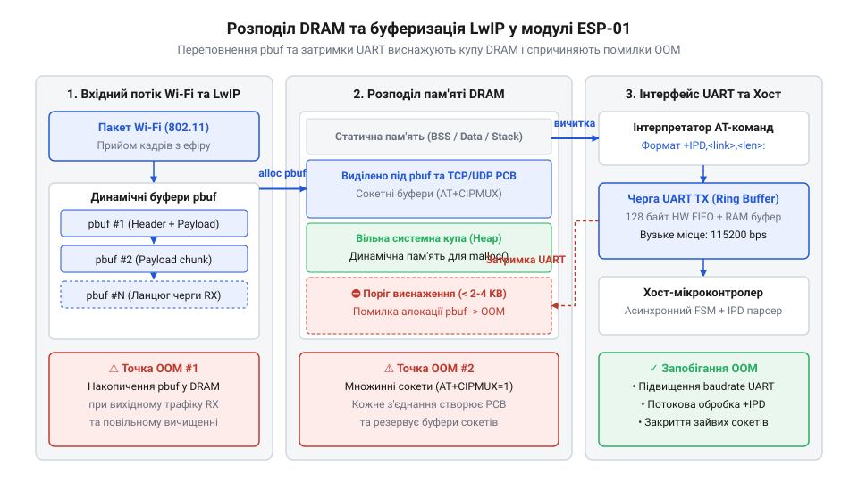
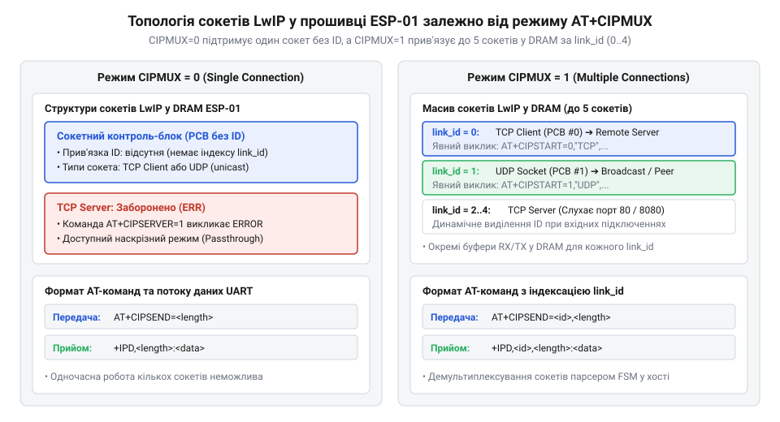
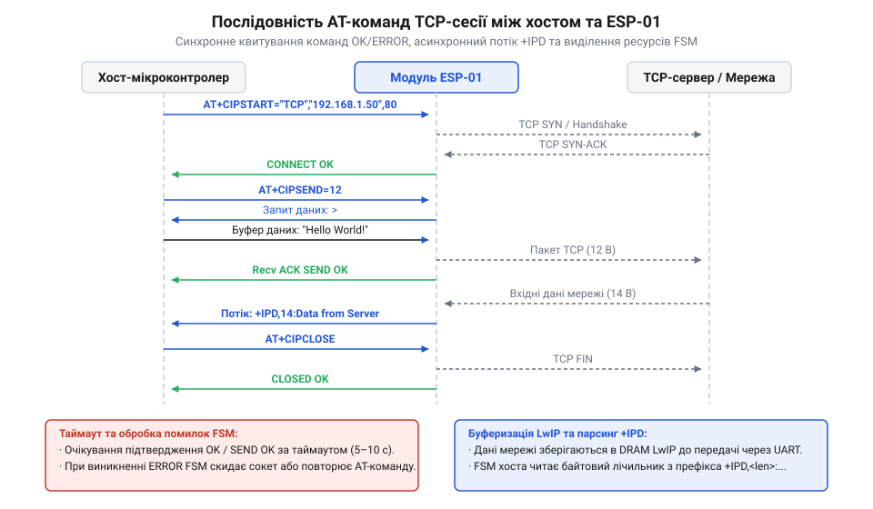
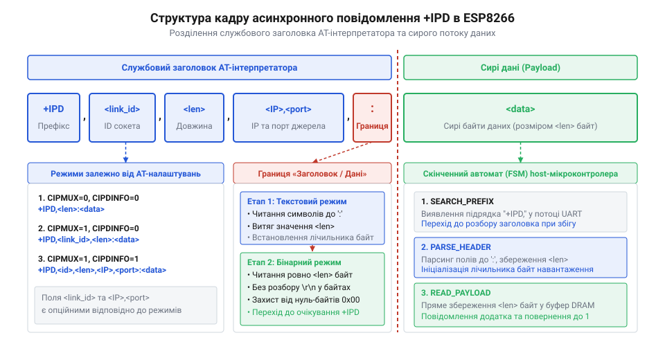
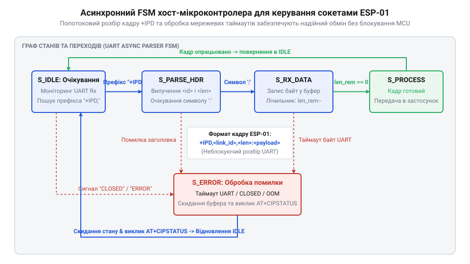

# Мережеві сокети TCP/UDP на модулі ESP-01

<preknowlist>
- [Огляд базового командного інтерфейсу ESP-AT](root:cat-hw-boards/esp-at-command-set-overview) — базовий синтаксис AT-команд, синтаксичні типи відповідей та організацію послідовного зв'язку UART
- [Архітектура та будова прошивки Espressif AT для ESP8266](root:cat-hw-boards/esp8266-at-firmware-architecture) — внутрішній розподіл задач прошивки, взаємодію командного інтерпретатора з мережевим стеком та системною кучею DRAM
- [Архітектура мережевого стека lwIP у ESP8266](root:cat-hw-boards/lwip-architecture-esp8266) — принципи функціонування легковагового стека LwIP, структуру буферів pbuf та механізми обробки мережевих пакетів
</preknowlist>

## Переповнення DRAM при мережевому обміні

Високошвидкісний мережевий обмін у вбудованих системах часто наражається на проблему раптової втрати пакетів, зависання послідовного порту або самовільного перезавантаження комунікаційного модуля. Під час інтенсивної передачі даних через [модуль Wi-Fi ESP-01](root:cat-hw-boards/esp-01) розробники спостерігають виникнення критичних помилок виділення пам'яті. Причина цього полягає не в фізичному пошкодженні лінії зв'язку, а у внутрішньому дефіциті оперативної пам'яті з довільним доступом (від англ. @@en|Dynamic Random-Access Memory@@, @@en|DRAM@@), яка одночасно обслуговує системні задачі, буфери бездротового адаптера та мережевий стек.

Апаратна платформа базується на мікроконтролері @@en|ESP8266@@, де загальний обсяг @@en|DRAM@@ становить 80 кілобайт. Якщо дослідити [архітектуру мікроконтролера ESP8266](root:cat-hw-boards/esp8266-soc-architecture-overview), стає зрозуміло, що значна частина цієї пам'яті жорстко зарезервована під статичні змінні прошивки, стек операційної системи реального часу, контексти задач та таблиці роутингу. У результаті для динамічного розподілу в системній кучі (від англ. @@en|heap@@ — купа) залишається лише від 20 до 30 кілобайт вільних ресурсів. Дізнатися більше про спільну архітектуру процесора Tensilica L106 та розподіл пам'яті у різних модифікаціях плат допоможе [огляд мікроконтролерів та модулів родини ESP8266](root:cat-hw-boards/esp8266-family-overview).

Всередині модуля функціонує відкритий мережевий стек @@en|LwIP@@ (від англ. @@en|Lightweight IP@@ — легковаговий протокол Інтернету). Згідно з тим, як влаштована [структура фірмової прошивки Espressif AT](root:cat-hw-boards/esp8266-at-firmware-architecture), стек @@en|LwIP@@ опрацьовує вхідні та вихідні мережеві кадри за допомогою пакетованих буферів (від англ. @@en|packet buffer@@, @@en|pbuf@@). Буфери @@en|pbuf@@ поділяються на три основні категорії:
1. `PBUF_RAM` — суцільні блоки пам'яті, які динамічно виділяються з системної кучі @@en|DRAM@@ для формування вихідних даних або збирання фрагментованих пакетів;
2. `PBUF_POOL` — фіксовані буфери з попередньо виділеного пулу, призначені для швидкого захоплення кадрів безпосередньо з мережевого адаптера @@en|Wi-Fi@@;
3. `PBUF_REF` та `PBUF_ROM` — вказівники на статичні структури в оперативній пам'яті @@en|RAM@@ або постійній пам'яті @@en|ROM@@, які не вимагають дублювання байтів. Детальніше внутрішню організацію системних буферів та обробку TCP/UDP-пакетів описує [архітектура та буферизація мережевого стека LwIP у вбудованих системах](root:sf-devices/lwip-internals).

Коли [стек LwIP у ESP8266](root:cat-hw-boards/lwip-architecture-esp8266) отримує кадри з бездротової мережі, він виділяє ланцюжки @@en|pbuf@@ у кучі @@en|DRAM@@. Прийняті дані передаються інтерпретаторові @@en|AT@@-команд, який відправляє їх хост-мікроконтролеру через універсальний асинхронний прийомопередавач (від англ. @@en|Universal Asynchronous Receiver-Transmitter@@, @@en|UART@@). На цьому етапі виникає апаратно-програмний дисбаланс продуктивності.

Швидкість надходження даних із бездротового каналу @@en|Wi-Fi@@ може сягати кількох мегабіт на секунду, тоді як стандартна швидкість послідовного порту @@en|UART@@ становить 115200 біт/с (приблизно 11.5 кілобайт/с). Якщо хост-мікроконтролер не встигає зчитувати дані або виникає затримка виконання команд інтерпретатора, ланцюжки @@en|pbuf@@ починають накопичуватися в оперативній пам'яті @@en|DRAM@@. Коли обсяг вільних байтів кучі виснажується до нуля, виникає критичний стан нестачі пам'яті (від англ. @@en|Out Of Memory@@, @@en|OOM@@). У результаті стек @@en|LwIP@@ скидає нові вхідні пакети, руйнує існуючі сокети або спричиняє перезавантаження модуля за таймером @@en|watchdog@@.

Еволюція прошивки @@en|AT@@ та стека @@en|LwIP@@ у модулях @@en|ESP8266@@ проходила складний шлях оптимізації. У ранніх версіях @@en|SDK@@ витоки пам'яті виникали через відсутність суворого квотування буферів `pbuf` та неконтрольоване створення мережевих структур під час інтенсивного обміну. Це призводило до частих збоїв прийомопередавача та блокування послідовного інтерфейсу. Із розвитком фірмового програмного забезпечення @@en|Espressif@@ інтегрувала вдосконалений механізм моніторингу кучі @@en|DRAM@@, встановила жорсткі ліміти на максимальну кількість одночасних з'єднань та ввела потоковий формат сповіщення `+IPD`. Це дозволило мінімізувати накладні витрати на парсинг команд та забезпечити стабільну роботу в режимах мультиплексування й наскрізної передачі даних.

Щоб оцінити критичність цього процесу, розрахуємо швидкість виснаження кучі @@en|DRAM@@ при тривалому прийомі даних. Нехай швидкість послідовного порту @@en|UART@@ становить `B = 115200` біт/с. При передачі кожного байта використовується 1 старт-біт, 8 біт даних та 1 стоп-біт (загалом 10 біт на байт). Пропускна здатність порту в байтах на секунду `S_uart` розраховується так:

```
S_uart = B ÷ 10
= 115200 ÷ 10      [розподіл бітового потоку на 10 біт у кадрі UART]
= 11520 байт/с     [максимальна швидкість передачі даних через UART]
```

Якщо вхідний потік даних із @@en|Wi-Fi@@ \(R_{wifi}\) становить 100 кілобайт/с (102400 байт/с), то швидкість накопичення необроблених даних у кучі \(\Delta M\) дорівнює різниці між швидкістю прийому та швидкістю зчитування:

```
ΔM = R_wifi - S_uart
= 102400 - 11520    [віднімання швидкості зчитування UART від швидкості Wi-Fi]
= 90880 байт/с      [інтенсивність заповнення пам'яті буферами pbuf]
```

При доступному обсязі системної кучі \(M_{heap} = 24576\) байт (24 кілобайти) час \(t_{OOM}\) до повного вичерпання оперативної пам'яті обчислюється наступним чином:

```
t_OOM = M_heap ÷ ΔM
= 24576 ÷ 90880     [ділення розміру вільної кучі на швидкість заповнення]
≈ 0.27 с            [час до виникнення помилки виснаження пам'яті OOM]
```

Отже, без застосування механізмів зворотного тиску (від англ. @@en|backpressure@@) у протоколі @@en|TCP@@ або без обмеження розміру вікна прийому куча @@en|DRAM@@ повністю переповнюється менш ніж за третину секунди. Щоб уникнути цього, розробник має аналізувати [математичний розрахунок пропускної здатності](root:cat-hw-boards/esp01-tcp-udp-sockets/math-esp01-socket-throughput-and-buffer-bounds.md) сокетного буфера та правильно обирати параметри послідовного зв'язку. Також при проектуванні системи слід враховувати [апаратні рівні та цокольовку](root:cat-hw-boards/esp01-tcp-udp-sockets/api-esp01-hardware-interface-pinout.md) інтерфейсних виводів для підтримки апаратного керування потоком @@en|RTS/CTS@@.


*Архітектура розподілу DRAM в ESP-01 ілюструє виснаження кучі при швидкому надходженні пакетів LwIP через дисбаланс між швидкостями Wi-Fi та UART.*

Для постійного контролю стану пам'яті на боці модуля рекомендується періодично опитувати обсяг вільної кучі або реалізувати хостову перевірку буферів. Нижче наведено приклад коду для перевірки стану пам'яті та керування вхідним потоком.

:::tabs
@tab ESP-IDF (C)
:::code esp01-tcp-udp-sockets-d/c/esp-idf/check-dram-health.c
@tab Arduino (C++)
```cpp|arduino
#include <Arduino.h>

// Перевірка доступного обсягу кучі на мікроконтролері
void checkMemoryStatus() {
    uint32_t freeHeap = ESP.getFreeHeap();
    Serial.print(F("Поточна вільна куча DRAM: "));
    Serial.print(freeHeap);
    Serial.println(F(" байт"));
    
    // Якщо пам'яті критично мало, призупиняємо прийом
    if (freeHeap < 8192) {
        Serial.println(F("Критичний рівень пам'яті! Зменшіть інтенсивність сокетів."));
    }
}
```
:::

Як демонструють приклади коду, контроль системних ресурсів є обов'язковою умовою для забезпечення стабільної роботи сокетного обміну.

## Організація режимів з'єднання AT+CIPMUX

Управління мережевими з'єднаннями у фірмовій прошивці здійснюється за допомогою мультиплексування сокетів. Оскільки ресурси оперативної пам'яті обмежені, система вимагає чіткого вибору топології мережевих каналів перед їх ініціалізацією. За це відповідає спеціальна команда мультиплексування `AT+CIPMUX`.

Використовуючи [командний інтерфейс ESP-AT](root:cat-hw-boards/esp-at-command-set-overview), розробник може встановити один із двох режимів функціонування сокетів:
* **Одиночне з'єднання (`AT+CIPMUX=0`)** — модуль підтримує одночасну роботу лише одного сокета (від англ. @@en|socket@@ — гніздо, точковий канал зв'язку). Цей режим мінімізує накладні витрати на збереження керуючих блоків протоколів та виділення пам'яті під буфери прийому.
* **Множинне з'єднання (`AT+CIPMUX=1`)** — модуль дозволяє відкривати до 5 незалежних мережевих каналів із фіксованими ідентифікаторами з'єднання (від англ. @@en|link ID@@) від 0 до 4.

Структура сокетів в операційній системі прошивки вимагає виділення окремого блоку керування мережевим з'єднанням (від англ. @@en|Protocol Control Block@@, @@en|PCB@@, `tcp_pcb`) під кожен активний канал. Кожен відкритий @@en|TCP@@-сокет у режимі `AT+CIPMUX=1` резервує в кучі @@en|DRAM@@ від 2 до 4 кілобайт пам'яті лише для збереження стану з'єднання, ковзного вікна прийому, таймерів повторної передачі та черг скопійованих пакетів. Відповідно, одночасне відкриття 5 сокетів виснажує понад 15 кілобайт кучі, істотно звужуючи буферний простір для потокових даних.

Конфігурація `AT+CIPMUX` безпосередньо визначає можливість створення різних типів мережевих вузлів:
1. **TCP-клієнт** — може розгортатися як у режимі `CIPMUX=0`, так і в `CIPMUX=1`. Клієнт ініціює з'єднання з віддаленим сервером за допомогою команди `AT+CIPSTART`.
2. **TCP-сервер** — створюється командою `AT+CIPSERVER` і **вимагає обов'язкової попередньої активації множинного режиму (`AT+CIPMUX=1`)**. Спроба запустити сервер у режимі одиночного з'єднання викликає відмову прошивки з поверненням помилки `ERROR`. Це зумовлено тим, що сервер повинен динамічно присвоювати унікальний ідентифікатор каналу (від 0 до 4) кожному новому вхідному клієнтському підключенню.
3. **UDP-сокети** — функціонують без встановлення постійного з'єднання, але вимагають створення локального ендпоінта (від англ. @@en|endpoint@@ — кінцева точка). При `CIPMUX=0` створюється єдиний сокет, а при `CIPMUX=1` можна налаштувати до 5 незалежних каналів із прив'язкою до різних віддалених IP-адрес та портів.

Вибір режиму мультиплексування також накладає жорсткі обмеження на спосіб передачі корисного навантаження. У базовому режимі (`AT+CIPMODE=0`) дані передаються з використанням явних команд відправки, а вхідні пакети огортаються в префіксні кадри `+IPD`. Для високошвидкісного обміну розроблено наскрізний режим прозорої передачі (від англ. @@en|passthrough mode@@, `AT+CIPMODE=1`).

У наскрізному режимі послідовний порт модуля перетворюється на прямий прозорий міст із мережевим сокетом: усі байти, що надходять у @@en|UART@@, відразу транслюються в мережу без використання команди `AT+CIPSEND`. Проте режим `AT+CIPMODE=1` підтримується **виключно при одиночному з'єднанні (`AT+CIPMUX=0`)** для клієнтських @@en|TCP@@ або @@en|UDP@@ сокетів. Наскрізна передача принципово неможлива при `CIPMUX=1`, оскільки відсутність префіксів `+IPD` у каналі робить неможливою ідентифікацію відправника серед кількох активних підключень.

Детальний синтаксис та параметри команд описує [довідник з AT-команд](root:cat-hw-boards/esp01-tcp-udp-sockets/api-esp01-at-tcp-udp-commands.md) для мережевих з'єднань. Базові принципи функціонування транспортного рівня розкривають [мережеві протоколи TCP і UDP](root:com-transport/tcp-udp-embedded-protocols) у вбудованих системах. Для забезпечення надійного обміну слід вивчити [двофазний протокол CIPSEND](root:cat-hw-boards/esp8266-at-cipsend-handshake), який визначає порядок квитування при передачі блоків даних. У разі потреби захисту каналу зв'язку застосовують [захищені TLS з'єднання](root:cat-hw-boards/esp8266-at-ssl-tls) у фірмовому стеку.


*Топологічна структура сокетів ESP-01 показує залежність між режимом CIPMUX, розподілом ідентифікаторів каналів та активацією TCP-сервера чи прозорого режиму.*

Нижче наведено реалізацію послідовності ініціалізації множинного режиму `AT+CIPMUX=1` та створення TCP-сервера для хост-мікроконтролера.

:::tabs
@tab ESP-IDF (C)
:::code esp01-tcp-udp-sockets-d/c/esp-idf/send-at-command.c
@tab Arduino (C++)
:::code esp01-tcp-udp-sockets-d/cpp/arduino/setupmulticonnectionserver.cpp
:::

Правильний вибір режимів `AT+CIPMUX` та `AT+CIPMODE` дозволяє оптимізувати використання обсягу кучі модуля та побудувати надійну архітектуру сокетів.

## Стандартний та наскрізний режими передачі

У разі використання базової конфігурації текстового інтерпретатора модуля @@en|ESP-01@@ (англ. @@en|ESP-01@@, від @@en|Espressif Systems@@) передача будь-якої порції даних мережевим сокетом вимагає виконання строкової процедури двофазного квитування. Хост-мікроконтролер спочатку надсилає текстову команду `@@en|AT+CIPSEND@@`, після чого очікує від модуля символу-запрошення `>` і лише після цього відправляє двійковий блок визначеної довжини. Якщо застосунок вимагає неперервної трансляції високочастотних замірів телеметрії або потокового аудіо, постійний обмін текстовими кадрами запитів і підтверджень `OK`, `SEND OK` утворює суттєві накладні витрати (англ. @@en|overhead@@ — накладні витрати). Наслідком цього є різке падіння ефективної пропускної здатності послідовного порту @@en|UART@@ (англ. @@en|UART@@, від @@en|Universal Asynchronous Receiver-Transmitter@@ — універсальний асинхронний приймач-передавач) та зростання затримок передачі пакетів у мережевому стеку @@en|LwIP@@.

У стандартному режимі (`@@en|AT+CIPMODE=0@@`) кожен сеанс відправки супроводжується аналізом синтаксичних конструкцій командним інтерпретатором прошивки. Коли хост-контролер ініціює відправку 20 байтів, послідовна лінія навантажується не лише корисними даними, а й службовими символами команди `AT+CIPSEND=<link_id>,20\r\n`, відповіддю `>\r\n` та ехо-повідомленнями про успішний прийом. Для усунення цієї проблеми в прошивці передбачено наскрізний режим (англ. @@en|passthrough mode@@, від @@en|pass through@@ — проходити наскрізь), що активується командою `@@en|AT+CIPMODE=1@@`. У цьому режимі командний інтерпретатор прошивки тимчасово вимикає парсер команд після стартового квитування. Послідовний порт модуля перетворюється на прозорий міст: кожен байт, який надходить на вхід RX, безпосередньо загортається в мережевий буфер @@en|pbuf@@ і відправляється в сокет @@en|TCP@@ (англ. @@en|TCP@@, від @@en|Transmission Control Protocol@@ — протокол керування передачею) або @@en|UDP@@ (англ. @@en|UDP@@, від @@en|User Datagram Protocol@@ — протокол користувацьких датаграм).

Для об'єктивної оцінки обох режимів розглянемо залежність часу передачі від обсягу корисного навантаження. Позначимо через `T_std` загальний час відправки пакета в двофазному режимі. Нехай `N` — розмір корисного навантаження в байтах, `L_over` — розмір текстового оверхеду AT-команд (команда `AT+CIPSEND=20\r\n`, символ `>` та відповідь `SEND OK`), який становить близько 43 байтів, `B_uart` — пропускна здатність послідовного порту в байтах за секунду (при 115200 біт/с це 11520 байт/с), а `t_proc` — часова затримка парсингу команди інтерпретатором ESP-01 (близько 0.005 с).

Розрахунок часу передачі пакета в стандартному режимі:
```
T_std = (N + L_over) ÷ B_uart + t_proc
= (N + 43) ÷ 11520 + 0.005      [підстановка параметрів оверхеду та швидкості UART]
```

У наскрізному режимі `@@en|passthrough@@` додатковий оверхед `L_over` та затримка `t_proc` відсутні:
```
T_pass = N ÷ B_uart
= N ÷ 11520                     [пряма передача байтового потоку без командних кадрів]
```

Звідси ефективна швидкість передачі корисного навантаження `S` обчислюється як відношення `N` до розрахованого часу:
```
S_std = N ÷ T_std
= N ÷ ((N + 43) ÷ 11520 + 0.005) [підстановка часу двофазного обміну]
```
Для малого пакета розміром `N = 20` байтів ефективна швидкість становить:
```
S_std = 20 ÷ ((20 + 43) ÷ 11520 + 0.005)
= 20 ÷ (0.00547 + 0.005)        [обчислення часу передачі по UART та затримки]
= 20 ÷ 0.01047                   [додавання затримок]
= 1910.2                       [байтів за секунду]
```
У той час як у наскрізному режимі для тих самих 20 байтів пропускна здатність сягає фізичного ліміту лінії:
```
S_pass = 20 ÷ (20 ÷ 11520)
= 11520                         [байтів за секунду]
```
Детальніший [математичний розрахунок пропускної здатності](root:cat-hw-boards/esp01-tcp-udp-sockets/math-esp01-socket-throughput-and-buffer-bounds.md) дозволяє точно визначити оптимальний розмір буфера хоста залежно від обраної швидкості @@en|UART@@.

Перехід у режим `@@en|passthrough@@` має чіткий алгоритмічний порядок. Обов'язковою передумовою є налаштування одиночного з'єднання командою `AT+CIPMUX=0`, оскільки в режимі мультиплексування наскрізний транзит не підтримується. Далі активується режим прозорої передачі `AT+CIPMODE=1` та відкривається сокет через `AT+CIPSTART`. Після цього хост-мікроконтролер надсилає звичайну команду `AT+CIPSEND`. Модуль відповідає символом `>` і переходить у стан прямих потокових даних. З цього моменту будь-які символи з лінії @@en|UART@@ надсилаються безпосередньо в мережу.

Для повернення модуля в командний режим використовується спеціальна escape-послідовність (англ. @@en|escape sequence@@ — послідовність виходу), що складається з трьох символів плюс `+++`. Головна пастка полягає у дотриманні часового інтервалу тиші (англ. @@en|guard time@@ — захисний інтервал). Хост-контролер повинен витримати паузу не менше 1000 мілісекунд до надсилання `+++` і не менше 1000 мілісекунд після. Якщо під час цього захисного інтервалу в лінію передачі потрапить хоча б один байт, прошивка сприйме символи `+++` як звичайне корисне навантаження сокета й транзит не зупиниться.

Попри високу ефективність, режим `@@en|passthrough@@` має архітектурні обмеження. У ньому повністю відсутня ідентифікація каналів, тому неможливо працювати з кількома сокетами одночасно. Крім того, хост-процесор втрачає можливість отримувати асинхронні службові сповіщення @@en|URC@@ (англ. @@en|URC@@, від @@en|Unsolicited Result Code@@ — ініціативно надісланий код результату), такі як `CLOSED` у разі аварійного розриву TCP-сесії сервером. Для побудови надійного [шлюзу неперервної телеметрії](root:cat-hw-boards/esp01-tcp-udp-sockets/proj-esp01-passthrough-telemetry-gateway.md) необхідно передбачити апаратний або програмний контроль таймаутів відсутності підтверджень. Детальний [довідник AT-команд сокетів](root:cat-hw-boards/esp01-tcp-udp-sockets/api-esp01-at-tcp-udp-commands.md) описує повний набір параметрів команд `AT+CIPMODE` та `AT+CIPSEND`. Під час проектування схеми підключення слід враховувати електричні параметри [апаратного інтерфейсу модуля](root:cat-hw-boards/esp01-tcp-udp-sockets/api-esp01-hardware-interface-pinout.md) для відсутності завад у лінії зв'язку.


*Часова діаграма обміну кадрами між мікроконтролером та модулем ESP-01 у стандартному режимі передачі.*

## Структура асинхронних кадрів повідомлення +IPD

Під час роботи модуля @@en|ESP-01@@ у стандартному режимі `@@en|AT+CIPMODE=0@@` усі вхідні мережеві пакети, які отримує стек @@en|LwIP@@, пересилаються в послідовний порт у вигляді асинхронних текстових кадрів із префіксом `@@en|+IPD@@`. Оскільки мережевий обмін відбувається незалежно від виконання команд хост-мікроконтролером, повідомлення `+IPD` можуть надходити в довільний момент часу, розриваючи відповіді на поточні @@en|AT-команди@@. Спроба зчитувати вхідні дані за допомогою наївних функцій очікування текстового рядка призводить до збоїв: двійкове корисне навантаження (англ. @@en|payload@@ — корисний вантаж) всередині кадру може містити керуючі символи переведення рядка `\r` (0x0D) та `\n` (0x0A), які помилково сприймаються парсером як кінець повідомлення.

Структура асинхронного повідомлення `@@en|+IPD@@` залежить від конфігурації мультиплексування та рівня деталізації метаданих. У режимі одиночного з'єднання (`AT+CIPMUX=0`) кадр має синтаксис:
`+IPD,<len>:<payload>`

У режимі множинних з'єднань (`AT+CIPMUX=1`) додається ідентифікатор каналу `link ID`:
`+IPD,<link_id>,<len>:<payload>`

Якщо ввімкнено вивід розширеної інформації про відправника командою `AT+CIPDINFO=1`, синтаксис ускладнюється долученням IP-адреси та порту:
`+IPD,<link_id>,<len>,"<remote_ip>",<remote_port>:<payload>`

Розділовий символ двокрапки `:` є критичною межею кадру: до нього передаються текстові службові метадані, а одразу після нього починається двійковий блок тривалістю точно `<len>` байтів.


*Формат потокового повідомлення +IPD та порядок розміщення метаданих перед двійковим навантаженням.*

Головною складністю під час обробки кадрів `@@en|+IPD@@` є забезпечення двійкової безпеки (англ. @@en|binary safety@@ — безпека двійкових даних) та стійкості до фрагментації потоку. Оскільки швидкість прийому даних з мережі Wi-Fi перевищує пропускну здатність шини @@en|UART@@, прошивка модуля може розбивати великий мережевий пакет на кілька послідовних кадрів `+IPD`. Окрім того, якщо хост-контролер повільно вичищає свій приймальний буфер, виникає фрагментація байтового потоку. Потоковий розбір вимагає гібридного підходу: до двокрапки парсер працює як текстовий аналізатор символів, а після двокрапки перемикається в режим точного відліку байтів, ігноруючи значення самих символів. Розуміння [двофазного квитування передачі](root:cat-hw-boards/esp8266-at-cipsend-handshake) дозволяє узгодити темп відправки та прийому даних між пристроями.

Для запобігання заблокуванню хост-процесора обробка вхідного потоку @@en|UART@@ організовується на основі неблокуючого скінченного автомата (англ. @@en|FSM@@, від @@en|Finite State Machine@@ — скінченний автомат) та кільцевого буфера (англ. @@en|ring buffer@@ — кільцевий буфер). Автомат аналізує байт за байтом у моменти їх надходження по перериванню послідовного порту. Стан автомата послідовно змінюється від пошуку префікса до зчитування довжини й накопичення двійкового блоку.


*Граф переходів скінченного автомата хост-контролера для неблокуючої обробки кадрів IPD.*

Нижче наведено практичну реалізацію неблокуючого парсера кадрів `@@en|+IPD@@` для хост-мікроконтролера. Код показує точне перемикання станів та збереження двійкового навантаження в буфер.

:::tabs
:::code esp01-tcp-udp-sockets-d/c/bare-metal/ipd-parser-init.c

:::code esp01-tcp-udp-sockets-d/cpp/arduino/ipdparser.cpp
:::

Застосування такого автомата у поєднанні з правильно підібраним [обробником кільцевого буфера](root:sf-tasks/uart-ring-buffer-parser) гарантує стабільну обробку мережевого потоку навіть при високій завантаженості шини. Більш розширений [драйвер асинхронного автомата](root:cat-hw-boards/esp01-tcp-udp-sockets/proj-esp01-async-socket-fsm.md) розглядає інтеграцію з реакціями на таймаути та помилки зв'язку. Повний опис структури службових відповідей містить спеціалізований [аналіз повідомлень IPD](root:cat-hw-boards/esp8266-at-ipd-parser). Базові принципи побудови неблокуючих з'єднань базуються на тому, як працюють [мережеві протоколи сокетів](root:com-transport/tcp-udp-embedded-protocols) у вбудованих системах.

## Керування життєвим циклом мережевих сокетів

При проектуванні мережевих застосунків на базі [модуля Wi-Fi ESP-01](root:cat-hw-boards/esp-01) ненадійність каналу зв'язку або порушення алгоритму обміну спричиняє швидке накопичення «завислих» сесій у пам'яті. Відкриття мережевого з'єднання вимагає від прошивки виділення не лише апаратних ресурсів, а й динамічних структур у кучі (від англ. @@en|heap@@ — купа) оперативної пам'яті з довільним доступом (від англ. @@en|Dynamic Random-Access Memory@@, @@en|DRAM@@). Якщо хост-мікроконтролер не контролює повний життєвий цикл сокета (від англ. @@en|socket@@ — гніздо, точковий канал зв'язку) — від ініціалізації до примусового закриття при виникненні помилок — системна пам'ять модуля виснажується, викликаючи аварійне перезавантаження пристрою.

Створення з'єднання починається з виклику команди `@@en|AT+CIPSTART@@`. Залежно від конфігурації мультиплексування (`@@en|AT+CIPMUX@@`), команда приймає ідентифікатор каналу, тип протоколу, мережеву адресу та порт призначення. Для протоколу @@en|TCP@@ (від англ. @@en|Transmission Control Protocol@@ — протокол керування передачею) модуль ініціює триетапне рукостискання, виділяючи структуру керуючого блоку `tcp_pcb`. На відміну від нього, створення сокета @@en|UDP@@ (від англ. @@en|User Datagram Protocol@@ — протокол користувацьких датаграм) за допомогою `AT+CIPSTART` лише реєструє локальний і віддалений кінцеві пункти без підтвердження доставки з боку сервера. Згідно з тим, як влаштовані [мережеві протоколи сокетів](root:com-transport/tcp-udp-embedded-protocols), пам'ять під керуючий блок `udp_pcb` виділяється миттєво, але не вимагає підтримки стану з'єднання.

Кожен активний сокет @@en|TCP@@ утримує в кучі @@en|DRAM@@ керуючий блок `tcp_pcb`, буфер прийому вікна `@@en|TCP@@` та буфер повторної відправки. Щоб оцінити сумарний обсяг пам'яті `M_total`, який споживається групою з `N_sock` відкритих сокетів, помножимо `N_sock` на суму розмірів керуючого блоку `M_pcb` (приблизно 148 байтів), приймального буфера вікна `M_rxbuf` (2048 байтів) та вихідного буфера `M_txbuf` (1460 байтів).

Розрахунок загального споживання оперативної пам'яті сокетами:
```
M_total = N_sock × (M_pcb + M_rxbuf + M_txbuf)
= 4 × (148 + 2048 + 1460)     [підстановка розмірів внутрішніх структур LwIP]
= 4 × 3656                     [додавання обсягів буферів одного TCP-сокета]
= 14624 байт                   [сумарна оперативна пам'ять під 4 активні сокети]
```

Якщо доступна вільна куча @@en|DRAM@@ становить `M_heap = 24576` байтів, відсоток зайнятої пам'яті `P_mem` обчислюється так:
```
P_mem = (M_total ÷ M_heap) × 100
= (14624 ÷ 24576) × 100        [відношення зайнятої пам'яті сокетами до вільної кучі]
≈ 59.5%                        [частка DRAM, заблокована чотирма TCP-сокетами]
```

Отже, утримування лише чотирьох активних сокетів поглинає понад 59% усієї оперативної пам'яті модуля. Якщо з'єднання розривається аварійно без виклику `@@en|AT+CIPCLOSE@@`, структура `tcp_pcb` залишається в стані `TIME_WAIT` або `FIN_WAIT_2` до закінчення внутрішнього системного таймауту, що призводить до виникнення критичного стану виснаження пам'яті (від англ. @@en|Out Of Memory@@, @@en|OOM@@). Окрему увагу слід приділити тому, що налаштування [захищених з'єднань SSL/TLS](root:cat-hw-boards/esp8266-at-ssl-tls) вимагає додаткових обсягів кучі для збереження ключів та контексту криптографічного стека.


*Послідовність виділення та вивільнення ресурсів системної кучі DRAM під час виконання команд ініціалізації, передачі даних і закриття сокета.*

Процедура надсилання даних ініціюється командою `@@en|AT+CIPSEND@@`. Після отримання символу-запрошення `>` хост-мікроконтролер передає двійкове навантаження. Потім модуль відправляє кадри у бездротову мережу й очікує підтвердження на рівні протоколу. Повернення відповіді `SEND OK` означає, що кадри успішно прийняті віддаленим вузлом. У разі втрати пакетів або вичерпання таймауту повторних спроб стек виводить `SEND FAIL` або `ERROR`. У цей момент хост-контролер повинен відреагувати не повторною відправкою `AT+CIPSEND`, а перевіркою стану сокета. Спроба відправити дані в сокет, закритий сервером, повертає ініціативне повідомлення (від англ. @@en|Unsolicited Result Code@@, @@en|URC@@) `CLOSED`.

Для безпечного закриття сесії використовується команда `@@en|AT+CIPCLOSE@@`. Повний [довідник AT-команд сокетів](root:cat-hw-boards/esp01-tcp-udp-sockets/api-esp01-at-tcp-udp-commands.md) містить варіанти виклику цієї команди як для одиночного режимів, так і з зазначенням ідентифікатора каналу `link ID`. Після виконання `AT+CIPCLOSE` стек @@en|LwIP@@ відправляє прапорець `FIN`, закриває з'єднання та вивільняє буфери `@@en|pbuf@@` назад у системний пул пам'яті. Як показує [розрахунок пропускної здатності](root:cat-hw-boards/esp01-tcp-udp-sockets/math-esp01-socket-throughput-and-buffer-bounds.md) мережевих буферів, лише своєчасний виклик закриття сокета гарантує відновлення оперативної пам'яті для наступних запитів.

Нижче наведено практичний приклад реалізації безпечного життєвого циклу сокета на боці хост-мікроконтролера з обробкою помилок та вивільненням ресурсів.

:::tabs
@tab Bare-Metal (C)
:::code esp01-tcp-udp-sockets-d/c/bare-metal/esp01-send-tcp-data.c
@tab Arduino (C++)
:::code esp01-tcp-udp-sockets-d/cpp/arduino/esp01socketmanager.cpp
:::

Як демонструють приклади коду, виклик команди `AT+CIPCLOSE` є обов'язковим завершальним кроком будь-якої транзакції, оскільки він повертає виділені буфери `pbuf` у системну кучу модуля.

## Асинхронний FSM-драйвер сокетів хост-контролера

Використання блокуючих функцій затримки `delay()` або синхронного очікування відповідей послідовного порту на боці хост-мікроконтролера створює серйозні ризики для стабільності всієї системи. Коли модуль @@en|ESP-01@@ отримує вхідні пакети з мережі, вони транслюються в лінію універсального асинхронного приймача-передавача (від англ. @@en|Universal Asynchronous Receiver-Transmitter@@, @@en|UART@@) у вигляді асинхронних кадрів `+IPD`. Якщо хост-процесор заблокований очікуванням текстової відповіді `OK` на іншу команду, приймальний кільцевий буфер (від англ. @@en|ring buffer@@ — кільцевий буфер) @@en|UART@@ швидко переповнюється. У результаті втрачаються важливі текстові повідомлення `URC` (наприклад, `CLOSED` або `WIFI DISCONNECT`), а двійкове корисне навантаження (від англ. @@en|payload@@ — корисний вантаж) `+IPD` виявляється спотвореним.

Розв'язанням цієї проблеми є проектування повністю асинхронного драйвера на основі неблокуючого скінченного автомата (від англ. @@en|Finite State Machine@@, @@en|FSM@@). Драйвер складається з двох основних частин:
1. Потокового демультиплексора (від англ. @@en|demultiplexer@@ — демультиплексор), який побайтово аналізує вхідний потік @@en|UART@@ у перериванні та розділяє його на текстові відповіді на AT-команди, асинхронні сповіщення `URC` та двійковий потік `+IPD`;
2. Автомата керування станами сокетів `FSM`, який послідовно виконує етапи життєвого циклу без блокування основного циклу програми.

Граф переходів неблокуючого `FSM` включає наступні базові стани: `STATE_IDLE` (очікування задач), `STATE_CONNECTING` (відправка `AT+CIPSTART` та очікування `CONNECT`), `STATE_SEND_PROMPT` (відправка `AT+CIPSEND` та очікування `>`), `STATE_TRANSMITTING` (передача двійкового блоку), `STATE_WAIT_SEND_OK` (очікування `SEND OK`), `STATE_CLOSING` (відправка `AT+CIPCLOSE`) та `STATE_RECOVERY` (обробка таймаутів і розривів зв'язку).

Для забезпечення надійності драйвер має вираховувати критичний таймаут очікування `T_timeout` для кожного стану, щоб запобігти вічному завісанню автомата при втраті пакетів у мережі. Таймаут залежить від максимального часу кругового затримки в мережі `RTT_max`, часу передачі даних через послідовний порт `T_uart` та часу внутрішнього опрацювання команди інтерпретатором `T_proc`.

Розрахунок неблокуючого таймауту обробки FSM-драйвера:
```
T_timeout = 2 × RTT_max + T_uart + T_proc
= 2 × 1500 + 50 + 200          [підстановка розрахованих затримок мережі та UART]
= 3000 + 50 + 200              [помноження RTT на коефіцієнт повторних спроб TCP]
= 3250 мілісекунд              [максимальний часовий поріг очікування для FSM]
```

Якщо час перебування в поточному стані перевищує `T_timeout` (3250 мілісекунд), автомат примусово переходить у стан `STATE_RECOVERY`. У цьому стані хост-контролер надсилає команда закриття `AT+CIPCLOSE`, а в разі відсутності реакції модуля — подає короткий низький імпульс на лінію скидання `RST`. Аналіз параметрів підключення детально висвітлено у довіднику, де описано [апаратний інтерфейс модуля](root:cat-hw-boards/esp01-tcp-udp-sockets/api-esp01-hardware-interface-pinout.md).


*Розподіл асинхронного потоку UART між парсером AT-відповідей, обробником URC та неблокуючим FSM керування сокетами.*

Побудова драйвера базується на інтеграції із [потоковим кільцевим буфером](root:sf-tasks/uart-ring-buffer-parser), який накопичує символи без втрати даних під час пікових навантажень. Практична реалізація [драйвера асинхронного автомата](root:cat-hw-boards/esp01-tcp-udp-sockets/proj-esp01-async-socket-fsm.md) дозволяє контролювати множинні сокети в реальному часі. Такий підхід є необхідним під час створення високошвидкісного [шлюзу неперервної телеметрії](root:cat-hw-boards/esp01-tcp-udp-sockets/proj-esp01-passthrough-telemetry-gateway.md).

Нижче наведено приклад побудови неблокуючого `FSM`-драйвера керування сокетами для хост-мікроконтролера.

:::tabs
@tab Bare-Metal (C)
:::code esp01-tcp-udp-sockets-d/c/bare-metal/host-socket-driver-update.c
@tab Arduino (C++)
:::code esp01-tcp-udp-sockets-d/cpp/arduino/asyncsocketdriver.cpp
:::

Розробка асинхронного автомата гарантує, що хост-мікроконтролер зберігає повну чутливість до подій у реальному часі та запобігає втраті вхідного потоку даних при роботі з модулем ESP-01.
