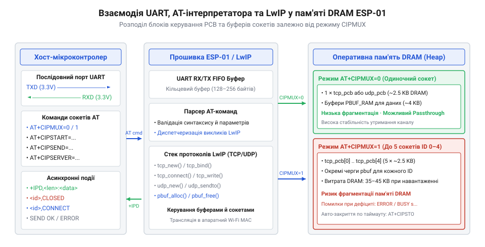
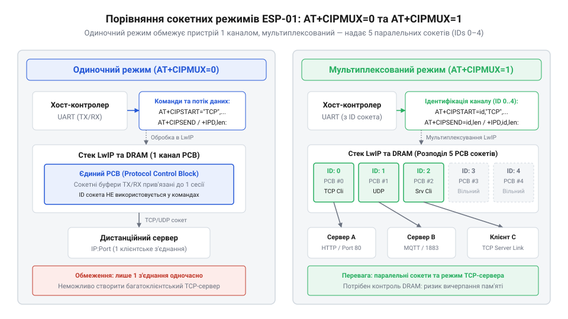
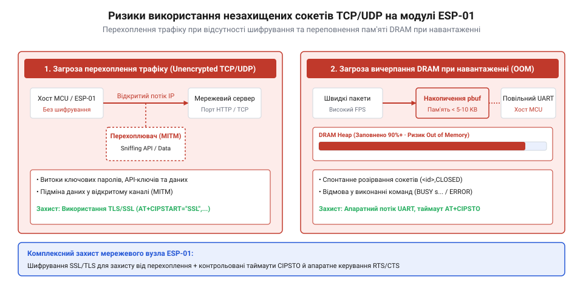
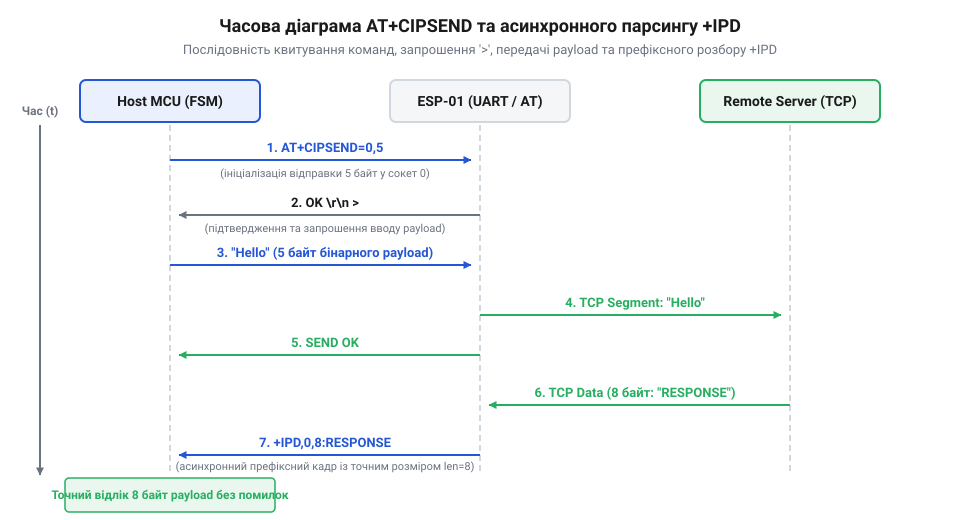
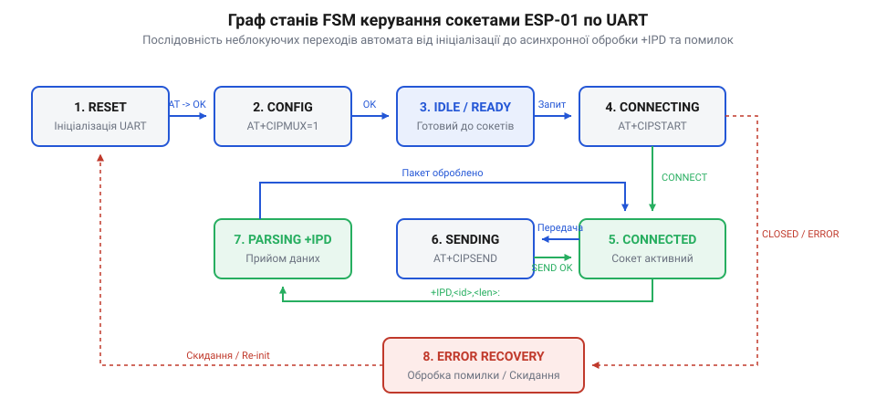

# Мережеві сокети TCP/UDP на модулі ESP-01

<preknowlist>
- [ESP-01 (Wi-Fi, ESP8266)](root:cat-hw-boards/esp-01) — Базова апаратна організація модуля ESP-01 та підключення послідовного порту UART.
- [Огляд сімейства Wi-Fi модулів ESP-01 та ESP-01S](root:cat-hw-boards/esp-01-module-family-overview) — Відмінності між модулями ESP-01 та ESP-01S у цокольовці та схемотехніці підтяжок.
- [Захищені SSL/TLS з'єднання в AT-прошивці ESP8266](root:cat-hw-boards/esp8266-at-ssl-tls) — Принципи організації шифрованого сокетного зв'язку на базі AT-команд.
</preknowlist>

## Архітектура стека LwIP та буферизація DRAM

При спробі побудувати мережевий обмін між компактним мікроконтролером і видаленим сервером головною перешкодою стає обмежений обсяг оперативної пам'яті хост-контролера, в якому неможливо розгорнути повнофункціональний мережевий стек. Компактний [модуль ESP-01](root:cat-hw-boards/esp-01) розв'язує цю проблему, беручи на себе всі низькорівневі мережеві обчислення через внутрішню прошивку `AT`-команд (англ. @@en|AT@@, від @@en|Attention@@ — увага). Проте внутрішня система модуля має жорсткі апаратні межі: кристалічна оперативна пам'ять `DRAM` (англ. @@en|DRAM@@, від @@en|Dynamic Random-Access Memory@@ — динамічна оперативна пам'ять з довільним доступом, від лат. @@la|dynamicus@@ — рухомий) однокристальної системи `ESP8266` становить лише близько `80 кБ`, з яких більша частина виділена під системний Wi-Fi стек та операційну систему реального часу.

*Схема взаємодії UART-інтерпретатора AT-команд із мережевим стеком LwIP та блоками PCB у пам'яті DRAM.*

Для управління протоколами `TCP` (англ. @@en|TCP@@, від @@en|Transmission Control Protocol@@ — протокол керування передачею) та `UDP` (англ. @@en|UDP@@, від @@en|User Datagram Protocol@@ — протокол користувацьких датаграм) прошивка модуля використовує компактний мережевий стек `LwIP` (англ. @@en|LwIP@@, від @@en|Lightweight IP@@ — легковаговий мережевий протокол IP). На кожне відкрите сокетне з'єднання стек динамічно виділяє у кучі `DRAM` спеціальну структуру — блок керування протоколом `PCB` (англ. @@en|PCB@@, від @@en|Protocol Control Block@@ — блок керування протоколом). Архітектурно розмір цієї структури суттєво різниться залежно від протоколу: легковаговий блок `struct udp_pcb` для безсеансового протоколу @@en|UDP@@ займає лише близько `32–48 байт`, оскільки зберігає тільки локальні й віддалені IP-адреси, номери портів та зворотний виклик обробника прийому, тоді як повнофункціональний блок `struct tcp_pcb` для гарантованої доставки @@en|TCP@@ має обсяг близько `128–160 байт`. Цей збільшений блок утримує системні стани з'єднання, номери послідовностей пакетів, покажчики на ретрансляційні таймери, розміри вікна прийому й передачі, а також внутрішні покажчики `unsent` та `unacked`. Саме через ці покажчики реалізовано механізм прив'язки ретрансляції: вони вказують безпосередньо на зв'язані списки кадрових буферів `pbuf` у пам'яті @@en|DRAM@@, утримуючи пакети в черзі повторної передачі до моменту отримання квитанції підтвердження. Як демонструє [еволюція AT-команд та сокетів](root:cat-hw-boards/esp01-tcp-udp-sockets/hist-esp01-at-commands-sockets-evolution.md), оптимізація розмірів `PCB` дозволила реалізувати одночасне обслуговування кількох мережевих каналів у [сімействі модулів ESP-01](root:cat-hw-boards/esp-01-module-family-overview).

Головна апаратна пастка полягає у буферизації даних між послідовним портом `UART` (англ. @@en|UART@@, від @@en|Universal Asynchronous Receiver-Transmitter@@ — універсальний асинхронний приймач-передавач) та сокетними кільцевими буферами `LwIP`. Коли хост-контролер надсилає байтовий потік через лінії `UART`, інтерпретатор накопичує дані в проміжному буфері та динамічно виділяє з кучі `DRAM` ланцюжки пакетних буферів `pbuf` (англ. @@en|pbuf@@, від @@en|packet buffer@@ — пакетний буфер) для формування кадру. У протоколі `TCP` кожен виділений буфер `pbuf` утримується в черзі ретрансляції та не може бути звільнений доти, доки від віддаленого хоста не надійде мережеве підтвердження прийому (англ. @@en|acknowledgement@@; @@en|ACK@@). Якщо швидкість надходження даних по послідовному інтерфейсу перевищує швидкість надходження квитанцій `ACK` через затримки або втрати пакетів у мережі, виділення нових структур `pbuf` зазнає невдачі, а вільна куча `DRAM` повністю вичерпується. Практичний [розрахунок сокетних буферів](root:cat-hw-boards/esp01-tcp-udp-sockets/math-esp01-tcp-udp-buffer-and-throughput-calc.md) показує, що при вичерпанні вільної пам'яті стек `LwIP` примусово скидає найстаріші активні сокетні з'єднання або перезавантажує модуль через спрацювання апаратного сторожового таймера. Визначення електричних обмежень шини даних та ліній керування наведено в [апаратному довіднику живлення](root:cat-hw-boards/esp01-tcp-udp-sockets/api-esp01-hardware-pinout-and-power-spec.md).

Коли вільний обсяг пам'яті @@en|DRAM@@ знижується до критичної позначки в межах `4–8 кБ` через накопичення непідтверджених кадрових буферів `pbuf`, у роботу вступає механізм автоматичного розвантаження кучі стека @@en|LwIP@@. При збільшенні затримок мережевих квитанцій @@en|ACK@@ внутрішній таймер повторної передачі (англ. @@en|retransmission timer@@) аналізує стани відкритих структур @@en|PCB@@ та поступово збільшує інтервали очікування підтверджень. Якщо віддалений хост довго не відповідає, непідтверджені кадри блокують оперативну пам'ять, і при досягненні порогу вичерпання стек активує процедуру відновлення пам'яті (англ. @@en|memory recovery@@): він примусово анулює черги ретрансляції найменш активних з'єднань, надсилає в мережу пакет скидання (англ. @@en|RST packet@@, від @@en|Reset@@ — скидання) та звільняє виділені під них сокетні буфери. Таке аварійне закриття каналів запобігає негайному переповненню оперативної пам'яті, проте якщо швидкість звільнення ресурсів не встигає за надходженням нових байтів з порту @@en|UART@@, блокування системного диспетчера призводить до скидання мікроконтролера @@en|ESP8266@@ апаратним таймером @@en|WDT@@. Глибокі принципи внутрішньої диспетчеризації таймерів та кадрів описує [архітектура мережевого стека LwIP](root:sf-devices/lwip-internals).

## Режими підключення та ініціалізація сокетів

Мікроконтролери з обмеженим обсягом оперативної пам'яті не спроможні виконувати повнофункціональний стек мережевих протоколів безпосередньо на власному кристалі. При використанні модуля [ESP-01](root:cat-hw-boards/esp-01) у ролі мережевого співпроцесора все завдання з обслуговування зв'язку покладається на прошивку @@en|AT@@, яка керує зашитим у ній стеком @@en|LwIP@@. Для створення мережевого каналу обміну — сокета (англ. @@en|socket@@ — роз'єм, гніздо) — хост-контролер повинен визначити режим мультиплексування каналів та параметри віддаленого вузла.

Режим роботи сокетного менеджера задається командою `AT+CIPMUX`. У прошивці передбачено два принципово відмінні режими організації каналів зв'язку:

*   **Одиночний режим (`AT+CIPMUX=0`)** — дозволяє утримувати лише одне активне з'єднання (@@en|TCP@@ або @@en|UDP@@). Оскільки стек @@en|LwIP@@ виділяє оперативну пам'ять @@en|DRAM@@ лише під один блок керування протоколом @@en|PCB@@, цей режим споживає найменше ресурсів модуля. Вхідні дані надходять у простішому форматі `+IPD,<len>:<data>` без ідентифікатора каналу. Одиночний режим є обов'язковим для активації режиму прозорого моста (англ. @@en|passthrough mode@@), коли всі байти з порту @@en|UART@@ безпосередньо транслюються в мережу.
*   **Мультиплексований режим (`AT+CIPMUX=1`)** — реалізує мультиплексування (англ. @@en|multiplexing@@, від лат. @@la|multiplex@@ — багаторазовий) до п'яти паралельних сокетів із числовими ідентифікаторами `link ID` від `0` до `4`. Цей режим необхідний при побудові локальних мережевих серверів (`AT+CIPSERVER`) або одночасному опитуванні кількох хмарних сервісів. Кожен відкритий канал потребує створення окремої структури @@en|PCB@@ у пам'яті @@en|DRAM@@, а вхідні асинхронні повідомлення отримують префікс каналу: `+IPD,<id>,<len>:<data>`.

Зміна режиму `AT+CIPMUX` можлива лише тоді, коли всі поточні мережеві з'єднання повністю закриті. Помилка `LINK IS BUILT` виникає тоді, коли хост-контролер намагається змінити конфігурацію мультиплексування при принаймні одному активному сокеті або незакритій структурі @@en|PCB@@ у пам'яті @@en|DRAM@@. Особливо часто це трапляється при переході з'єднання у стан очікування закриття (англ. @@en|TIME_WAIT state@@), коли стек @@en|LwIP@@ утримує структуру @@en|PCB@@ у пам'яті для збору запізнілих кадрових пакетів. Інтерпретатор прошивки блокує перемикання, оскільки режими `CIPMUX=0` та `CIPMUX=1` використовують принципово різні механізми маршрутизації кадрових буферів та префіксів `+IPD`. Для коректного скидання цього стану хост повинен примусово закрити всі сокети командою `AT+CIPCLOSE=5` (у мультиплексованому режимі) або `AT+CIPCLOSE` (в одиночному). Щоб очистити застряглу структуру @@en|PCB@@ без повного перезапуску модуля, хост надсилає повторну команду примусового закриття сокета за його ідентифікатором або очікує завершення внутрішнього таймауту стека; якщо ж сокет остаточно застряг, реалізують перезапуск модуля командою `AT+RST` з наступним очікуванням символу готовності `ready` перед повторною видачею `AT+CIPMUX`.

*Розподіл буферів LwIP та ідентифікаторів каналів при режимах CIPMUX=0 та CIPMUX=1.*

Вибір режиму роботи тісно пов'язаний з історією розвитку прошивки модуля. Вивчити те, як формувалася архітектура мережевого стека від простих послідовних мостів до повноцінного сокетного менеджера, дозволяє [історія AT-команд ESP-01](root:cat-hw-boards/esp01-tcp-udp-sockets/hist-esp01-at-commands-sockets-evolution.md).

Для відкриття мережевого з'єднання використовується команда `AT+CIPSTART`. Її синтаксис та структура параметрів залежать від вибраного режиму мультиплексування й транспортного протоколу. Під час виконання цієї команди стек @@en|LwIP@@ спочатку ініціює перетворення доменного імені через @@en|DNS@@-резолвер (якщо замість @@en|IP@@-адреси передано хост): у разі недоступності DNS-сервера або відсутності доменного запису процедура завершується невдачею із повідомленням `DNS Fail` або `ERROR` після внутрішнього таймауту очікування. Якщо ж адресу успішно визначено або вказано прямо, для протоколу @@en|TCP@@ запускається потрійне рукостискання (англ. @@en|three-way handshake@@): прошивка відправляє `SYN`-пакет і очікує підтвердження `SYN-ACK`. У разі втрати пакетів стек повторює спроби з експоненційним збільшенням таймауту (англ. @@en|retransmission timeout@@; @@en|RTO@@), і якщо сервер не відповідає протягом системного ліміту (зазвичай `15–75` секунд), модуль припиняє спроби та повертає помилку `CONNECT FAIL` або `CLOSED`. В одиночному режимі команда приймає тип з'єднання, адресу та порт:

`AT+CIPSTART="<type>","<addr>",<port>[,<keep_alive>]`

У мультиплексованому режимі першим аргументом обов'язково передається ідентифікатор каналу `link ID`:

`AT+CIPSTART=<id>,"<type>","<addr>",<port>[,<keep_alive>]`

Основними параметрами ініціалізації є:

1.  `type` — рядок `"TCP"` або `"UDP"`. Для протоколу @@en|TCP@@ модуль виконує процедуру потрійного рукостискання (англ. @@en|three-way handshake@@), перевіряючи доступність хоста. Для @@en|UDP@@ створюється безсесійний сокет.
2.  `addr` — @@en|IP@@-адреса (наприклад, `"192.168.1.100"`) або доменне ім'я. При вказуванні домену внутрішній @@en|DNS@@-резолвер прошивки @@en|LwIP@@ асинхронно запитує @@en|IP@@-адресу у розпізнавача імен мережі.
3.  `port` — номер порту віддаленого сервера (1–65535).
4.  `keep_alive` — опціональний таймер підтримання з'єднання @@en|TCP Keep-Alive@@ у секундах (від 1 до 7200). Якщо сервер не відповідає протягом заданого часу, стек @@en|LwIP@@ автоматично закриває збанкрутілий сокет.

Для з'єднань @@en|UDP@@ команда `AT+CIPSTART` підтримує додаткові параметри розширеного конфігурування локального порту та поведінки сокета: `AT+CIPSTART=<id>,"UDP","<addr>",<port>[,<local_port>,<mode>]`. Параметр `mode=0` фіксує віддалену адресу; `mode=1` дозволяє змінювати адресу призначення при відправці; `mode=2` автоматично оновлює віддалену адресу та порт сокета на основі останнього отриманого пакета @@en|UDP@@.

Ініціалізація сокетів несе в собі два приховані ризики: безпековий та ресурсний. За замовчуванням з'єднання `AT+CIPSTART` створюють незахищені канали зв'язку. Трафік передається у відкритому вигляді без шифрування, що створює загрозу перехоплення даних у бездротовому середовищі. Повноцінне шифрування вимагає переходу на [захищені SSL/TLS сокети](root:cat-hw-boards/esp8266-at-ssl-tls). Другий ризик полягає у ресурсному обмеженні пам'яті @@en|DRAM@@. Кожне з'єднання виділяє оперативну пам'ять під структури @@en|PCB@@ та кільцеві буфери прийому. При інтенсивному трафіку або частих обривах зв'язку виникає загроза вичерпання пам'яті, що призводить до спонтанного скидання мікроконтролера @@en|ESP8266@@ через спрацювання апаратного сторожового таймера (англ. @@en|Watchdog Timer@@; @@en|WDT@@).

*Механізми вразливості незахищеного TCP/UDP трафіку та переповнення сокетних буферів.*

Точний алгоритм розподілу системних буферів, а також формули розрахунку граничної пропускної здатності містить [розрахунок сокетних буферів](root:cat-hw-boards/esp01-tcp-udp-sockets/math-esp01-tcp-udp-buffer-and-throughput-calc.md). Повний синтаксис та відповіді помилок описано у [довіднику AT-команд сокетів](root:cat-hw-boards/esp01-tcp-udp-sockets/api-esp01-at-command-tcp-udp-sockets-ref.md).

:::tabs
@tab C (ESP-IDF / MCU)
:::code esp01-tcp-udp-sockets-d/c/esp-idf/esp01-init-tcp-socket.c

@tab C++ (Arduino)
:::code esp01-tcp-udp-sockets-d/cpp/arduino/inittcpsocket.cpp
:::

Спрощена реалізація ініціалізації сокета зі звичайним синхронним очікуванням підтверджувальних рядків `OK` або `CONNECT` створює суттєві ризики для стабільності мікроконтролера. У реальному бездротовому середовищі процедура розпізнавання доменного імені через @@en|DNS@@ або виконання потрійного рукостискання @@en|TCP@@ може тривати від кількох сотень мілісекунд до десятків секунд. Якщо хост-контролер блокує свій основний цикл у повній очікувальній петлі порту @@en|UART@@, він втрачає здатність обробляти переривання периферії та допускає переповнення вхідних буферів. Захист від подібних заморожувань вимагає відмови від прямих очікувальних циклів на користь [асинхронних парсерів AT-команд](root:sf-devices/uart-at-command-parser-fsm), які розпізнають відповіді прошивки у фоновому режимі та не зупиняють виконання системних завдань.

## Процедура передачі та асинхронний парсинг +IPD

Передача даних через встановлений сокет та прийом вхідних мережевих пакетів у прошивці [ESP-01](root:cat-hw-boards/esp-01) відбуваються через послідовний інтерфейс @@en|UART@@. Оскільки мережеве середовище @@en|Wi-Fi@@ є за своєю природою асинхронним, хост-контролер повинен строго дотримуватися протоколу квитування при відправці та мати потоковий парсер для обробки асинхронних кадрів `+IPD`.

Для відправки даних у мережу прошивка надає дві команди: `AT+CIPSEND` та `AT+CIPSENDBUF`.

Стандартна процедура передачі `AT+CIPSEND` виконується за двокроковою схемою:

1.  **Запит на передачу.** Хост надсилає команду `AT+CIPSEND=<len>` (в одиночному режимі) або `AT+CIPSEND=<id>,<len>` (у мультиплексованому). Аргумент `len` вказує точну кількість байтів корисного навантаження (англ. @@en|payload@@), яку хост планує передати.
2.  **Запрошення та бінарний потік.** Модуль підтверджує готовність прийняти буфер, повертаючи символьну підказку `>`. Отримавши цей символ, хост-контролер зобов'язаний негайно надіслати в порт @@en|UART@@ точно `len` байтів.

Після надсилання байтів модуль вивантажує пакет у мережевий стек @@en|LwIP@@. Для з'єднань @@en|TCP@@ модуль чекає підтвердження прийому (англ. @@en|acknowledgement@@; @@en|ACK@@) від віддаленого хоста, після чого повертає у послідовний порт рядок `SEND OK`. Якщо мережеве підтвердження не надійшло до вичерпання внутрішнього таймауту (англ. @@en|timeout@@ — граничний час очікування), повертається рядок `SEND FAIL`.

Команда `AT+CIPSENDBUF` оптимізує потокову передачу даних за рахунок використання проміжних буферів пам'яті @@en|DRAM@@ всередині прошивки. Вона не чекає проходження пакета до віддаленого сервера чи підтвердження @@en|TCP ACK@@, а присвоює кожному блоку числовий ідентифікатор сегмента `segment_id` і повертає підтвердження `<segment_id>,SEND OK` одразу після розміщення байтів у черзі відправки @@en|LwIP@@. Це дозволяє хост-контролеру надсилати наступні кадри без очікування мережевих затримок (англ. @@en|latency@@) та відстежувати успішність доставки окремих сегментів за їхніми ідентифікаторами. Проте при вичерпанні вільного місця у кільцевому буфері пам'яті @@en|DRAM@@ через накопичення непідтверджених кадрів прошивка тимчасово блокує приймач і видає статус `Busy s...` або повертає помилку `ERROR`. Поява повідомлення `Busy s...` слугує сигналом керування потоком, який зобов'язує хост зупинити видачу нових команд відправки доти, доки стек @@en|LwIP@@ не звільнить кільцевий буфер після отримання чергових мережевих квитанцій.

*Узгодження сигнальних часових інтервалів відправки даних та асинхронного парсингу вхідного потоку.*

Головна складність обробки зв'язку на хост-контролері полягає в асинхронному надходженні вхідного мережевого трафіку. Коли віддалений хост надсилає дані, модуль [ESP-01](root:cat-hw-boards/esp-01) спонтанно виводить у порт @@en|UART@@ кадр повідомлення `+IPD` (англ. @@en|Incoming Packet Data@@ — вхідні дані пакета). Формат префікса залежить від режиму `AT+CIPMUX`:

*   При `CIPMUX=0`: `+IPD,<len>:<data>`
*   При `CIPMUX=1`: `+IPD,<id>,<len>:<data>`

Значення `len` вказує на точну довжину байтового масиву `data`, який іде одразу після двокрапки. Мережеві байти `data` можуть містити довільний бінарний вміст: нульові байти `0x00`, керуючі символи переходу рядка `\r\n` або навіть текстові підрядки `"OK"`, `"ERROR"`, `"+IPD"`. Через це стандартні текстові парсери, які очікують символи закінчення рядка, ламаються або втрачають синхронізацію при зустрічі бінарного пакета `+IPD`.

Особливо критичною є поведінка парсера, коли кадр `+IPD` розривається на межі кількох порцій зчитування з порту @@en|UART@@ (наприклад, при обробці за перериваннями або через кільцевий буфер @@en|DMA@@). Префікс `+IPD,`, числовий заголовок довжини та самі байти корисного навантаження можуть надходити окремими фрагментами з довільними часовими інтервалами. Для запобігання втраті синхронізації неблокуючий скінченний автомат (англ. @@en|Finite State Machine@@; @@en|FSM@@) зберігає поточний стан, ідентифікатор сокета та лічильник зчитаних байтів у глобальному контексті між викликами обробника порту. При передчасному вичерпані байтів у буфері прийому автомат не скидає накопичений стан, а зупиняється у режимі очікування корисного навантаження, продовжуючи прямоточне копіювання байтів одразу після надходження наступної порції з шини @@en|UART@@. Якщо ж через перешкоди на лінії зв'язку чи переповнення буфера @@en|DMA@@ втрачаються керуючі байти або спотворюється числовий заголовок довжини, автомат ризикує зависнути в режимі очікування неіснуючого масиву даних. Для відновлення синхронізації парсер застосовує два механізми захисту: часовий таймаут очікування байтів (англ. @@en|inter-byte timeout@@), який скидає стан до `SEARCH_PREFIX` у разі паузи прийому понад `100–200` мілісекунд, та паралельний сканер ковзного вікна, який шукає послідовність `+IPD,` або службові маркери `CLOSED` безпосередньо в середовищі зчитаного корисного навантаження, перериваючи помилковий прийом. Докладно алгоритми фрагментаційного розбору кадрів висвітлює [проєктування асинхронних парсерів](root:sf-devices/uart-at-command-parser-fsm).

Для надійної обробки вхідного потоку хост-контролер повинен реалізувати неблокуючий асинхронний скінченний автомат (англ. @@en|Finite State Machine@@; @@en|FSM@@, від грец. @@el|automatos@@ — саморухомий).

*Стани неблокуючого скінченного автомата для потокового розбору послідовного інтерфейсу UART.*

Алгоритм обробки байтів у скінченному автоматі працює за такими станами:

1.  `SEARCH_PREFIX` — побайтове зчитування з буфера @@en|UART@@ та пошук послідовності `+IPD,`. Звичайні текстові відповіді (`OK`, `ERROR`) обробляються текстовим парсером.
2.  `PARSE_HEADER` — зчитування десяткових символів `id` (якщо `CIPMUX=1`) та довжини `len` до знаходження розділової двокрапки `:`.
3.  `READ_PAYLOAD` — переключення парсера у режим прямого копіювання байтів. Хост зчитує рівно `len` байтів у буфер застосунку, ігноруючи будь-які текстові маркери.
4.  `PARSE_COMPLETE` — повернення автомата у вихідний стан `SEARCH_PREFIX`.

Детальний приклад реалізації такого парсера для мікроконтролера розкриває [розробка асинхронного FSM-драйвера](root:cat-hw-boards/esp01-tcp-udp-sockets/proj-esp01-uart-fsm-tcp-client-server.md). Загальні архітектурні принципи побудови таких парсерів описано в матеріалі про [проєктування асинхронних парсерів](root:sf-devices/uart-at-command-parser-fsm). При цьому підключення фізичних ліній зв'язку регламентує [апаратний довідник цокольовки](root:cat-hw-boards/esp01-tcp-udp-sockets/api-esp01-hardware-pinout-and-power-spec.md).

:::tabs
@tab C (ESP-IDF / MCU)
:::code esp01-tcp-udp-sockets-d/c/esp-idf/ipd-parser-feed-byte.c

@tab C++ (Arduino)
:::code esp01-tcp-udp-sockets-d/cpp/arduino/ipdparser.cpp
:::

## Побудова FSM для хост-контролера

Використання затримок (англ. @@en|delay@@) або блокуючих функцій очікування символів у послідовному порту на хост-контролері призводить до зависання всієї системи при будь-якому мережевому збої. Мережеве середовище @@en|Wi-Fi@@ характеризується непередбачуваними затримками за маршрутом, втратами пакетів та спонтанними розривами сокетів. Щоб забезпечити безперебійну роботу пристрою @@en|IoT@@, керування модулем [ESP-01](root:cat-hw-boards/esp-01) має будуватися на базі неблокуючого скінченного автомата (англ. @@en|Finite State Machine@@; @@en|FSM@@).

Логіка роботи хост-контролера розбивається на окремі стани виконання:

1.  **Ініціалізація (`FSM_STATE_INIT`)** — перевірка зв'язку по порту @@en|UART@@ за допомогою команди `AT`, вимкнення луна-команд (`ATE0`) та конфігурація режиму мультиплексування `AT+CIPMUX=1`.
2.  **Встановлення з'єднання (`FSM_STATE_CONNECTING`)** — надсилання команди `AT+CIPSTART` та перехід у стан очікування підтвердження. Хост запускає внутрішній системний таймер: якщо протягом заданого таймауту (наприклад, 10 секунд) не надійшов рядок `CONNECT` або `OK`, спроба вважається невдалою.
3.  **Очікування та моніторинг (`FSM_STATE_IDLE`)** — сокет відкрито, хост обробляє асинхронні вхідні байти `+IPD` через потоковий парсер або готує чергову порцію даних для відправки.
4.  **Відправка даних (`FSM_STATE_SENDING`)** — двокроковий процес видачі `AT+CIPSEND`, очікування символу-підказки `>` та передачі корисного навантаження @@en|payload@@ з наступним очікуванням `SEND OK` або `SEND FAIL`.
5.  **Відновлення зв'язку (`FSM_STATE_RECONNECT`)** — обробка обриву сокета при отриманні `CLOSED` або вичерпанні таймауту.

Під час перебування у будь-якому стані FSM повинен аналізувати системні відповіді модуля [ESP-01](root:cat-hw-boards/esp-01). Відповідь `OK` підтверджує успіх команди, `ERROR` сигналізує про помилку синтаксису або закритий сокет, а статус `BUSY` вимагає диференційованої відстрочки повторних команд залежно від підтипу: повідомлення `busy p...` свідчить про те, що внутрішній парсер команд зайнятий обробкою попередньої операції (наприклад, розпізнаванням домену), тому автомат переходить у короткий стан очікування на `50–100` мілісекунд для повторного надсилання команди; натомість статус `busy s...` вказує на переповнення сокетних буферів відправки стека @@en|LwIP@@ у пам'яті @@en|DRAM@@, що вимагає тривалішої паузи на `200–500` мілісекунд для давання прошивці можливості отримати мережеві квитанції та звільнити чергу відправки. Отримавши будь-який варіант `BUSY`, хост категорично не повинен штурмувати послідовний порт новими командами, а зобов'язаний перейти в стан відкладеного повтору (англ. @@en|yield delay@@) з відповідним таймером паузи.

При надходженні асинхронного повідомлення `CLOSED` або `<id>,CLOSED` сокет вважається втраченим. Щоб не перевантажувати мережу та послідовний порт безперервними спробами підключення, реалізують алгоритм наростаючого відкладання спроб (англ. @@en|exponential backoff@@ — експоненційне збільшення інтервалу повтору). Перша повторна спроба `AT+CIPSTART` виконується через 1 секунду, наступні — через 2, 4, 8, 16 секунд, аж до максимального ліміту (наприклад, 60 секунд). Подібна неблокуюча перевірка застосовується і в початковому стані `FSM_STATE_INIT`: надсилаючи командний рядок `AT` або `AT+CIPMUX=1`, хост запускає таймер очікування відповіді (англ. @@en|response timer@@; наприклад, 2000 мс). При частих обривах @@en|Wi-Fi@@ зв'язку спрацювання таймера очікування відповіді примусово збільшує лічильник невдалих спроб і перераховує інтервал відкладання, що запобігає частим повторним запитам під час нестабільного з'єднання. Якщо прошивка модуля не відповідає підтвердженням `OK` до вичерпання таймауту через апаратне замикання або неузгодженість швидкості @@en|UART@@, скінченний автомат нарощує лічильник помилок та видає короткий низький імпульс на лінію `RST` для апаратного перезапуску [модуля ESP-01](root:cat-hw-boards/esp-01) перед повторною ініціалізацією.

Практичну реалізацію неблокуючого керування сокетами демонструє [розробка асинхронного FSM-драйвера](root:cat-hw-boards/esp01-tcp-udp-sockets/proj-esp01-uart-fsm-tcp-client-server.md). Загальні шаблони проєктування та суміжні алгоритми розбору відповідей розглянуто в матеріалі про [проєктування асинхронних парсерів](root:sf-devices/uart-at-command-parser-fsm). Повний перелік системних відповідей доступний у [довіднику AT-команд сокетів](root:cat-hw-boards/esp01-tcp-udp-sockets/api-esp01-at-command-tcp-udp-sockets-ref.md).

:::tabs
@tab C (ESP-IDF / MCU)
:::code esp01-tcp-udp-sockets-d/c/esp-idf/host-fsm-step.c

@tab C++ (Arduino)
:::code esp01-tcp-udp-sockets-d/cpp/arduino/hostsocketfsm.cpp
:::

Спроба відновлення працездатності модуля через апаратне скидання виводом `RST` створює додаткові вимоги до стану керуючих сигналів хост-контролера. Якщо під час зняття низького рівня з лінії `RST` стан підтяжок зовнішніх виводів зміниться, мікроконтролер @@en|ESP8266@@ може замість звичайного виходу в робочий режим перейти у стан програмування прошивки по порту @@en|UART@@, що висвітлюють [режими завантаження мікроконтролера ESP8266](root:cat-hw-boards/esp8266-boot-modes). Щоб уникнути подібного блокування, скінченний автомат утримує високий логічний рівень на лінії вибору режиму, витримує паузу після відпускання скидання для стабілізації внутрішнього текстового баннера прошивки та очікує завантажувального повідомлення `ready` перед переходом до повторної видачі @@en|AT@@-команд.

## Безпека трафіку та граничні режими навантаження

Стандартна робота сокетів @@en|TCP@@ та @@en|UDP@@ через прошивку [ESP-01](root:cat-hw-boards/esp-01) з базовими AT-командами не забезпечує шифрування транспортного рівня. Всі дані надсилаються мережевими каналами у відкритому вигляді. При використанні незахищених сокетів виникає загроза несанкціонованого прослуховування (англ. @@en|eavesdropping@@) та атак типу «людина посередині» (англ. @@en|Man-in-the-Middle@@; @@en|MitM@@), під час яких зловмисник може перехопити або підмінити телеметрію та команди керування.

Якщо перехід на повноцінні [захищені SSL/TLS сокети](root:cat-hw-boards/esp8266-at-ssl-tls) неможливий через обмеження пам'яті чи обчислювальної потужності, розробник мусить реалізувати захисні механізми на рівні прикладного протоколу хост-контролера: Детальні принципи конфігурації шифрованих каналів та роботи з сертифікатами описують [захищені сокети SSL/TLS](root:sf-security/esp01-tls-ssl-secure-sockets).

*   **Контроль цілісності.** До кожного пакета додається контрольна сума (англ. @@en|checksum@@) або хеш-код @@en|HMAC-SHA256@@. Це дозволяє виявити спотворення чи підміну байтів при транзиті через незахищену мережу.
*   **Захист від повторів.** Включення монотонно зростаючого лічильника пакетів або часової мітки у кадр унеможливлює повторну підкидку раніше перехоплених команд.
*   **Симметричне шифрування.** Зашифровування корисного навантаження @@en|payload@@ алгоритмом @@en|AES-128-CBC@@ безпосередньо на хост-контролері перед відправкою у порт @@en|UART@@.

Друга критична проблема незахищеної сокетної системи — поведінка модуля [ESP-01](root:cat-hw-boards/esp-01) при граничних режимах навантаження. Прошивка @@en|AT@@ має обмежений обсяг оперативної пам'яті @@en|DRAM@@ (близько 24–36 КБ вільної пам'яті для стека @@en|LwIP@@). Якщо хост-контролер генерує вихідні пакети `AT+CIPSEND` занадто часто або якщо з мережі надходить неконтрольований шквал вхідних кадрів `+IPD`, внутрішні кільцеві буфери пам'яті та структури блоків керування протоколом @@en|PCB@@ швидко заповнюються.

Переповнення оперативної пам'яті спричиняє такі негативні наслідки:

1.  **Втрата пакетів та відмови `ERROR`.** Стек @@en|LwIP@@ не може виділити нові кадрові буфери `pbuf`, у результаті чого модуль відповідає помилкою `ERROR` або скидає поточні TCP-з'єднання.
2.  **Спонтанне перезавантаження модуля.** При вичерпанні оперативної пам'яті системний диспетчер прошивки @@en|ESP8266@@ блокується, викликаючи спрацювання апаратного сторожового таймера @@en|WDT@@. Модуль перезавантажується та виводить у послідовний порт баннер завантаження `ready`, перериваючи всі активні сокети.
3.  **Переповнення UART буфера.** Якщо швидкість читання хост-контролера нижча за швидкість надходження даних по @@en|Wi-Fi@@, виникає втрата байтів через переповнення вхідного буфера @@en|FIFO@@ (128 байтів). Апаратне керування потоком (англ. @@en|hardware flow control@@; @@en|RTS/CTS@@, від @@en|Request to Send / Clear to Send@@) запобігає цій втраті: при заповненні буфера лінія `RTS` переходить у високий стан, вимагаючи від хоста призупинити передачу. Оскільки стандартний [модуль ESP-01](root:cat-hw-boards/esp-01) не виводить лінії `RTS/CTS` на 8-піновий роз'єм, для запобігання втратам кадрових відповідей розробник повинен покладатися на програмне обмеження частоти запитів.

1.  **Втрата пакетів та відмови `ERROR`.** Стек @@en|LwIP@@ не може виділити нові кадрові буфери `pbuf`, у результаті чого модуль відповідає помилкою `ERROR` або скидає поточні TCP-з'єднання.
2.  **Спонтанне перезавантаження модуля.** При вичерпанні оперативної пам'яті системний диспетчер прошивки @@en|ESP8266@@ блокується, викликаючи спрацювання апаратного сторожового таймера @@en|WDT@@. Модуль перезавантажується та виводить у послідовний порт баннер завантаження `ready`, перериваючи всі активні сокети.
3.  **Переповнення UART буфера.** Якщо швидкість читання хост-контролера нижча за швидкість надходження даних по @@en|Wi-Fi@@, входять в дію втрати байтів через переповнення внутрішнього буфера @@en|FIFO@@ послідовного порту.

Для запобігання аварійним ситуаціям на хост-контролері необхідно реалізувати обмеження частоти запитів (англ. @@en|rate limiting@@). Частота передачі пакетів не повинна перевищувати граничну пропускну здатність сокетних буферів, яку розраховує [розрахунок сокетних буферів](root:cat-hw-boards/esp01-tcp-udp-sockets/math-esp01-tcp-udp-buffer-and-throughput-calc.md). При виявленні відповідей `BUSY` (зокрема статусів `busy p...` або `busy s...`) чи помилок виділення пам'яті `ERROR` хост-контролер застосовує алгоритм динамічного підлаштування: він збільшує мінімальний інтервал між відправками `minIntervalMs` (наприклад, подвоює затримку або додає крок у 100 мс). У міру успішного проходження наступних пакетів без системних зауважень значення `minIntervalMs` поступово зменшується до вихідного базового рівня. Такий адаптивний відкат захищає буфери @@en|DRAM@@ від переповнення при сплесках мережевих затримок і відновлює максимальну швидкість обміну за сприятливих умов зв'язку.

:::tabs
@tab C (ESP-IDF / MCU)
:::code esp01-tcp-udp-sockets-d/c/esp-idf/check-rate-limit.c

@tab C++ (Arduino)
:::code esp01-tcp-udp-sockets-d/cpp/arduino/trafficguard.cpp
:::
