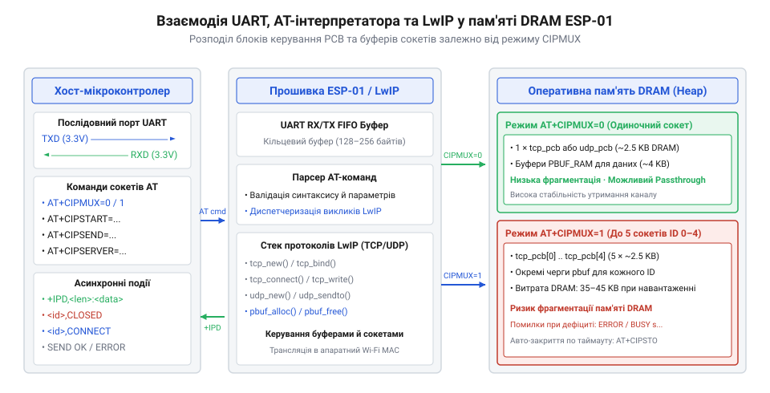
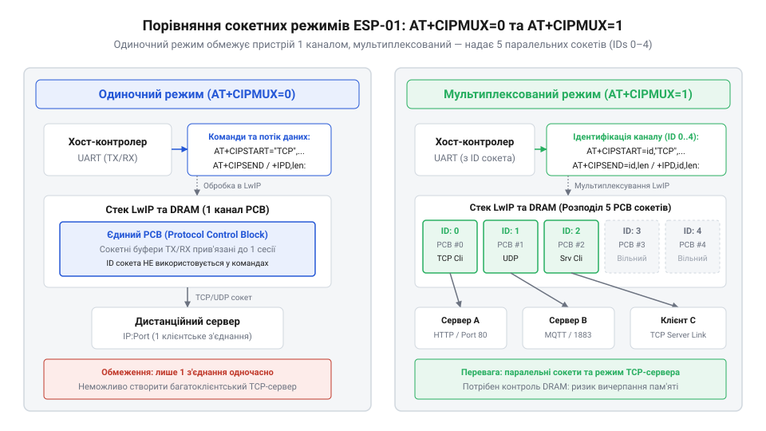
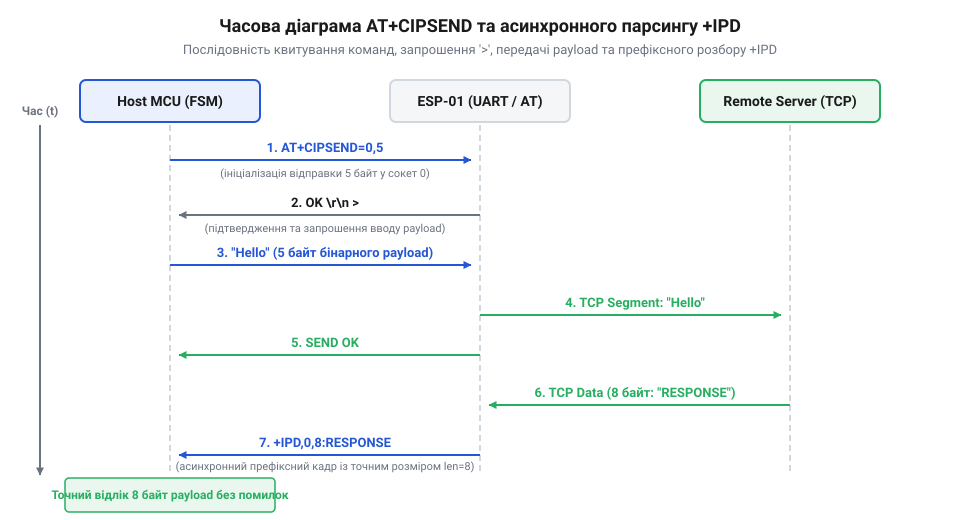
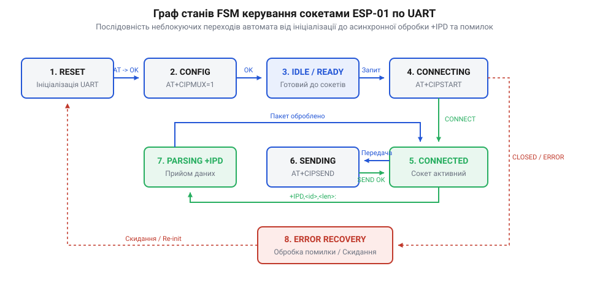

# Мережеві сокети TCP/UDP на модулі ESP-01

<preknowlist>
- [ESP-01 (Wi-Fi, ESP8266)](root:cat-hw-boards/esp-01) — Базова апаратна організація модуля ESP-01 та підключення послідовного порту UART
- [Огляд сімейства Wi-Fi модулів ESP-01 та ESP-01S](root:cat-hw-boards/esp-01-module-family-overview) — Відмінності між модулями ESP-01 та ESP-01S у цокольовці та схемотехніці підтяжок
- [Захищені SSL/TLS з'єднання в AT-прошивці ESP8266](root:cat-hw-boards/esp8266-at-ssl-tls) — Принципи організації шифрованого сокетного зв'язку на базі AT-команд
</preknowlist>

## Архітектура LwIP та буферизація пам'яті

При спробі побудувати мережевий обмін між компактним мікроконтролером і віддаленим сервером головною перешкодою є дефіцит оперативної пам'яті хост-контролера, де неможливо розгорнути повнофункціональний мережевий стек. Компактний [модуль ESP-01](root:cat-hw-boards/esp-01) розв'язує цю проблему, беручи на себе низькорівневі мережеві обчислення через внутрішню прошивку @@en|AT@@-команд (англ. @@en|AT@@, від @@en|Attention@@ — увага). Внутрішня система модуля використовує компактний мережевий стек @@en|LwIP@@ (англ. @@en|LwIP@@, від @@en|Lightweight IP@@ — легковаговий мережевий протокол IP), який на кожне з'єднання виділяє у кучі оперативної пам'яті @@en|DRAM@@ (англ. @@en|DRAM@@, від @@en|Dynamic Random-Access Memory@@ — динамічна оперативна пам'ять) спеціальний блок керування протоколом @@en|PCB@@ (англ. @@en|PCB@@, від @@en|Protocol Control Block@@ — блок керування протоколом).

*Схема взаємодії UART-інтерпретатора AT-команд із мережевим стеком LwIP та блоками PCB у пам'яті DRAM.*

Легковаговий блок для безсеансового протоколу @@en|UDP@@ (англ. @@en|UDP@@, від @@en|User Datagram Protocol@@ — протокол користувацьких датаграм) зберігає лише адреси та порти, тоді як блок для гарантованої доставки @@en|TCP@@ (англ. @@en|TCP@@, від @@en|Transmission Control Protocol@@ — протокол керування передачею) додатково утримує черги кадрових буферів @@en|pbuf@@ (англ. @@en|pbuf@@, від @@en|packet buffer@@ — пакетний буфер) до отримання підтвердження @@en|ACK@@. Організацію оперативної пам'яті описує [архітектура SoC ESP8266](root:cat-hw-boards/esp8266-soc-architecture-overview). Якщо швидкість надходження даних по послідовному інтерфейсу @@en|UART@@ (англ. @@en|UART@@, від @@en|Universal Asynchronous Receiver-Transmitter@@ — універсальний асинхронний приймач-передавач) перевищує швидкість мережевих підтверджень, куча вичерпується, що призводить до перезавантаження модуля апаратним таймером @@en|WDT@@ (англ. @@en|WDT@@, від @@en|Watchdog Timer@@ — сторожовий таймер).

## Конфігурація режимів та ініціалізація сокетів

Для створення мережевого каналу обміну — сокета (англ. @@en|socket@@ — роз'єм, гніздо) — хост-контролер задає режим мультиплексування командою `AT+CIPMUX`. В одиночному режимі (`AT+CIPMUX=0`) стек утримує лише один активний сокет, споживаючи найменше ресурсів, тоді як у мультиплексованому режимі (`AT+CIPMUX=1`) прошивка підтримує до п'яти паралельних з'єднань із числовими ідентифікаторами від `0` до `4`. Зміна режиму можлива лише після повного закриття активних сокетів командою `AT+CIPCLOSE`.

*Розподіл буферів LwIP та ідентифікаторів каналів при режимах CIPMUX=0 та CIPMUX=1.*

Відкриття з'єднання виконується командою `AT+CIPSTART`. При її виконанні стек спочатку ініціює доменне розпізнавання через @@en|DNS@@ (англ. @@en|DNS@@, від @@en|Domain Name System@@ — система доменних імен), після чого для протоколу @@en|TCP@@ запускає потрійне рукостискання. Особливості підключення модулів розкрито у [огляді сімейства модулів ESP-01](root:cat-hw-boards/esp-01-module-family-overview). За замовчуванням створюються незахищені канали; перехід на шифровані сесії вимагає використання [SSL/TLS з'єднань](root:cat-hw-boards/esp8266-at-ssl-tls).

## Передача даних та асинхронний прийом

Надсилання даних у мережу командою `AT+CIPSEND` виконується за двокроковою схемою: хост вказує довжину корисного навантаження, отримує від прошивки символьну підказку `>` і передає потрібну кількість байтів. Після вивантаження пакета стек очікує мережеве підтвердження та повертає рядок `SEND OK`.

*Узгодження сигнальних часових інтервалів відправки даних та асинхронного парсингу вхідного потоку.*

Коли віддалений хост надсилає відповідь, [модуль ESP-01](root:cat-hw-boards/esp-01) спонтанно виводить у порт @@en|UART@@ асинхронне повідомлення `+IPD` (англ. @@en|Incoming Packet Data@@ — вхідні дані пакета). Бінарний вміст пакета може містити нульові байти або текстові маркери `OK`, через що стандартні текстові парсери втрачають синхронізацію. Для надійної обробки вхідного потоку хост-контролер повинен використовувати потоковий скінченний автомат @@en|FSM@@ (англ. @@en|FSM@@, від @@en|Finite State Machine@@ — скінченний автомат).

## Побудова FSM та захист буферів

Керування модулем на хост-контролері будується на базі неблокуючого скінченного автомата @@en|FSM@@, який послідовно проходить стани ініціалізації, встановлення з'єднання, моніторингу та передачі.

*Стани неблокуючого скінченного автомата для потокового розбору послідовного інтерфейсу UART.*

При отриманні статусів `BUSY` автомат виконує паузу, запобігаючи переповненню проміжних буферів. При розриві зв'язку або появі повідомлення `CLOSED` застосовують алгоритм експоненційного відкладання спроб (англ. @@en|exponential backoff@@), а при зависанні порту видають короткий низький імпульс на лінію `RST` з урахуванням [режимів завантаження](root:cat-hw-boards/esp8266-boot-modes). Для захисту оперативної пам'яті хост обмежує частоту відправки команд, адаптивно збільшуючи затримку при виявленні помилок мережі.
