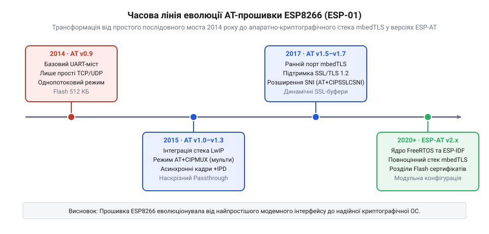
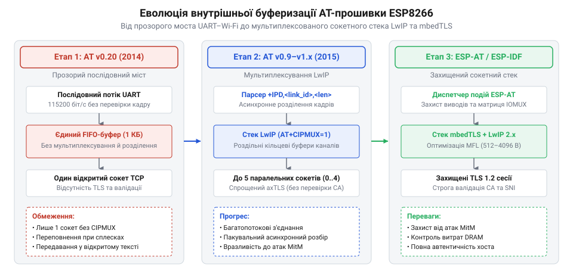

# Еволюція стека AT-команд та сокетного зв'язку ESP-01

<preknowlist>
- [ESP-01 (Wi-Fi, ESP8266)](root:cat-hw-boards/esp-01) — Базову апаратну структуру модуля ESP-01, розпіновку та обмеження оперативної пам'яті.
- [Огляд мікроконтролера та архітектури SoC ESP8266](root:cat-hw-boards/esp8266-soc-architecture-overview) — Архітектуру процесорного ядра Tensilica L106 та структуру оперативної пам'яті DRAM.
- [Захищені SSL/TLS з'єднання в AT-прошивці ESP8266](root:cat-hw-boards/esp8266-at-ssl-tls) — Принципи роботи стека mbedTLS та оптимізації криптографічних кадрів у прошивці AT.
</preknowlist>

## Поява ESP-01 у 2014 році

У серпні 2014 року шанхайська компанія @@en|Espressif Systems@@ представила мікроконтролер @@en|ESP8266@@ та ультракомпактний модуль @@en|ESP-01@@, що спровокувало справжню революцію в сфері аматорського інтернету речей. До цього моменту підключення мікроконтролерних плат @@en|Arduino@@ до бездротової мережі вимагало купівлі громіздких та дорогих платоформ розширення (англ. @@en|shield@@, від англ. @@en|shield@@ — щит), вартість яких сягала від 40 до 80 доларів США. Поява вивідного модуля @@en|ESP-01@@ ціною менше 5 доларів створила доступний міст між послідовним портом та бездротовою мережею.

Перша заводська прошивка Espressif AT v0.9 поставлялася як готове рішення для реалізації бездротового послідовного транзиту (англ. @@en|UART-to-Wi-Fi bridge@@). Хост-мікроконтролер надсилав текстові команди по інтерфейсу @@en|UART@@, доручаючи чипу сканування ефіру, підключення до точок доступу та відкриття базових послідовних з'єднань. Базову будову кристала та організацію пам'яті описано в [огляді мікроконтролера ESP8266](root:cat-hw-boards/esp8266-soc-architecture-overview).

Апаратна компоновка самого модуля `@@en|ESP-01@@` містила дворядний 8-контактний роз'єм (`2 × 4`), який виводив лінії живлення `VCC` і `GND`, послідовний порт `TX` та `RX`, два виводи загального призначення `GPIO0` і `GPIO2`, а також лінії скидання `RST` та увімкнення `CH_PD` (англ. @@en|Chip Power Down@@). Перші розробники масово стикалися зі складнощами під час запуску пристрою: на відміну від класичних послідовних модемів, модуль залишався повністю неактивним без обов'язкової зовнішньої підтяжки лінії `CH_PD` до високого рівня напруги 3.3 В. Оскільки вивід `GPIO0` додатково відповідав за вибір режиму старту завантажувача, будь-яка плаваюча напруга на виводах під час подачі живлення призводила до збоїв ініціалізації чипа, що детально розкрито в описі [конфігураційних виводів завантаження ESP8266](root:cat-hw-boards/esp8266-boot-strapping-pins).

Ще однією критичною перешкодою в перші роки стало живлення модуля: компактна друкована плата не мала власного стабілізатора напруги (англ. @@en|Low Dropout Regulator@@, @@en|LDO@@, від *low* — низький, *dropout* — перепад, та *regulator* — регулятор) і вимагала суворо `3.3 В`. Спроби живити пристрій від 3.3-вольтового виводу плат @@en|Arduino Uno@@, розрахованого лише на `50 мА`, призводили до хаотичних перезавантажень чипа (англ. @@en|brownout reset@@). Під час увімкнення передавача та калібрування радіочастотного тракту каскад споживає короткочасні пікові струми до `300 мА`. Непідготовленість розробників до таких імпульсних навантажень викликала міф про «нестабільність» перших прошивок, поки спільнота не сформувала правило обов'язкового використання зовнішніх перетворювачів живлення та згладжувальних конденсаторів ємністю від `100` до `470 мкФ`, що пізніше врахували в оновленому [модулі ESP-01S](root:cat-hw-boards/esp-01s) та висвітлили в [огляді сімейства модулів](root:cat-hw-boards/esp-01-module-family-overview).

## Проблема пропускної здатності v0.9-v1.x

Первинні версії прошивки AT v0.9.x володіли суттєвими архітектурними обмеженнями: обробка вхідних даних була блокуючою, а текстовий інтерпретатор не мав надійного механізму пакування кадрових масивів. При надходженні вхідного мережевого пакета прошивка просто вигружала сирі байти у послідовний порт. Якщо у бінарному потоці корисного навантаження (англ. @@en|payload@@) траплялися випадкові байтові збіги з ASCII-символами зарезервованих відповідей `OK` чи `ERROR`, автомат станів парсера хост-контролера передчасно завершував прийом даних. Прийнявши частину бінарного файлу за системну відповідь, прошивка виходила з режиму транзиту даних і починала інтерпретувати наступні довільні байти як нові текстові `@@en|AT@@`-команди, що викликало лавину синтаксичних помилок і повне апаратне зависання парсера. Ситуацію ускладнювала принципова диспропорція швидкостей: безпровідний Wi-Fi трафік надходив на мегабітній швидкості, тоді як за замовчуванням послідовний порт працював на швидкості `115200 бод` (близько `11.5 КБ/с`). Через відсутність апаратного керування потоком (англ. @@en|hardware flow control@@) та малий обсяг оперативної пам'яті внутрішній кільцевий буфер (англ. @@en|ring buffer@@) миттєво переповнювався (англ. @@en|buffer overflow@@), викликаючи втрату байтів у сокетному потоці. Крім того, режим поодинокого підключення дозволяв утримувати лише один сокет одночасно, а будь-які паралельні запити викликали мовчки скинуті пакети.

_*Часова лінія еволюції версій AT-прошивки ESP-01 від v0.9 до v2.x із ключовими етапами розвитку сокетного стека.*_

Наприкінці 2014 року Espressif випустила оновлення прошивки v0.9.5–v1.0, де впровадила режим мультиплексування `AT+CIPMUX=1` для одночасної підтримки до 5 сокетів та префіксний парсинг вхідних даних у форматі `+IPD,<link_id>,<len>:<data>`. Наявність чіткої довжини кадру `<len>` у префіксі дозволила хост-процесорам вести точний відлік байтів payload без ризику хибного спрацьовування на текстові термінатори. Програмні інструкції керування описано у [керуванні GPIO виводами ESP8266](root:cat-hw-boards/esp8266-at-gpio-control).

## Інтеграція LwIP та сокетний стек

Фундаментом мережевої функціональності прошивки AT стала інтеграція відкритого компактного мережевого стека @@en|LwIP@@ (англ. @@en|LwIP@@, від @@en|Lightweight IP@@ — полегшений протокол IP). У ранніх збірках буферизація сокетів мала статичний характер з жорстко виділеними обсягами пам'яті. Перехід на повноцінний стек @@en|LwIP@@ у складі Espressif SDK v1.x (2015 рік) дозволив реалізувати динамічне виділення буферів оперативної пам'яті, контроль вікна @@en|TCP@@, черги повторної передачі та маршрутизацію датаграм @@en|UDP@@.

Ключовим рішенням при адаптації стека під жорсткі обмеження оперативної пам'яті (англ. *Static Random-Access Memory*, @@en|SRAM@@) став вибір правильного рівня програмного інтерфейсу. Бібліотека @@en|LwIP@@ пропонує два основні підходи: високорівневий послідовний інтерфейс з'єднань (англ. *network connection API*, @@en|netconn API@@) та низькорівневий подієвий інтерфейс (англ. *raw Application Programming Interface*, від англ. *raw* — первинний, необроблений, @@en|raw API@@). Використання @@en|netconn API@@ вимагало б створення окремих потоків виконання та виділення послідовних буферів для кожного сокета, що миттєво вичерпало б доступні ресурси за [архітектурою чипа ESP8266](root:cat-hw-boards/esp8266-soc-architecture-overview). Інженери Espressif зробили ставку на @@en|raw API@@, який працює повністю на асинхронних функціях зворотного виклику (англ. *callback*, @@en|колбеки@@) без виділення окремих стеків виконання, завдяки чому вдалося досягти обробки багатьох паралельних сесій у невеликій пам'яті.

_*Схема еволюції внутрішньої буферизації AT-прошивки від базового послідовного моста до мультиплексованого сокетного стека LwIP.*_

Цей крок перетворив модуль [ESP-01](root:cat-hw-boards/esp-01) з простого адаптера на самостійний мережевий вузол. Усвідомлення спільнотою розробників обчислювальної потужності 32-бітного ядра Tensilica L106 призвело до створення у 2015 році відкритого ядра ESP8266 Arduino Core, що дозволило завантажувати власні прошивки безпосередньо в кристал, повністю минаючи шар AT-команд.

## Перехід до захищеного стека mbedTLS

Зі стрімким переходом веб-сервісів на захищений протокол @@en|HTTPS@@ у 2016 році відкриті сокети @@en|TCP@@ перестали задовольняти вимоги безпеки. Двостороння передача даних у відкритому вигляді робила пристрої @@en|IoT@@ вразливими до перехоплення трафіку, проте інтеграція криптографічних протоколів @@en|SSL/TLS@@ зіткнулася з жорсткими апаратними обмеженнями модуля [ESP-01 (Wi-Fi, ESP8266)](root:cat-hw-boards/esp-01). Стандартний специфікований розмір кадру @@en|TLS@@ становить 16 КБ, що вимагає щонайменше 35 КБ оперативної пам'яті для вхідного й вихідного буферів та контексту шифрування, тоді як уся доступна операційна пам'ять купи (англ. @@en|heap@@) чипа становила лише близько 36 КБ.

Для подолання цього бар'єра інженери компанії @@en|Espressif Systems@@ інтегрували у прошивку компактну криптографічну бібліотеку @@en|mbedTLS@@ (від англ. @@en|embedded Transport Layer Security@@, раніше відому як @@en|PolarSSL@@). У версіях прошивки @@en|AT@@ v1.5+ та v2.0 було реалізовано розширення узгодження максимальної довжини фрагмента (англ. @@en|Maximum Fragment Length Negotiation@@, @@en|MFLN@@), яке дало змогу зменшити робочий буфер кадру з 16 КБ до 2–4 КБ. Завдяки новим командам налаштування шифрування, зокрема спеціалізованій команді `AT+CIPSSLCCONF`, розробники отримали можливість гнучко обирати рівень суворості валідації ланцюжка довіри та перевірки сертифікатів Центру сертифікації (англ. @@en|Certificate Authority@@, @@en|CA@@). Команда `AT+CIPSSLCCONF` дозволяла задавати режим перевірки (від відсутності перевірки до суворого зіставляння сертифіката клієнта й сервера) та вказувати індекси завантажених у флеш-пам'ять ключів. Для прискорення найбільш витратної фази рукостискання — асиметричного шифрування `@@en|RSA@@` (від прізвищ розробників @@en|Rivest–Shamir–Adleman@@) — прошивка задіювала апаратний прискорювач модульного множення SoC `ESP8266`. Це дозволило скоротити обчислення ключів `RSA-2048` з десятків секунд до кількох сотень мілісекунд, розвантажуючи процесорне ядро та запобігаючи спрацьовуванню системного сторожового таймера `WDT`. Повний опис структури криптографічного буфера та опцій конфігурування наведено в матеріалі [Захищені SSL/TLS з'єднання в AT-прошивці ESP8266](root:cat-hw-boards/esp8266-at-ssl-tls).

## Розвінчання міфу про чип-модем

Після появи модуля [ESP-01 (Wi-Fi, ESP8266)](root:cat-hw-boards/esp-01) у серпні 2014 року серед міжнародної спільноти розробників поширилося уявлення про те, що чип розроблявся виключно як дешевий послідовний Wi-Fi-модем (англ. @@en|serial modem@@) для розширення можливостей плати @@en|Arduino@@. Цей міф виник через те, що перші поставки модулів супроводжувалися лише заводською прошивкою @@en|AT@@-команд та базовою документацією китайською мовою, яка описувала чип як периферійний міст між послідовним портом @@en|UART@@ та бездротовою мережею.

Насправді засновник @@en|Espressif Systems@@ Тео Сві Анн (англ. @@en|Teo Swee Ann@@) та команда розробників із самого початку проектували @@en|ESP8266@@ як самостійну систему-на-кристалі (англ. @@en|System-on-Chip@@, @@en|SoC@@) на базі повноцінного 32-бітного процесорного ядра @@en|Tensilica Xtensa L106@@. Наявність вбудованого блоку адресації пам'яті @@en|MMU@@, периферійних контролерів та власної оперативної пам'яті дозволяла виконувати користувацький код безпосередньо у кристалі. Публікація в жовтні 2014 року офіційного комплекту розробки @@en|C-SDK@@ та створення ентузіастами власного компілятора на базі @@en|GCC@@ остаточно спростували модемну гіпотезу. Це дало поштовх розробці альтернативних прошивок та проекту @@en|Arduino Core for ESP8266@@, перетворивши чип на одну з найпопулярніших автономних мікроконтролерних платформ, архітектурний устрій якої розкрито у матеріалі [Огляд мікроконтролера та архітектури SoC ESP8266](root:cat-hw-boards/esp8266-soc-architecture-overview).

Ключовим каталізатором цієї трансформації стала поява відкритого інструментарію прошивання та компіляції. Розробка відкритої Python-утиліти `@@en|esptool@@` дозволила реверс-інжинірити протокол масочного завантажувача (англ. @@en|ROM bootloader@@) чипа, що дало змогу завантажувати виконувані кадри у флеш-пам'яті `@@en|SPI Flash@@` по інтерфейсу `@@en|UART@@` з будь-якої операційної системи без прив'язки до закритих утиліт під Windows. Одночасно із цим адаптація крос-компілятора `@@en|xtensa-lx106-elf-gcc@@` на основі відкритого набору `@@en|GCC@@` вивільнила розробку прошивок від проприєтарних середовищ, дозволивши збирати та прошивати автономний код безпосередньо у внутрішній простір пам'яті мікроконтролера.
