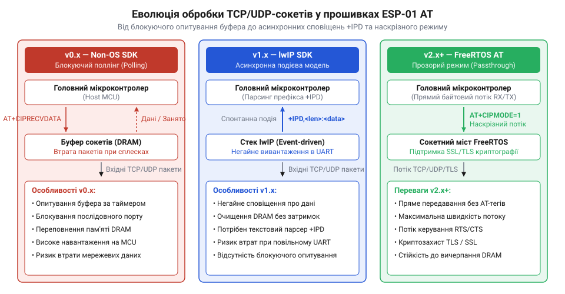
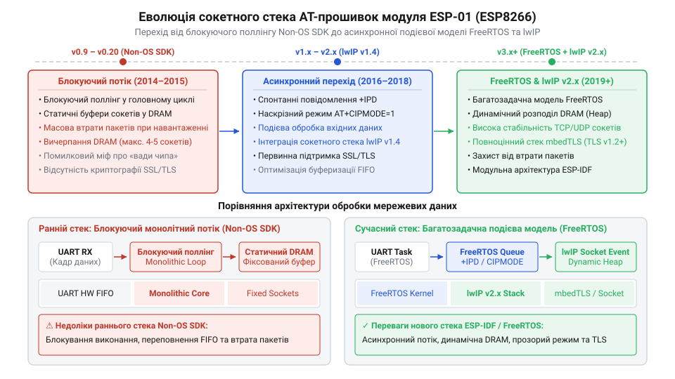

# Еволюція реалізації TCP/UDP сокетів у прошивках модуля ESP-01

<preknowlist>
- [ESP-01 (Wi-Fi, ESP8266)](root:cat-hw-boards/esp-01) — Апаратне влаштування модуля ESP-01, схему підключення через UART та обмеження оперативної пам'яті DRAM.
- [Огляд мікроконтролера та архітектури SoC ESP8266](root:cat-hw-boards/esp8266-soc-architecture-overview) — Архітектуру процесорного ядра Tensilica L106, розподіл пам'яті та можливості периферійного UART-контролера.
- [Захищені SSL/TLS з'єднання в AT-прошивці ESP8266](root:cat-hw-boards/esp8266-at-ssl-tls) — Особливості роботи криптографічного стека mbedTLS та налаштування режимів шифрування у прошивках AT.
- [Оновлення прошивки та прошивання ESP-01](root:cat-hw-boards/esp01-firmware-flashing) — Процедуру завантаження різних версій AT-прошивок у Flash-пам'ять модуля ESP-01.
</preknowlist>

## Криза блокуючого поллінгу в AT v0.x

Коли компанія @@en|Espressif Systems@@ у 2014 році випустила на ринок мікроконтролер @@en|ESP8266@@, першим масовим рішенням для розробників став компактний [модуль бездротового зв'язку ESP-01](root:cat-hw-boards/esp-01). Початкова концепція цього модуля передбачала його використання як відносно простого та дешевого моста між послідовним інтерфейсом @@en|UART@@ (від англ. @@en|Universal Asynchronous Receiver-Transmitter@@ — універсальний асинхронний трансивер; @@en|UART@@) та мережею Wi-Fi. Перші офіційні прошивки @@en|Espressif AT v0.x@@ (зокрема версії v0.9.0–v0.9.2) були створені на базі початкового монолітного середовища @@en|Non-OS SDK@@. У цій первинній архітектурі взаємодія з мережевими сокетами @@en|TCP/UDP@@ спиралася на асинхронну модель обробки даних, в основі якої лежала подієва обробка через колбеки.

У такій підсистемі зовнішній керуючий мікроконтролер мусив постійно надсилати серію текстових @@en|AT@@-команд для перевірки наявності нових пакетів та вичитування накопичених байтів. Проте фізична швидкість передачі через послідовний порт @@en|UART@@ (яка за замовчуванням становила 9600 або 115200 бод) у сотні разів поступалася реальній швидкості надходження кадрів із бездротової мережі Wi-Fi. Стек прошивки @@en|Espressif AT v0.x@@ виділяв під вхідні сокетні дані фіксовані статичні буфери (від англ. @@en|buffer@@ — проміжна область пам'яті; @@en|буфер@@) у внутрішній оперативній пам'яті @@en|DRAM@@ (від англ. @@en|Dynamic RAM@@ — динамічна оперативна пам'ять; @@en|DRAM@@). Специфічна апаратна структура процесора, яку детально розкриває опис [архітектури системного чипа ESP8266](root:cat-hw-boards/esp8266-soc-architecture-overview), мала вкрай обмежений обсяг оперативної пам'яті для розміщення мережевих кадрів.

Оскільки первинне середовище @@en|Non-OS SDK@@ не містило механізмів динамічного керування потоком даних на рівні протоколу TCP у зв'язці з буферами послідовного порту, прибуття інтенсивного мережевого трафіку миттєво викликало катастрофічні наслідки. Вхідні кадри з Wi-Fi MAC-рівня заповнювали статичний буфер приймання значно швидше, ніж хост-контролер встигав їх вичитати через повільний @@en|UART@@. Не маючи можливості вчасно надіслати віддаленому вузлу сповіщення про закриття TCP-вікна (від англ. @@en|zero-window advertisement@@), стек прошивки просто відкидав нові кадри. Це спричиняло масову втрату пакетів, нескінченні повторні відправки (від англ. @@en|retransmission@@) з боку сервера, таймаути з'єднання та переповнення пам'яті. У підсумку сокетний сеанс аварійно розривався, а модуль @@en|ESP-01@@ входив у стан циклічного перезавантаження за спрацьовуванням апаратного таймера контролю (від англ. @@en|watchdog timer@@). Ця криза чітко показала непридатність синхронного модемного поллінгу і змусила розробників Espressif шукати принципово нову асинхронну подієву модель.

## Впровадження асинхронних +IPD та наскрізного режиму

Усвідомивши тупиковість асинхронної подієвої моделі обробки мережевого трафіку, інженери @@en|Espressif Systems@@ здійснили масштабний перехід від асинхронних колбеків до багатопотокового середовища. Ключовим архітектурним рішенням для подолання затримок послідовного порту стало впровадження спонтанних незапланованих повідомлень `@@en|+IPD@@` (від англ. @@en|Incoming Packet Data@@ — вхідні дані пакета; `@@en|+IPD@@`). Передумовою цього кроку була гостра потреба негайно розвантажувати вхідні сокетні буфери пам'яті @@en|DRAM@@ одразу за фактом демодуляції кадру бездротовим радіотрансивером.

У новій асинхронній системі модуль @@en|ESP-01@@ більше не чекав опитувальних команд від зовнішнього мікроконтролера. Щойно мережевий стек отримував новий TCP або UDP пакет, прошивка переривала поточний вивід @@en|UART@@ і відправляла в послідовну лінію спеціальний подієвий заголовок вигляду `+IPD,<len>:` для одиночного з'єднання або `+IPD,<link_id>,<len>:` для багатоканального режиму, після чого одразу ж транслювала точний обсяг байтів корисного навантаження. Це повністю усунуло затримки поллінгу й дозволило керуючому контролеру парсити вхідний потік у момент його прибуття. Завдяки цьому пропускна здатність сокетного інтерфейсу зросла в рази, а ризик переповнення внутрішніх буферів мінімізувався.

*Показано еволюцію моделей обробки мережевих даних та перерозподіл навантаження між UART-інтерфейсом і стеком прошивки.*

Для вирішення завдань, які вимагали передачі суцільних бінарних потоків даних без накладних витрат текстового аналізатора @@en|AT@@-команд, розробники запровадили спеціальний наскрізний режим передачі даних (від англ. @@en|passthrough mode@@ / @@en|unvarnished transmission@@ — прохідна передача без заголовків; @@en|наскрізний режим@@). Його активація здійснювалася комбінацією конфігураційних команд `@@en|AT+CIPMODE=1@@` та `@@en|AT+CIPSEND@@` за умови роботи в одиночному режимі `@@en|AT+CIPMUX=0@@`. Після успішного входу в наскрізний режим трансивер перетворювався на прямий апаратний міст: усі байти з лінії RX послідовного порту безпосередньо загорталися в TCP-сегменти й надсилалися в мережу, а вхідні сокетні байти напряму виводилися на лінію TX. Для виходу з цього режиму використовувалася спеціальна управляюча послідовність `+++` із обов'язковою паузою в 1 секунду до та після неї. Для [родинних модулів ESP-01S](root:cat-hw-boards/esp-01s) такий асинхронний та наскрізний підхід забезпечив високу стабільність передачі даних, звільнивши процесор від зайвого розбору символів.

## Перехід на lwIP та FreeRTOS SDK

Незважаючи на ефективність асинхронних сповіщень `@@en|+IPD@@`, прошивки першого покоління серії v0.x залишалися обмеженими однопотоковою подієвою петлею середовища @@en|Non-OS SDK@@. Усі системні обробники, таймери та робота послідовного порту виконувалися в єдиному головному потоці. Якщо виконання якоїсь функції затримувалося, мережевий стек втрачав можливість вчасно обробляти підтвердження TCP ACK або відповіді протоколу ARP, що призводило до раптових обривів сесій при високому навантаженні.

Переломним моментом в історії модуля став вихід прошивок @@en|Espressif AT v2.x@@ (побудованих на ESP-IDF), коли розробники повністю відмовилися від застарілого середовища на користь повноцінного відкритого мережевого стека @@en|lwIP@@ (від англ. @@en|lightweight IP@@ — полегшений мережевий стек; @@en|lwIP@@), що функціонував під управлінням операційної системи реального часу @@en|FreeRTOS@@ (від англ. @@en|Free Real-Time Operating System@@ — вільна операційна система реального часу; @@en|FreeRTOS@@). Перехід на багатозадачне операційне середовище дозволив розділити драйвер послідовного порту @@en|UART@@, Wi-Fi підсистему та стек TCP/IP на окремі незалежні задачі з різними рівнями пріоритетів.

Інтеграція стека @@en|lwIP@@ принесла повноцінну підтримку мультиплексування сокетів (від англ. @@en|multiplexing@@ — ущільнення/мультиплексування каналів; @@en|мультиплексування сокетів@@), дозволивши модулю підтримувати до 5 одночасних незалежних з'єднань (`@@en|AT+CIPMUX=1@@`). Замість жорстких статичних масивів виділення пам'яті під сокетні буфери почало здійснюватися динамічно з оперативної купи (від англ. @@en|heap@@ — динамічна область пам'яті; @@en|динамічна купа@@) @@en|DRAM@@ під час відкриття нового сеансу. Додатково це відкрило можливість реалізації [захищених SSL/TLS з'єднань](root:cat-hw-boards/esp8266-at-ssl-tls) на основі бібліотеки @@en|mbedTLS@@. Оскільки вільний обсяг динамічної купи на чипі @@en|ESP8266@@ становив лише близько 40–50 кілобайтів, робота з великими криптографічними буферами TLS вимагала жорстких компромісів: узгодження зменшеної довжини фрагмента (MFL) до 2048 байтів та відмови від повного варіанта перевірки ланцюжка сертифікатів.

*Показано етапи розвитку прошивок AT, перехід від однопотокового середовища до багатозадачної операційної системи та впровадження динамічного керування сокетами.*

Ця еволюція програмного стека остаточно розвінчала поширений серед розробників міф про те, ніби ранні нестабільності сокетів, втрати пакетів та суворі обмеження кількості з'єднань у модулі @@en|ESP-01@@ були зумовлені апаратними вадами кремнієвого процесора @@en|Tensilica L106@@. Фізичний чип @@en|ESP8266@@ мав достатню обчислювальну потужність та апаратні можливості, однак його потенціал тривалий час блокувався програмними компромісами та монолітною структурою середовища @@en|Non-OS SDK@@. Впровадження операційної системи @@en|FreeRTOS@@ та стека @@en|lwIP@@ довело, що критерії надійності мережевого обміну визначаються виключно архітектурою сокетного програмного стека. Практичний порядок перешивки та оновлення модулів детально описують інструкції з [процедури оновлення прошивки ESP-01](root:cat-hw-boards/esp01-firmware-flashing).

## Реалізація SSL/TLS сокетів у v2.x

З розвитком концепції Інтернету речей (від англ. @@en|Internet of Things@@ — Інтернет речей; @@en|IoT@@) та масовим впровадженням хмарних сервісів передача даних у відкритому вигляді через незахищені сокети @@en|TCP/UDP@@ перестала відповідати вимогам безпеки. Вихід прошивок @@en|Espressif AT v1.x@@ ознаменував інтеграцію криптографічного захисту протоколів @@en|SSL/TLS@@ (від англ. @@en|Secure Sockets Layer / Transport Layer Security@@ — шар захищених сокетів / безпека транспортного рівня; @@en|SSL/TLS@@) на базі відкритої бібліотеки @@en|mbedTLS@@. Однак реалізація стійкого шифрування на модулі [з обмеженими ресурсами DRAM](root:cat-hw-boards/esp-01) вимагала від інженерів компанії @@en|Espressif Systems@@ прийняття складних апаратних і програмних компромісів.

Головною перешкодою для повноцінного функціонування захищених з'єднань став високий накладний обсяг оперативної пам'яті, необхідний для проведення мережевого рукостискання (від англ. @@en|handshake@@ — процедура узгодження ключів та параметрів шифрування; @@en|рукостискання@@). Стандартний специфікований розмір кадру @@en|TLS@@ становить 16 кілобайтів. Для підтримки одного активного криптографічного сеансу сокетний стек мусить виділити окремі буфери приймання та відправки (до 16 кілобайтів кожен), а також зберегти розшифрований стан сесії й обчислити асиметричні криптографічні ключі. Оскільки у мікроконтролері @@en|ESP8266@@ загальний обсяг вільної динамічної купи в оперативній пам'яті @@en|DRAM@@ після ініціалізації операційної системи @@en|FreeRTOS@@ та стека @@en|lwIP@@ становив лише близько 40–50 кілобайтів, виділення понад 32 кілобайтів під один захищений сокет призводило до негайного вичерпання пам'яті та аварійного падіння системи під час виконання криптографічних функцій `@@en|malloc@@`.

Щоб зробити можливими [захищені SSL/TLS з'єднання](root:cat-hw-boards/esp8266-at-ssl-tls) у прошивках @@en|Espressif AT v2.x@@, розробники запровадили низку суворих системних обмежень. По-перше, було реалізовано підтримку розширення узгодження зменшеної довжини фрагмента — @@en|Max Fragment Length@@ (від англ. @@en|Maximum Fragment Length Extension@@ — розширення максимальної довжини фрагмента; @@en|MFL@@), яке примусово обмежує розмір кадру @@en|TLS@@ до 2048 або 4096 байтів замість стандартних 16384 байтів. Це зменшило вимоги до розміру буферів до прийнятних 2–4 кілобайтів. По-друге, задля заощадження обчислювальних ресурсів процесора та оперативної пам'яті під зберігання проміжних ключів, у конфігураціях за замовчуванням було спрощено або вимкнено повну перевірку ланцюжка цифрових сертифікатів @@en|X.509@@ центрів сертифікації (від англ. @@en|Certificate Authority@@; @@en|CA@@). По-третє, кількість одночасних захищених з'єднань у прошивці була жорстко обмежена лише 1 активним сокетом `@@en|SSL/TLS@@` (на відміну від 5 звичайних незахищених сокетів `@@en|TCP/UDP@@`). Ці компроміси дозволили забезпечити базовий криптографічний захист трафіку на скромному апаратному рівні модуля @@en|ESP-01@@.

## Розвінчання кремнієвого міфу та вибір прошивки

Упродовж тривалого часу серед інженерів та розробників електроніки існувало поширене хибне уявлення про те, ніби ранні нестабільності сокетних з'єднань, втрати пакетів та обмеження кількості каналів у модулях [родини ESP-01](root:cat-hw-boards/esp-01) були спричинені дефектами чи вадами кремнієвої архітектури чипа @@en|ESP8266@@. Проте детальний історичний аналіз еволюції прошивок доводить, що 32-бітне процесорне ядро @@en|Tensilica L106@@ (з архітектурою @@en|RISC@@) із тактовою частотою 80 або 160 МГц володіло достатнім обчислювальним потенціалом для надійної мережевої роботи. Первинні проблеми пропадання з'єднань виникали виключно через програмні обмеження застарілого середовища @@en|Non-OS SDK@@. У ньому обробка подій Wi-Fi MAC та аналізатора @@en|AT@@-команд виконувалася в єдиній блокуючій петлі, де найменша затримка в інтерфейсі @@en|UART@@ призводила до розсинхронізації таймерів автомата станів @@en|TCP@@ та переповнення статичних буферів.

Масштабна рефакторизація сокетного стека з переходом на операційну систему @@en|FreeRTOS@@, мережеву бібліотеку @@en|lwIP@@ та криптографічний стек @@en|mbedTLS@@ перетворила [покращений модуль ESP-01S](root:cat-hw-boards/esp-01s) і класичний модуль @@en|ESP-01@@ із простих проміжних модемів на стабільні та автономні мережеві вузли. Цей історичний досвід показує, що надійність мережевого обміну визначається не лише апаратними параметрами мікроконтролера, а й архітектурною зрілістю його програмного стека. Уявні «дефекти кремнію» виявилися лише наслідком ранніх компромісів у розробці базового ПЗ.

На основі цього розробники можуть сформулювати чіткі критерії вибору версії прошивки та сокетних режимів для сучасних пристроїв. Перші версії прошивок @@en|Espressif AT v0.x@@ та v1.x на базі @@en|Non-OS SDK@@ вважаються застарілими й не рекомендуються для використання. Для побудови надійних систем слід застосовувати версії @@en|Espressif AT v2.x@@ (і вище), обираючи режим роботи сокетів під конкретні вимоги проєкту:
- Для високошвидкісної потокової передачі даних без накладних витрат текстового аналізатора команд найкраще підходить наскрізний режим (`@@en|AT+CIPMODE=1@@` + `@@en|AT+CIPSEND@@`) у поєднанні з одиночним TCP-з'єднанням.
- Для пристроїв збору даних з кількох датчиків чи серверів доцільно використовувати асинхронне мультиплексування (`@@en|AT+CIPMUX=1@@`) із обробкою спонтанних подієвих сповіщень `@@en|+IPD@@`.
- Для взаємодії з хмарними платформами за протоколами @@en|HTTPS@@ або @@en|MQTT@@ over @@en|TLS@@ слід застосовувати захищені сокети `@@en|SSL/TLS@@`, враховуючи обмеження на 1 активне з'єднання та налаштування MFL-буферизації.
Своєчасне виконання [процедури оновлення прошивки ESP-01](root:cat-hw-boards/esp01-firmware-flashing) дозволяє розкрити повний потенціал модуля та забезпечити стабільний мережевий обмін.
