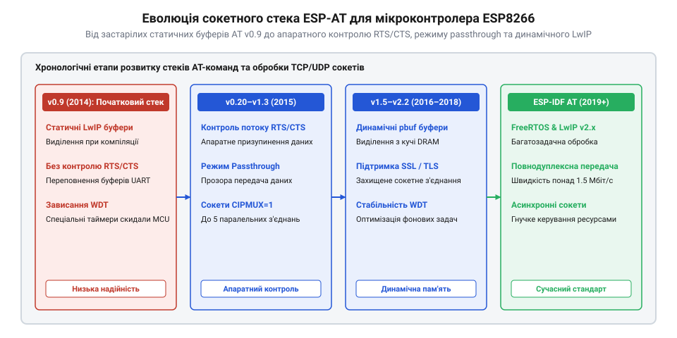

# Еволюція реалізації TCP/UDP сокетів в AT-прошивці ESP8266

<preknowlist>
- [ESP-01 (Wi-Fi, ESP8266)](root:cat-hw-boards/esp-01) — Базову апаратну будову модуля ESP-01 та обмеження обсягу оперативної пам'яті DRAM
- [Огляд мікроконтролера та архітектури SoC ESP8266](root:cat-hw-boards/esp8266-soc-architecture-overview) — Архітектуру процесорного ядра Tensilica L106 та схему розподілу внутрішньої пам'яті SRAM
</preknowlist>

## Проблеми перших версій прошивки v0.9

Поява мікроконтролерного чипа ESP8266 у 2014 році стала справжнім проривом у галузі Інтернету речей завдяки надзвичайно низькій вартості апаратного модуля [ESP-01 (Wi-Fi, ESP8266)](root:cat-hw-boards/esp-01). Перші офіційні версії базової прошивки Espressif AT серії v0.9 (серпень–вересень 2014 року) розроблялися як простий послідовний міст @@en|serial bridge@@ (від англ. @@en|serial bridge@@ — послідовний міст) для надання мережевих функцій зовнішнім 8-бітним мікроконтролерам. Проте початкова кодова база виявила серйозні архітектурні обмеження: обробка мережевого стека @@en|LwIP@@ (від англ. @@en|Lightweight IP@@ — легкий мережевий протокол IP) спиралася на статичне виділення пам'яті в оперативному масиві DRAM, обмежуючи максимальну кількість одночасних з'єднань і унеможливлюючи гнучкий розподіл кадрових буферів. Ситуацію ускладнювали мікроархітектурні проблеми первинного обробника порту @@en|UART@@ (від англ. @@en|Universal Asynchronous Receiver-Transmitter@@ — універсальний асинхронний приймач-передавач) чипа: вхідний апаратний буфер @@en|FIFO@@ (від англ. @@en|First In, First Out@@ — першим прийшов, першим вийшов) обсягом лише 128 байтів обслуговувався програмним кільцевим буфером із високими затримками переривань. За будь-яких радіочастотних пауз трансивера Wi-Fi обробник не встигав вивантажувати дані з FIFO, що призводило до фатального переповнення буфера, мовчазної втрати вхідних байтів, викривлення парсера AT-команд та руйнування пакетів LwIP.

Схемотехнічно ситуацію погіршувала відсутність сигнальних ліній апаратного контролю потоку даних @@en|RTS/CTS@@ (від англ. @@en|Request to Send / Clear to Send@@ — запит на передачу / готовність до приймання) у стандартній цокольовці [модуля ESP-01](root:cat-hw-boards/esp-01). Вхідний апаратний буфер @@en|FIFO@@ послідовного порту @@en|UART@@ (від англ. @@en|Universal Asynchronous Receiver-Transmitter@@ — універсальний асинхронний приймач-передавач) чипа обмежений обсягом всього 128 байтів. На стандартній швидкості 115200 біт/с передача одного байта триває близько 87 мікросекунд, тому буфер повністю заповнюється менш ніж за 11 мілісекунд суцільного потоку. Якщо процесорне ядро в цей момент обслуговує високопріоритетне переривання трансивера @@en|Wi-Fi@@ або виконання калібрування радіотракту, програмний обробник @@en|UART@@ не встигає вивантажувати дані. За відсутності ліній @@en|RTS/CTS@@ модуль позбавлений можливості виставити сигнал зупинки хост-контролеру, через що нові вхідні біти фізично накладаються на незчитані регістри та спричиняють апаратну помилку переповнення (англ. @@en|overrun error@@). У результаті фрагменти символьних рядків викривляються або губляться mid-stream, текстовий парсер @@en|AT@@-команд отримує розірвані лексеми (наприклад, замість `AT+CIPSEND` надходить спотворений опікод), видає синтаксичну помилку `ERROR` та повністю втрачає синхронізацію командного контексту з зовнішнім мікроконтролером.

Крім того, ранній обробник команд `AT+CIPSEND` виконував суворо синхронне блокування обчислювального ядра Tensilica L106 на [SoC ESP8266](root:cat-hw-boards/esp8266-soc-architecture-overview). Якщо сервер затримував підтвердження @@en|ACK@@ (від англ. @@en|Acknowledgment@@ — підтвердження прийому) або відбувалися повторні ретрансляції кадрів, системний цикл зупинявся, що викликало спрацьовування апаратного сторожового таймера @@en|WDT@@ (від англ. @@en|Watchdog Timer@@ — сторожовий таймер) із фатальним перезавантаженням модуля та розривом усіх сокетів.

## Впровадження CIPMUX та прозорого режиму

Масштабний перегляд архітектури сокетного стека відбувся на початку 2015 року з релізом прошивок Espressif AT версій v0.20–v1.3. Для усунення проблем негнучкого розподілу пам'яті розробники запровадили прапор мультиплексування `AT+CIPMUX`. У режимі одиночного сокета (`CIPMUX=0`) весь доступний обсяг буферів LwIP виділявся під єдине з'єднання, що дозволило вперше реалізувати прозорий режим передачі (англ. @@en|passthrough mode@@) за допомогою команди `AT+CIPMODE=1`. У цьому режимі модуль трансформувався у прямий двосторонній тунель даних між UART та TCP-сокетом без додавання текстових префіксів `+IPD` та викликів `AT+CIPSEND` на кожен кадр. Ключовим архітектурним проривом став фазовий перехід від статично виділених масивів до динамічного розміщення пакетних буферів @@en|pbuf@@ (від англ. @@en|packet buffer@@ — пакетний буфер) у кучі оперативної пам'яті @@en|DRAM@@ (від англ. @@en|Dynamic Random Access Memory@@ — динамічна оперативна пам'ять). Замість утримання монолітних резервів прошивка почала неблокуюче виділяти ланцюжки `pbuf` безпосередньо з вільної кучі під час надходження кадру, а після підтвердження доставки TCP-сегмента миттєво звільняти пам'ять, забезпечуючи високу пропускну здатність тунелю без ризику вичерпання статичних пулів.

Паралельно для складних багатовузлових систем було створено режим мультисокетного мультиплексування (`CIPMUX=1`), який забезпечив одночасну підтримку до 5 незалежних каналів з ідентифікаторами від 0 до 4. Вирішальним кроком у боротьбі із втратою даних стала поява підтримки апаратного контролю потоку даних `RTS/CTS` через конфігураційні команди порту UART. Апаратна зупинка передачі хост-контролером при заповненні FIFO-буфера на 80% виключила переповнення оперативної пам'яті й усунула втрати байтів під час приймання високих обсягів трафіку.

*Порівняльна хронологічна схема еволюції сокетного стека ESP-AT від v0.9 до ESP-IDF показує ключові вехи розвитку буферизації LwIP, появу RTS/CTS та режимів CIPMUX.*

Для усунення фатальних скидань `WDT` інженери переписали обробник мережевих подій у неблокуючу асинхронну модель. Перенесення сокетних контекстів у кучу @@en|DRAM@@ (від англ. @@en|Dynamic Random Access Memory@@ — динамічна оперативна пам'ять) та динамічне виділення структур `pbuf` дозволили гнучко адаптувати розмір вікна TCP залежно від поточного стану вільних ресурсів мікроконтролера.

## Перехід на стек ESP-IDF

Останнім етапом фундаментальної еволюції сокетного стека став перехід кодової бази прошивки Espressif AT з застарілого середовища Non-OS SDK на сучасний фреймворк ESP-IDF з операційною системою реального часу @@en|FreeRTOS@@ (від англ. @@en|Free Real-Time Operating System@@ — вільна операційна система реального часу). Це забезпечило повну ізоляцію переривань порту UART від системного потоку TCP/IP та оновленого мережевого стека LwIP 2.x. Архітектурно взаємодія побудована на розподілі обробки між окремими контекстами задач FreeRTOS: драйвер порту UART виділено в ізольований потік, який передає отримані двійкові кадри через черги @@en|queue@@ (від англ. @@en|queue@@ — черга) у системну задачу `tcpip_thread` стека LwIP 2.x. Асинхронний обмін між задачами через міжпроцесні семафори усунув блокування основного обчислювального циклу, гарантуючи потокобезпечну обробку сокетних подій та запобігаючи фатальним скиданням сторожового таймера.

Сучасна реалізація прошивки повністю відмовилася від статичних обмежень, перевівши виділення пам'яті під сокетні структури `PCB` (англ. @@en|Protocol Control Block@@ — блок керування протоколом) на повністю динамічну кучу DRAM. Завдяки цьому з'явилася можливість гнучко налаштовувати розмір скользящого вікна `TCP_WND`, підтримувати розширення `Max Fragment Length` та інтегрувати повноцінний криптографічний стек @@en|mbedTLS@@ для створення захищених сокетів. Практичне конфігурування шифрованих каналів детально описують [Захищені SSL/TLS з'єднання в AT-прошивці ESP8266](root:cat-hw-boards/esp8266-at-ssl-tls). Міграція на ESP-IDF перетворила застарілі AT-команди на надійну промислову платформу, здатну обробляти асинхронні сокетні з'єднання без ризику вичерпання пам'яті чи апаратних зависань.
