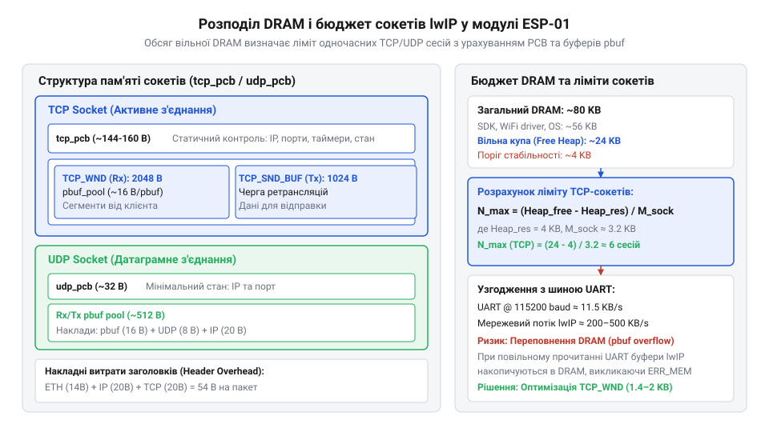

# Математичний розрахунок бюджету DRAM та продуктивності сокетів ESP-01

<preknowlist>
- [ESP-01 (Wi-Fi, ESP8266)](root:cat-hw-boards/esp-01) — Базова апаратна конфігурація модуля ESP-01, обсяг доступної пам'яті DRAM та загальні обмеження ресурсів.
- [Огляд мікроконтролера та архітектури SoC ESP8266](root:cat-hw-boards/esp8266-soc-architecture-overview) — Карта оперативної пам'яті ESP8266, розділення на IRAM і DRAM та системний розподіл пам'яті купою.
- [Захищені SSL/TLS з'єднання в AT-прошивці ESP8266](root:cat-hw-boards/esp8266-at-ssl-tls) — Базові поняття шифрованого мережевого трафіку та принципи функціонування AT-прошивки ESP8266.
</preknowlist>

## Аварійні перезавантаження ESP-01 під мережевим навантаженням

Модуль `@@en|ESP-01@@` на базі мікроконтролера `@@en|ESP8266@@` створює ілюзію стабільної роботи під час виконання поодиноких запитів. Проте спроба відкрити кілька паралельних з'єднань спричиняє раптове перезавантаження пристрою. Причиною цього є паніка ядра через вичерпання пам'яті `@@en|DRAM@@` (від англ. @@en|dynamic random-access memory@@ — динамічна оперативна пам'ять, де @@en|dynamic@@ вказує на потребу постійної регенерації заряду комірок).

Фізичний обсяг `@@en|DRAM@@` кришталю `@@en|ESP8266@@` становить 80 KiB (81 920 байтів). Через особливості [архітектури оперативної пам'яті](root:cat-hw-boards/esp8266-soc-architecture-overview) пристрою левову частку пам'яті займають системні бібліотеки, кеш `@@en|IRAM@@` (від англ. @@en|instruction RAM@@ — оперативна пам'ять інструкцій) та буфери `@@en|Wi-Fi@@`. У результаті для застосунку й мережевого стека залишається динамічна купа — `@@en|heap@@` (від англ. @@en|heap@@ — купа, динамічно розподілювана пам'ять), яка в реальних умовах рідко перевищує 24–32 KiB.

Мережевий стек `@@en|lwIP@@` (від англ. @@en|lightweight IP@@ — легковаговий мережевий протокол) під час відкриття кожного `@@en|socket@@` (від англ. @@en|socket@@ — гніздо чи роз'єм) динамічно виділяє пам'ять із купи `@@en|heap@@`. Без розрахунку бюджету ресурсів черговий пакет чи з'єднання запитує більше пам'яті, ніж є у вільному залимку. Внутрішні функції `@@en|lwIP@@` отримують нульовий вказівник `@@en|NULL@@`, що призводить до падіння системи з роздруком `Fatal exception 28` або `Panic: Memory allocation failed`. Ситуація ускладнюється для [захищених шифрованих з'єднань](root:cat-hw-boards/esp8266-at-ssl-tls), де криптографічні буфери миттєво поглинають оперативну пам'ять. Щоб гарантувати стабільність з урахуванням обмежень [апаратної конфігурації модуля](root:cat-hw-boards/esp-01) `@@en|ESP-01@@`, необхідно відмовитися від інтуїтивного налаштування мережі та побудувати точну математичну модель розподілу `@@en|DRAM@@`. lwIP@@ (від англ. @@en | lightweight IP@@ | Детальніше про взаємодію протокольного стека з драйвером Wi-Fi та операційною системою викладено у матеріалі про [архітектуру мережевого стека lwIP у ESP8266](root:cat-hw-boards/lwip-architecture-esp8266).

## Фіксовані накладні витрати блоків керування lwIP

Кожне відкрите з'єднання у стеку `@@en|lwIP@@` вимагає виділення пам'яті ще до того, як по ньому пройде перший байт користувацьких даних. Стек `@@en|lwIP@@` зберігає стан мережевого сокета у спеціальній структурі — блоці керування протоколом `@@en|PCB@@` (від англ. @@en|protocol control block@@ — блок керування протоколом).

Для протоколу `@@en|TCP@@` (від англ. @@en|transmission control protocol@@ — протокол керування передачею) використовується структура `@@en|tcp_pcb@@`, а для `@@en|UDP@@` (від англ. @@en|user datagram protocol@@ — протокол користувацьких датаграм) — простіша структура `@@en|udp_pcb@@`.

Для одного блоку `@@en|tcp_pcb@@` фіксовані витрати `@@en|DRAM@@` становлять `S_tcp_pcb = 160` байтів, а для `@@en|udp_pcb@@` — `S_udp_pcb = 32` байти.

Загальні статичні накладні витрати пам'яті `M_pcb` для конфігурації із `N_tcp` відкритих `@@en|TCP@@`-сокетів та `N_udp` відкритих `@@en|UDP@@`-сокетів обчислюються за формулою:

M_pcb
= N_tcp · S_tcp_pcb + N_udp · S_udp_pcb      [сумування витрат контрольних блоків]
= N_tcp · 160 + N_udp · 32                     [підстановка сталих розмірів PCB у байтах]

Навіть у стані спокою 10 активних `@@en|TCP@@`-сокетів вилучають 1600 байтів із купи `@@en|heap@@`. Цей фіксований обсяг утворює нижній поріг витрат `@@en|DRAM@@`, який не залежить від обсягу переданих даних і є базою сокетного бюджету `@@en|ESP-01@@`.

## Динамічні буфери pbuf та вікно TCP

Основна частка оперативної пам'яті `@@en|DRAM@@` під час роботи мережі витрачається не на блоки керування `@@en|PCB@@`, а на збереження самих мережевих пакетів. У стеку `@@en|lwIP@@` будь-який пакет описується структурою пакетного буфера `@@en|pbuf@@` (від англ. @@en|packet buffer@@ — пакетний буфер).

Кожен системний буфер `@@en|pbuf@@` складається з двох частин: метаданих `struct pbuf` розміром `S_pbuf_hdr = 16` байтів та виділеного блоку пам'яті під заголовки мережевих протоколів і корисне навантаження. Заголовки мережевого рівня `@@en|IP@@` (`S_ip_hdr = 20` байтів) та транспортного рівня `@@en|TCP@@` (`S_tcp_hdr = 20` байтів) додають до кожного сегмента додаткові 40 байтів службових даних. Таким чином, сумарні накладні витрати на один системний сегмент пакету `S_hdr` становлять:

S_hdr
= S_pbuf_hdr + S_ip_hdr + S_tcp_hdr            [сумування заголовків pbuf, IP та TCP]
= 16 + 20 + 20                                 [підстановка розмірів службових структур]
= 56                                           [сумарний заголовок сегмента у байтах]

Для забезпечення безперервної передачі даних протокол `@@en|TCP@@` використовує механізм вікна — `@@en|TCP Window Size@@` (від англ. @@en|window size@@ — розмір вікна підтвердження), позначуваний як `W`. Розмір вікна визначає максимальну кількість байтів, яку відправник може надіслати до отримання підтвердження `@@en|ACK@@` (від англ. @@en|acknowledgement@@ — підтвердження). Щоб утримувати ці дані в пам'яті, стек `@@en|lwIP@@` виділяє кілька буферів `@@en|pbuf@@`. Кількість необхідних буферів `N_pbuf` залежить від розміру максимального сегмента `@@en|MSS@@` (від англ. @@en|maximum segment size@@ — максимальний розмір сегмента), який для `@@en|Wi-Fi@@` зазвичай дорівнює `MSS = 1460` байтів:

N_pbuf
= ⌈ W / MSS ⌉                                  [округлення до більшого цілого числа сегментів]

Повний обсяг оперативної пам'яті `M_conn`, який поглинає одне активне `@@en|TCP@@`-з'єднання при заданому вікні `W`, обчислюється шляхом додавання фіксованого блоку `@@en|tcp_pcb@@`, корисного навантаження вікна `W` та службових заголовків `S_hdr`:

M_conn
= S_tcp_pcb + W + N_pbuf · S_hdr              [сума витрат PCB, вікна та заголовків]
= 160 + W + ⌈ W / MSS ⌉ · 56                 [підстановка числових констант]

*Структура розподілу DRAM між контролюючими блоками lwIP та пакетними буферами.*

Для прикладу розрахуємо витрати пам'яті при стандартному розмірі вікна `W = 2920` байтів (що відповідає 2 сегментам `@@en|MSS@@`):

N_pbuf
= ⌈ 2920 / 1460 ⌉
= 2                                          [кількість потрібних буферів pbuf]

M_conn
= 160 + 2920 + 2 · 56
= 160 + 2920 + 112
= 3192                                       [загальний бюджет одного TCP-сокета у байтах]

Розрахунок показує, що одне `@@en|TCP@@`-з'єднання з вікном 2920 байтів фактично забирає з купи `@@en|heap@@` 3192 байти `@@en|DRAM@@`.

## Розрахунок граничної кількості одночасних сокетів

Дефіцит оперативної пам'яті під навантаженням спричиняє паніку ядра й перезавантаження `@@en|ESP-01@@`. Щоб це відвернути, витрати `@@en|DRAM@@` обчислюють через балансове рівняння бюджету.

З вільної купи `@@en|heap@@` `M_avail` (28672 байти, або 28 KiB) вираховують системний резерв `M_reserve` (8192 байти, або 8 KiB), отримуючи мережевий бюджет `M_net`:

M_net
= M_avail - M_reserve                        [мережевий бюджет]
= 28672 - 8192                               [підстановка]
= 20480                                       [чистий бюджет]

Результат у 20480 байтів визначає ліміт `@@en|DRAM@@` під мережеві сокети.

Витрати `@@en|UDP@@`-сокета `M_udp` з навантаженням `P_udp` (256 байтів) складаються з керуючого блоку `S_udp_pcb` (32 байти), заголовків буфера `S_pbuf_hdr` (16 байтів) і протоколів `S_ip_hdr` (20 байтів), `S_udp_hdr` (8 байтів):

M_udp
= S_udp_pcb + S_pbuf_hdr + S_ip_hdr + S_udp_hdr + P_udp  [витрати UDP-сокета]
= 32 + 16 + 20 + 8 + 256                       [підстановка]
= 332                                         [бюджет UDP-сокета]

Сума 332 байти фіксує повну вартість одного `@@en|UDP@@`-сокета.

Мережевий бюджет `M_net` розподіляється між `N_tcp` сесіями `@@en|TCP@@` вартістю `M_conn` і `N_udp` сокетами `@@en|UDP@@` вартістю `M_udp` через балансове рівняння:

M_net
≥ N_tcp · M_conn + N_udp · M_udp             [баланс DRAM]

Ця нерівність визначає межу стабільності розподілу пам'яті.

Для двох `@@en|UDP@@`-сокетів (`N_udp = 2`) та `@@en|TCP@@`-вікна `W = 2920` байтів (`M_conn = 3192` байти) розраховують граничну кількість `@@en|TCP@@`-сесій `N_tcp_max`:

M_udp_total
= 2 · 332
= 664                                        [витрати UDP]

M_tcp_avail
= 20480 - 664
= 19816                                      [залишок для TCP]

N_tcp_max
= ⌊ M_tcp_avail / M_conn ⌋                    [граничні сокети]
= ⌊ 19816 / 3192 ⌋                           [підстановка]
= ⌊ 6.208 ⌋
= 6                                          [округлення до цілого]

Отже, `@@en|ESP-01@@` утримує до 6 `@@en|TCP@@`-сесій; відкриття 7-го сокета вичерпає `@@en|heap@@` і спричинить паніку ядра.

## Узгодження пропускної здатності мережі з UART

У разі використання модуля `@@en|ESP-01@@` як мережевого співпроцесора послідовний шинний інтерфейс `@@en|UART@@` (від англ. @@en|universal asynchronous receiver-transmitter@@ — універсальний асинхронний приймач-передавач) обмежує передачу даних до основного мікроконтролера. Реальна продуктивність системи визначається швидкістю шини та накладними витратами мережевих заголовків.

Коефіцієнт ефективності мережевого пакета `η` показує частку корисного навантаження `P_payload` (від англ. @@en|payload@@ — корисне навантаження) відносно повного розміру пакета з урахуванням мережевих заголовків `S_hdr_net` (`S_ip_hdr + S_tcp_hdr = 40` байтів):

η
= P_payload / (P_payload + S_hdr_net)        [частка корисного навантаження у пакеті]

При передачі дрібних пакетів телеметрії (`P_payload = 64` байти) ефективність каналу становить:

η_small
= 64 / (64 + 40)
= 64 / 104
≈ 0.6154                                     [ефективність використання каналу для малих пакетів]

Це означає, що 38.46% всього трафіку витрачається на службові заголовки. При передачі великих пакетів (`P_payload = 1460` байтів) ефективність зростає:

η_large
= 1460 / (1460 + 40)
= 1460 / 1500
≈ 0.9733                                     [ефективність каналу для повнорозмірного сегмента]

Частка корисних даних для повнорозмірних сегментів досягає 97.33%.

Швидкість фізичного потоку даних через `@@en|UART@@` при стандартній швидкості `B = 115200` бод (від англ. @@en|baud rate@@ — швидкість передачі в бодах) з урахуванням 10 бітів на один байт обчислюється як:

R_uart
= B / 10                                      [обчислення байтової швидкості шини UART]
= 115200 / 10
= 11520                                      [максимальна байтова швидкість UART у байтах за секунду]

Ефективна швидкість передачі корисного навантаження `T_payload` через шину `@@en|UART@@` для малих та великих пакетів дорівнює:

T_small
= R_uart · η_small
= 11520 · 0.6154
≈ 7090                                       [корисна пропускна здатність для малих пакетів, байт/с]

T_large
= R_uart · η_large
= 11520 · 0.9733
≈ 11212                                      [корисна пропускна здатність для великих пакетів, байт/с]

Якщо мережевий стек `@@en|lwIP@@` отримує дані через `@@en|Wi-Fi@@` зі швидкістю 200–500 KB/s, а шина `@@en|UART@@` обмежена 11.52 KB/s, виникає вузьке місце. Надлишково велике вікно `@@en|TCP Window Size@@` призводить лише до накопичення пакетів у буферах `@@en|pbuf@@` та вичерпання `@@en|DRAM@@`, бо шина `@@en|UART@@` фізично не встигає зчитувати дані. Особливо гостро це проявляється під час передачі даних сенсорів чи [команд керування GPIO](root:cat-hw-boards/esp8266-at-gpio-control).

## Оптимізація конфігурації lwIP під обмежену DRAM

Розмір вікна `@@en|TCP Window Size@@` зменшують до рівня, обмеженого пропускною здатністю шини `@@en|UART@@` та часом кругового обігу `@@en|RTT@@`.

Оптимальний розмір вікна `W_opt` обчислюють як добуток швидкості `@@en|UART@@` `R_uart` та затримки `@@en|RTT@@`:

W_opt
= R_uart · RTT                                [добуток пропускної здатності на затримку]

Цей вираз визначає обсяг даних у дорозі, який шина встигає опрацювати.

**При затримці `RTT = 50` мс (0.05 s) та швидкості `R_uart = 11520` байтів/с:**

W_opt
= 11520 · 0.05
= 576                                         [розрахунковий оптимальний розмір вікна у байтах]

Зменшення параметра `TCP_WND` у конфігурації `@@en|lwIP@@` зі стандартних 2920 байтів до 1460 байтів (1 `@@en|MSS@@`) скорочує витрати `@@en|DRAM@@` на один сокет:

M_conn_opt
= 160 + 1460 + 1 · 56
= 1676                                       [оптимізований бюджет одного TCP-сокета у байтах]

Економія становить 1516 байтів `@@en|DRAM@@` (майже 47.5%) на сокет без втрати швидкості `@@en|UART@@`, що подвоює граничну кількість з'єднань у купі `@@en|heap@@`.

Перед відкриттям сокета на модулях [родини ESP8266](root:cat-hw-boards/esp-01-module-family-overview) перевіряють доступний обсяг купи `@@en|heap@@`.

:::tabs
@tab C
:::code math-esp01-dram-socket-budgeting/c/calculate-tcp-socket-mem.c
@tab C++
:::code math-esp01-dram-socket-budgeting/cpp/socketbudgetcalculator.cpp
:::
