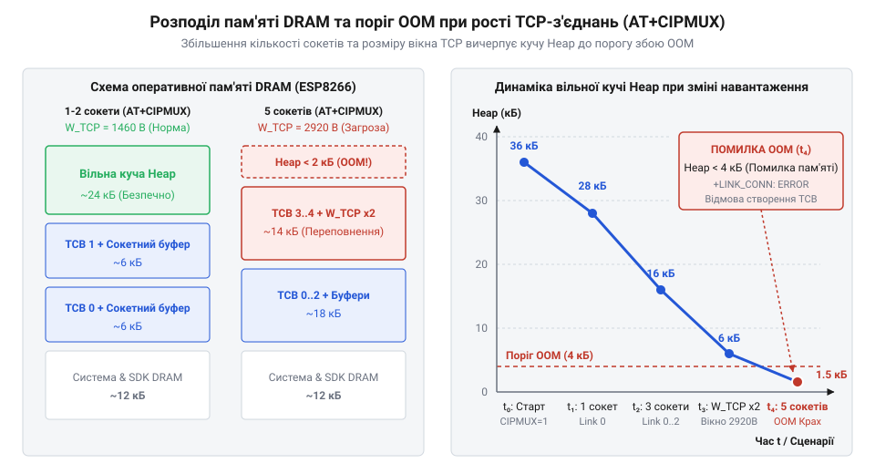

# Математичний розрахунок пропускної здатності та буферів пам'яті сокетів ESP-01

<preknowlist>
- [Огляд мікроконтролера та архітектури SoC ESP8266](root:cat-hw-boards/esp8266-soc-architecture-overview) — структуру організації оперативної пам'яті DRAM та обсяги доступної кучі
- [Архітектура мережевого стека lwIP у ESP8266](root:cat-hw-boards/lwip-architecture-esp8266) — будову буферів pbuf, керування TCP Window Size та структуру блоків TCB
- [Потоковий розбір асинхронних кадрів +IPD в AT-прошивці ESP8266](root:cat-hw-boards/esp8266-at-ipd-parser) — формат префіксів +IPD та накладні витрати розбору вхідного потоку
- [Протокол двофазної передачі даних AT+CIPSEND в ESP8266](root:cat-hw-boards/esp8266-at-cipsend-handshake) — двофазний хендшейк відправки даних та накладні символи підтвердження
</preknowlist>

## Дисбаланс швидкостей UART та Wi-Fi

Розробники мікроконтролерних систем під час використання бездротових [модулів ESP-01](root:cat-hw-boards/esp-01) як мережевих модемів регулярно стикаються із самовільними перезавантаженнями модуля, викривленням вхідних пакетів або падінням з'єднання. Причина цих збоїв криється у глибокому фізичному дисбалансі пропускної здатності між радіоканалом та послідовною шиною передачі даних.

Мікросхема кристала в [архітектурі SoC ESP8266](root:cat-hw-boards/esp8266-soc-architecture-overview) приймає кадрову інформацію з ефіру через радіомодуль @@en|Wi-Fi@@ (стандарт IEEE 802.11b/g/n) на фізичній швидкості до десятків мегабітів за секунду. Реальна швидкість протоколу @@en|TCP@@ (англ. @@en|Transmission Control Protocol@@) у локальній мережі легко досягає від 1 до 2 @@en|Mbps@@, що відповідає потоку від 125 до 250 кілобайтів за секунду. Проте обмін даними між хост-мікроконтролером (наприклад, AVR чи STM32) та модулем @@en|ESP-01@@ відбувається через послідовний інтерфейс @@en|UART@@ (англ. @@en|Universal Asynchronous Receiver-Transmitter@@) на базовій бодовій швидкості (англ. @@en|baud rate@@) 115200 бод.

За фізичною нормою кодування фізична пропускна здатність шини @@en|UART@@ при 115200 бод становить лише близько 11.52 кілобайтів за секунду. Виникає катастрофічний дисбаланс: вхідний мережевий потік надходить у сокет (англ. @@en|socket@@, від англо-норм. @@fro|soket@@ — наконечник списа, лемеш) у 10–20 разів швидше, ніж фізична шина @@en|UART@@ здатна вивантажити його в хост-мікроконтролер.

Коли віддалений сервер надсилає інтенсивний сплеск пакетів, мережевий стек @@en|lwIP@@ у [прошивці Espressif AT](root:cat-hw-boards/esp8266-at-firmware-architecture) розміщує вхідні кадри в оперативній пам'яті (англ. @@en|DRAM@@, @@en|Dynamic Random-Access Memory@@). Дані вибудовуються у зв'язані структури буферів (англ. @@en|buffer@@, від старофранк. @@fro|bufe@@ — удар, ляпас) типу @@en|pbuf@@. Оскільки шина @@en|UART@@ не встигає звільняти ці буфери, динамічна пам'ять чи купа (англ. @@en|heap@@ — купа, звалище) мікроконтролера @@en|ESP8266@@ стрімко вичерпується. 

Якщо хост-мікроконтролер не використовує апаратне керування потоком @@en|RTS/CTS@@ або не обмежує швидкість прийому, виникає критична помилка вичерпання пам'яті @@en|OOM@@ (англ. @@en|Out-Of-Memory@@). У результаті системний сторожовий таймер викликає паніку ядра й примусове перезавантаження модуля. Аналогічно при відправці даних із хоста у мережу: якщо хост помпує дані у @@en|UART@@ швидше, ніж бездротовий канал @@en|Wi-Fi@@ отримує підтвердження @@en|ACK@@ від сервера, внутрішні буфери передачі переповнюються. Для запобігання втратам пакетів та аварійним зупинкам необхідно математично узгодити граничні параметри потоків на кожній ділянці тракту.

## Розрахунок пропускної здатності шини UART

Для визначення вузького місця каналу передачі необхідно обчислити точну максимальну швидкість, з якою корисні дані можуть передаватися через послідовний інтерфейс @@en|UART@@. Стандартний кадр передачі @@en|UART@@ налаштовується у форматі @@en|8N1@@: 1 старт-біт, 8 бітів даних, без біта парності та 1 стоп-біт.

Введемо позначення величин:
- `B_baud` — бодова швидкість шини @@en|UART@@ у символах за секунду (бод);
- `b_frame` — повна кількість фізичних бітів у кадровому форматі @@en|8N1@@ (`b_frame = 10` біт/байт);
- `R_raw` — фізична швидкість передачі сирих байтів через інтерфейс @@en|UART@@ у байтах за секунду.

Сумарна фізична швидкість передачі байтів через інтерфейс @@en|UART@@ обчислюється як відношення бодової швидкості до кількості бітів у кадрі:

```
R_raw
= B_baud ÷ b_frame      [ділення бодової швидкості на розмір кадру 8N1]
= B_baud ÷ 10           [підстановка b_frame = 10 біт/байт]
```

Вираз показує, що фізична межа байтового потоку @@en|UART@@ становить точно одну десяту від обраної бодової швидкості.

Проте фізична швидкість `R_raw` не дорівнює швидкості корисного навантаження (англ. @@en|payload@@). Під час [розбору асинхронних кадрів](root:cat-hw-boards/esp8266-at-ipd-parser) вхідні мережеві дані обгортаються прошивкою у службовий префікс `+IPD,<link_id>,<len>:`. Кожен блок даних супроводжується текстовими символами керування.

Введемо додаткові величини:
- `P_payload` — обсяг корисних мережевих даних у блоці (байти);
- `L_prefix` — довжина службового префікса @@en|+IPD@@ у байтах (наприклад, для `+IPD,0,1460:` довжина становить 13 байтів);
- `R_eff_rx` — ефективна пропускна здатність корисного навантаження при прийомі даних.

Рівняння ефективної пропускної здатності корисного навантаження при прийомі даних визначається пропорцією корисного блоку до повного кадрованого пакета @@en|UART@@:

```
R_eff_rx
= R_raw × (P_payload ÷ (P_payload + L_prefix))      [помноження фізичної швидкості на коефіцієнт корисного навантаження]
= (B_baud ÷ 10) × (P_payload ÷ (P_payload + L_prefix))  [підстановка виразу фізичної швидкості]
```

З формули видно, що малі порції корисного навантаження `P_payload` суттєво знижують ефективність шини @@en|UART@@ через зростання відносного впливу префікса `L_prefix`.

**Обчислення ефективної швидкості UART для бодової швидкості 115200 baud та розміру блоку 100 байтів:**

```
[Крок 1: Фізична швидкість UART]
R_raw = 115200 ÷ 10 = 11520 байт/с

[Крок 2: Розмір префікса +IPD,0,100:]
L_prefix = 12 байт

[Крок 3: Коефіцієнт корисного навантаження]
K_payload = 100 ÷ (100 + 12) = 100 ÷ 112 ≈ 0.8928 (89.28%)

[Крок 4: Ефективна пропускна здатність]
R_eff_rx = 11520 × 0.8928 ≈ 10285 байт/с (10.04 КБ/с)
```

Висновок: при передачі даних малими порціями по 100 байтів на швидкості 115200 бод накладні витрати префіксів @@en|+IPD@@ у [базовій системі AT-команд](root:cat-hw-boards/esp8266-at-command-set-overview) з'їдають понад 10% фізичної смуги @@en|UART@@. Для максимізації пропускної здатності необхідно збільшувати розмір порцій `P_payload` до межі мережевого сегмента.

## Мережевий стек та ефективність сокетів

На відміну від шини @@en|UART@@, сокети у [мережевому стеку lwIP](root:cat-hw-boards/lwip-architecture-esp8266) оперують кадрами канального та мережевого рівнів. Головними параметрами мережевого кадрування є @@en|MTU@@ (англ. @@en|Maximum Transmission Unit@@ — максимальний блок передачі, для @@en|Wi-Fi@@ становить 1500 байтів) та @@en|MSS@@ (англ. @@en|Maximum Segment Size@@ — максимальний розмір сегмента корисних даних).

Для протоколу @@en|TCP@@ розмір @@en|MSS@@ обчислюється як різниця між @@en|MTU@@ та заголовками протоколів @@en|IP@@ (20 байтів) і @@en|TCP@@ (20 байтів): `MSS = 1500 - 20 - 20 = 1460` байтів. Для протоколу @@en|UDP@@ заголовки @@en|IP@@ (20 байтів) та @@en|UDP@@ (8 байтів) залишають максимальне корисне навантаження `1500 - 28 = 1472` байти.

Під час відправки даних хостом застосовується протокол [двофазної передачі даних](root:cat-hw-boards/esp8266-at-cipsend-handshake) `AT+CIPSEND`. Процес передачі складається з таких послідовних кроків:
1. Хост надсилає у @@en|UART@@ команду `AT+CIPSEND=<id>,<len>\r\n` (наприклад, 19 байтів).
2. Модуль @@en|ESP-01@@ обробляє команду й повертає у @@en|UART@@ запрошення `\r\n> ` (4 байти).
3. Хост передає у @@en|UART@@ блок корисних даних обсягом `P_payload` байтів.
4. Модуль @@en|ESP-01@@ відправляє дані у мережу, очікує підтвердження й повертає у @@en|UART@@ відповідь `Recv 1460 bytes\r\n\r\nSEND OK\r\n` (27 байтів).

Введемо змінні для оцінки часу передачі:
- `T_uart_overhead` — сумарний час передачі службових символів @@en|UART@@ (50 байтів);
- `T_net_rtt` — мережева затримка кругового обігу (англ. @@en|RTT@@, @@en|Round-Trip Time@@) у каналі @@en|Wi-Fi@@ та мережі Інтернет;
- `T_tx_total` — тривалість повного циклу відправки одного пакета.

Формула тривалості повного циклу відправки одного пакета даних через двофазний хендшейк (англ. @@en|handshake@@) AT+CIPSEND:

```
T_tx_total
= ((P_payload + 50) × 10 ÷ B_baud) + T_net_rtt    [сума часу передачі кадрів UART та мережевої затримки RTT]
```

Вираз демонструє, що загальна пропускна здатність відправки обмежена як бодовою швидкістю @@en|UART@@, так і затримкою мережі `T_net_rtt`. Якщо host відправляє дрібні пакети (наприклад, `P_payload = 64` байти), накладні 50 байтів @@en|UART@@ та затримка `T_net_rtt` у [мережевому стеку LwIP](root:cat-hw-boards/lwip-stack-architecture-in-embedded) знижують реальну швидкість передачі у десятки разів. Оптимальним розміром блоку передачі є точний розмір @@en|MSS@@ — 1460 байтів.

## Динаміка кучі та режим CIPMUX

Обмеження розміру буферів сокетів безпосередньо пов'язане з обсягом оперативної пам'яті [мікроконтролера ESP8266](root:cat-hw-boards/esp8266-soc-architecture-overview). З загальних 80 КБ системної пам'яті @@en|DRAM@@ після завантаження операційної системи та стека [SSL/TLS з'єднань](root:cat-hw-boards/esp8266-at-ssl-tls) у вільній кучі @@en|heap@@ залишається від 24 до 36 КБ пам'яті.

У режимі багатьох з'єднань `AT+CIPMUX=1` модуль @@en|ESP-01@@ підтримує до 5 одночасних сокетів (ідентифікатори від 0 до 4). Кожне відкрите @@en|TCP@@-з'єднання потребує виділення динамічної пам'яті під кілька системних структур:
- `M_TCB` — контрольний блок протоколу @@en|TCP@@ (`struct tcp_pcb` у @@en|lwIP@@), близько 250 байтів;
- `W_tcp` — буфер вікна прийому @@en|TCP@@ (англ. @@en|TCP Window Size@@), у прошивці AT дорівнює 2920 байтам (`2 × MSS`);
- `M_tx_queue` — буфер черги сегментів передачі, що очікують підтвердження @@en|ACK@@ (близько 1460 байтів);
- `M_at_ctx` — контекст обробника AT-команд сокета, близько 512 байтів.

Введемо позначення для обчислення межі пам'яті:
- `M_conn` — сумарний обсяг оперативної пам'яті @@en|DRAM@@, необхідний для обслуговування одного сокета;
- `M_heap_free` — обсяг вільної кучі до відкриття мережевих з'єднань;
- `M_reserve` — недоторканний резерв кучі для функціонування драйвера @@en|Wi-Fi@@ (не менше 9 КБ);
- `N_max` — гранично безпечна кількість одночасних активних сокетів.

Формула обчислення сумарних витрат оперативної пам'яті DRAM на одне активне TCP-з'єднання:

```
M_conn
= M_TCB + W_tcp + M_tx_queue + M_at_ctx      [сума блоків керування TCB, вікна прийому, черги передачі та контексту]
= 250 + 2920 + 1460 + 512                     [підстановка типових значень у байтах]
= 5142 байт                                  [підсумкова витрата пам'яті на один сокет]
```

Вираз показує, що кожне відкрите з'єднання вилучає з вільної кучі приблизно 5.1 КБ @@en|DRAM@@.

Формула розрахунку максимально безпечної кількості сокетів у режимі `AT+CIPMUX=1`:

```
N_max
= ⌊ (M_heap_free - M_reserve) ÷ M_conn ⌋     [заокруглення до меншого цілого доступного резерву до витрат сокета]
```

Вираз описує математичну межу кількості відкритих сокетів, перевищення якої гарантовано викличе помилку вичерпання пам'яті @@en|OOM@@.

**Обчислення гранично безпечної кількості сокетів при вільній кучі 28 КБ:**

```
[Крок 1: Визначення вільної кучі та системного резерву]
M_heap_free = 28672 байт (28 КБ)
M_reserve = 9216 байт (9 КБ)

[Крок 2: Доступний обсяг пам'яті під мережеві сокети]
M_available = 28672 - 9216 = 19456 байт

[Крок 3: Розрахунок кількості з'єднань при M_conn = 5142 байт]
N_max = ⌊ 19456 ÷ 5142 ⌋ = ⌊ 3.78 ⌋ = 3 сокети
```

Висновок: хоча конфігурація `AT+CIPMUX=1` дозволяє вказати до 5 сокетів, безпечна математична межа без ризику виклику @@en|OOM@@ з урахуванням витрат на [криптографічний стек mbedTLS](root:cat-hw-boards/mbedtls-embedded-crypto-library) становить не більше **3 одночасних TCP-з'єднань**.


*_Динаміка споживання кучі DRAM залежно від кількості активних сокетів AT+CIPMUX та розрахованого резерву пам'яті для запобігання OOM._*

## Буфери хоста та таймаути FSM

Отримані межі пам'яті та пропускної здатності визначають вимоги до архітектури керуючого скінченного автомата (англ. @@en|FSM@@, @@en|Finite State Machine@@) на хост-мікроконтролері. Для запобігання втраті даних при прийомі з @@en|UART@@ хост має організувати кільцевий буфер (англ. @@en|ring buffer@@).

Під час використання ліній апаратного керування потоком @@en|RTS/CTS@@ хост виставляє сигнал @@en|RTS@@ у високий рівень при досягненні верхнього порогу (англ. @@en|watermark@@) заповнення буфера `S_watermark`. Проте апаратний FIFO-буфер передавача @@en|UART0@@ у @@en|ESP8266@@ містить 128 байтів, які будуть виштовхнуті в лінію навіть після деасерції @@en|RTS@@. Детальніше внутрішній устрій 128-байтових буферів UART0 та налаштування порогів переривань розкрито в матеріалі про [апаратні FIFO-буфери інтерфейсу UART в ESP8266](root:cat-hw-boards/esp8266-uart-hardware-fifo).

Введемо змінні:
- `S_ring` — загальний розмір кільцевого буфера хоста (байти);
- `S_watermark` — поріг заповнення буфера для сигналізації @@en|RTS@@;
- `S_headroom` — необхідний захисний запас буфера хоста над порогом `S_watermark`;
- `t_host_latency` — максимальна затримка реакції основного циклу чи переривання (англ. @@en|ISR@@, @@en|Interrupt Service Routine@@) хоста.

Формула обчислення мінімального обсягу кільцевого буфера хост-мікроконтролера:

```
S_ring
= S_watermark + S_headroom                   [сума порогу спрацювання RTS та захисного запасу FIFO]
= (R_raw × t_host_latency) + 128             [підстановка розрахунку затримки хоста та 128 байт FIFO ESP8266]
```

Вираз показує, що розмір буфера хоста залежить від максимально припустимої затримки реакції основного циклу `t_host_latency` та розміру апаратного FIFO модуля @@en|ESP8266@@.

Для надійної обробки відповіді [командного інтерфейсу ESP-AT](root:cat-hw-boards/esp-at-command-set-overview) керуючий автомат @@en|FSM@@ повинен використовувати розрахований часовий таймаут `T_timeout`. Для операції `AT+CIPSEND` мінімальний таймаут обчислюється як сума часу передачі через @@en|UART@@, максимальної мережевої затримки `T_net_rtt_max`, часу обробки прошивкою `T_esp_proc` (100 мс) та захисного інтервалу `T_margin` (500 мс): `T_timeout = T_uart_tx + T_net_rtt_max + T_esp_proc + T_margin`.

Приклад реалізації розрахунку параметрів буферизації та таймаутів подано у коді нижче:

:::tabs
:::tab{title="C (ESP-IDF / Generic C)"}
:::code math-esp01-socket-throughput-and-buffer-bounds/c/esp-idf/calculate-host-ring-buffer.c
:::
:::tab{title="C++ (Arduino / Modern C++)"}
:::code math-esp01-socket-throughput-and-buffer-bounds/cpp/arduino/espsocketmath.cpp
:::
:::

Розраховані буфери та таймаути під час підключення через [адаптери програмування ESP-01](root:cat-hw-boards/esp-01-programmer-adapters) повністю виключають втрати пакетів та зависання керуючого автомата.
