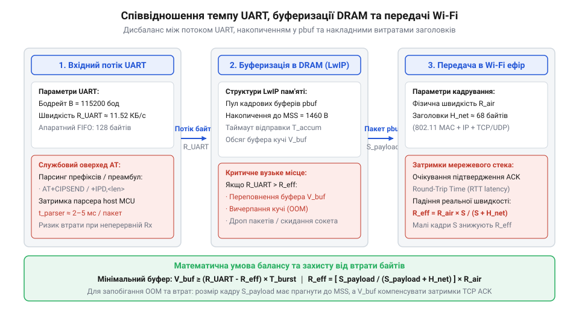

# Розрахунок сокетних буферів, пропускної здатності та таймаутів TCP/UDP на ESP-01

<preknowlist>
- [ESP-01 (Wi-Fi, ESP8266)](root:cat-hw-boards/esp-01) — конструктивні особливості та специфікація DRAM модуля ESP-01
- [Огляд мікроконтролера та архітектури SoC ESP8266](root:cat-hw-boards/esp8266-soc-architecture-overview) — загальна організація оперативної пам'яті та системних шин ESP8266
- [Захищені SSL/TLS з'єднання в AT-прошивці ESP8266](root:cat-hw-boards/esp8266-at-ssl-tls) — особливості криптографічного накладного навантаження на буфери пам'яті
</preknowlist>

## Дефіцит пам'яті та переповнення буферів

При побудові автономного мережевого пристрою на базі [модуля ESP-01](root:cat-hw-boards/esp-01) розробник часто зіштовхується з раптовими перезавантаженнями або втратою переданих даних при зростанні інтенсивності обміну. Причина полягає у фізичному обмеженні оперативної пам'яті динамічного розподілу (англ. *Dynamic Random-Access Memory*, @@en|DRAM@@). Загальний розмір доступної пам'яті становить близько 80 кілобайтів, як показує [архітектура чипа ESP8266](root:cat-hw-boards/esp8266-soc-architecture-overview), проте левова частка цієї пам'яті вже зайнята стеком бездротового зв'язку @@en|Wi-Fi@@, прошивкою @@en|AT-команд@@ та операційною системою.

Коли пристрій відкриває декілька паралельних з'єднань @@en|TCP@@ чи @@en|UDP@@, прошивка виділяє пам'ять під мережевий стек @@en|LwIP@@ (англ. *Lightweight IP*). Якщо вхідний потік даних із послідовного порту @@en|UART@@ (англ. *Universal Asynchronous Receiver-Transmitter*) перевищує швидкість обробки або пропускну здатність бездротового ефіру, кадрові буфери переповнюються. Пам'ять @@en|DRAM@@ вичерпується, що призводить до відмови створення нових сокетів або до тихого скидання байтів у вхідному потоці @@en|+IPD@@.

Додаткове затримкове навантаження створюється апаратною специфікою [архітектури ESP8266](root:cat-hw-boards/esp8266-soc-architecture-overview), де виконання коду мережевого обробника спирається на первинну кеш-пам'ять інструкцій (англ. *cache*, від фр. *cacher* — приховувати, @@en|ICACHE@@). Оскільки обсяг швидкої оперативної пам'яті інструкцій (англ. *Instruction RAM*, від лат. *instructio* — побудова, вказівка, @@en|IRAM@@) строго обмежений, основна маса функцій стека @@en|LwIP@@ зберігається у зовнішній енергонезалежній флеш-пам'яті та зчитується через послідовний шинний інтерфейс (англ. *Serial Peripheral Interface*, @@en|SPI@@). При високій інтенсивності вхідного потоку даних процесор змушений постійно переключатися між обробкою переривань та виконувати вивантаження ліній кешу для завантаження нових блоків коду. Кожен такий промах кешу (англ. *cache miss*, @@en|промах кешу@@) зупиняє конвеєр обчислень на десятки тактів для вибірки інструкцій із зовнішньої шини, що критично збільшує затримки обробки вхідних сокетних буферів і прискорює переповнення @@en|DRAM@@.

## Розрахунок пам'яті під LwIP та сокети

Щоб уникнути вичерпання пам'яті, необхідно математично розрахувати витрати @@en|DRAM@@ для кожної активної мережевої сесії. Стек @@en|LwIP@@ виділяє пам'ять під два основних типи структур: блок керування протоколом @@en|PCB@@ (англ. *Protocol Control Block*) та ланцюжок кадрових буферів @@en|pbuf@@ (англ. *packet buffer*).

Структура `PCB` зберігає стан з'єднання, порт, IP-адресу, номери послідовностей та вікна прийому. Для одного сокета `TCP` структура `PCB` займає орієнтовно `M_pcb = 164` байти, тоді як для сокета `UDP` структура коротша й становить `M_pcb_udp = 32` байти. Кадрові буфери `pbuf` зберігають самі мережеві пакети. Одиничний буфер `pbuf` транспортного рівня має фіксований службовий заголовок розміром 32 байти плюс розмір корисного навантаження (зазвичай `MTU = 536` байтів для стандартного налаштування `TCP` на @@en|ESP8266@@), що разом становить `M_pbuf = 568` байтів.

Обчислимо загальний обсяг оперативної пам'яті `M_tcp`, необхідний для обслуговування одного `TCP` з'єднання з буфером на `N` кадрових пакетів:

```
M_tcp = M_pcb + N × M_pbuf
= 164 + 4 × 568               [підстановка обсягів PCB та чотирьох буферів pbuf]
= 164 + 2272                  [обчислення загального розміру кадрових буферів]
= 2436                        [підсумкова витрата DRAM на одне TCP з'єднання в байтах]
```

Якщо для пристрою активовано [криптографічний захист TLS](root:cat-hw-boards/esp8266-at-ssl-tls), до цього додаються буфери контексту сесії розміром від 4 до 16 кілобайтів. Для звичайного незахищеного з'єднання при вільній @@en|DRAM@@ обсягом `M_free = 12288` байтів гранична кількість паралельних `TCP` сокетів `K_max` обчислюється так:

Для зменшення криптографічного накладного навантаження у [захищених SSL/TLS з'єднаннях](root:cat-hw-boards/esp8266-at-ssl-tls) застосовують розширення @@en|MFL@@ (англ. @@en|Max Fragment Length@@, від *maximum* — максимальний, *fragment* — фрагмент, та *length* — довжина), яке узгоджує зменшений розмір кадру замість стандартного значення `S_std = 16384` байти. Коригувальний коефіцієнт пам'яті `k_mfl` обчислюється як відношення обраного розміру фрагмента `S_mfl` (зазвичай 512, 1024 або 2048 байтів) до стандартного `S_std`, тобто `k_mfl = S_mfl ÷ S_std`. Наприклад, для розміру `S_mfl = 512` байтів коефіцієнт становить `k_mfl = 512 ÷ 16384 = 0.03125`, що пропорційно масштабує обсяг динамічних буферів криптографічного контексту до `M_tls_opt = k_mfl × M_tls_std` і дозволяє розмістити сесію в обмеженій @@en|DRAM@@ мікроконтролера @@en|ESP8266@@.

```
K_max = ⌊ M_free ÷ M_tcp ⌋
= ⌊ 12288 ÷ 2436 ⌋            [ділення доступної DRAM на витрату одного сокета]
= ⌊ 5.04 ⌋                    [округлення до меншого цілого числа]
= 5                           [максимальна кількість стабільних паралельних TCP сокетів]
```

## Баланс швидкості UART та Wi-Fi

Швидкість обміну між зовнішнім хост-контролером і модулем @@en|ESP-01@@ визначається пропускною здатністю послідовного порту @@en|UART@@. Однак реальна швидкість передачі корисних даних завжди нижча за встановлену швидкість бодрейту (англ. *baud rate*, @@en|baud rate@@) через накладні витрати бітів кадрування та службовий синтаксис @@en|AT-команд@@.


*Співвідношення пропускної здатності UART, накопичення кадрових буферів у DRAM та виходу пакетиків у радіоканал Wi-Fi.*

При стандартному форматі кадру `UART` (1 стартовий біт, 8 бітів даних, 1 стоповий біт) кожні 8 бітів корисного навантаження потребують передачі 10 фізичних бітів у лінії. Наприклад, при швидкості `S_baud = 115200` бод фізична швидкість становить `B_uart_raw = 115200 ÷ 10 = 11520` байтів за секунду.

Під час потокового прийому через префікс `+IPD` прошивка додає службові байти кадрування вигляду `+IPD,<link_id>,<len>:`. Для пакета корисного навантаження розміром `L` байтів обсяг переданих по `UART` байтів дорівнює `L_total = L + H_at`, де `H_at = 9` байтів (службовий заголовок). Ефективна пропускна здатність передачі даних `B_eff` розраховується за формулою:

```
B_eff = B_uart_raw × (L ÷ (L + H_at))
= 11520 × (64 ÷ (64 + 9))     [обчислення для малого пакета розміром 64 байти]
= 11520 × (64 ÷ 73)           [співвідношення корисного навантаження до повного кадру]
= 10099.7                     [ефективна швидкість у байтах за секунду]
```

Якщо швидкість надходження даних по `UART` перевищує швидкість виходу кадрових пакетів у мережу @@en|Wi-Fi@@, виникає затор. Модуль змушений накопичувати вхідні дані в буферах `pbuf` оперативної пам'яті @@en|DRAM@@. Час `T_overflow` до повного переповнення вільного буферного простору `M_buf` при різниці швидкостей `ΔB = B_in - B_out` обчислюється так:

Для запобігання фатальному витоку даних та переповненню буферів при досягненні граничного часу `T_overflow` застосовують апаратний контроль потоку (від англ. @@en|Hardware Flow Control@@; @@en|апаратний контроль потоку@@) за допомогою керуючих ліній `RTS` (від англ. @@en|Request to Send@@; @@en|запит на відправу@@) та `CTS` (від англ. @@en|Clear to Send@@; @@en|готовність до прийому@@). Коли залишок вільної пам'яті в накопичувальних буферах `pbuf` опускається нижче безпечного порогового значення `M_threshold` (наприклад, менше ніж 512 байтів), мікроконтролер переводить лінію `RTS` у високий логічний стан HIGH. Отримавши цей сигнал на своїй лінії `CTS`, хост-контролер негайно призупиняє передачу нових байтів по шині `UART`, даючи змогу стеку LwIP трансивера [модуля ESP-01](root:cat-hw-boards/esp-01) успішно вивантажити затримані пакети в мережу @@en|Wi-Fi@@ та звільнити оперативну пам'ять @@en|DRAM@@. Щойно обсяг вільної пам'яті відновлюється, лінія `RTS` повертається в низький стан LOW, відновлюючи передачу без жодної втрати байтів.

```
T_overflow = M_buf ÷ ΔB
= 4096 ÷ (11520 - 8000)       [підстановка вільного буфера 4 КБ та різниці швидкостей]
= 4096 ÷ 3520                 [ділення обсягу буфера на швидкість накопичення]
= 1.16                        [час у секундах до втрати байтів у вхідному потоці]
```

## Таймаути повторів та місткість кільцевого буфера

Для запобігання втратам байтів зовнішній хост-контролер повинен мати кільцевий приймальний буфер (англ. *ring buffer*) належної розрядності та правильно налаштовані затримки повторів при роботі з префіксом @@en|+IPD@@.

Час очікування відповіді (англ. *timeout*) `T_timeout` для мережевого з'єднання має враховувати середній час кругової затримки пакета `RTT` (англ. *Round-Trip Time*) та відхилення затримки `RTTVAR`. Базова формула таймауту повторної передачі в стеку `LwIP` визначається як:

```
T_timeout = RTT + 4 × RTTVAR
= 120 + 4 × 35                [підстановка середнього RTT 120 мс та відхилення 35 мс]
= 120 + 140                   [додавання чотирьох стандартних відхилень затримки]
= 260                         [розрахований таймаут повторної спроби в мілісекундах]
```

Під час парсингу асинхронних відповідей `+IPD` хост-контролер обробляє потік байтів, який надходить із послідовного порту. Якщо обробник переривань хоста затримується на час `t_delay` (наприклад, через виконання інших задач чи запис у флеш-пам'ять), приймальний кільцевий буфер хоста розміром `C_ring` накопичує байти зі швидкістю `B_uart_raw`.

Мінімально необхідна місткість кільцевого буфера `C_ring_min` визначається з умови відсутності переповнення:

```
C_ring_min = ⌈ B_uart_raw × t_delay ⌉
= ⌈ 11520 × 0.05 ⌉            [обчислення для затримки обробника переривань 50 мс]
= ⌈ 576 ⌉                     [мінімальний розмір кільцевого буфера в байтах]
= 576                         [необхідна місткість приймального буфера хоста]
```

Для забезпечення надійності розмір `C_ring` обирають як найближчий більший степінь двійки, тобто `C_ring = 1024` байти. Це гарантує сумісність із масками побітового індексування та виключає втрату байтів при парсингу AT-команд.

У разі критичного групування асинхронних подій @@en|+IPD@@ трансивер надсилає в послідовний порт @@en|UART@@ серію повідомлень поспіль без часових інтервалів між кадрами. Сумарна кількість байтів у пакетному сплеску `S_burst` для `N_ipd` згрупованих повідомлень залежить від розміру заголовків `H_ipd` та довжини корисного навантаження `L_i`. Загальна затримка сповіщення подійного обробника `t_notify` визначається відношенням обсягу пачки `S_burst` до байтової швидкості порту `B_uart_raw`:

```
t_notify = S_burst ÷ B_uart_raw
= (N_ipd × (H_ipd + L)) ÷ B_uart_raw    [підстановка параметрів однакових пакетів у пачці]
= (3 × (12 + 256)) ÷ 11520              [обчислення для 3 пакетів по 256 байтів при 115200 бод]
= 804 ÷ 11520                           [ділення сумарного обсягу байтів на швидкість UART]
≈ 0.0698                                [підсумкова затримка сповіщення хоста в секундах]
```

Отримана затримка приблизно 69.8 мс визначає час, упродовж якого подійний парсер хост-контролера модуля [ESP-01 (Wi-Fi, ESP8266)](root:cat-hw-boards/esp-01) повинен повністю розібрати потік байтів із кільцевого буфера, щоб запобігти переповненню та пропуску сповіщень вищих рівнів програми.
