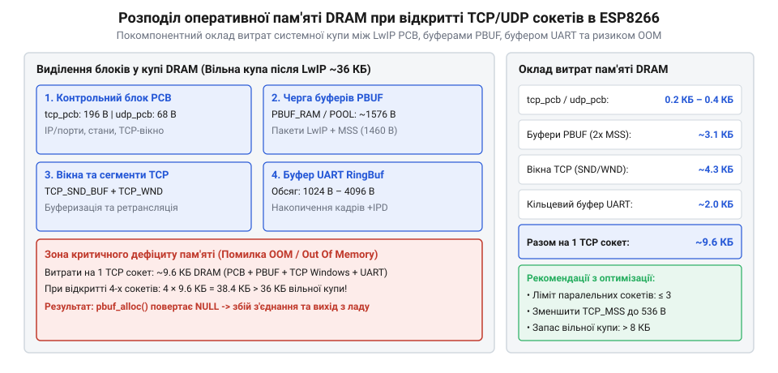

# Розрахунок витрат DRAM та пропускної здатності TCP/UDP сокетів у прошивці AT

<preknowlist>
- [Огляд мікроконтролера та архітектури SoC ESP8266](root:cat-hw-boards/esp8266-soc-architecture-overview) — розподіл системної пам'яті DRAM та SRAM у мікроконтролері ESP8266
- [Захищені SSL/TLS з'єднання в AT-прошивці ESP8266](root:cat-hw-boards/esp8266-at-ssl-tls) — накладні витрати пам'яті під криптографічні контексти та сертифікати
- [ESP-01 (Wi-Fi, ESP8266)](root:cat-hw-boards/esp-01) — базові параметри периферії та апаратні обмеження модуля ESP-01
</preknowlist>

## Обмеження DRAM та пам'ять сокетних структур

У мікроконтролерах без зовнішньої оперативної пам'яті головним обмеженням мережевого стека є дефіцит динамічної пам'яті (англ. @@en|Dynamic RAM@@, скорочено DRAM: dynamic — динамічний, RAM від Random-Access Memory — пам'ять довільного доступу). У процесорі ESP8266 із загального обсягу 80 КБ DRAM значна частина виділяється під статичні бафери операційної системи, кадри Wi-Fi MAC-драйвера та стек виконання. У результаті системна купа (англ. @@en|heap@@ — купа) для прошивки AT має вільний обсяг `V_heap ≈ 24`–`32 КБ`. При відкритті кожного мережевого з'єднання стек LwIP динамічно виділяє структури керування протоколом (англ. @@en|Protocol Control Block@@, скорочено PCB: protocol — протокол, control — керування, block — блок).

Для кожного сокета розраховується статичний оклад пам'яті, який складається з базової структури LwIP, обгортки прошивки AT та вирівнювання адрес (англ. @@en|memory alignment@@ — вирівнювання пам'яті). Структура `tcp_pcb` для активного з'єднання TCP має опис `M_tcp_pcb = 156 Байт`, слухаючий сокет `tcp_pcb_listen` займає `M_tcp_listen = 72 Байт`, а протокол UDP використовує `M_udp_pcb = 32 Байт`. Обгортка обробника AT-команд вимагає `M_at_conn ≈ 64 Байт`, а падінг вирівнювання становить `M_align = 4 Байт`. Проте успішне створення сокета залежить не лише від сумарного обсягу вільної купи, а й від відсутності фрагментації пам'яті (англ. @@en|heap fragmentation@@ — фрагментація купи). Оскільки розповсюджені структури PCB та обгортки вимагають виділення строго неперервних блоків у кучі DRAM, динамічне відкриття й закриття з'єднань розбиває вільний простір на ізольовані фрагменти. У результаті виклик виділення пам'яті повертає помилку нестачі ресурсів навіть тоді, коли загальний залишок купи перевищує розмір сокетної структури, але не містить жодного суцільного блоку потрібного обсягу.

Перед розрахунком загального окладу визначимо статичні витрати пам'яті на один сокет TCP через суму його елементів:

```
M_control_tcp = M_tcp_pcb + M_at_conn + M_align
              = 156 + 64 + 4            [додавання базових структур]
              = 224 Байт                [статичні витрати на один TCP сокет]
```

Аналогічно обчислюється оклад для з'єднання UDP:

```
M_control_udp = M_udp_pcb + M_at_conn + M_align
              = 32 + 64 + 4             [додавання базових структур]
              = 100 Байт                [статичні витрати на один UDP сокет]
```

Ці витрати є незмінним мінімумом, який виділяється з купи відразу при виконанні команд `AT+CIPSTART`. Детальніший розбір розподілу оперативної пам'яті містить [огляд мікроконтролера та архітектури SoC ESP8266](root:cat-hw-boards/esp8266-soc-architecture-overview).

Фіксація статичних витрат показує лише початкову точку виділення пам'яті під час встановлення з'єднання, проте реальне навантаження на кучу динамічно зростає у момент початку обміну даними. Базовий оклад `M_control_tcp` гарантує збереження системного контексту сокета, тоді як для обробки вхідних та вихідних потоків мережевий стек потребує додаткових обсягів пам'яті під дескриптори черг повторної передачі (англ. @@en|retransmission queue@@: retransmission — повторна передача, queue — черга). Для протоколу UDP математичний оклад суттєво менший: при ініціалізації п'яти паралельних UDP-сокетів у режимі `CIPMUX=1` сумарні статичні витрати становлять лише `5 × M_control_udp = 5 × 100 = 500 Байт`, що залишає понад 98% доступної купи `V_heap` вільною для динамічного зберігання датаграм. Отже, загальні витрати DRAM під сокет складаються з постійної частини керування та змінної частини буферизації мережевих кадрів.

## Математична модель споживання буферів PBUF

Основне споживання динамічної пам'яті припадає не на структури керування, а на пакети даних, що утримуються в мережевих буферах (англ. @@en|packet buffer@@, скорочено `pbuf`). Мережевий стек LwIP організовує `pbuf` у вигляді зв'язаних ланцюжків. Кожен елемент `pbuf` містить заголовок `M_pbuf_hdr = 16 Байт` та виділений шар корисного навантаження. Розмір максимального сегмента (англ. @@en|Maximum Segment Size@@, скорочено MSS: maximum — максимальний, segment — сегмент, size — розмір) для TCP зазвичай становить `MSS = 1460 Байт`.

При розмірі пулу `S_payload = 512 Байт` один повний кадр TCP MSS розбивається на кілька буферів `PBUF_POOL`. Загальний обсяг пам'яті `M_segment` для утримання одного прийнятого сегмента обчислюється як добуток кількості буферів на їхній повний розмір. У разі використання нетипових розмірів MSS у промислових мережах, наприклад при зменшенні `MSS = 536 Байт` для малопотужних каналів, сегмент розбивається на `N_pbuf = 2` буфери, що вимагає `M_segment = 2 × (16 + 512) = 1056 Байт` пам'яті DRAM і створює майже дворазовий оклад над корисним навантаженням. Для стандартного мережевого сегмента розрахунок обсягу `M_segment` має такий вигляд:

```
M_segment = N_pbuf × (M_pbuf_hdr + S_payload)
          = 3 × (16 + 512)              [розбиття 1460 Байт MSS на 3 буфери PBUF_POOL]
          = 3 × 528                     [сума заголовка та корисного навантаження]
          = 1584 Байт                   [оклад DRAM на один TCP сегмент]
```

Для забезпечення неперервного потоку даних стек TCP використовує ковзне вікно (англ. @@en|sliding window@@ — ковзне вікно) розміром `W_tcp`. При стандартному розмірі вікна `W_tcp = 2920 Байт` (що відповідає двом сегментам `2 × MSS`) пікове динамічне споживання пам'яті прийому `M_rx_buffer` визначається формулою. Однак у разі погіршення рівня сигналу Wi-Fi або високого відсотка втрати кадрів (англ. @@en|frame loss@@ — втрата кадрів) алгоритм уникнення заторів стека LwIP автоматично зменшує оголошене вікно прийому `W_tcp` до одного сегмента `1 × MSS` (1460 Байт), а при високій фрагментації зменшує розмір `MSS` з `1460` до `536 Байт`. Зменшення `MSS` знижує ризик втрати цілісного кадру на радіоканалі, але зростання кількості дрібних сегментів збільшує відносний оклад заголовків `M_pbuf_hdr` на кожний байт даних, знижуючи ефективне використання купи DRAM.

```
M_rx_buffer = N_win_segments × M_segment
            = 2 × 1584                  [множення кількості сегментів вікна на оклад сегмента]
            = 3168 Байт                 [динамічний буфер прийому TCP]
```


*Схема розподілу динамічної пам'яті DRAM між структурами PCB, ланцюжками буферів PBUF та кільцевою чергою UART.*

Сумарні витрати пам'яті на один відкритий TCP сокет `M_socket_tcp` складають `M_socket_tcp = M_control_tcp + M_rx_buffer = 224 + 3168 = 3392 Байт`.

## Гранична кількість сокетів і переповнення купи

При одночасній обробці кількох сесій виникає ризик критичного вичерпання пам'яті (англ. @@en|out of memory@@, скорочено OOM: out of — вичерпання, memory — пам'ять). Крім сокетів, купу споживають кільцеві черги (англ. @@en|ring buffer@@ — кільцевий буфер) послідовного порту UART, які вимагають `M_uart_buf = 2048 Байт` для запобігання втраті символів.

При корисній купі `V_heap = 28672 Байт` (28 КБ) гранично припустима кількість паралельних незахищених TCP з'єднань `N_max_tcp` обчислюється шляхом ділення залишкового обсягу купи на повний оклад одного сокета:

```
N_max_tcp = (V_heap - M_uart_buf) ÷ M_socket_tcp
          = (28672 - 2048) ÷ 3392        [віднімання черги UART від доступної купи]
          = 26624 ÷ 3392                [залишок купи під мережеві сокети]
          ≈ 7.85                         [дробовий результат обчислення]
          = 7 сокетів                    [гранична кількість незахищених TCP з'єднань]
```

Якщо в прошивці активуються [захищені SSL/TLS з'єднання в AT-прошивці ESP8266](root:cat-hw-boards/esp8266-at-ssl-tls), кожен контекст безпеки додатково виділяє криптографічні буфери розміром `M_ssl ≈ 18432 Байт` (18 КБ). Коли спроба ініціалізації чергового мережевого з'єднання вимагає обсягу оперативної пам'яті, що перевищує доступний залишок динамічної купи `V_heap`, системний алокатор повертає покажчик `NULL`, унаслідок чого командний інтерпретатор перериває виконання інструкції `AT+CIPSTART` та виводить у послідовний порт текстову помилку `ERROR` або текстове сповіщення `link is not valid` чи `connect fail` без створення нового каналу. При вичерпанні вільної кучі під час прийому вхідного мережевого трафіку стек @@en|LwIP@@ позбавлений можливості виділити новий буфер `pbuf`, що змушує прошивку мовчазно скидати вхідні пакети або ініціювати примусовий розрив сесії пакетом @@en|RST@@. Розрахунок граничної кількості шифрованих сесій `N_max_ssl` має вигляд:

```
N_max_ssl = (V_heap - M_uart_buf - M_ssl) ÷ M_socket_tcp
          = (28672 - 2048 - 18432) ÷ 3392 [віднімання криптоконтексту SSL]
          = 8144 ÷ 3392                   [залишок купи для шифрованих сокетів]
          ≈ 2.40                          [дробовий результат обчислення]
          = 2 сокети                     [гранична кількість SSL з'єднань]
```

Спроба відкрити третій SSL сокет викликає фатальну помилку виділення пам'яті та аварійне закриття нових підключень.

## Розрахунок пропускної здатності та накладних витрат

Підсумкова швидкість передачі даних обмежується найвужчим місцем у ланцюжку між мережевим інтерфейсом Wi-Fi та зовнішнім контролером. Стрімкий потік даних від сокета перетворюється прошивкою в текстові префікси та кадрується (англ. @@en|framing overhead@@ — накладні витрати кадрування) службовими заголовками `+IPD,<id>,<len>:`.

Для заголовка `+IPD,0,1460:` довжина оверхеду становить `L_ipd_hdr = 13 Байт`. При швидкості UART `B_uart = 115200 Baud` із 10 бітами на байт (1 стартовий, 8 даних, 1 стоповий) сира швидкість становить `R_uart_raw = 115200 ÷ 10 = 11520 Байт/с`. Реальна пропускна здатність шини UART `T_uart` з урахуванням кадрування розраховується так:

```
T_uart = R_uart_raw × (MSS ÷ (MSS + L_ipd_hdr))
       = (115200 ÷ 10) × (1460 ÷ (1460 + 13)) [ділення бітрейту на 10 та множення на коефіцієнт кадрування]
       = 11520 × (1460 ÷ 1473)               [проміжне значення байтового потоку]
       = 11520 × 0.9911                      [врахування коефіцієнта корисного навантаження]
       ≈ 11417 Байт/с                        [гранична швидкість UART при 115200 Baud]
```

При підвищенні бітрейту до `B_uart = 921600 Baud` пропускна здатність послідовного порту зростає до `T_uart_high ≈ 91340 Байт/с`. Однак на такій високій швидкості кожен символ надходить кожні 10.85 мкс, а апаратний буфер FIFO послідовного порту обсягом всього 128 байтів переповнюється за 1.39 мс. На проміжній швидкості `B_uart = 460800 Baud` сирий потік складає `46080 Байт/с` (тривалість одного байта `21.70 мкс`), через що 128-байтовий буфер FIFO заповнюється доверху всього за `t_fifo = 128 ÷ 46080 ≈ 2.78 мс`. При інтенсивному радіообміні Wi-Fi високопріоритетні переривання MAC-рівня затримують обробку переривань UART на триваліший час, що за відсутності апаратного контролю потоку RTS/CTS призводить до неминучої втрати байтів через переповнення FIFO. З іншого боку, мережева швидкість обмежується затримкою кругового обігу (англ. @@en|Round-Trip Time@@, скорочено RTT: round — круг, trip — поїздка, time — час) та розміром вікна `W_tcp`. При `RTT = 50 мс` (0.05 с) та `W_tcp = 2920 Байт` пропускна здатність мережі `T_net` становить:

```
T_net = W_tcp ÷ RTT
      = 2920 ÷ 0.05                          [ділення вікна TCP на затримку RTT]
      = 58400 Байт/с                         [мережева межа пропускної здатності]
```

Підсумкова продуктивність становить `T_total = min(T_uart, T_net)`. При `115200 Baud` вузьким місцем є UART (`11417 Байт/с`), а при `921600 Baud` лімітуючим чинником стає мережеве вікно TCP (`58400 Байт/с`), що відповідає реальним умовам роботи модуля [ESP-01 (Wi-Fi, ESP8266)](root:cat-hw-boards/esp-01).
